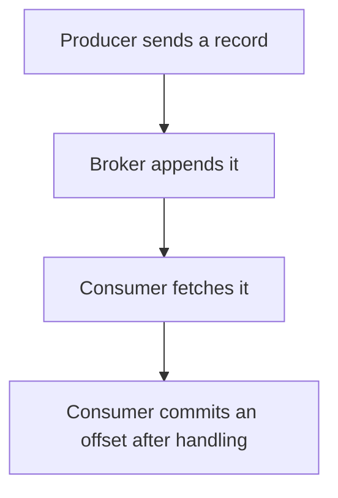

# D14-T005 — Producers and consumers

Topic ID: `D14-T005`
Domain: Messaging and Event-Driven Architecture
Subdomain: Producers and consumers
Importance: common
Complexity: advanced
Dependencies: `D14-T004`, `D14-T001`, `D04-T001`, `D04-T002`, `D05-T001`, `D05-T002`
Execution status of the code in section F: unexecuted

## A. Topic Overview

A producer appends records to a topic. A consumer reads them. The producer's ack setting decides when a send is successful: leader only, or all in-sync replicas. The consumer's offset decides what it will see again after a crash. Producers and consumers fail independently. A successful produce does not mean a consumer has handled the record.

In production this shows up as follows: A payment service produces with acks=all. The ledger consumer commits the offset only after the database transaction commits. A crash in between redelivers, and the ledger upsert is idempotent.

Interviewers use Producers and consumers to see whether you can state the failure mode, not only the definition. The failure to name is: acking on the leader only and losing the record on a leader failure, or committing an offset before the handler finishes

Prerequisites: `D14-T004`, `D14-T001`, `D04-T001`, `D04-T002`, `D05-T001`, `D05-T002`. Later notes should link here instead of repeating the mechanism.

## B. First-Principles Explanation

A producer appends records to a topic. A consumer reads them. The producer's ack setting decides when a send is successful: leader only, or all in-sync replicas. The consumer's offset decides what it will see again after a crash. Producers and consumers fail independently. A successful produce does not mean a consumer has handled the record.

The useful picture is: The producer is the reporter filing a story. The consumer is a reader with a bookmark. The bookmark moving before the reader finishes the story is how they skip a chapter after a nap.

What has to be true:

1. Producer sends a record
2. Broker appends it
3. Consumer fetches it
4. Consumer commits an offset after handling

It works when those steps preserve one invariant. It fails when acking on the leader only and losing the record on a leader failure, or committing an offset before the handler finishes. The alternative is: you commit offsets first and do the work second

## C. Internal Working and Architecture

Components involved: the caller, the state Producers and consumers mutates or reads, and the observer that reports produce error rate, consumer lag, and duplicate handling after restart.

Execution:

1. Producer sends a record
2. Broker appends it
3. Consumer fetches it
4. Consumer commits an offset after handling

Data moves only along that path. A retry re-enters at step 1, so the operation must say what a duplicate does. Memory and locks stay inside this mechanism. Callers see the result or a typed error, not a half-updated invariant.

State to remember: choose this when work crosses a process boundary through a log. Do not choose it when you commit offsets first and do the work second.

## D. Diagrams and Visual Models



Read the diagram from top to bottom. Each box is one step of Producers and consumers. The failure mode (acking on the leader only and losing the record on a leader failure, or committing an offset before the handler finishes) is what you look for when a later box never happens or happens twice.

## E. Examples and Analogies

Analogy: The producer is the reporter filing a story. The consumer is a reader with a bookmark. The bookmark moving before the reader finishes the story is how they skip a chapter after a nap.

Production example: A payment service produces with acks=all. The ledger consumer commits the offset only after the database transaction commits. A crash in between redelivers, and the ledger upsert is idempotent.

A small counterexample is enough in an interview. Show the input, apply the steps, and show the broken outcome if someone uses the mechanism outside its rule: acking on the leader only and losing the record on a leader failure, or committing an offset before the handler finishes.

## F. Code Examples

The snippet is labeled unexecuted. It illustrates the shape of the idea. It is not a benchmark and it embeds no secret.

```python
def commit_after(handled):
    if not handled:
        raise RuntimeError('do not commit')
    return 'commit'
```

After the snippet, check produce error rate, consumer lag, and duplicate handling after restart. If that signal moves the wrong way, the snippet is the wrong tool for the workload.

## G. Practical Backend Application

Use Producers and consumers in a service when work crosses a process boundary through a log.

A typical place is the production case already stated: A payment service produces with acks=all. The ledger consumer commits the offset only after the database transaction commits. A crash in between redelivers, and the ledger upsert is idempotent.

Operationally you alert on produce error rate, consumer lag, and duplicate handling after restart. You do not alert only on process uptime. The dashboard should show the failure mode, a success rate, and the saturation signal (queue depth, lock wait, or latency) that predicts it.

## H. Advantages, Limitations and Trade-offs

| Choice | Benefit | Cost | Choose when | Avoid when |
| --- | --- | --- | --- | --- |
| Apply Producers and consumers | work crosses a process boundary through a log | Extra moving parts and a new failure mode | The failure you are preventing is already real | you commit offsets first and do the work second |
| Simpler alternative | Less code and fewer dependencies | acking on the leader only and losing the record on a leader failure, or committing an offset before the handler finishes | The workload does not hit the limit | The invariant must hold under concurrency or failure |

Producers and consumers is a trade. State the benefit and the cost in the same sentence when you propose it in a design review.

## I. Common Mistakes and Misconceptions

- Fire-and-forget produces.
- Auto-commit on receive.
- No key and no idempotency.
- Treating a diagram of Producers and consumers as proof that the invariant holds in production.
- Copying a default configuration without naming produce error rate, consumer lag, and duplicate handling after restart.

## J. Debugging and Troubleshooting

Symptom: acking on the leader only and losing the record on a leader failure, or committing an offset before the handler finishes

First check: produce error rate, consumer lag, and duplicate handling after restart.

Then compare one healthy instance against one unhealthy instance. Confirm whether retries are duplicating work. Confirm whether a timeout is shorter than the work. Fix the invariant, then watch the same metric for a full peak, not only for the next minute.

Useful questions: did the step order in section C actually happen, or did a caller skip a step? Did a deploy change the data shape that Producers and consumers assumes?

## K. Interview Preparation

### Beginner

#### Q1. What problem does Producers and consumers solve?

**Answer:** A producer appends records to a topic. A consumer reads them. The producer's ack setting decides when a send is successful: leader only, or all in-sync replicas. The consumer's offset decides what it will see again after a crash. Producers and consumers fail independently. A successful produce does not mean a consumer has handled the record. Without it, the usual backend failure is: acking on the leader only and losing the record on a leader failure, or committing an offset before the handler finishes.

#### Q2. Where does Producers and consumers sit on a request path?

**Answer:** Producers and consumers is not a library you sprinkle on every call. work crosses a process boundary through a log You notice it when produce error rate, consumer lag, and duplicate handling after restart. Name the constraint that makes this choice correct. Say what you would measure to confirm it.

#### Q3. Give a concrete example of Producers and consumers.

**Answer:** A payment service produces with acks=all. The ledger consumer commits the offset only after the database transaction commits. A crash in between redelivers, and the ledger upsert is idempotent. Walk the input, the state change, and the observable output.

#### Q4. What is a common mix-up around Producers and consumers?

**Answer:** acking on the leader only and losing the record on a leader failure, or committing an offset before the handler finishes The corrective check is produce error rate, consumer lag, and duplicate handling after restart. Name the constraint that makes this choice correct. Say what you would measure to confirm it. Say which alternative you rejected and why.

#### Q5. When would you skip Producers and consumers?

**Answer:** you commit offsets first and do the work second Skipping is a decision with a measured cost, not a slogan. Name the constraint that makes this choice correct. Say what you would measure to confirm it. Say which alternative you rejected and why.

### Intermediate

#### Q1. What invariant makes Producers and consumers correct?

**Answer:** A producer appends records to a topic. A consumer reads them. The producer's ack setting decides when a send is successful: leader only, or all in-sync replicas. The consumer's offset decides what it will see again after a crash. Producers and consumers fail independently. A successful produce does not mean a consumer has handled the record. State the invariant before you name the tool.

#### Q2. How do you test Producers and consumers?

**Answer:** Assert the failure mode directly: acking on the leader only and losing the record on a leader failure, or committing an offset before the handler finishes. The assertion should watch produce error rate, consumer lag, and duplicate handling after restart. Include a concurrent or retry case if the bug only appears then. Name the constraint that makes this choice correct.

#### Q3. What signal tells you Producers and consumers is misbehaving in production?

**Answer:** Watch produce error rate, consumer lag, and duplicate handling after restart. The user-visible symptom is usually acking on the leader only and losing the record on a leader failure, or committing an offset before the handler finishes. Name the constraint that makes this choice correct. Say what you would measure to confirm it.

#### Q4. How would you introduce Producers and consumers into a legacy service?

**Answer:** work crosses a process boundary through a log Ship it behind a metric so you can compare the old path. Roll back if acking on the leader only and losing the record on a leader failure, or committing an offset before the handler finishes gets worse. Name the constraint that makes this choice correct. Say what you would measure to confirm it.

#### Q5. What do you trade away by choosing Producers and consumers?

**Answer:** work crosses a process boundary through a log you commit offsets first and do the work second Say the cost in latency, storage, or operational load. Name the constraint that makes this choice correct. Say what you would measure to confirm it. Say which alternative you rejected and why.

### Advanced

#### Q1. What breaks if a dependency of Producers and consumers is slow or down?

**Answer:** acking on the leader only and losing the record on a leader failure, or committing an offset before the handler finishes Degrade using the rule: you commit offsets first and do the work second. Timeouts must be shorter than the caller's deadline. Name the constraint that makes this choice correct. Say what you would measure to confirm it.

#### Q2. How does Producers and consumers behave under retries?

**Answer:** Retries repeat work, so Producers and consumers must define what a duplicate does. acking on the leader only and losing the record on a leader failure, or committing an offset before the handler finishes Idempotency keys or fences belong next to the write, not in a comment. Name the constraint that makes this choice correct. Say what you would measure to confirm it.

#### Q3. What is the capacity limit of Producers and consumers?

**Answer:** The limit shows up as produce error rate, consumer lag, and duplicate handling after restart. Add capacity only after you know whether the bottleneck is CPU, lock wait, or network. Name the constraint that makes this choice correct. Say what you would measure to confirm it.

#### Q4. How do you evolve Producers and consumers without a flag day?

**Answer:** work crosses a process boundary through a log Version the contract or the on-disk format. Readers should tolerate one old and one new shape during the rollout. Name the constraint that makes this choice correct. Say what you would measure to confirm it.

#### Q5. What security or correctness bug hides inside Producers and consumers?

**Answer:** acking on the leader only and losing the record on a leader failure, or committing an offset before the handler finishes Check authorization and tenancy at the same boundary as the mechanism. A cache or queue must not widen who can read the data. Name the constraint that makes this choice correct. Say what you would measure to confirm it.

### Scenario

#### Q1. Incident: acking on the leader only and losing the record on a leader failure, or committing an offset before the handler finishes. What do you check first?

**Answer:** Start with produce error rate, consumer lag, and duplicate handling after restart. Compare a good host and a bad host before you restart anything. A producer appends records to a topic. A consumer reads them. The producer's ack setting decides when a send is successful: leader only, or all in-sync replicas. The consumer's offset decides what it will see again after a crash. Producers and consumers fail independently. A successful produce does not mean a consumer has handled the record.

#### Q2. A reviewer wants the clever version. What data settles it?

**Answer:** work crosses a process boundary through a log you commit offsets first and do the work second Bring produce error rate, consumer lag, and duplicate handling after restart from a load test or from production, not a slogan. Name the constraint that makes this choice correct. Say what you would measure to confirm it. Say which alternative you rejected and why.

#### Q3. You have one hour to explain Producers and consumers at a whiteboard.

**Answer:** Draw the happy path in four boxes. Then draw the failure: acking on the leader only and losing the record on a leader failure, or committing an offset before the handler finishes. End with the metric you would page on. Name the constraint that makes this choice correct.

#### Q4. The bug only appears under two concurrent callers.

**Answer:** acking on the leader only and losing the record on a leader failure, or committing an offset before the handler finishes Reproduce with a barrier so both sides enter the critical window. Confirm the fix with produce error rate, consumer lag, and duplicate handling after restart. Name the constraint that makes this choice correct. Say what you would measure to confirm it.

#### Q5. Leadership wants this on every service next week.

**Answer:** you commit offsets first and do the work second work crosses a process boundary through a log Roll it out where the failure mode is already hurting users. Name the constraint that makes this choice correct. Say what you would measure to confirm it. Say which alternative you rejected and why.

### Follow-up

#### Q1. What did you assume about the data size or the clock?

**Answer:** A producer appends records to a topic. A consumer reads them. The producer's ack setting decides when a send is successful: leader only, or all in-sync replicas. The consumer's offset decides what it will see again after a crash. Producers and consumers fail independently. A successful produce does not mean a consumer has handled the record. Clocks are not a total order across machines. State whether the algorithm needs bounded size or a single leader.

#### Q2. What would you measure after the change ships?

**Answer:** Page on produce error rate, consumer lag, and duplicate handling after restart. Keep a before/after dashboard for one week. Alert on the failure mode, not only on CPU. Name the constraint that makes this choice correct.

#### Q3. Which neighboring topic did you deliberately not re-teach?

**Answer:** This note owns Producers and consumers. Related identifiers are in section N. Shared ideas are linked, not copied. Name the constraint that makes this choice correct.

## L. Practical Exercises

Solutions are in `EXERCISES/solutions/D14-T005.md`, not in this section.

1. Whiteboard the four steps of Producers and consumers and mark where `acking on the leader only and losing the record on a leader failure, or committing an offset before the handler finishes` enters.
2. Read the snippet in section F and write the assertion that would catch that failure. The assertion must mention `produce error rate, consumer lag, and duplicate handling after restart`.
3. Argue for or against using Producers and consumers on a service you know. Use the choose and avoid rows from section H. Do not appeal to popularity.

## M. Revision Notes

- Mechanism: A producer appends records to a topic.
- Failure: acking on the leader only and losing the record on a leader failure, or committing an offset before the handler finishes
- Metric: produce error rate, consumer lag, and duplicate handling after restart
- Choose when: work crosses a process boundary through a log
- Avoid when: you commit offsets first and do the work second

## N. Related Topics

Dependencies to review first: `D14-T004`, `D14-T001`, `D04-T001`, `D04-T002`, `D05-T001`, `D05-T002`.

Shared ideas stay in those notes. This note does not restate them.

## O. Completion Criteria

- You can explain Producers and consumers without reading this note, including the failure mode.
- You can draw the diagram in section D from memory.
- You can say when not to use it, using the avoid condition in section H.
- You can name the metric you would watch after shipping it.
