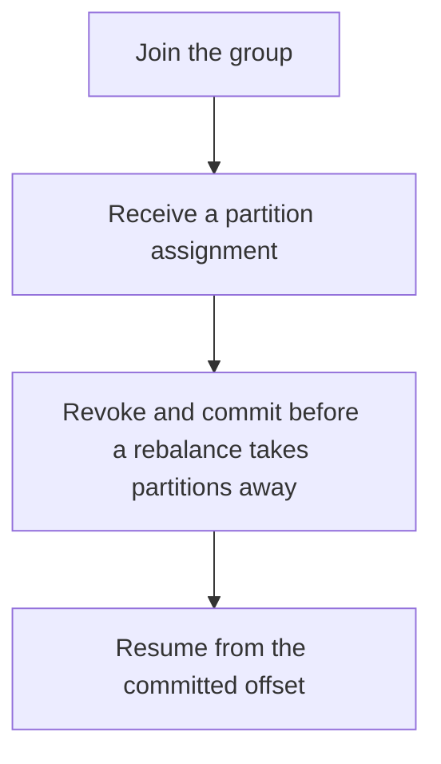

# D14-T006 — Consumer groups and rebalancing

Topic ID: `D14-T006`
Domain: Messaging and Event-Driven Architecture
Subdomain: Consumer groups and rebalancing
Importance: common
Complexity: advanced
Dependencies: `D14-T005`, `D14-T001`, `D04-T001`, `D04-T002`, `D05-T001`, `D05-T002`
Execution status of the code in section F: unexecuted

## A. Topic Overview

A consumer group divides partitions among its members so each partition is handled by one member at a time. Rebalancing runs when members join, leave, or die, and it moves partition assignments. During a rebalance, progress can pause. A rebalance that is too eager, or a session timeout that is too short, causes a storm. Cooperative protocols move fewer partitions.

In production this shows up as follows: A deploy restarts consumers one at a time. A short session timeout makes the group rebalance on each restart and lag spikes. A longer timeout and cooperative assignment keep most partitions moving.

Interviewers use Consumer groups and rebalancing to see whether you can state the failure mode, not only the definition. The failure to name is: a long handler that misses the poll timeout, so the member is declared dead and the group rebalances forever

Prerequisites: `D14-T005`, `D14-T001`, `D04-T001`, `D04-T002`, `D05-T001`, `D05-T002`. Later notes should link here instead of repeating the mechanism.

## B. First-Principles Explanation

A consumer group divides partitions among its members so each partition is handled by one member at a time. Rebalancing runs when members join, leave, or die, and it moves partition assignments. During a rebalance, progress can pause. A rebalance that is too eager, or a session timeout that is too short, causes a storm. Cooperative protocols move fewer partitions.

The useful picture is: A consumer group is a set of clerks sharing a stack of inboxes. A rebalance is reshuffling the inboxes when a clerk leaves. If you reshuffle every minute, nobody reads.

What has to be true:

1. Join the group
2. Receive a partition assignment
3. Revoke and commit before a rebalance takes partitions away
4. Resume from the committed offset

It works when those steps preserve one invariant. It fails when a long handler that misses the poll timeout, so the member is declared dead and the group rebalances forever. The alternative is: two groups accidentally share a group id and steal each other's partitions

## C. Internal Working and Architecture

Components involved: the caller, the state Consumer groups and rebalancing mutates or reads, and the observer that reports rebalance count and processing pause during rebalance.

Execution:

1. Join the group
2. Receive a partition assignment
3. Revoke and commit before a rebalance takes partitions away
4. Resume from the committed offset

Data moves only along that path. A retry re-enters at step 1, so the operation must say what a duplicate does. Memory and locks stay inside this mechanism. Callers see the result or a typed error, not a half-updated invariant.

State to remember: choose this when several instances should split a topic without double-processing a partition. Do not choose it when two groups accidentally share a group id and steal each other's partitions.

## D. Diagrams and Visual Models



Read the diagram from top to bottom. Each box is one step of Consumer groups and rebalancing. The failure mode (a long handler that misses the poll timeout, so the member is declared dead and the group rebalances forever) is what you look for when a later box never happens or happens twice.

## E. Examples and Analogies

Analogy: A consumer group is a set of clerks sharing a stack of inboxes. A rebalance is reshuffling the inboxes when a clerk leaves. If you reshuffle every minute, nobody reads.

Production example: A deploy restarts consumers one at a time. A short session timeout makes the group rebalance on each restart and lag spikes. A longer timeout and cooperative assignment keep most partitions moving.

A small counterexample is enough in an interview. Show the input, apply the steps, and show the broken outcome if someone uses the mechanism outside its rule: a long handler that misses the poll timeout, so the member is declared dead and the group rebalances forever.

## F. Code Examples

The snippet is labeled unexecuted. It illustrates the shape of the idea. It is not a benchmark and it embeds no secret.

```python
def assignment(partitions, members):
    return {m: partitions[i::members] for i, m in enumerate(range(members))}
```

After the snippet, check rebalance count and processing pause during rebalance. If that signal moves the wrong way, the snippet is the wrong tool for the workload.

## G. Practical Backend Application

Use Consumer groups and rebalancing in a service when several instances should split a topic without double-processing a partition.

A typical place is the production case already stated: A deploy restarts consumers one at a time. A short session timeout makes the group rebalance on each restart and lag spikes. A longer timeout and cooperative assignment keep most partitions moving.

Operationally you alert on rebalance count and processing pause during rebalance. You do not alert only on process uptime. The dashboard should show the failure mode, a success rate, and the saturation signal (queue depth, lock wait, or latency) that predicts it.

## H. Advantages, Limitations and Trade-offs

| Choice | Benefit | Cost | Choose when | Avoid when |
| --- | --- | --- | --- | --- |
| Apply Consumer groups and rebalancing | several instances should split a topic without double-processing a partition | Extra moving parts and a new failure mode | The failure you are preventing is already real | two groups accidentally share a group id and steal each other's partitions |
| Simpler alternative | Less code and fewer dependencies | a long handler that misses the poll timeout, so the member is declared dead and the group rebalances forever | The workload does not hit the limit | The invariant must hold under concurrency or failure |

Consumer groups and rebalancing is a trade. State the benefit and the cost in the same sentence when you propose it in a design review.

## I. Common Mistakes and Misconceptions

- Poll intervals shorter than processing.
- Committing during revocation too late.
- One group id for two different applications.
- Treating a diagram of Consumer groups and rebalancing as proof that the invariant holds in production.
- Copying a default configuration without naming rebalance count and processing pause during rebalance.

## J. Debugging and Troubleshooting

Symptom: a long handler that misses the poll timeout, so the member is declared dead and the group rebalances forever

First check: rebalance count and processing pause during rebalance.

Then compare one healthy instance against one unhealthy instance. Confirm whether retries are duplicating work. Confirm whether a timeout is shorter than the work. Fix the invariant, then watch the same metric for a full peak, not only for the next minute.

Useful questions: did the step order in section C actually happen, or did a caller skip a step? Did a deploy change the data shape that Consumer groups and rebalancing assumes?

## K. Interview Preparation

### Beginner

#### Q1. What problem does Consumer groups and rebalancing solve?

**Answer:** A consumer group divides partitions among its members so each partition is handled by one member at a time. Rebalancing runs when members join, leave, or die, and it moves partition assignments. During a rebalance, progress can pause. A rebalance that is too eager, or a session timeout that is too short, causes a storm. Cooperative protocols move fewer partitions. Without it, the usual backend failure is: a long handler that misses the poll timeout, so the member is declared dead and the group rebalances forever.

#### Q2. Where does Consumer groups and rebalancing sit on a request path?

**Answer:** Consumer groups and rebalancing is not a library you sprinkle on every call. several instances should split a topic without double-processing a partition You notice it when rebalance count and processing pause during rebalance. Name the constraint that makes this choice correct. Say what you would measure to confirm it.

#### Q3. Give a concrete example of Consumer groups and rebalancing.

**Answer:** A deploy restarts consumers one at a time. A short session timeout makes the group rebalance on each restart and lag spikes. A longer timeout and cooperative assignment keep most partitions moving. Walk the input, the state change, and the observable output.

#### Q4. What is a common mix-up around Consumer groups and rebalancing?

**Answer:** a long handler that misses the poll timeout, so the member is declared dead and the group rebalances forever The corrective check is rebalance count and processing pause during rebalance. Name the constraint that makes this choice correct. Say what you would measure to confirm it. Say which alternative you rejected and why.

#### Q5. When would you skip Consumer groups and rebalancing?

**Answer:** two groups accidentally share a group id and steal each other's partitions Skipping is a decision with a measured cost, not a slogan. Name the constraint that makes this choice correct. Say what you would measure to confirm it. Say which alternative you rejected and why.

### Intermediate

#### Q1. What invariant makes Consumer groups and rebalancing correct?

**Answer:** A consumer group divides partitions among its members so each partition is handled by one member at a time. Rebalancing runs when members join, leave, or die, and it moves partition assignments. During a rebalance, progress can pause. A rebalance that is too eager, or a session timeout that is too short, causes a storm. Cooperative protocols move fewer partitions. State the invariant before you name the tool.

#### Q2. How do you test Consumer groups and rebalancing?

**Answer:** Assert the failure mode directly: a long handler that misses the poll timeout, so the member is declared dead and the group rebalances forever. The assertion should watch rebalance count and processing pause during rebalance. Include a concurrent or retry case if the bug only appears then. Name the constraint that makes this choice correct.

#### Q3. What signal tells you Consumer groups and rebalancing is misbehaving in production?

**Answer:** Watch rebalance count and processing pause during rebalance. The user-visible symptom is usually a long handler that misses the poll timeout, so the member is declared dead and the group rebalances forever. Name the constraint that makes this choice correct. Say what you would measure to confirm it.

#### Q4. How would you introduce Consumer groups and rebalancing into a legacy service?

**Answer:** several instances should split a topic without double-processing a partition Ship it behind a metric so you can compare the old path. Roll back if a long handler that misses the poll timeout, so the member is declared dead and the group rebalances forever gets worse. Name the constraint that makes this choice correct. Say what you would measure to confirm it.

#### Q5. What do you trade away by choosing Consumer groups and rebalancing?

**Answer:** several instances should split a topic without double-processing a partition two groups accidentally share a group id and steal each other's partitions Say the cost in latency, storage, or operational load. Name the constraint that makes this choice correct. Say what you would measure to confirm it. Say which alternative you rejected and why.

### Advanced

#### Q1. What breaks if a dependency of Consumer groups and rebalancing is slow or down?

**Answer:** a long handler that misses the poll timeout, so the member is declared dead and the group rebalances forever Degrade using the rule: two groups accidentally share a group id and steal each other's partitions. Timeouts must be shorter than the caller's deadline. Name the constraint that makes this choice correct. Say what you would measure to confirm it.

#### Q2. How does Consumer groups and rebalancing behave under retries?

**Answer:** Retries repeat work, so Consumer groups and rebalancing must define what a duplicate does. a long handler that misses the poll timeout, so the member is declared dead and the group rebalances forever Idempotency keys or fences belong next to the write, not in a comment. Name the constraint that makes this choice correct. Say what you would measure to confirm it.

#### Q3. What is the capacity limit of Consumer groups and rebalancing?

**Answer:** The limit shows up as rebalance count and processing pause during rebalance. Add capacity only after you know whether the bottleneck is CPU, lock wait, or network. Name the constraint that makes this choice correct. Say what you would measure to confirm it.

#### Q4. How do you evolve Consumer groups and rebalancing without a flag day?

**Answer:** several instances should split a topic without double-processing a partition Version the contract or the on-disk format. Readers should tolerate one old and one new shape during the rollout. Name the constraint that makes this choice correct. Say what you would measure to confirm it.

#### Q5. What security or correctness bug hides inside Consumer groups and rebalancing?

**Answer:** a long handler that misses the poll timeout, so the member is declared dead and the group rebalances forever Check authorization and tenancy at the same boundary as the mechanism. A cache or queue must not widen who can read the data. Name the constraint that makes this choice correct. Say what you would measure to confirm it.

### Scenario

#### Q1. Incident: a long handler that misses the poll timeout, so the member is declared dead and the group rebalances forever. What do you check first?

**Answer:** Start with rebalance count and processing pause during rebalance. Compare a good host and a bad host before you restart anything. A consumer group divides partitions among its members so each partition is handled by one member at a time. Rebalancing runs when members join, leave, or die, and it moves partition assignments. During a rebalance, progress can pause. A rebalance that is too eager, or a session timeout that is too short, causes a storm. Cooperative protocols move fewer partitions.

#### Q2. A reviewer wants the clever version. What data settles it?

**Answer:** several instances should split a topic without double-processing a partition two groups accidentally share a group id and steal each other's partitions Bring rebalance count and processing pause during rebalance from a load test or from production, not a slogan. Name the constraint that makes this choice correct. Say what you would measure to confirm it. Say which alternative you rejected and why.

#### Q3. You have one hour to explain Consumer groups and rebalancing at a whiteboard.

**Answer:** Draw the happy path in four boxes. Then draw the failure: a long handler that misses the poll timeout, so the member is declared dead and the group rebalances forever. End with the metric you would page on. Name the constraint that makes this choice correct.

#### Q4. The bug only appears under two concurrent callers.

**Answer:** a long handler that misses the poll timeout, so the member is declared dead and the group rebalances forever Reproduce with a barrier so both sides enter the critical window. Confirm the fix with rebalance count and processing pause during rebalance. Name the constraint that makes this choice correct. Say what you would measure to confirm it.

#### Q5. Leadership wants this on every service next week.

**Answer:** two groups accidentally share a group id and steal each other's partitions several instances should split a topic without double-processing a partition Roll it out where the failure mode is already hurting users. Name the constraint that makes this choice correct. Say what you would measure to confirm it. Say which alternative you rejected and why.

### Follow-up

#### Q1. What did you assume about the data size or the clock?

**Answer:** A consumer group divides partitions among its members so each partition is handled by one member at a time. Rebalancing runs when members join, leave, or die, and it moves partition assignments. During a rebalance, progress can pause. A rebalance that is too eager, or a session timeout that is too short, causes a storm. Cooperative protocols move fewer partitions. Clocks are not a total order across machines. State whether the algorithm needs bounded size or a single leader.

#### Q2. What would you measure after the change ships?

**Answer:** Page on rebalance count and processing pause during rebalance. Keep a before/after dashboard for one week. Alert on the failure mode, not only on CPU. Name the constraint that makes this choice correct.

#### Q3. Which neighboring topic did you deliberately not re-teach?

**Answer:** This note owns Consumer groups and rebalancing. Related identifiers are in section N. Shared ideas are linked, not copied. Name the constraint that makes this choice correct.

## L. Practical Exercises

Solutions are in `EXERCISES/solutions/D14-T006.md`, not in this section.

1. Whiteboard the four steps of Consumer groups and rebalancing and mark where `a long handler that misses the poll timeout, so the member is declared dead and the group rebalances forever` enters.
2. Read the snippet in section F and write the assertion that would catch that failure. The assertion must mention `rebalance count and processing pause during rebalance`.
3. Argue for or against using Consumer groups and rebalancing on a service you know. Use the choose and avoid rows from section H. Do not appeal to popularity.

## M. Revision Notes

- Mechanism: A consumer group divides partitions among its members so each partition is handled by one member at a time.
- Failure: a long handler that misses the poll timeout, so the member is declared dead and the group rebalances forever
- Metric: rebalance count and processing pause during rebalance
- Choose when: several instances should split a topic without double-processing a partition
- Avoid when: two groups accidentally share a group id and steal each other's partitions

## N. Related Topics

Dependencies to review first: `D14-T005`, `D14-T001`, `D04-T001`, `D04-T002`, `D05-T001`, `D05-T002`.

Shared ideas stay in those notes. This note does not restate them.

## O. Completion Criteria

- You can explain Consumer groups and rebalancing without reading this note, including the failure mode.
- You can draw the diagram in section D from memory.
- You can say when not to use it, using the avoid condition in section H.
- You can name the metric you would watch after shipping it.
