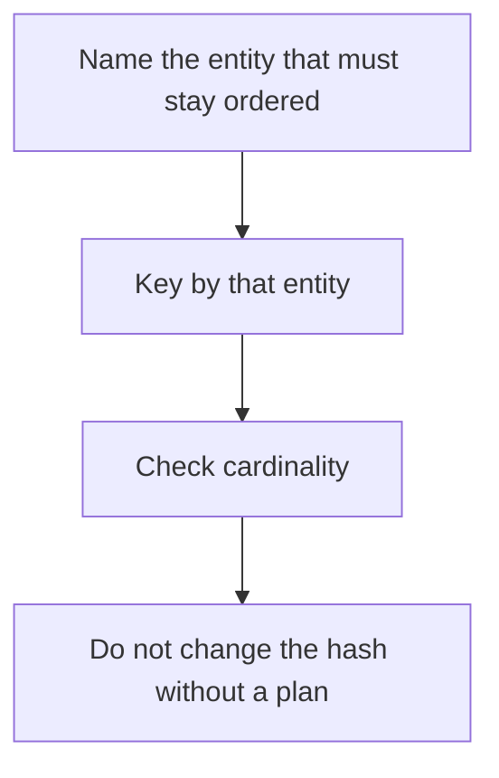

# D14-T007 — Partition keys and ordering

Topic ID: `D14-T007`
Domain: Messaging and Event-Driven Architecture
Subdomain: Partition keys and ordering
Importance: common
Complexity: advanced
Dependencies: `D14-T006`, `D14-T001`, `D04-T001`, `D04-T002`, `D05-T001`, `D05-T002`
Execution status of the code in section F: unexecuted

## A. Topic Overview

A partition key hashes to a partition. All records with the same key share that partition's order. Different keys do not. A null key spreads records and loses per-entity order. A hot key pins a partition. The key should be the entity whose order you care about, and it should have enough cardinality.

In production this shows up as follows: Order events are keyed by order id. Customer-wide order is not guaranteed across orders, and that is acceptable. Keying every event by a constant puts the whole topic on one partition.

Interviewers use Partition keys and ordering to see whether you can state the failure mode, not only the definition. The failure to name is: a hot key that makes one partition lag while others are idle, or a missing key that reorders a user's events

Prerequisites: `D14-T006`, `D14-T001`, `D04-T001`, `D04-T002`, `D05-T001`, `D05-T002`. Later notes should link here instead of repeating the mechanism.

## B. First-Principles Explanation

A partition key hashes to a partition. All records with the same key share that partition's order. Different keys do not. A null key spreads records and loses per-entity order. A hot key pins a partition. The key should be the entity whose order you care about, and it should have enough cardinality.

The useful picture is: The key is the label that decides which single-file line you stand in. Everyone with the same label keeps their order. A celebrity label makes one line enormous.

What has to be true:

1. Name the entity that must stay ordered
2. Key by that entity
3. Check cardinality
4. Do not change the hash without a plan

It works when those steps preserve one invariant. It fails when a hot key that makes one partition lag while others are idle, or a missing key that reorders a user's events. The alternative is: you need global order, which one key cannot scale

## C. Internal Working and Architecture

Components involved: the caller, the state Partition keys and ordering mutates or reads, and the observer that reports bytes and lag per partition, and the hottest key's share.

Execution:

1. Name the entity that must stay ordered
2. Key by that entity
3. Check cardinality
4. Do not change the hash without a plan

Data moves only along that path. A retry re-enters at step 1, so the operation must say what a duplicate does. Memory and locks stay inside this mechanism. Callers see the result or a typed error, not a half-updated invariant.

State to remember: choose this when you can name the stream that must be ordered. Do not choose it when you need global order, which one key cannot scale.

## D. Diagrams and Visual Models



Read the diagram from top to bottom. Each box is one step of Partition keys and ordering. The failure mode (a hot key that makes one partition lag while others are idle, or a missing key that reorders a user's events) is what you look for when a later box never happens or happens twice.

## E. Examples and Analogies

Analogy: The key is the label that decides which single-file line you stand in. Everyone with the same label keeps their order. A celebrity label makes one line enormous.

Production example: Order events are keyed by order id. Customer-wide order is not guaranteed across orders, and that is acceptable. Keying every event by a constant puts the whole topic on one partition.

A small counterexample is enough in an interview. Show the input, apply the steps, and show the broken outcome if someone uses the mechanism outside its rule: a hot key that makes one partition lag while others are idle, or a missing key that reorders a user's events.

## F. Code Examples

The snippet is labeled unexecuted. It illustrates the shape of the idea. It is not a benchmark and it embeds no secret.

```python
def key_for(order):
    return order['customer_id']
```

After the snippet, check bytes and lag per partition, and the hottest key's share. If that signal moves the wrong way, the snippet is the wrong tool for the workload.

## G. Practical Backend Application

Use Partition keys and ordering in a service when you can name the stream that must be ordered.

A typical place is the production case already stated: Order events are keyed by order id. Customer-wide order is not guaranteed across orders, and that is acceptable. Keying every event by a constant puts the whole topic on one partition.

Operationally you alert on bytes and lag per partition, and the hottest key's share. You do not alert only on process uptime. The dashboard should show the failure mode, a success rate, and the saturation signal (queue depth, lock wait, or latency) that predicts it.

## H. Advantages, Limitations and Trade-offs

| Choice | Benefit | Cost | Choose when | Avoid when |
| --- | --- | --- | --- | --- |
| Apply Partition keys and ordering | you can name the stream that must be ordered | Extra moving parts and a new failure mode | The failure you are preventing is already real | you need global order, which one key cannot scale |
| Simpler alternative | Less code and fewer dependencies | a hot key that makes one partition lag while others are idle, or a missing key that reorders a user's events | The workload does not hit the limit | The invariant must hold under concurrency or failure |

Partition keys and ordering is a trade. State the benefit and the cost in the same sentence when you propose it in a design review.

## I. Common Mistakes and Misconceptions

- A constant key.
- A key with a time prefix that changes hash.
- Assuming order across keys.
- Treating a diagram of Partition keys and ordering as proof that the invariant holds in production.
- Copying a default configuration without naming bytes and lag per partition, and the hottest key's share.

## J. Debugging and Troubleshooting

Symptom: a hot key that makes one partition lag while others are idle, or a missing key that reorders a user's events

First check: bytes and lag per partition, and the hottest key's share.

Then compare one healthy instance against one unhealthy instance. Confirm whether retries are duplicating work. Confirm whether a timeout is shorter than the work. Fix the invariant, then watch the same metric for a full peak, not only for the next minute.

Useful questions: did the step order in section C actually happen, or did a caller skip a step? Did a deploy change the data shape that Partition keys and ordering assumes?

## K. Interview Preparation

### Beginner

#### Q1. What problem does Partition keys and ordering solve?

**Answer:** A partition key hashes to a partition. All records with the same key share that partition's order. Different keys do not. A null key spreads records and loses per-entity order. A hot key pins a partition. The key should be the entity whose order you care about, and it should have enough cardinality. Without it, the usual backend failure is: a hot key that makes one partition lag while others are idle, or a missing key that reorders a user's events.

#### Q2. Where does Partition keys and ordering sit on a request path?

**Answer:** Partition keys and ordering is not a library you sprinkle on every call. you can name the stream that must be ordered You notice it when bytes and lag per partition, and the hottest key's share. Name the constraint that makes this choice correct. Say what you would measure to confirm it.

#### Q3. Give a concrete example of Partition keys and ordering.

**Answer:** Order events are keyed by order id. Customer-wide order is not guaranteed across orders, and that is acceptable. Keying every event by a constant puts the whole topic on one partition. Walk the input, the state change, and the observable output.

#### Q4. What is a common mix-up around Partition keys and ordering?

**Answer:** a hot key that makes one partition lag while others are idle, or a missing key that reorders a user's events The corrective check is bytes and lag per partition, and the hottest key's share. Name the constraint that makes this choice correct. Say what you would measure to confirm it. Say which alternative you rejected and why.

#### Q5. When would you skip Partition keys and ordering?

**Answer:** you need global order, which one key cannot scale Skipping is a decision with a measured cost, not a slogan. Name the constraint that makes this choice correct. Say what you would measure to confirm it. Say which alternative you rejected and why.

### Intermediate

#### Q1. What invariant makes Partition keys and ordering correct?

**Answer:** A partition key hashes to a partition. All records with the same key share that partition's order. Different keys do not. A null key spreads records and loses per-entity order. A hot key pins a partition. The key should be the entity whose order you care about, and it should have enough cardinality. State the invariant before you name the tool.

#### Q2. How do you test Partition keys and ordering?

**Answer:** Assert the failure mode directly: a hot key that makes one partition lag while others are idle, or a missing key that reorders a user's events. The assertion should watch bytes and lag per partition, and the hottest key's share. Include a concurrent or retry case if the bug only appears then. Name the constraint that makes this choice correct.

#### Q3. What signal tells you Partition keys and ordering is misbehaving in production?

**Answer:** Watch bytes and lag per partition, and the hottest key's share. The user-visible symptom is usually a hot key that makes one partition lag while others are idle, or a missing key that reorders a user's events. Name the constraint that makes this choice correct. Say what you would measure to confirm it.

#### Q4. How would you introduce Partition keys and ordering into a legacy service?

**Answer:** you can name the stream that must be ordered Ship it behind a metric so you can compare the old path. Roll back if a hot key that makes one partition lag while others are idle, or a missing key that reorders a user's events gets worse. Name the constraint that makes this choice correct. Say what you would measure to confirm it.

#### Q5. What do you trade away by choosing Partition keys and ordering?

**Answer:** you can name the stream that must be ordered you need global order, which one key cannot scale Say the cost in latency, storage, or operational load. Name the constraint that makes this choice correct. Say what you would measure to confirm it. Say which alternative you rejected and why.

### Advanced

#### Q1. What breaks if a dependency of Partition keys and ordering is slow or down?

**Answer:** a hot key that makes one partition lag while others are idle, or a missing key that reorders a user's events Degrade using the rule: you need global order, which one key cannot scale. Timeouts must be shorter than the caller's deadline. Name the constraint that makes this choice correct. Say what you would measure to confirm it.

#### Q2. How does Partition keys and ordering behave under retries?

**Answer:** Retries repeat work, so Partition keys and ordering must define what a duplicate does. a hot key that makes one partition lag while others are idle, or a missing key that reorders a user's events Idempotency keys or fences belong next to the write, not in a comment. Name the constraint that makes this choice correct. Say what you would measure to confirm it.

#### Q3. What is the capacity limit of Partition keys and ordering?

**Answer:** The limit shows up as bytes and lag per partition, and the hottest key's share. Add capacity only after you know whether the bottleneck is CPU, lock wait, or network. Name the constraint that makes this choice correct. Say what you would measure to confirm it.

#### Q4. How do you evolve Partition keys and ordering without a flag day?

**Answer:** you can name the stream that must be ordered Version the contract or the on-disk format. Readers should tolerate one old and one new shape during the rollout. Name the constraint that makes this choice correct. Say what you would measure to confirm it.

#### Q5. What security or correctness bug hides inside Partition keys and ordering?

**Answer:** a hot key that makes one partition lag while others are idle, or a missing key that reorders a user's events Check authorization and tenancy at the same boundary as the mechanism. A cache or queue must not widen who can read the data. Name the constraint that makes this choice correct. Say what you would measure to confirm it.

### Scenario

#### Q1. Incident: a hot key that makes one partition lag while others are idle, or a missing key that reorders a user's events. What do you check first?

**Answer:** Start with bytes and lag per partition, and the hottest key's share. Compare a good host and a bad host before you restart anything. A partition key hashes to a partition. All records with the same key share that partition's order. Different keys do not. A null key spreads records and loses per-entity order. A hot key pins a partition. The key should be the entity whose order you care about, and it should have enough cardinality.

#### Q2. A reviewer wants the clever version. What data settles it?

**Answer:** you can name the stream that must be ordered you need global order, which one key cannot scale Bring bytes and lag per partition, and the hottest key's share from a load test or from production, not a slogan. Name the constraint that makes this choice correct. Say what you would measure to confirm it. Say which alternative you rejected and why.

#### Q3. You have one hour to explain Partition keys and ordering at a whiteboard.

**Answer:** Draw the happy path in four boxes. Then draw the failure: a hot key that makes one partition lag while others are idle, or a missing key that reorders a user's events. End with the metric you would page on. Name the constraint that makes this choice correct.

#### Q4. The bug only appears under two concurrent callers.

**Answer:** a hot key that makes one partition lag while others are idle, or a missing key that reorders a user's events Reproduce with a barrier so both sides enter the critical window. Confirm the fix with bytes and lag per partition, and the hottest key's share. Name the constraint that makes this choice correct. Say what you would measure to confirm it.

#### Q5. Leadership wants this on every service next week.

**Answer:** you need global order, which one key cannot scale you can name the stream that must be ordered Roll it out where the failure mode is already hurting users. Name the constraint that makes this choice correct. Say what you would measure to confirm it. Say which alternative you rejected and why.

### Follow-up

#### Q1. What did you assume about the data size or the clock?

**Answer:** A partition key hashes to a partition. All records with the same key share that partition's order. Different keys do not. A null key spreads records and loses per-entity order. A hot key pins a partition. The key should be the entity whose order you care about, and it should have enough cardinality. Clocks are not a total order across machines. State whether the algorithm needs bounded size or a single leader.

#### Q2. What would you measure after the change ships?

**Answer:** Page on bytes and lag per partition, and the hottest key's share. Keep a before/after dashboard for one week. Alert on the failure mode, not only on CPU. Name the constraint that makes this choice correct.

#### Q3. Which neighboring topic did you deliberately not re-teach?

**Answer:** This note owns Partition keys and ordering. Related identifiers are in section N. Shared ideas are linked, not copied. Name the constraint that makes this choice correct.

## L. Practical Exercises

Solutions are in `EXERCISES/solutions/D14-T007.md`, not in this section.

1. Whiteboard the four steps of Partition keys and ordering and mark where `a hot key that makes one partition lag while others are idle, or a missing key that reorders a user's events` enters.
2. Read the snippet in section F and write the assertion that would catch that failure. The assertion must mention `bytes and lag per partition, and the hottest key's share`.
3. Argue for or against using Partition keys and ordering on a service you know. Use the choose and avoid rows from section H. Do not appeal to popularity.

## M. Revision Notes

- Mechanism: A partition key hashes to a partition.
- Failure: a hot key that makes one partition lag while others are idle, or a missing key that reorders a user's events
- Metric: bytes and lag per partition, and the hottest key's share
- Choose when: you can name the stream that must be ordered
- Avoid when: you need global order, which one key cannot scale

## N. Related Topics

Dependencies to review first: `D14-T006`, `D14-T001`, `D04-T001`, `D04-T002`, `D05-T001`, `D05-T002`.

Shared ideas stay in those notes. This note does not restate them.

## O. Completion Criteria

- You can explain Partition keys and ordering without reading this note, including the failure mode.
- You can draw the diagram in section D from memory.
- You can say when not to use it, using the avoid condition in section H.
- You can name the metric you would watch after shipping it.
