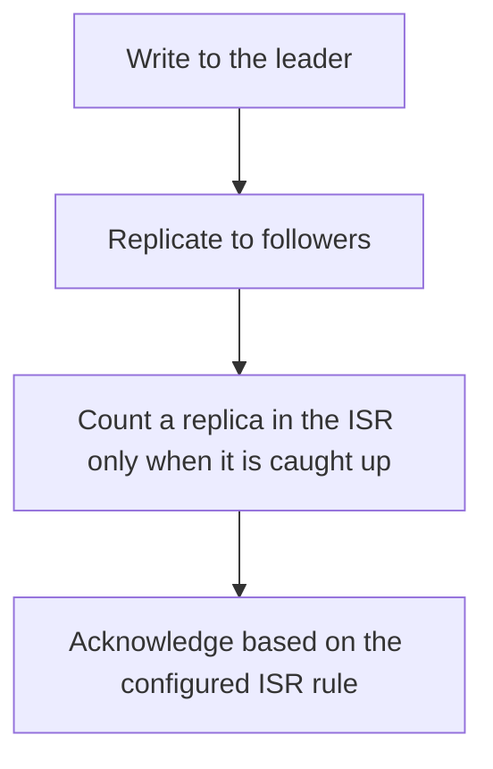

# D14-T008 — Replication and ISR

Topic ID: `D14-T008`
Domain: Messaging and Event-Driven Architecture
Subdomain: Replication and ISR
Importance: common
Complexity: advanced
Dependencies: `D14-T007`, `D14-T001`, `D04-T001`, `D04-T002`, `D05-T001`, `D05-T002`
Execution status of the code in section F: unexecuted

## A. Topic Overview

Replication copies each partition to several brokers. The leader handles writes. In-sync replicas have caught up within the allowed lag. An ack of all means the in-sync set has the record. If the only in-sync replica is the leader, acks=all does not tolerate a leader loss. Under-replicated partitions are the metric. Unclean leader election can serve a replica that missed writes.

In production this shows up as follows: A topic uses replication factor 3 and min.insync.replicas 2. A produce with acks=all fails when only one replica remains, which is louder and safer than accepting a write that cannot survive another failure.

Interviewers use Replication and ISR to see whether you can state the failure mode, not only the definition. The failure to name is: acks=all with min in-sync replicas of 1, so a single leader acknowledges and then dies with the data

Prerequisites: `D14-T007`, `D14-T001`, `D04-T001`, `D04-T002`, `D05-T001`, `D05-T002`. Later notes should link here instead of repeating the mechanism.

## B. First-Principles Explanation

Replication copies each partition to several brokers. The leader handles writes. In-sync replicas have caught up within the allowed lag. An ack of all means the in-sync set has the record. If the only in-sync replica is the leader, acks=all does not tolerate a leader loss. Under-replicated partitions are the metric. Unclean leader election can serve a replica that missed writes.

The useful picture is: The ISR is the set of clerks who have copied the page. If you accept a promise from a room with one clerk, and that clerk leaves, the page is gone.

What has to be true:

1. Write to the leader
2. Replicate to followers
3. Count a replica in the ISR only when it is caught up
4. Acknowledge based on the configured ISR rule

It works when those steps preserve one invariant. It fails when acks=all with min in-sync replicas of 1, so a single leader acknowledges and then dies with the data. The alternative is: you enable unclean leader election to keep producing at the cost of silent data loss

## C. Internal Working and Architecture

Components involved: the caller, the state Replication and ISR mutates or reads, and the observer that reports under-replicated partition count and produce errors when the ISR shrinks.

Execution:

1. Write to the leader
2. Replicate to followers
3. Count a replica in the ISR only when it is caught up
4. Acknowledge based on the configured ISR rule

Data moves only along that path. A retry re-enters at step 1, so the operation must say what a duplicate does. Memory and locks stay inside this mechanism. Callers see the result or a typed error, not a half-updated invariant.

State to remember: choose this when a committed message must survive a broker loss. Do not choose it when you enable unclean leader election to keep producing at the cost of silent data loss.

## D. Diagrams and Visual Models



Read the diagram from top to bottom. Each box is one step of Replication and ISR. The failure mode (acks=all with min in-sync replicas of 1, so a single leader acknowledges and then dies with the data) is what you look for when a later box never happens or happens twice.

## E. Examples and Analogies

Analogy: The ISR is the set of clerks who have copied the page. If you accept a promise from a room with one clerk, and that clerk leaves, the page is gone.

Production example: A topic uses replication factor 3 and min.insync.replicas 2. A produce with acks=all fails when only one replica remains, which is louder and safer than accepting a write that cannot survive another failure.

A small counterexample is enough in an interview. Show the input, apply the steps, and show the broken outcome if someone uses the mechanism outside its rule: acks=all with min in-sync replicas of 1, so a single leader acknowledges and then dies with the data.

## F. Code Examples

The snippet is labeled unexecuted. It illustrates the shape of the idea. It is not a benchmark and it embeds no secret.

```python
def acked(isr_size, min_isr):
    return isr_size >= min_isr
```

After the snippet, check under-replicated partition count and produce errors when the ISR shrinks. If that signal moves the wrong way, the snippet is the wrong tool for the workload.

## G. Practical Backend Application

Use Replication and ISR in a service when a committed message must survive a broker loss.

A typical place is the production case already stated: A topic uses replication factor 3 and min.insync.replicas 2. A produce with acks=all fails when only one replica remains, which is louder and safer than accepting a write that cannot survive another failure.

Operationally you alert on under-replicated partition count and produce errors when the ISR shrinks. You do not alert only on process uptime. The dashboard should show the failure mode, a success rate, and the saturation signal (queue depth, lock wait, or latency) that predicts it.

## H. Advantages, Limitations and Trade-offs

| Choice | Benefit | Cost | Choose when | Avoid when |
| --- | --- | --- | --- | --- |
| Apply Replication and ISR | a committed message must survive a broker loss | Extra moving parts and a new failure mode | The failure you are preventing is already real | you enable unclean leader election to keep producing at the cost of silent data loss |
| Simpler alternative | Less code and fewer dependencies | acks=all with min in-sync replicas of 1, so a single leader acknowledges and then dies with the data | The workload does not hit the limit | The invariant must hold under concurrency or failure |

Replication and ISR is a trade. State the benefit and the cost in the same sentence when you propose it in a design review.

## I. Common Mistakes and Misconceptions

- Replication factor 1.
- min.insync.replicas left at 1.
- Ignoring under-replicated partitions.
- Treating a diagram of Replication and ISR as proof that the invariant holds in production.
- Copying a default configuration without naming under-replicated partition count and produce errors when the ISR shrinks.

## J. Debugging and Troubleshooting

Symptom: acks=all with min in-sync replicas of 1, so a single leader acknowledges and then dies with the data

First check: under-replicated partition count and produce errors when the ISR shrinks.

Then compare one healthy instance against one unhealthy instance. Confirm whether retries are duplicating work. Confirm whether a timeout is shorter than the work. Fix the invariant, then watch the same metric for a full peak, not only for the next minute.

Useful questions: did the step order in section C actually happen, or did a caller skip a step? Did a deploy change the data shape that Replication and ISR assumes?

## K. Interview Preparation

### Beginner

#### Q1. What problem does Replication and ISR solve?

**Answer:** Replication copies each partition to several brokers. The leader handles writes. In-sync replicas have caught up within the allowed lag. An ack of all means the in-sync set has the record. If the only in-sync replica is the leader, acks=all does not tolerate a leader loss. Under-replicated partitions are the metric. Unclean leader election can serve a replica that missed writes. Without it, the usual backend failure is: acks=all with min in-sync replicas of 1, so a single leader acknowledges and then dies with the data.

#### Q2. Where does Replication and ISR sit on a request path?

**Answer:** Replication and ISR is not a library you sprinkle on every call. a committed message must survive a broker loss You notice it when under-replicated partition count and produce errors when the ISR shrinks. Name the constraint that makes this choice correct. Say what you would measure to confirm it.

#### Q3. Give a concrete example of Replication and ISR.

**Answer:** A topic uses replication factor 3 and min.insync.replicas 2. A produce with acks=all fails when only one replica remains, which is louder and safer than accepting a write that cannot survive another failure. Walk the input, the state change, and the observable output. Name the constraint that makes this choice correct.

#### Q4. What is a common mix-up around Replication and ISR?

**Answer:** acks=all with min in-sync replicas of 1, so a single leader acknowledges and then dies with the data The corrective check is under-replicated partition count and produce errors when the ISR shrinks. Name the constraint that makes this choice correct. Say what you would measure to confirm it. Say which alternative you rejected and why.

#### Q5. When would you skip Replication and ISR?

**Answer:** you enable unclean leader election to keep producing at the cost of silent data loss Skipping is a decision with a measured cost, not a slogan. Name the constraint that makes this choice correct. Say what you would measure to confirm it. Say which alternative you rejected and why.

### Intermediate

#### Q1. What invariant makes Replication and ISR correct?

**Answer:** Replication copies each partition to several brokers. The leader handles writes. In-sync replicas have caught up within the allowed lag. An ack of all means the in-sync set has the record. If the only in-sync replica is the leader, acks=all does not tolerate a leader loss. Under-replicated partitions are the metric. Unclean leader election can serve a replica that missed writes. State the invariant before you name the tool.

#### Q2. How do you test Replication and ISR?

**Answer:** Assert the failure mode directly: acks=all with min in-sync replicas of 1, so a single leader acknowledges and then dies with the data. The assertion should watch under-replicated partition count and produce errors when the ISR shrinks. Include a concurrent or retry case if the bug only appears then. Name the constraint that makes this choice correct.

#### Q3. What signal tells you Replication and ISR is misbehaving in production?

**Answer:** Watch under-replicated partition count and produce errors when the ISR shrinks. The user-visible symptom is usually acks=all with min in-sync replicas of 1, so a single leader acknowledges and then dies with the data. Name the constraint that makes this choice correct. Say what you would measure to confirm it.

#### Q4. How would you introduce Replication and ISR into a legacy service?

**Answer:** a committed message must survive a broker loss Ship it behind a metric so you can compare the old path. Roll back if acks=all with min in-sync replicas of 1, so a single leader acknowledges and then dies with the data gets worse. Name the constraint that makes this choice correct. Say what you would measure to confirm it.

#### Q5. What do you trade away by choosing Replication and ISR?

**Answer:** a committed message must survive a broker loss you enable unclean leader election to keep producing at the cost of silent data loss Say the cost in latency, storage, or operational load. Name the constraint that makes this choice correct. Say what you would measure to confirm it. Say which alternative you rejected and why.

### Advanced

#### Q1. What breaks if a dependency of Replication and ISR is slow or down?

**Answer:** acks=all with min in-sync replicas of 1, so a single leader acknowledges and then dies with the data Degrade using the rule: you enable unclean leader election to keep producing at the cost of silent data loss. Timeouts must be shorter than the caller's deadline. Name the constraint that makes this choice correct. Say what you would measure to confirm it.

#### Q2. How does Replication and ISR behave under retries?

**Answer:** Retries repeat work, so Replication and ISR must define what a duplicate does. acks=all with min in-sync replicas of 1, so a single leader acknowledges and then dies with the data Idempotency keys or fences belong next to the write, not in a comment. Name the constraint that makes this choice correct. Say what you would measure to confirm it.

#### Q3. What is the capacity limit of Replication and ISR?

**Answer:** The limit shows up as under-replicated partition count and produce errors when the ISR shrinks. Add capacity only after you know whether the bottleneck is CPU, lock wait, or network. Name the constraint that makes this choice correct. Say what you would measure to confirm it.

#### Q4. How do you evolve Replication and ISR without a flag day?

**Answer:** a committed message must survive a broker loss Version the contract or the on-disk format. Readers should tolerate one old and one new shape during the rollout. Name the constraint that makes this choice correct. Say what you would measure to confirm it.

#### Q5. What security or correctness bug hides inside Replication and ISR?

**Answer:** acks=all with min in-sync replicas of 1, so a single leader acknowledges and then dies with the data Check authorization and tenancy at the same boundary as the mechanism. A cache or queue must not widen who can read the data. Name the constraint that makes this choice correct. Say what you would measure to confirm it.

### Scenario

#### Q1. Incident: acks=all with min in-sync replicas of 1, so a single leader acknowledges and then dies with the data. What do you check first?

**Answer:** Start with under-replicated partition count and produce errors when the ISR shrinks. Compare a good host and a bad host before you restart anything. Replication copies each partition to several brokers. The leader handles writes. In-sync replicas have caught up within the allowed lag. An ack of all means the in-sync set has the record. If the only in-sync replica is the leader, acks=all does not tolerate a leader loss. Under-replicated partitions are the metric. Unclean leader election can serve a replica that missed writes.

#### Q2. A reviewer wants the clever version. What data settles it?

**Answer:** a committed message must survive a broker loss you enable unclean leader election to keep producing at the cost of silent data loss Bring under-replicated partition count and produce errors when the ISR shrinks from a load test or from production, not a slogan. Name the constraint that makes this choice correct. Say what you would measure to confirm it. Say which alternative you rejected and why.

#### Q3. You have one hour to explain Replication and ISR at a whiteboard.

**Answer:** Draw the happy path in four boxes. Then draw the failure: acks=all with min in-sync replicas of 1, so a single leader acknowledges and then dies with the data. End with the metric you would page on. Name the constraint that makes this choice correct.

#### Q4. The bug only appears under two concurrent callers.

**Answer:** acks=all with min in-sync replicas of 1, so a single leader acknowledges and then dies with the data Reproduce with a barrier so both sides enter the critical window. Confirm the fix with under-replicated partition count and produce errors when the ISR shrinks. Name the constraint that makes this choice correct. Say what you would measure to confirm it.

#### Q5. Leadership wants this on every service next week.

**Answer:** you enable unclean leader election to keep producing at the cost of silent data loss a committed message must survive a broker loss Roll it out where the failure mode is already hurting users. Name the constraint that makes this choice correct. Say what you would measure to confirm it. Say which alternative you rejected and why.

### Follow-up

#### Q1. What did you assume about the data size or the clock?

**Answer:** Replication copies each partition to several brokers. The leader handles writes. In-sync replicas have caught up within the allowed lag. An ack of all means the in-sync set has the record. If the only in-sync replica is the leader, acks=all does not tolerate a leader loss. Under-replicated partitions are the metric. Unclean leader election can serve a replica that missed writes. Clocks are not a total order across machines. State whether the algorithm needs bounded size or a single leader.

#### Q2. What would you measure after the change ships?

**Answer:** Page on under-replicated partition count and produce errors when the ISR shrinks. Keep a before/after dashboard for one week. Alert on the failure mode, not only on CPU. Name the constraint that makes this choice correct.

#### Q3. Which neighboring topic did you deliberately not re-teach?

**Answer:** This note owns Replication and ISR. Related identifiers are in section N. Shared ideas are linked, not copied. Name the constraint that makes this choice correct.

## L. Practical Exercises

Solutions are in `EXERCISES/solutions/D14-T008.md`, not in this section.

1. Whiteboard the four steps of Replication and ISR and mark where `acks=all with min in-sync replicas of 1, so a single leader acknowledges and then dies with the data` enters.
2. Read the snippet in section F and write the assertion that would catch that failure. The assertion must mention `under-replicated partition count and produce errors when the ISR shrinks`.
3. Argue for or against using Replication and ISR on a service you know. Use the choose and avoid rows from section H. Do not appeal to popularity.

## M. Revision Notes

- Mechanism: Replication copies each partition to several brokers.
- Failure: acks=all with min in-sync replicas of 1, so a single leader acknowledges and then dies with the data
- Metric: under-replicated partition count and produce errors when the ISR shrinks
- Choose when: a committed message must survive a broker loss
- Avoid when: you enable unclean leader election to keep producing at the cost of silent data loss

## N. Related Topics

Dependencies to review first: `D14-T007`, `D14-T001`, `D04-T001`, `D04-T002`, `D05-T001`, `D05-T002`.

Shared ideas stay in those notes. This note does not restate them.

## O. Completion Criteria

- You can explain Replication and ISR without reading this note, including the failure mode.
- You can draw the diagram in section D from memory.
- You can say when not to use it, using the avoid condition in section H.
- You can name the metric you would watch after shipping it.
