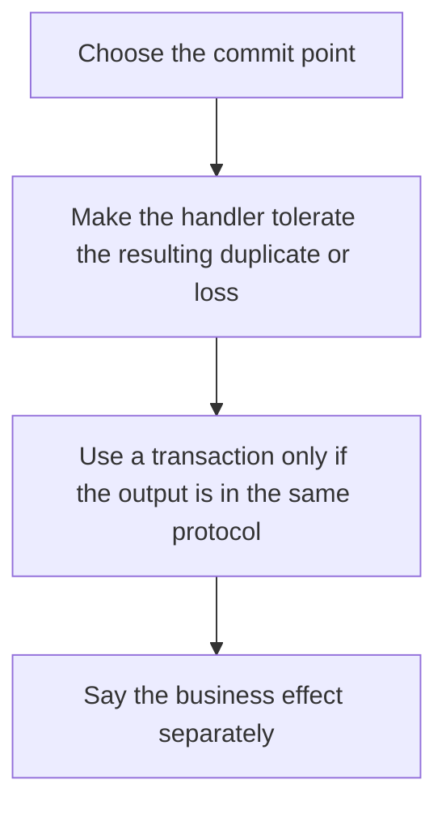

# D14-T009 — Delivery semantics: at-most-once, at-least-once, exactly-once

Topic ID: `D14-T009`
Domain: Messaging and Event-Driven Architecture
Subdomain: Delivery semantics: at-most-once, at-least-once, exactly-once
Importance: advanced
Complexity: advanced
Dependencies: `D14-T008`, `D14-T001`, `D04-T001`, `D04-T002`, `D05-T001`, `D05-T002`
Execution status of the code in section F: unexecuted

## A. Topic Overview

At-most-once processing commits the offset before handling, so a crash skips the record. At-least-once handles and then commits, so a crash repeats the record. Exactly-once in a log system is a transactional handshake between the consume offset and the output write, and it still needs an idempotent effect on the real world. The words describe delivery into your handler, not the business outcome, unless the handler participates.

In production this shows up as follows: A consumer writes a ledger row and commits the Kafka offset in one transaction, which is exactly-once between those two. The subsequent SMS is at-least-once and uses a provider idempotency key.

Interviewers use Delivery semantics: at-most-once, at-least-once, exactly-once to see whether you can state the failure mode, not only the definition. The failure to name is: calling a path exactly-once while the email provider is called outside the transaction and can double-send

Prerequisites: `D14-T008`, `D14-T001`, `D04-T001`, `D04-T002`, `D05-T001`, `D05-T002`. Later notes should link here instead of repeating the mechanism.

## B. First-Principles Explanation

At-most-once processing commits the offset before handling, so a crash skips the record. At-least-once handles and then commits, so a crash repeats the record. Exactly-once in a log system is a transactional handshake between the consume offset and the output write, and it still needs an idempotent effect on the real world. The words describe delivery into your handler, not the business outcome, unless the handler participates.

The useful picture is: At-most-once is throwing away the receipt before you file it. At-least-once is filing it and sometimes filing a copy. Exactly-once is one atomic staple around the receipt and the filing cabinet, and only if both are in the cabinet.

What has to be true:

1. Choose the commit point
2. Make the handler tolerate the resulting duplicate or loss
3. Use a transaction only if the output is in the same protocol
4. Say the business effect separately

It works when those steps preserve one invariant. It fails when calling a path exactly-once while the email provider is called outside the transaction and can double-send. The alternative is: you promise exactly-once to a third party that has no idempotency key

## C. Internal Working and Architecture

Components involved: the caller, the state Delivery semantics: at-most-once, at-least-once, exactly-once mutates or reads, and the observer that reports duplicate side effects and skipped offsets after a crash test.

Execution:

1. Choose the commit point
2. Make the handler tolerate the resulting duplicate or loss
3. Use a transaction only if the output is in the same protocol
4. Say the business effect separately

Data moves only along that path. A retry re-enters at step 1, so the operation must say what a duplicate does. Memory and locks stay inside this mechanism. Callers see the result or a typed error, not a half-updated invariant.

State to remember: choose this when you can point at where the offset is committed. Do not choose it when you promise exactly-once to a third party that has no idempotency key.

## D. Diagrams and Visual Models



Read the diagram from top to bottom. Each box is one step of Delivery semantics: at-most-once, at-least-once, exactly-once. The failure mode (calling a path exactly-once while the email provider is called outside the transaction and can double-send) is what you look for when a later box never happens or happens twice.

## E. Examples and Analogies

Analogy: At-most-once is throwing away the receipt before you file it. At-least-once is filing it and sometimes filing a copy. Exactly-once is one atomic staple around the receipt and the filing cabinet, and only if both are in the cabinet.

Production example: A consumer writes a ledger row and commits the Kafka offset in one transaction, which is exactly-once between those two. The subsequent SMS is at-least-once and uses a provider idempotency key.

A small counterexample is enough in an interview. Show the input, apply the steps, and show the broken outcome if someone uses the mechanism outside its rule: calling a path exactly-once while the email provider is called outside the transaction and can double-send.

## F. Code Examples

The snippet is labeled unexecuted. It illustrates the shape of the idea. It is not a benchmark and it embeds no secret.

```python
def effect_key(event):
    return event['event_id']
```

After the snippet, check duplicate side effects and skipped offsets after a crash test. If that signal moves the wrong way, the snippet is the wrong tool for the workload.

## G. Practical Backend Application

Use Delivery semantics: at-most-once, at-least-once, exactly-once in a service when you can point at where the offset is committed.

A typical place is the production case already stated: A consumer writes a ledger row and commits the Kafka offset in one transaction, which is exactly-once between those two. The subsequent SMS is at-least-once and uses a provider idempotency key.

Operationally you alert on duplicate side effects and skipped offsets after a crash test. You do not alert only on process uptime. The dashboard should show the failure mode, a success rate, and the saturation signal (queue depth, lock wait, or latency) that predicts it.

## H. Advantages, Limitations and Trade-offs

| Choice | Benefit | Cost | Choose when | Avoid when |
| --- | --- | --- | --- | --- |
| Apply Delivery semantics: at-most-once, at-least-once, exactly-once | you can point at where the offset is committed | Extra moving parts and a new failure mode | The failure you are preventing is already real | you promise exactly-once to a third party that has no idempotency key |
| Simpler alternative | Less code and fewer dependencies | calling a path exactly-once while the email provider is called outside the transaction and can double-send | The workload does not hit the limit | The invariant must hold under concurrency or failure |

Delivery semantics: at-most-once, at-least-once, exactly-once is a trade. State the benefit and the cost in the same sentence when you propose it in a design review.

## I. Common Mistakes and Misconceptions

- Equating broker acks with exactly-once processing.
- Committing before a non-idempotent write.
- Ignoring duplicates because they are rare.
- Treating a diagram of Delivery semantics: at-most-once, at-least-once, exactly-once as proof that the invariant holds in production.
- Copying a default configuration without naming duplicate side effects and skipped offsets after a crash test.

## J. Debugging and Troubleshooting

Symptom: calling a path exactly-once while the email provider is called outside the transaction and can double-send

First check: duplicate side effects and skipped offsets after a crash test.

Then compare one healthy instance against one unhealthy instance. Confirm whether retries are duplicating work. Confirm whether a timeout is shorter than the work. Fix the invariant, then watch the same metric for a full peak, not only for the next minute.

Useful questions: did the step order in section C actually happen, or did a caller skip a step? Did a deploy change the data shape that Delivery semantics: at-most-once, at-least-once, exactly-once assumes?

## K. Interview Preparation

### Beginner

#### Q1. What problem does Delivery semantics: at-most-once, at-least-once, exactly-once solve?

**Answer:** At-most-once processing commits the offset before handling, so a crash skips the record. At-least-once handles and then commits, so a crash repeats the record. Exactly-once in a log system is a transactional handshake between the consume offset and the output write, and it still needs an idempotent effect on the real world. The words describe delivery into your handler, not the business outcome, unless the handler participates. Without it, the usual backend failure is: calling a path exactly-once while the email provider is called outside the transaction and can double-send.

#### Q2. Where does Delivery semantics: at-most-once, at-least-once, exactly-once sit on a request path?

**Answer:** Delivery semantics: at-most-once, at-least-once, exactly-once is not a library you sprinkle on every call. you can point at where the offset is committed You notice it when duplicate side effects and skipped offsets after a crash test. Name the constraint that makes this choice correct. Say what you would measure to confirm it.

#### Q3. Give a concrete example of Delivery semantics: at-most-once, at-least-once, exactly-once.

**Answer:** A consumer writes a ledger row and commits the Kafka offset in one transaction, which is exactly-once between those two. The subsequent SMS is at-least-once and uses a provider idempotency key. Walk the input, the state change, and the observable output. Name the constraint that makes this choice correct.

#### Q4. What is a common mix-up around Delivery semantics: at-most-once, at-least-once, exactly-once?

**Answer:** calling a path exactly-once while the email provider is called outside the transaction and can double-send The corrective check is duplicate side effects and skipped offsets after a crash test. Name the constraint that makes this choice correct. Say what you would measure to confirm it. Say which alternative you rejected and why.

#### Q5. When would you skip Delivery semantics: at-most-once, at-least-once, exactly-once?

**Answer:** you promise exactly-once to a third party that has no idempotency key Skipping is a decision with a measured cost, not a slogan. Name the constraint that makes this choice correct. Say what you would measure to confirm it. Say which alternative you rejected and why.

### Intermediate

#### Q1. What invariant makes Delivery semantics: at-most-once, at-least-once, exactly-once correct?

**Answer:** At-most-once processing commits the offset before handling, so a crash skips the record. At-least-once handles and then commits, so a crash repeats the record. Exactly-once in a log system is a transactional handshake between the consume offset and the output write, and it still needs an idempotent effect on the real world. The words describe delivery into your handler, not the business outcome, unless the handler participates. State the invariant before you name the tool.

#### Q2. How do you test Delivery semantics: at-most-once, at-least-once, exactly-once?

**Answer:** Assert the failure mode directly: calling a path exactly-once while the email provider is called outside the transaction and can double-send. The assertion should watch duplicate side effects and skipped offsets after a crash test. Include a concurrent or retry case if the bug only appears then. Name the constraint that makes this choice correct.

#### Q3. What signal tells you Delivery semantics: at-most-once, at-least-once, exactly-once is misbehaving in production?

**Answer:** Watch duplicate side effects and skipped offsets after a crash test. The user-visible symptom is usually calling a path exactly-once while the email provider is called outside the transaction and can double-send. Name the constraint that makes this choice correct. Say what you would measure to confirm it.

#### Q4. How would you introduce Delivery semantics: at-most-once, at-least-once, exactly-once into a legacy service?

**Answer:** you can point at where the offset is committed Ship it behind a metric so you can compare the old path. Roll back if calling a path exactly-once while the email provider is called outside the transaction and can double-send gets worse. Name the constraint that makes this choice correct. Say what you would measure to confirm it.

#### Q5. What do you trade away by choosing Delivery semantics: at-most-once, at-least-once, exactly-once?

**Answer:** you can point at where the offset is committed you promise exactly-once to a third party that has no idempotency key Say the cost in latency, storage, or operational load. Name the constraint that makes this choice correct. Say what you would measure to confirm it. Say which alternative you rejected and why.

### Advanced

#### Q1. What breaks if a dependency of Delivery semantics: at-most-once, at-least-once, exactly-once is slow or down?

**Answer:** calling a path exactly-once while the email provider is called outside the transaction and can double-send Degrade using the rule: you promise exactly-once to a third party that has no idempotency key. Timeouts must be shorter than the caller's deadline. Name the constraint that makes this choice correct. Say what you would measure to confirm it.

#### Q2. How does Delivery semantics: at-most-once, at-least-once, exactly-once behave under retries?

**Answer:** Retries repeat work, so Delivery semantics: at-most-once, at-least-once, exactly-once must define what a duplicate does. calling a path exactly-once while the email provider is called outside the transaction and can double-send Idempotency keys or fences belong next to the write, not in a comment. Name the constraint that makes this choice correct. Say what you would measure to confirm it.

#### Q3. What is the capacity limit of Delivery semantics: at-most-once, at-least-once, exactly-once?

**Answer:** The limit shows up as duplicate side effects and skipped offsets after a crash test. Add capacity only after you know whether the bottleneck is CPU, lock wait, or network. Name the constraint that makes this choice correct. Say what you would measure to confirm it.

#### Q4. How do you evolve Delivery semantics: at-most-once, at-least-once, exactly-once without a flag day?

**Answer:** you can point at where the offset is committed Version the contract or the on-disk format. Readers should tolerate one old and one new shape during the rollout. Name the constraint that makes this choice correct. Say what you would measure to confirm it.

#### Q5. What security or correctness bug hides inside Delivery semantics: at-most-once, at-least-once, exactly-once?

**Answer:** calling a path exactly-once while the email provider is called outside the transaction and can double-send Check authorization and tenancy at the same boundary as the mechanism. A cache or queue must not widen who can read the data. Name the constraint that makes this choice correct. Say what you would measure to confirm it.

### Scenario

#### Q1. Incident: calling a path exactly-once while the email provider is called outside the transaction and can double-send. What do you check first?

**Answer:** Start with duplicate side effects and skipped offsets after a crash test. Compare a good host and a bad host before you restart anything. At-most-once processing commits the offset before handling, so a crash skips the record. At-least-once handles and then commits, so a crash repeats the record. Exactly-once in a log system is a transactional handshake between the consume offset and the output write, and it still needs an idempotent effect on the real world. The words describe delivery into your handler, not the business outcome, unless the handler participates.

#### Q2. A reviewer wants the clever version. What data settles it?

**Answer:** you can point at where the offset is committed you promise exactly-once to a third party that has no idempotency key Bring duplicate side effects and skipped offsets after a crash test from a load test or from production, not a slogan. Name the constraint that makes this choice correct. Say what you would measure to confirm it. Say which alternative you rejected and why.

#### Q3. You have one hour to explain Delivery semantics: at-most-once, at-least-once, exactly-once at a whiteboard.

**Answer:** Draw the happy path in four boxes. Then draw the failure: calling a path exactly-once while the email provider is called outside the transaction and can double-send. End with the metric you would page on. Name the constraint that makes this choice correct.

#### Q4. The bug only appears under two concurrent callers.

**Answer:** calling a path exactly-once while the email provider is called outside the transaction and can double-send Reproduce with a barrier so both sides enter the critical window. Confirm the fix with duplicate side effects and skipped offsets after a crash test. Name the constraint that makes this choice correct. Say what you would measure to confirm it.

#### Q5. Leadership wants this on every service next week.

**Answer:** you promise exactly-once to a third party that has no idempotency key you can point at where the offset is committed Roll it out where the failure mode is already hurting users. Name the constraint that makes this choice correct. Say what you would measure to confirm it. Say which alternative you rejected and why.

### Follow-up

#### Q1. What did you assume about the data size or the clock?

**Answer:** At-most-once processing commits the offset before handling, so a crash skips the record. At-least-once handles and then commits, so a crash repeats the record. Exactly-once in a log system is a transactional handshake between the consume offset and the output write, and it still needs an idempotent effect on the real world. The words describe delivery into your handler, not the business outcome, unless the handler participates. Clocks are not a total order across machines. State whether the algorithm needs bounded size or a single leader.

#### Q2. What would you measure after the change ships?

**Answer:** Page on duplicate side effects and skipped offsets after a crash test. Keep a before/after dashboard for one week. Alert on the failure mode, not only on CPU. Name the constraint that makes this choice correct.

#### Q3. Which neighboring topic did you deliberately not re-teach?

**Answer:** This note owns Delivery semantics: at-most-once, at-least-once, exactly-once. Related identifiers are in section N. Shared ideas are linked, not copied. Name the constraint that makes this choice correct.

## L. Practical Exercises

Solutions are in `EXERCISES/solutions/D14-T009.md`, not in this section.

1. Whiteboard the four steps of Delivery semantics: at-most-once, at-least-once, exactly-once and mark where `calling a path exactly-once while the email provider is called outside the transaction and can double-send` enters.
2. Read the snippet in section F and write the assertion that would catch that failure. The assertion must mention `duplicate side effects and skipped offsets after a crash test`.
3. Argue for or against using Delivery semantics: at-most-once, at-least-once, exactly-once on a service you know. Use the choose and avoid rows from section H. Do not appeal to popularity.

## M. Revision Notes

- Mechanism: At-most-once processing commits the offset before handling, so a crash skips the record.
- Failure: calling a path exactly-once while the email provider is called outside the transaction and can double-send
- Metric: duplicate side effects and skipped offsets after a crash test
- Choose when: you can point at where the offset is committed
- Avoid when: you promise exactly-once to a third party that has no idempotency key

## N. Related Topics

Dependencies to review first: `D14-T008`, `D14-T001`, `D04-T001`, `D04-T002`, `D05-T001`, `D05-T002`.

Shared ideas stay in those notes. This note does not restate them.

## O. Completion Criteria

- You can explain Delivery semantics: at-most-once, at-least-once, exactly-once without reading this note, including the failure mode.
- You can draw the diagram in section D from memory.
- You can say when not to use it, using the avoid condition in section H.
- You can name the metric you would watch after shipping it.
