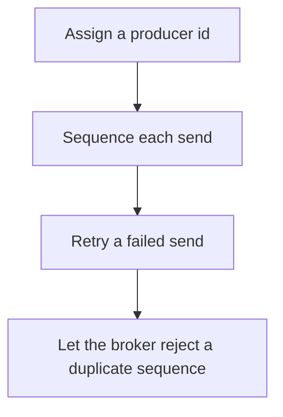

# D14-T010 — Idempotent producers

Topic ID: `D14-T010`
Domain: Messaging and Event-Driven Architecture
Subdomain: Idempotent producers
Importance: core
Complexity: advanced
Dependencies: `D14-T009`, `D14-T001`, `D04-T001`, `D04-T002`, `D05-T001`, `D05-T002`
Execution status of the code in section F: unexecuted

## A. Topic Overview

An idempotent producer attaches a producer id and a sequence number so the broker can drop a retried send that it already appended. It prevents duplicates from producer retries within that session. It does not make the consumer idempotent. It does not dedupe two different producer instances that both mean the same business event. Enable it when retries are on.

In production this shows up as follows: A service enables idempotent produce and retries on timeout. The topic does not grow a duplicate from that retry. The consumer still upserts by order id because a second process may emit the same order.

Interviewers use Idempotent producers to see whether you can state the failure mode, not only the definition. The failure to name is: two application instances producing the same logical event with different producer ids, so both are stored

Prerequisites: `D14-T009`, `D14-T001`, `D04-T001`, `D04-T002`, `D05-T001`, `D05-T002`. Later notes should link here instead of repeating the mechanism.

## B. First-Principles Explanation

An idempotent producer attaches a producer id and a sequence number so the broker can drop a retried send that it already appended. It prevents duplicates from producer retries within that session. It does not make the consumer idempotent. It does not dedupe two different producer instances that both mean the same business event. Enable it when retries are on.

The useful picture is: An idempotent producer is a courier with a badge number and a parcel number. The dock refuses a parcel it already scanned from that courier. A different courier with a copy of the letter is a different parcel.

What has to be true:

1. Assign a producer id
2. Sequence each send
3. Retry a failed send
4. Let the broker reject a duplicate sequence

It works when those steps preserve one invariant. It fails when two application instances producing the same logical event with different producer ids, so both are stored. The alternative is: you treat it as business-level deduplication across services

## C. Internal Working and Architecture

Components involved: the caller, the state Idempotent producers mutates or reads, and the observer that reports duplicate offsets for one logical send after a retry.

Execution:

1. Assign a producer id
2. Sequence each send
3. Retry a failed send
4. Let the broker reject a duplicate sequence

Data moves only along that path. A retry re-enters at step 1, so the operation must say what a duplicate does. Memory and locks stay inside this mechanism. Callers see the result or a typed error, not a half-updated invariant.

State to remember: choose this when the producer retries sends. Do not choose it when you treat it as business-level deduplication across services.

## D. Diagrams and Visual Models



Read the diagram from top to bottom. Each box is one step of Idempotent producers. The failure mode (two application instances producing the same logical event with different producer ids, so both are stored) is what you look for when a later box never happens or happens twice.

## E. Examples and Analogies

Analogy: An idempotent producer is a courier with a badge number and a parcel number. The dock refuses a parcel it already scanned from that courier. A different courier with a copy of the letter is a different parcel.

Production example: A service enables idempotent produce and retries on timeout. The topic does not grow a duplicate from that retry. The consumer still upserts by order id because a second process may emit the same order.

A small counterexample is enough in an interview. Show the input, apply the steps, and show the broken outcome if someone uses the mechanism outside its rule: two application instances producing the same logical event with different producer ids, so both are stored.

## F. Code Examples

The snippet is labeled unexecuted. It illustrates the shape of the idea. It is not a benchmark and it embeds no secret.

```python
def same_send(producer_id, seq, seen):
    return (producer_id, seq) in seen
```

After the snippet, check duplicate offsets for one logical send after a retry. If that signal moves the wrong way, the snippet is the wrong tool for the workload.

## G. Practical Backend Application

Use Idempotent producers in a service when the producer retries sends.

A typical place is the production case already stated: A service enables idempotent produce and retries on timeout. The topic does not grow a duplicate from that retry. The consumer still upserts by order id because a second process may emit the same order.

Operationally you alert on duplicate offsets for one logical send after a retry. You do not alert only on process uptime. The dashboard should show the failure mode, a success rate, and the saturation signal (queue depth, lock wait, or latency) that predicts it.

## H. Advantages, Limitations and Trade-offs

| Choice | Benefit | Cost | Choose when | Avoid when |
| --- | --- | --- | --- | --- |
| Apply Idempotent producers | the producer retries sends | Extra moving parts and a new failure mode | The failure you are preventing is already real | you treat it as business-level deduplication across services |
| Simpler alternative | Less code and fewer dependencies | two application instances producing the same logical event with different producer ids, so both are stored | The workload does not hit the limit | The invariant must hold under concurrency or failure |

Idempotent producers is a trade. State the benefit and the cost in the same sentence when you propose it in a design review.

## I. Common Mistakes and Misconceptions

- Retries without idempotence.
- Assuming it covers consumer redelivery.
- Reusing state across a process restart incorrectly.
- Treating a diagram of Idempotent producers as proof that the invariant holds in production.
- Copying a default configuration without naming duplicate offsets for one logical send after a retry.

## J. Debugging and Troubleshooting

Symptom: two application instances producing the same logical event with different producer ids, so both are stored

First check: duplicate offsets for one logical send after a retry.

Then compare one healthy instance against one unhealthy instance. Confirm whether retries are duplicating work. Confirm whether a timeout is shorter than the work. Fix the invariant, then watch the same metric for a full peak, not only for the next minute.

Useful questions: did the step order in section C actually happen, or did a caller skip a step? Did a deploy change the data shape that Idempotent producers assumes?

## K. Interview Preparation

### Beginner

#### Q1. What problem does Idempotent producers solve?

**Answer:** An idempotent producer attaches a producer id and a sequence number so the broker can drop a retried send that it already appended. It prevents duplicates from producer retries within that session. It does not make the consumer idempotent. It does not dedupe two different producer instances that both mean the same business event. Enable it when retries are on. Without it, the usual backend failure is: two application instances producing the same logical event with different producer ids, so both are stored.

#### Q2. Where does Idempotent producers sit on a request path?

**Answer:** Idempotent producers is not a library you sprinkle on every call. the producer retries sends You notice it when duplicate offsets for one logical send after a retry. Name the constraint that makes this choice correct. Say what you would measure to confirm it.

#### Q3. Give a concrete example of Idempotent producers.

**Answer:** A service enables idempotent produce and retries on timeout. The topic does not grow a duplicate from that retry. The consumer still upserts by order id because a second process may emit the same order. Walk the input, the state change, and the observable output.

#### Q4. What is a common mix-up around Idempotent producers?

**Answer:** two application instances producing the same logical event with different producer ids, so both are stored The corrective check is duplicate offsets for one logical send after a retry. Name the constraint that makes this choice correct. Say what you would measure to confirm it. Say which alternative you rejected and why.

#### Q5. When would you skip Idempotent producers?

**Answer:** you treat it as business-level deduplication across services Skipping is a decision with a measured cost, not a slogan. Name the constraint that makes this choice correct. Say what you would measure to confirm it. Say which alternative you rejected and why.

### Intermediate

#### Q1. What invariant makes Idempotent producers correct?

**Answer:** An idempotent producer attaches a producer id and a sequence number so the broker can drop a retried send that it already appended. It prevents duplicates from producer retries within that session. It does not make the consumer idempotent. It does not dedupe two different producer instances that both mean the same business event. Enable it when retries are on. State the invariant before you name the tool.

#### Q2. How do you test Idempotent producers?

**Answer:** Assert the failure mode directly: two application instances producing the same logical event with different producer ids, so both are stored. The assertion should watch duplicate offsets for one logical send after a retry. Include a concurrent or retry case if the bug only appears then. Name the constraint that makes this choice correct.

#### Q3. What signal tells you Idempotent producers is misbehaving in production?

**Answer:** Watch duplicate offsets for one logical send after a retry. The user-visible symptom is usually two application instances producing the same logical event with different producer ids, so both are stored. Name the constraint that makes this choice correct. Say what you would measure to confirm it.

#### Q4. How would you introduce Idempotent producers into a legacy service?

**Answer:** the producer retries sends Ship it behind a metric so you can compare the old path. Roll back if two application instances producing the same logical event with different producer ids, so both are stored gets worse. Name the constraint that makes this choice correct. Say what you would measure to confirm it.

#### Q5. What do you trade away by choosing Idempotent producers?

**Answer:** the producer retries sends you treat it as business-level deduplication across services Say the cost in latency, storage, or operational load. Name the constraint that makes this choice correct. Say what you would measure to confirm it. Say which alternative you rejected and why.

### Advanced

#### Q1. What breaks if a dependency of Idempotent producers is slow or down?

**Answer:** two application instances producing the same logical event with different producer ids, so both are stored Degrade using the rule: you treat it as business-level deduplication across services. Timeouts must be shorter than the caller's deadline. Name the constraint that makes this choice correct. Say what you would measure to confirm it.

#### Q2. How does Idempotent producers behave under retries?

**Answer:** Retries repeat work, so Idempotent producers must define what a duplicate does. two application instances producing the same logical event with different producer ids, so both are stored Idempotency keys or fences belong next to the write, not in a comment. Name the constraint that makes this choice correct. Say what you would measure to confirm it.

#### Q3. What is the capacity limit of Idempotent producers?

**Answer:** The limit shows up as duplicate offsets for one logical send after a retry. Add capacity only after you know whether the bottleneck is CPU, lock wait, or network. Name the constraint that makes this choice correct. Say what you would measure to confirm it.

#### Q4. How do you evolve Idempotent producers without a flag day?

**Answer:** the producer retries sends Version the contract or the on-disk format. Readers should tolerate one old and one new shape during the rollout. Name the constraint that makes this choice correct. Say what you would measure to confirm it.

#### Q5. What security or correctness bug hides inside Idempotent producers?

**Answer:** two application instances producing the same logical event with different producer ids, so both are stored Check authorization and tenancy at the same boundary as the mechanism. A cache or queue must not widen who can read the data. Name the constraint that makes this choice correct. Say what you would measure to confirm it.

### Scenario

#### Q1. Incident: two application instances producing the same logical event with different producer ids, so both are stored. What do you check first?

**Answer:** Start with duplicate offsets for one logical send after a retry. Compare a good host and a bad host before you restart anything. An idempotent producer attaches a producer id and a sequence number so the broker can drop a retried send that it already appended. It prevents duplicates from producer retries within that session. It does not make the consumer idempotent. It does not dedupe two different producer instances that both mean the same business event. Enable it when retries are on.

#### Q2. A reviewer wants the clever version. What data settles it?

**Answer:** the producer retries sends you treat it as business-level deduplication across services Bring duplicate offsets for one logical send after a retry from a load test or from production, not a slogan. Name the constraint that makes this choice correct. Say what you would measure to confirm it. Say which alternative you rejected and why.

#### Q3. You have one hour to explain Idempotent producers at a whiteboard.

**Answer:** Draw the happy path in four boxes. Then draw the failure: two application instances producing the same logical event with different producer ids, so both are stored. End with the metric you would page on. Name the constraint that makes this choice correct.

#### Q4. The bug only appears under two concurrent callers.

**Answer:** two application instances producing the same logical event with different producer ids, so both are stored Reproduce with a barrier so both sides enter the critical window. Confirm the fix with duplicate offsets for one logical send after a retry. Name the constraint that makes this choice correct. Say what you would measure to confirm it.

#### Q5. Leadership wants this on every service next week.

**Answer:** you treat it as business-level deduplication across services the producer retries sends Roll it out where the failure mode is already hurting users. Name the constraint that makes this choice correct. Say what you would measure to confirm it. Say which alternative you rejected and why.

### Follow-up

#### Q1. What did you assume about the data size or the clock?

**Answer:** An idempotent producer attaches a producer id and a sequence number so the broker can drop a retried send that it already appended. It prevents duplicates from producer retries within that session. It does not make the consumer idempotent. It does not dedupe two different producer instances that both mean the same business event. Enable it when retries are on. Clocks are not a total order across machines. State whether the algorithm needs bounded size or a single leader.

#### Q2. What would you measure after the change ships?

**Answer:** Page on duplicate offsets for one logical send after a retry. Keep a before/after dashboard for one week. Alert on the failure mode, not only on CPU. Name the constraint that makes this choice correct.

#### Q3. Which neighboring topic did you deliberately not re-teach?

**Answer:** This note owns Idempotent producers. Related identifiers are in section N. Shared ideas are linked, not copied. Name the constraint that makes this choice correct.

## L. Practical Exercises

Solutions are in `EXERCISES/solutions/D14-T010.md`, not in this section.

1. Whiteboard the four steps of Idempotent producers and mark where `two application instances producing the same logical event with different producer ids, so both are stored` enters.
2. Read the snippet in section F and write the assertion that would catch that failure. The assertion must mention `duplicate offsets for one logical send after a retry`.
3. Argue for or against using Idempotent producers on a service you know. Use the choose and avoid rows from section H. Do not appeal to popularity.

## M. Revision Notes

- Mechanism: An idempotent producer attaches a producer id and a sequence number so the broker can drop a retried send that it already appended.
- Failure: two application instances producing the same logical event with different producer ids, so both are stored
- Metric: duplicate offsets for one logical send after a retry
- Choose when: the producer retries sends
- Avoid when: you treat it as business-level deduplication across services

## N. Related Topics

Dependencies to review first: `D14-T009`, `D14-T001`, `D04-T001`, `D04-T002`, `D05-T001`, `D05-T002`.

Shared ideas stay in those notes. This note does not restate them.

## O. Completion Criteria

- You can explain Idempotent producers without reading this note, including the failure mode.
- You can draw the diagram in section D from memory.
- You can say when not to use it, using the avoid condition in section H.
- You can name the metric you would watch after shipping it.
