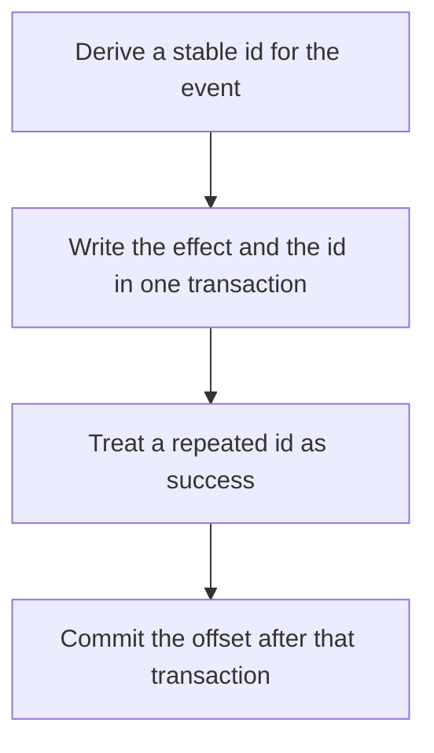

# D14-T011 — Idempotent consumers

Topic ID: `D14-T011`
Domain: Messaging and Event-Driven Architecture
Subdomain: Idempotent consumers
Importance: core
Complexity: advanced
Dependencies: `D14-T010`, `D14-T001`, `D04-T001`, `D04-T002`, `D05-T001`, `D05-T002`
Execution status of the code in section F: unexecuted

## A. Topic Overview

An idempotent consumer can handle the same record more than once and leave the same business state. The usual tools are a unique key, an upsert, or a processed-event table in the same transaction as the side effect. Redelivery is normal after a crash that happened after the write and before the offset commit. Idempotency is a property of the effect, not of the broker.

In production this shows up as follows: A refund consumer inserts refund_id as a primary key and applies the balance change in that transaction. The second delivery hits the key and does nothing. The offset commit follows the commit.

Interviewers use Idempotent consumers to see whether you can state the failure mode, not only the definition. The failure to name is: a second email or a second charge because the handler's effect was not keyed

Prerequisites: `D14-T010`, `D14-T001`, `D04-T001`, `D04-T002`, `D05-T001`, `D05-T002`. Later notes should link here instead of repeating the mechanism.

## B. First-Principles Explanation

An idempotent consumer can handle the same record more than once and leave the same business state. The usual tools are a unique key, an upsert, or a processed-event table in the same transaction as the side effect. Redelivery is normal after a crash that happened after the write and before the offset commit. Idempotency is a property of the effect, not of the broker.

The useful picture is: An idempotent consumer is a clerk who stamps each invoice number and refuses to pay the same number twice, even if the envelope arrives again.

What has to be true:

1. Derive a stable id for the event
2. Write the effect and the id in one transaction
3. Treat a repeated id as success
4. Commit the offset after that transaction

It works when those steps preserve one invariant. It fails when a second email or a second charge because the handler's effect was not keyed. The alternative is: the side effect has no stable id and is not safe to repeat

## C. Internal Working and Architecture

Components involved: the caller, the state Idempotent consumers mutates or reads, and the observer that reports unique-constraint hits on the processed-event table, and duplicate charges.

Execution:

1. Derive a stable id for the event
2. Write the effect and the id in one transaction
3. Treat a repeated id as success
4. Commit the offset after that transaction

Data moves only along that path. A retry re-enters at step 1, so the operation must say what a duplicate does. Memory and locks stay inside this mechanism. Callers see the result or a typed error, not a half-updated invariant.

State to remember: choose this when delivery is at-least-once. Do not choose it when the side effect has no stable id and is not safe to repeat.

## D. Diagrams and Visual Models



Read the diagram from top to bottom. Each box is one step of Idempotent consumers. The failure mode (a second email or a second charge because the handler's effect was not keyed) is what you look for when a later box never happens or happens twice.

## E. Examples and Analogies

Analogy: An idempotent consumer is a clerk who stamps each invoice number and refuses to pay the same number twice, even if the envelope arrives again.

Production example: A refund consumer inserts refund_id as a primary key and applies the balance change in that transaction. The second delivery hits the key and does nothing. The offset commit follows the commit.

A small counterexample is enough in an interview. Show the input, apply the steps, and show the broken outcome if someone uses the mechanism outside its rule: a second email or a second charge because the handler's effect was not keyed.

## F. Code Examples

The snippet is labeled unexecuted. It illustrates the shape of the idea. It is not a benchmark and it embeds no secret.

```python
def already_done(db, event_id):
    return db.insert_ignore('processed', event_id)
```

After the snippet, check unique-constraint hits on the processed-event table, and duplicate charges. If that signal moves the wrong way, the snippet is the wrong tool for the workload.

## G. Practical Backend Application

Use Idempotent consumers in a service when delivery is at-least-once.

A typical place is the production case already stated: A refund consumer inserts refund_id as a primary key and applies the balance change in that transaction. The second delivery hits the key and does nothing. The offset commit follows the commit.

Operationally you alert on unique-constraint hits on the processed-event table, and duplicate charges. You do not alert only on process uptime. The dashboard should show the failure mode, a success rate, and the saturation signal (queue depth, lock wait, or latency) that predicts it.

## H. Advantages, Limitations and Trade-offs

| Choice | Benefit | Cost | Choose when | Avoid when |
| --- | --- | --- | --- | --- |
| Apply Idempotent consumers | delivery is at-least-once | Extra moving parts and a new failure mode | The failure you are preventing is already real | the side effect has no stable id and is not safe to repeat |
| Simpler alternative | Less code and fewer dependencies | a second email or a second charge because the handler's effect was not keyed | The workload does not hit the limit | The invariant must hold under concurrency or failure |

Idempotent consumers is a trade. State the benefit and the cost in the same sentence when you propose it in a design review.

## I. Common Mistakes and Misconceptions

- Deduping only in memory.
- Committing the offset before the transaction.
- Using a random id per receive.
- Treating a diagram of Idempotent consumers as proof that the invariant holds in production.
- Copying a default configuration without naming unique-constraint hits on the processed-event table, and duplicate charges.

## J. Debugging and Troubleshooting

Symptom: a second email or a second charge because the handler's effect was not keyed

First check: unique-constraint hits on the processed-event table, and duplicate charges.

Then compare one healthy instance against one unhealthy instance. Confirm whether retries are duplicating work. Confirm whether a timeout is shorter than the work. Fix the invariant, then watch the same metric for a full peak, not only for the next minute.

Useful questions: did the step order in section C actually happen, or did a caller skip a step? Did a deploy change the data shape that Idempotent consumers assumes?

## K. Interview Preparation

### Beginner

#### Q1. What problem does Idempotent consumers solve?

**Answer:** An idempotent consumer can handle the same record more than once and leave the same business state. The usual tools are a unique key, an upsert, or a processed-event table in the same transaction as the side effect. Redelivery is normal after a crash that happened after the write and before the offset commit. Idempotency is a property of the effect, not of the broker. Without it, the usual backend failure is: a second email or a second charge because the handler's effect was not keyed.

#### Q2. Where does Idempotent consumers sit on a request path?

**Answer:** Idempotent consumers is not a library you sprinkle on every call. delivery is at-least-once You notice it when unique-constraint hits on the processed-event table, and duplicate charges. Name the constraint that makes this choice correct. Say what you would measure to confirm it.

#### Q3. Give a concrete example of Idempotent consumers.

**Answer:** A refund consumer inserts refund_id as a primary key and applies the balance change in that transaction. The second delivery hits the key and does nothing. The offset commit follows the commit. Walk the input, the state change, and the observable output.

#### Q4. What is a common mix-up around Idempotent consumers?

**Answer:** a second email or a second charge because the handler's effect was not keyed The corrective check is unique-constraint hits on the processed-event table, and duplicate charges. Name the constraint that makes this choice correct. Say what you would measure to confirm it. Say which alternative you rejected and why.

#### Q5. When would you skip Idempotent consumers?

**Answer:** the side effect has no stable id and is not safe to repeat Skipping is a decision with a measured cost, not a slogan. Name the constraint that makes this choice correct. Say what you would measure to confirm it. Say which alternative you rejected and why.

### Intermediate

#### Q1. What invariant makes Idempotent consumers correct?

**Answer:** An idempotent consumer can handle the same record more than once and leave the same business state. The usual tools are a unique key, an upsert, or a processed-event table in the same transaction as the side effect. Redelivery is normal after a crash that happened after the write and before the offset commit. Idempotency is a property of the effect, not of the broker. State the invariant before you name the tool.

#### Q2. How do you test Idempotent consumers?

**Answer:** Assert the failure mode directly: a second email or a second charge because the handler's effect was not keyed. The assertion should watch unique-constraint hits on the processed-event table, and duplicate charges. Include a concurrent or retry case if the bug only appears then. Name the constraint that makes this choice correct.

#### Q3. What signal tells you Idempotent consumers is misbehaving in production?

**Answer:** Watch unique-constraint hits on the processed-event table, and duplicate charges. The user-visible symptom is usually a second email or a second charge because the handler's effect was not keyed. Name the constraint that makes this choice correct. Say what you would measure to confirm it.

#### Q4. How would you introduce Idempotent consumers into a legacy service?

**Answer:** delivery is at-least-once Ship it behind a metric so you can compare the old path. Roll back if a second email or a second charge because the handler's effect was not keyed gets worse. Name the constraint that makes this choice correct. Say what you would measure to confirm it.

#### Q5. What do you trade away by choosing Idempotent consumers?

**Answer:** delivery is at-least-once the side effect has no stable id and is not safe to repeat Say the cost in latency, storage, or operational load. Name the constraint that makes this choice correct. Say what you would measure to confirm it. Say which alternative you rejected and why.

### Advanced

#### Q1. What breaks if a dependency of Idempotent consumers is slow or down?

**Answer:** a second email or a second charge because the handler's effect was not keyed Degrade using the rule: the side effect has no stable id and is not safe to repeat. Timeouts must be shorter than the caller's deadline. Name the constraint that makes this choice correct. Say what you would measure to confirm it.

#### Q2. How does Idempotent consumers behave under retries?

**Answer:** Retries repeat work, so Idempotent consumers must define what a duplicate does. a second email or a second charge because the handler's effect was not keyed Idempotency keys or fences belong next to the write, not in a comment. Name the constraint that makes this choice correct. Say what you would measure to confirm it.

#### Q3. What is the capacity limit of Idempotent consumers?

**Answer:** The limit shows up as unique-constraint hits on the processed-event table, and duplicate charges. Add capacity only after you know whether the bottleneck is CPU, lock wait, or network. Name the constraint that makes this choice correct. Say what you would measure to confirm it.

#### Q4. How do you evolve Idempotent consumers without a flag day?

**Answer:** delivery is at-least-once Version the contract or the on-disk format. Readers should tolerate one old and one new shape during the rollout. Name the constraint that makes this choice correct. Say what you would measure to confirm it.

#### Q5. What security or correctness bug hides inside Idempotent consumers?

**Answer:** a second email or a second charge because the handler's effect was not keyed Check authorization and tenancy at the same boundary as the mechanism. A cache or queue must not widen who can read the data. Name the constraint that makes this choice correct. Say what you would measure to confirm it.

### Scenario

#### Q1. Incident: a second email or a second charge because the handler's effect was not keyed. What do you check first?

**Answer:** Start with unique-constraint hits on the processed-event table, and duplicate charges. Compare a good host and a bad host before you restart anything. An idempotent consumer can handle the same record more than once and leave the same business state. The usual tools are a unique key, an upsert, or a processed-event table in the same transaction as the side effect. Redelivery is normal after a crash that happened after the write and before the offset commit. Idempotency is a property of the effect, not of the broker.

#### Q2. A reviewer wants the clever version. What data settles it?

**Answer:** delivery is at-least-once the side effect has no stable id and is not safe to repeat Bring unique-constraint hits on the processed-event table, and duplicate charges from a load test or from production, not a slogan. Name the constraint that makes this choice correct. Say what you would measure to confirm it. Say which alternative you rejected and why.

#### Q3. You have one hour to explain Idempotent consumers at a whiteboard.

**Answer:** Draw the happy path in four boxes. Then draw the failure: a second email or a second charge because the handler's effect was not keyed. End with the metric you would page on. Name the constraint that makes this choice correct.

#### Q4. The bug only appears under two concurrent callers.

**Answer:** a second email or a second charge because the handler's effect was not keyed Reproduce with a barrier so both sides enter the critical window. Confirm the fix with unique-constraint hits on the processed-event table, and duplicate charges. Name the constraint that makes this choice correct. Say what you would measure to confirm it.

#### Q5. Leadership wants this on every service next week.

**Answer:** the side effect has no stable id and is not safe to repeat delivery is at-least-once Roll it out where the failure mode is already hurting users. Name the constraint that makes this choice correct. Say what you would measure to confirm it. Say which alternative you rejected and why.

### Follow-up

#### Q1. What did you assume about the data size or the clock?

**Answer:** An idempotent consumer can handle the same record more than once and leave the same business state. The usual tools are a unique key, an upsert, or a processed-event table in the same transaction as the side effect. Redelivery is normal after a crash that happened after the write and before the offset commit. Idempotency is a property of the effect, not of the broker. Clocks are not a total order across machines. State whether the algorithm needs bounded size or a single leader.

#### Q2. What would you measure after the change ships?

**Answer:** Page on unique-constraint hits on the processed-event table, and duplicate charges. Keep a before/after dashboard for one week. Alert on the failure mode, not only on CPU. Name the constraint that makes this choice correct.

#### Q3. Which neighboring topic did you deliberately not re-teach?

**Answer:** This note owns Idempotent consumers. Related identifiers are in section N. Shared ideas are linked, not copied. Name the constraint that makes this choice correct.

## L. Practical Exercises

Solutions are in `EXERCISES/solutions/D14-T011.md`, not in this section.

1. Whiteboard the four steps of Idempotent consumers and mark where `a second email or a second charge because the handler's effect was not keyed` enters.
2. Read the snippet in section F and write the assertion that would catch that failure. The assertion must mention `unique-constraint hits on the processed-event table, and duplicate charges`.
3. Argue for or against using Idempotent consumers on a service you know. Use the choose and avoid rows from section H. Do not appeal to popularity.

## M. Revision Notes

- Mechanism: An idempotent consumer can handle the same record more than once and leave the same business state.
- Failure: a second email or a second charge because the handler's effect was not keyed
- Metric: unique-constraint hits on the processed-event table, and duplicate charges
- Choose when: delivery is at-least-once
- Avoid when: the side effect has no stable id and is not safe to repeat

## N. Related Topics

Dependencies to review first: `D14-T010`, `D14-T001`, `D04-T001`, `D04-T002`, `D05-T001`, `D05-T002`.

Shared ideas stay in those notes. This note does not restate them.

## O. Completion Criteria

- You can explain Idempotent consumers without reading this note, including the failure mode.
- You can draw the diagram in section D from memory.
- You can say when not to use it, using the avoid condition in section H.
- You can name the metric you would watch after shipping it.
