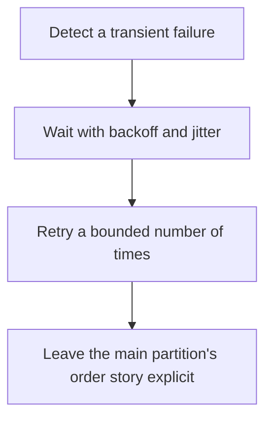

# D14-T012 — Retries and retry topics

Topic ID: `D14-T012`
Domain: Messaging and Event-Driven Architecture
Subdomain: Retries and retry topics
Importance: common
Complexity: advanced
Dependencies: `D14-T011`, `D14-T001`, `D04-T001`, `D04-T002`, `D05-T001`, `D05-T002`
Execution status of the code in section F: unexecuted

## A. Topic Overview

A retry repeats a failed handler after a delay. Immediate retries amplify an outage. Backoff and jitter spread them. A retry topic or a delayed queue holds the record off the main partition so one bad record does not block its neighbors forever, depending on ordering needs. Retries must stop. The record then goes to a dead-letter path. A retry of a non-idempotent handler doubles the effect.

In production this shows up as follows: A notification consumer retries three times with jitter when the provider returns 503, then publishes to a retry topic. A 400 is not retried. The send uses an idempotency key.

Interviewers use Retries and retry topics to see whether you can state the failure mode, not only the definition. The failure to name is: a poison record blocking a partition, or a retry storm against a down dependency

Prerequisites: `D14-T011`, `D14-T001`, `D04-T001`, `D04-T002`, `D05-T001`, `D05-T002`. Later notes should link here instead of repeating the mechanism.

## B. First-Principles Explanation

A retry repeats a failed handler after a delay. Immediate retries amplify an outage. Backoff and jitter spread them. A retry topic or a delayed queue holds the record off the main partition so one bad record does not block its neighbors forever, depending on ordering needs. Retries must stop. The record then goes to a dead-letter path. A retry of a non-idempotent handler doubles the effect.

The useful picture is: A retry is knocking again later, not pounding the door. A retry topic is a side corridor so the main line can keep moving while one guest waits.

What has to be true:

1. Detect a transient failure
2. Wait with backoff and jitter
3. Retry a bounded number of times
4. Leave the main partition's order story explicit

It works when those steps preserve one invariant. It fails when a poison record blocking a partition, or a retry storm against a down dependency. The alternative is: you retry validation errors or you block the partition on the first failure

## C. Internal Working and Architecture

Components involved: the caller, the state Retries and retry topics mutates or reads, and the observer that reports retry count per event and the age of the oldest retrying event.

Execution:

1. Detect a transient failure
2. Wait with backoff and jitter
3. Retry a bounded number of times
4. Leave the main partition's order story explicit

Data moves only along that path. A retry re-enters at step 1, so the operation must say what a duplicate does. Memory and locks stay inside this mechanism. Callers see the result or a typed error, not a half-updated invariant.

State to remember: choose this when the failure is transient and the effect is safe to repeat. Do not choose it when you retry validation errors or you block the partition on the first failure.

## D. Diagrams and Visual Models



Read the diagram from top to bottom. Each box is one step of Retries and retry topics. The failure mode (a poison record blocking a partition, or a retry storm against a down dependency) is what you look for when a later box never happens or happens twice.

## E. Examples and Analogies

Analogy: A retry is knocking again later, not pounding the door. A retry topic is a side corridor so the main line can keep moving while one guest waits.

Production example: A notification consumer retries three times with jitter when the provider returns 503, then publishes to a retry topic. A 400 is not retried. The send uses an idempotency key.

A small counterexample is enough in an interview. Show the input, apply the steps, and show the broken outcome if someone uses the mechanism outside its rule: a poison record blocking a partition, or a retry storm against a down dependency.

## F. Code Examples

The snippet is labeled unexecuted. It illustrates the shape of the idea. It is not a benchmark and it embeds no secret.

```python
def delay(attempt):
    return min(60, 2 ** attempt)
```

After the snippet, check retry count per event and the age of the oldest retrying event. If that signal moves the wrong way, the snippet is the wrong tool for the workload.

## G. Practical Backend Application

Use Retries and retry topics in a service when the failure is transient and the effect is safe to repeat.

A typical place is the production case already stated: A notification consumer retries three times with jitter when the provider returns 503, then publishes to a retry topic. A 400 is not retried. The send uses an idempotency key.

Operationally you alert on retry count per event and the age of the oldest retrying event. You do not alert only on process uptime. The dashboard should show the failure mode, a success rate, and the saturation signal (queue depth, lock wait, or latency) that predicts it.

## H. Advantages, Limitations and Trade-offs

| Choice | Benefit | Cost | Choose when | Avoid when |
| --- | --- | --- | --- | --- |
| Apply Retries and retry topics | the failure is transient and the effect is safe to repeat | Extra moving parts and a new failure mode | The failure you are preventing is already real | you retry validation errors or you block the partition on the first failure |
| Simpler alternative | Less code and fewer dependencies | a poison record blocking a partition, or a retry storm against a down dependency | The workload does not hit the limit | The invariant must hold under concurrency or failure |

Retries and retry topics is a trade. State the benefit and the cost in the same sentence when you propose it in a design review.

## I. Common Mistakes and Misconceptions

- Retrying forever.
- No jitter.
- Blocking every key behind one bad record when order among keys does not matter.
- Treating a diagram of Retries and retry topics as proof that the invariant holds in production.
- Copying a default configuration without naming retry count per event and the age of the oldest retrying event.

## J. Debugging and Troubleshooting

Symptom: a poison record blocking a partition, or a retry storm against a down dependency

First check: retry count per event and the age of the oldest retrying event.

Then compare one healthy instance against one unhealthy instance. Confirm whether retries are duplicating work. Confirm whether a timeout is shorter than the work. Fix the invariant, then watch the same metric for a full peak, not only for the next minute.

Useful questions: did the step order in section C actually happen, or did a caller skip a step? Did a deploy change the data shape that Retries and retry topics assumes?

## K. Interview Preparation

### Beginner

#### Q1. What problem does Retries and retry topics solve?

**Answer:** A retry repeats a failed handler after a delay. Immediate retries amplify an outage. Backoff and jitter spread them. A retry topic or a delayed queue holds the record off the main partition so one bad record does not block its neighbors forever, depending on ordering needs. Retries must stop. The record then goes to a dead-letter path. A retry of a non-idempotent handler doubles the effect. Without it, the usual backend failure is: a poison record blocking a partition, or a retry storm against a down dependency.

#### Q2. Where does Retries and retry topics sit on a request path?

**Answer:** Retries and retry topics is not a library you sprinkle on every call. the failure is transient and the effect is safe to repeat You notice it when retry count per event and the age of the oldest retrying event. Name the constraint that makes this choice correct. Say what you would measure to confirm it.

#### Q3. Give a concrete example of Retries and retry topics.

**Answer:** A notification consumer retries three times with jitter when the provider returns 503, then publishes to a retry topic. A 400 is not retried. The send uses an idempotency key. Walk the input, the state change, and the observable output.

#### Q4. What is a common mix-up around Retries and retry topics?

**Answer:** a poison record blocking a partition, or a retry storm against a down dependency The corrective check is retry count per event and the age of the oldest retrying event. Name the constraint that makes this choice correct. Say what you would measure to confirm it. Say which alternative you rejected and why.

#### Q5. When would you skip Retries and retry topics?

**Answer:** you retry validation errors or you block the partition on the first failure Skipping is a decision with a measured cost, not a slogan. Name the constraint that makes this choice correct. Say what you would measure to confirm it. Say which alternative you rejected and why.

### Intermediate

#### Q1. What invariant makes Retries and retry topics correct?

**Answer:** A retry repeats a failed handler after a delay. Immediate retries amplify an outage. Backoff and jitter spread them. A retry topic or a delayed queue holds the record off the main partition so one bad record does not block its neighbors forever, depending on ordering needs. Retries must stop. The record then goes to a dead-letter path. A retry of a non-idempotent handler doubles the effect. State the invariant before you name the tool.

#### Q2. How do you test Retries and retry topics?

**Answer:** Assert the failure mode directly: a poison record blocking a partition, or a retry storm against a down dependency. The assertion should watch retry count per event and the age of the oldest retrying event. Include a concurrent or retry case if the bug only appears then. Name the constraint that makes this choice correct.

#### Q3. What signal tells you Retries and retry topics is misbehaving in production?

**Answer:** Watch retry count per event and the age of the oldest retrying event. The user-visible symptom is usually a poison record blocking a partition, or a retry storm against a down dependency. Name the constraint that makes this choice correct. Say what you would measure to confirm it.

#### Q4. How would you introduce Retries and retry topics into a legacy service?

**Answer:** the failure is transient and the effect is safe to repeat Ship it behind a metric so you can compare the old path. Roll back if a poison record blocking a partition, or a retry storm against a down dependency gets worse. Name the constraint that makes this choice correct. Say what you would measure to confirm it.

#### Q5. What do you trade away by choosing Retries and retry topics?

**Answer:** the failure is transient and the effect is safe to repeat you retry validation errors or you block the partition on the first failure Say the cost in latency, storage, or operational load. Name the constraint that makes this choice correct. Say what you would measure to confirm it. Say which alternative you rejected and why.

### Advanced

#### Q1. What breaks if a dependency of Retries and retry topics is slow or down?

**Answer:** a poison record blocking a partition, or a retry storm against a down dependency Degrade using the rule: you retry validation errors or you block the partition on the first failure. Timeouts must be shorter than the caller's deadline. Name the constraint that makes this choice correct. Say what you would measure to confirm it.

#### Q2. How does Retries and retry topics behave under retries?

**Answer:** Retries repeat work, so Retries and retry topics must define what a duplicate does. a poison record blocking a partition, or a retry storm against a down dependency Idempotency keys or fences belong next to the write, not in a comment. Name the constraint that makes this choice correct. Say what you would measure to confirm it.

#### Q3. What is the capacity limit of Retries and retry topics?

**Answer:** The limit shows up as retry count per event and the age of the oldest retrying event. Add capacity only after you know whether the bottleneck is CPU, lock wait, or network. Name the constraint that makes this choice correct. Say what you would measure to confirm it.

#### Q4. How do you evolve Retries and retry topics without a flag day?

**Answer:** the failure is transient and the effect is safe to repeat Version the contract or the on-disk format. Readers should tolerate one old and one new shape during the rollout. Name the constraint that makes this choice correct. Say what you would measure to confirm it.

#### Q5. What security or correctness bug hides inside Retries and retry topics?

**Answer:** a poison record blocking a partition, or a retry storm against a down dependency Check authorization and tenancy at the same boundary as the mechanism. A cache or queue must not widen who can read the data. Name the constraint that makes this choice correct. Say what you would measure to confirm it.

### Scenario

#### Q1. Incident: a poison record blocking a partition, or a retry storm against a down dependency. What do you check first?

**Answer:** Start with retry count per event and the age of the oldest retrying event. Compare a good host and a bad host before you restart anything. A retry repeats a failed handler after a delay. Immediate retries amplify an outage. Backoff and jitter spread them. A retry topic or a delayed queue holds the record off the main partition so one bad record does not block its neighbors forever, depending on ordering needs. Retries must stop. The record then goes to a dead-letter path. A retry of a non-idempotent handler doubles the effect.

#### Q2. A reviewer wants the clever version. What data settles it?

**Answer:** the failure is transient and the effect is safe to repeat you retry validation errors or you block the partition on the first failure Bring retry count per event and the age of the oldest retrying event from a load test or from production, not a slogan. Name the constraint that makes this choice correct. Say what you would measure to confirm it. Say which alternative you rejected and why.

#### Q3. You have one hour to explain Retries and retry topics at a whiteboard.

**Answer:** Draw the happy path in four boxes. Then draw the failure: a poison record blocking a partition, or a retry storm against a down dependency. End with the metric you would page on. Name the constraint that makes this choice correct.

#### Q4. The bug only appears under two concurrent callers.

**Answer:** a poison record blocking a partition, or a retry storm against a down dependency Reproduce with a barrier so both sides enter the critical window. Confirm the fix with retry count per event and the age of the oldest retrying event. Name the constraint that makes this choice correct. Say what you would measure to confirm it.

#### Q5. Leadership wants this on every service next week.

**Answer:** you retry validation errors or you block the partition on the first failure the failure is transient and the effect is safe to repeat Roll it out where the failure mode is already hurting users. Name the constraint that makes this choice correct. Say what you would measure to confirm it. Say which alternative you rejected and why.

### Follow-up

#### Q1. What did you assume about the data size or the clock?

**Answer:** A retry repeats a failed handler after a delay. Immediate retries amplify an outage. Backoff and jitter spread them. A retry topic or a delayed queue holds the record off the main partition so one bad record does not block its neighbors forever, depending on ordering needs. Retries must stop. The record then goes to a dead-letter path. A retry of a non-idempotent handler doubles the effect. Clocks are not a total order across machines. State whether the algorithm needs bounded size or a single leader.

#### Q2. What would you measure after the change ships?

**Answer:** Page on retry count per event and the age of the oldest retrying event. Keep a before/after dashboard for one week. Alert on the failure mode, not only on CPU. Name the constraint that makes this choice correct.

#### Q3. Which neighboring topic did you deliberately not re-teach?

**Answer:** This note owns Retries and retry topics. Related identifiers are in section N. Shared ideas are linked, not copied. Name the constraint that makes this choice correct.

## L. Practical Exercises

Solutions are in `EXERCISES/solutions/D14-T012.md`, not in this section.

1. Whiteboard the four steps of Retries and retry topics and mark where `a poison record blocking a partition, or a retry storm against a down dependency` enters.
2. Read the snippet in section F and write the assertion that would catch that failure. The assertion must mention `retry count per event and the age of the oldest retrying event`.
3. Argue for or against using Retries and retry topics on a service you know. Use the choose and avoid rows from section H. Do not appeal to popularity.

## M. Revision Notes

- Mechanism: A retry repeats a failed handler after a delay.
- Failure: a poison record blocking a partition, or a retry storm against a down dependency
- Metric: retry count per event and the age of the oldest retrying event
- Choose when: the failure is transient and the effect is safe to repeat
- Avoid when: you retry validation errors or you block the partition on the first failure

## N. Related Topics

Dependencies to review first: `D14-T011`, `D14-T001`, `D04-T001`, `D04-T002`, `D05-T001`, `D05-T002`.

Shared ideas stay in those notes. This note does not restate them.

## O. Completion Criteria

- You can explain Retries and retry topics without reading this note, including the failure mode.
- You can draw the diagram in section D from memory.
- You can say when not to use it, using the avoid condition in section H.
- You can name the metric you would watch after shipping it.
