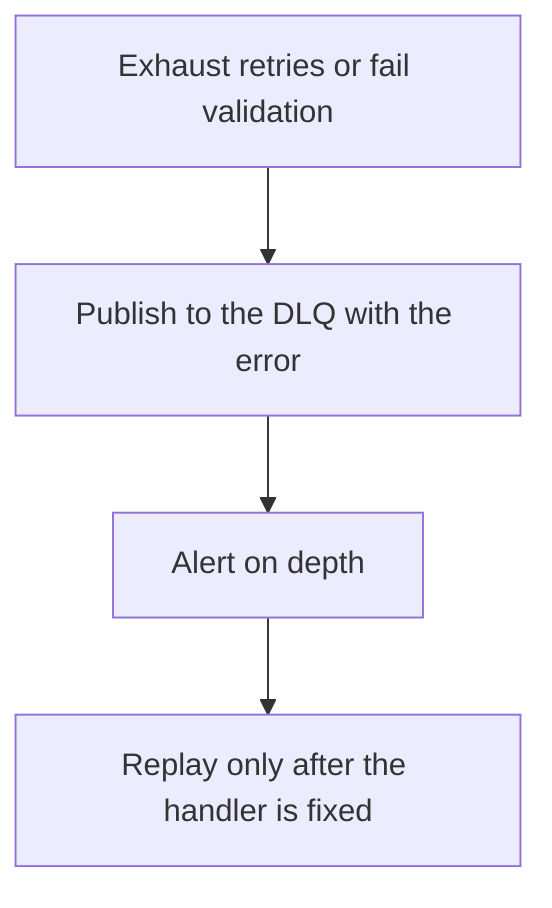

# D14-T013 — Dead-letter queues (DLQs)

Topic ID: `D14-T013`
Domain: Messaging and Event-Driven Architecture
Subdomain: Dead-letter queues (DLQs)
Importance: common
Complexity: advanced
Dependencies: `D14-T012`, `D14-T001`, `D04-T001`, `D04-T002`, `D05-T001`, `D05-T002`
Execution status of the code in section F: unexecuted

## A. Topic Overview

A dead-letter queue holds messages a consumer could not process after the retry policy ended, or that failed validation. It is a parking lot, not a trash can. Operators need the reason, the original payload, and a way to replay after a fix. A DLQ that nobody reads is a silent data loss. Poison messages should arrive there without stopping healthy traffic.

In production this shows up as follows: A consumer DLQs a message after five tries and pages when the queue is non-empty. A human or a tool replays it once the bug fix is deployed. Automatic replay without a fix recreates the outage.

Interviewers use Dead-letter queues (DLQs) to see whether you can state the failure mode, not only the definition. The failure to name is: an unmonitored DLQ, or a replay that sends the same poison back in a loop

Prerequisites: `D14-T012`, `D14-T001`, `D04-T001`, `D04-T002`, `D05-T001`, `D05-T002`. Later notes should link here instead of repeating the mechanism.

## B. First-Principles Explanation

A dead-letter queue holds messages a consumer could not process after the retry policy ended, or that failed validation. It is a parking lot, not a trash can. Operators need the reason, the original payload, and a way to replay after a fix. A DLQ that nobody reads is a silent data loss. Poison messages should arrive there without stopping healthy traffic.

The useful picture is: A dead-letter queue is the tray for forms the clerk could not file. Someone still has to look at the tray. Shredding it because it is out of the way loses the form.

What has to be true:

1. Exhaust retries or fail validation
2. Publish to the DLQ with the error
3. Alert on depth
4. Replay only after the handler is fixed

It works when those steps preserve one invariant. It fails when an unmonitored DLQ, or a replay that sends the same poison back in a loop. The alternative is: you drop them on the floor or you retry them forever on the main path

## C. Internal Working and Architecture

Components involved: the caller, the state Dead-letter queues (DLQs) mutates or reads, and the observer that reports DLQ depth and age of the oldest dead-lettered message.

Execution:

1. Exhaust retries or fail validation
2. Publish to the DLQ with the error
3. Alert on depth
4. Replay only after the handler is fixed

Data moves only along that path. A retry re-enters at step 1, so the operation must say what a duplicate does. Memory and locks stay inside this mechanism. Callers see the result or a typed error, not a half-updated invariant.

State to remember: choose this when some messages will fail for a reason a retry cannot cure. Do not choose it when you drop them on the floor or you retry them forever on the main path.

## D. Diagrams and Visual Models



Read the diagram from top to bottom. Each box is one step of Dead-letter queues (DLQs). The failure mode (an unmonitored DLQ, or a replay that sends the same poison back in a loop) is what you look for when a later box never happens or happens twice.

## E. Examples and Analogies

Analogy: A dead-letter queue is the tray for forms the clerk could not file. Someone still has to look at the tray. Shredding it because it is out of the way loses the form.

Production example: A consumer DLQs a message after five tries and pages when the queue is non-empty. A human or a tool replays it once the bug fix is deployed. Automatic replay without a fix recreates the outage.

A small counterexample is enough in an interview. Show the input, apply the steps, and show the broken outcome if someone uses the mechanism outside its rule: an unmonitored DLQ, or a replay that sends the same poison back in a loop.

## F. Code Examples

The snippet is labeled unexecuted. It illustrates the shape of the idea. It is not a benchmark and it embeds no secret.

```python
def dead_letter(event, reason):
    return {'event': event, 'reason': reason}
```

After the snippet, check DLQ depth and age of the oldest dead-lettered message. If that signal moves the wrong way, the snippet is the wrong tool for the workload.

## G. Practical Backend Application

Use Dead-letter queues (DLQs) in a service when some messages will fail for a reason a retry cannot cure.

A typical place is the production case already stated: A consumer DLQs a message after five tries and pages when the queue is non-empty. A human or a tool replays it once the bug fix is deployed. Automatic replay without a fix recreates the outage.

Operationally you alert on DLQ depth and age of the oldest dead-lettered message. You do not alert only on process uptime. The dashboard should show the failure mode, a success rate, and the saturation signal (queue depth, lock wait, or latency) that predicts it.

## H. Advantages, Limitations and Trade-offs

| Choice | Benefit | Cost | Choose when | Avoid when |
| --- | --- | --- | --- | --- |
| Apply Dead-letter queues (DLQs) | some messages will fail for a reason a retry cannot cure | Extra moving parts and a new failure mode | The failure you are preventing is already real | you drop them on the floor or you retry them forever on the main path |
| Simpler alternative | Less code and fewer dependencies | an unmonitored DLQ, or a replay that sends the same poison back in a loop | The workload does not hit the limit | The invariant must hold under concurrency or failure |

Dead-letter queues (DLQs) is a trade. State the benefit and the cost in the same sentence when you propose it in a design review.

## I. Common Mistakes and Misconceptions

- No alert.
- Replay without a fix.
- Stripping the failure reason.
- Treating a diagram of Dead-letter queues (DLQs) as proof that the invariant holds in production.
- Copying a default configuration without naming DLQ depth and age of the oldest dead-lettered message.

## J. Debugging and Troubleshooting

Symptom: an unmonitored DLQ, or a replay that sends the same poison back in a loop

First check: DLQ depth and age of the oldest dead-lettered message.

Then compare one healthy instance against one unhealthy instance. Confirm whether retries are duplicating work. Confirm whether a timeout is shorter than the work. Fix the invariant, then watch the same metric for a full peak, not only for the next minute.

Useful questions: did the step order in section C actually happen, or did a caller skip a step? Did a deploy change the data shape that Dead-letter queues (DLQs) assumes?

## K. Interview Preparation

### Beginner

#### Q1. What problem does Dead-letter queues (DLQs) solve?

**Answer:** A dead-letter queue holds messages a consumer could not process after the retry policy ended, or that failed validation. It is a parking lot, not a trash can. Operators need the reason, the original payload, and a way to replay after a fix. A DLQ that nobody reads is a silent data loss. Poison messages should arrive there without stopping healthy traffic. Without it, the usual backend failure is: an unmonitored DLQ, or a replay that sends the same poison back in a loop.

#### Q2. Where does Dead-letter queues (DLQs) sit on a request path?

**Answer:** Dead-letter queues (DLQs) is not a library you sprinkle on every call. some messages will fail for a reason a retry cannot cure You notice it when DLQ depth and age of the oldest dead-lettered message. Name the constraint that makes this choice correct. Say what you would measure to confirm it.

#### Q3. Give a concrete example of Dead-letter queues (DLQs).

**Answer:** A consumer DLQs a message after five tries and pages when the queue is non-empty. A human or a tool replays it once the bug fix is deployed. Automatic replay without a fix recreates the outage. Walk the input, the state change, and the observable output.

#### Q4. What is a common mix-up around Dead-letter queues (DLQs)?

**Answer:** an unmonitored DLQ, or a replay that sends the same poison back in a loop The corrective check is DLQ depth and age of the oldest dead-lettered message. Name the constraint that makes this choice correct. Say what you would measure to confirm it. Say which alternative you rejected and why.

#### Q5. When would you skip Dead-letter queues (DLQs)?

**Answer:** you drop them on the floor or you retry them forever on the main path Skipping is a decision with a measured cost, not a slogan. Name the constraint that makes this choice correct. Say what you would measure to confirm it. Say which alternative you rejected and why.

### Intermediate

#### Q1. What invariant makes Dead-letter queues (DLQs) correct?

**Answer:** A dead-letter queue holds messages a consumer could not process after the retry policy ended, or that failed validation. It is a parking lot, not a trash can. Operators need the reason, the original payload, and a way to replay after a fix. A DLQ that nobody reads is a silent data loss. Poison messages should arrive there without stopping healthy traffic. State the invariant before you name the tool.

#### Q2. How do you test Dead-letter queues (DLQs)?

**Answer:** Assert the failure mode directly: an unmonitored DLQ, or a replay that sends the same poison back in a loop. The assertion should watch DLQ depth and age of the oldest dead-lettered message. Include a concurrent or retry case if the bug only appears then. Name the constraint that makes this choice correct.

#### Q3. What signal tells you Dead-letter queues (DLQs) is misbehaving in production?

**Answer:** Watch DLQ depth and age of the oldest dead-lettered message. The user-visible symptom is usually an unmonitored DLQ, or a replay that sends the same poison back in a loop. Name the constraint that makes this choice correct. Say what you would measure to confirm it.

#### Q4. How would you introduce Dead-letter queues (DLQs) into a legacy service?

**Answer:** some messages will fail for a reason a retry cannot cure Ship it behind a metric so you can compare the old path. Roll back if an unmonitored DLQ, or a replay that sends the same poison back in a loop gets worse. Name the constraint that makes this choice correct. Say what you would measure to confirm it.

#### Q5. What do you trade away by choosing Dead-letter queues (DLQs)?

**Answer:** some messages will fail for a reason a retry cannot cure you drop them on the floor or you retry them forever on the main path Say the cost in latency, storage, or operational load. Name the constraint that makes this choice correct. Say what you would measure to confirm it. Say which alternative you rejected and why.

### Advanced

#### Q1. What breaks if a dependency of Dead-letter queues (DLQs) is slow or down?

**Answer:** an unmonitored DLQ, or a replay that sends the same poison back in a loop Degrade using the rule: you drop them on the floor or you retry them forever on the main path. Timeouts must be shorter than the caller's deadline. Name the constraint that makes this choice correct. Say what you would measure to confirm it.

#### Q2. How does Dead-letter queues (DLQs) behave under retries?

**Answer:** Retries repeat work, so Dead-letter queues (DLQs) must define what a duplicate does. an unmonitored DLQ, or a replay that sends the same poison back in a loop Idempotency keys or fences belong next to the write, not in a comment. Name the constraint that makes this choice correct. Say what you would measure to confirm it.

#### Q3. What is the capacity limit of Dead-letter queues (DLQs)?

**Answer:** The limit shows up as DLQ depth and age of the oldest dead-lettered message. Add capacity only after you know whether the bottleneck is CPU, lock wait, or network. Name the constraint that makes this choice correct. Say what you would measure to confirm it.

#### Q4. How do you evolve Dead-letter queues (DLQs) without a flag day?

**Answer:** some messages will fail for a reason a retry cannot cure Version the contract or the on-disk format. Readers should tolerate one old and one new shape during the rollout. Name the constraint that makes this choice correct. Say what you would measure to confirm it.

#### Q5. What security or correctness bug hides inside Dead-letter queues (DLQs)?

**Answer:** an unmonitored DLQ, or a replay that sends the same poison back in a loop Check authorization and tenancy at the same boundary as the mechanism. A cache or queue must not widen who can read the data. Name the constraint that makes this choice correct. Say what you would measure to confirm it.

### Scenario

#### Q1. Incident: an unmonitored DLQ, or a replay that sends the same poison back in a loop. What do you check first?

**Answer:** Start with DLQ depth and age of the oldest dead-lettered message. Compare a good host and a bad host before you restart anything. A dead-letter queue holds messages a consumer could not process after the retry policy ended, or that failed validation. It is a parking lot, not a trash can. Operators need the reason, the original payload, and a way to replay after a fix. A DLQ that nobody reads is a silent data loss. Poison messages should arrive there without stopping healthy traffic.

#### Q2. A reviewer wants the clever version. What data settles it?

**Answer:** some messages will fail for a reason a retry cannot cure you drop them on the floor or you retry them forever on the main path Bring DLQ depth and age of the oldest dead-lettered message from a load test or from production, not a slogan. Name the constraint that makes this choice correct. Say what you would measure to confirm it. Say which alternative you rejected and why.

#### Q3. You have one hour to explain Dead-letter queues (DLQs) at a whiteboard.

**Answer:** Draw the happy path in four boxes. Then draw the failure: an unmonitored DLQ, or a replay that sends the same poison back in a loop. End with the metric you would page on. Name the constraint that makes this choice correct.

#### Q4. The bug only appears under two concurrent callers.

**Answer:** an unmonitored DLQ, or a replay that sends the same poison back in a loop Reproduce with a barrier so both sides enter the critical window. Confirm the fix with DLQ depth and age of the oldest dead-lettered message. Name the constraint that makes this choice correct. Say what you would measure to confirm it.

#### Q5. Leadership wants this on every service next week.

**Answer:** you drop them on the floor or you retry them forever on the main path some messages will fail for a reason a retry cannot cure Roll it out where the failure mode is already hurting users. Name the constraint that makes this choice correct. Say what you would measure to confirm it. Say which alternative you rejected and why.

### Follow-up

#### Q1. What did you assume about the data size or the clock?

**Answer:** A dead-letter queue holds messages a consumer could not process after the retry policy ended, or that failed validation. It is a parking lot, not a trash can. Operators need the reason, the original payload, and a way to replay after a fix. A DLQ that nobody reads is a silent data loss. Poison messages should arrive there without stopping healthy traffic. Clocks are not a total order across machines. State whether the algorithm needs bounded size or a single leader.

#### Q2. What would you measure after the change ships?

**Answer:** Page on DLQ depth and age of the oldest dead-lettered message. Keep a before/after dashboard for one week. Alert on the failure mode, not only on CPU. Name the constraint that makes this choice correct.

#### Q3. Which neighboring topic did you deliberately not re-teach?

**Answer:** This note owns Dead-letter queues (DLQs). Related identifiers are in section N. Shared ideas are linked, not copied. Name the constraint that makes this choice correct.

## L. Practical Exercises

Solutions are in `EXERCISES/solutions/D14-T013.md`, not in this section.

1. Whiteboard the four steps of Dead-letter queues (DLQs) and mark where `an unmonitored DLQ, or a replay that sends the same poison back in a loop` enters.
2. Read the snippet in section F and write the assertion that would catch that failure. The assertion must mention `DLQ depth and age of the oldest dead-lettered message`.
3. Argue for or against using Dead-letter queues (DLQs) on a service you know. Use the choose and avoid rows from section H. Do not appeal to popularity.

## M. Revision Notes

- Mechanism: A dead-letter queue holds messages a consumer could not process after the retry policy ended, or that failed validation.
- Failure: an unmonitored DLQ, or a replay that sends the same poison back in a loop
- Metric: DLQ depth and age of the oldest dead-lettered message
- Choose when: some messages will fail for a reason a retry cannot cure
- Avoid when: you drop them on the floor or you retry them forever on the main path

## N. Related Topics

Dependencies to review first: `D14-T012`, `D14-T001`, `D04-T001`, `D04-T002`, `D05-T001`, `D05-T002`.

Shared ideas stay in those notes. This note does not restate them.

## O. Completion Criteria

- You can explain Dead-letter queues (DLQs) without reading this note, including the failure mode.
- You can draw the diagram in section D from memory.
- You can say when not to use it, using the avoid condition in section H.
- You can name the metric you would watch after shipping it.
