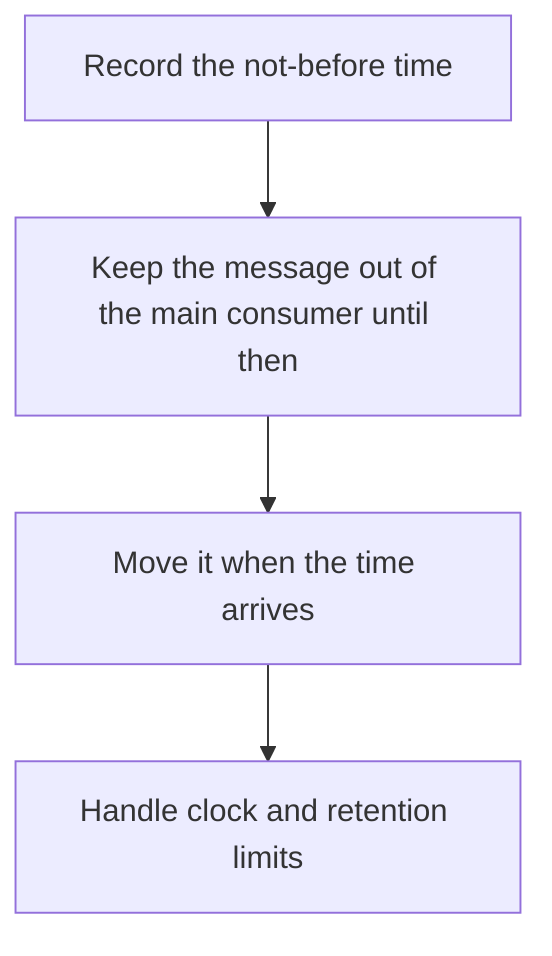

# D14-T014 — Delayed messages

Topic ID: `D14-T014`
Domain: Messaging and Event-Driven Architecture
Subdomain: Delayed messages
Importance: common
Complexity: advanced
Dependencies: `D14-T013`, `D14-T001`, `D04-T001`, `D04-T002`, `D05-T001`, `D05-T002`
Execution status of the code in section F: unexecuted

## A. Topic Overview

A delayed message becomes visible to consumers only after a timestamp. Implementations use a delay queue that a timer moves onto the real queue, or broker features such as delayed topics. The delay is for scheduled work, not for sleeping inside a handler. Order with non-delayed messages is not guaranteed. A delay longer than retention disappears.

In production this shows up as follows: A trial-ending email is published with a visible time of fourteen days later. A scheduler moves due messages onto the send topic. The worker does not hold a thread asleep for fourteen days.

Interviewers use Delayed messages to see whether you can state the failure mode, not only the definition. The failure to name is: a consumer sleeping in-process so a restart loses the delay, or a message whose delay exceeds retention

Prerequisites: `D14-T013`, `D14-T001`, `D04-T001`, `D04-T002`, `D05-T001`, `D05-T002`. Later notes should link here instead of repeating the mechanism.

## B. First-Principles Explanation

A delayed message becomes visible to consumers only after a timestamp. Implementations use a delay queue that a timer moves onto the real queue, or broker features such as delayed topics. The delay is for scheduled work, not for sleeping inside a handler. Order with non-delayed messages is not guaranteed. A delay longer than retention disappears.

The useful picture is: A delayed message is a letter with a 'do not open until' date sitting in a side drawer, not a clerk staring at the clock.

What has to be true:

1. Record the not-before time
2. Keep the message out of the main consumer until then
3. Move it when the time arrives
4. Handle clock and retention limits

It works when those steps preserve one invariant. It fails when a consumer sleeping in-process so a restart loses the delay, or a message whose delay exceeds retention. The alternative is: you sleep in the consumer and call it a delay queue

## C. Internal Working and Architecture

Components involved: the caller, the state Delayed messages mutates or reads, and the observer that reports on-time delivery rate and messages whose visible time is late.

Execution:

1. Record the not-before time
2. Keep the message out of the main consumer until then
3. Move it when the time arrives
4. Handle clock and retention limits

Data moves only along that path. A retry re-enters at step 1, so the operation must say what a duplicate does. Memory and locks stay inside this mechanism. Callers see the result or a typed error, not a half-updated invariant.

State to remember: choose this when work must wait without occupying a handler. Do not choose it when you sleep in the consumer and call it a delay queue.

## D. Diagrams and Visual Models



Read the diagram from top to bottom. Each box is one step of Delayed messages. The failure mode (a consumer sleeping in-process so a restart loses the delay, or a message whose delay exceeds retention) is what you look for when a later box never happens or happens twice.

## E. Examples and Analogies

Analogy: A delayed message is a letter with a 'do not open until' date sitting in a side drawer, not a clerk staring at the clock.

Production example: A trial-ending email is published with a visible time of fourteen days later. A scheduler moves due messages onto the send topic. The worker does not hold a thread asleep for fourteen days.

A small counterexample is enough in an interview. Show the input, apply the steps, and show the broken outcome if someone uses the mechanism outside its rule: a consumer sleeping in-process so a restart loses the delay, or a message whose delay exceeds retention.

## F. Code Examples

The snippet is labeled unexecuted. It illustrates the shape of the idea. It is not a benchmark and it embeds no secret.

```python
def visible(now, not_before):
    return now >= not_before
```

After the snippet, check on-time delivery rate and messages whose visible time is late. If that signal moves the wrong way, the snippet is the wrong tool for the workload.

## G. Practical Backend Application

Use Delayed messages in a service when work must wait without occupying a handler.

A typical place is the production case already stated: A trial-ending email is published with a visible time of fourteen days later. A scheduler moves due messages onto the send topic. The worker does not hold a thread asleep for fourteen days.

Operationally you alert on on-time delivery rate and messages whose visible time is late. You do not alert only on process uptime. The dashboard should show the failure mode, a success rate, and the saturation signal (queue depth, lock wait, or latency) that predicts it.

## H. Advantages, Limitations and Trade-offs

| Choice | Benefit | Cost | Choose when | Avoid when |
| --- | --- | --- | --- | --- |
| Apply Delayed messages | work must wait without occupying a handler | Extra moving parts and a new failure mode | The failure you are preventing is already real | you sleep in the consumer and call it a delay queue |
| Simpler alternative | Less code and fewer dependencies | a consumer sleeping in-process so a restart loses the delay, or a message whose delay exceeds retention | The workload does not hit the limit | The invariant must hold under concurrency or failure |

Delayed messages is a trade. State the benefit and the cost in the same sentence when you propose it in a design review.

## I. Common Mistakes and Misconceptions

- In-memory timers as the only copy.
- Delay past retention.
- Assuming FIFO with immediate messages.
- Treating a diagram of Delayed messages as proof that the invariant holds in production.
- Copying a default configuration without naming on-time delivery rate and messages whose visible time is late.

## J. Debugging and Troubleshooting

Symptom: a consumer sleeping in-process so a restart loses the delay, or a message whose delay exceeds retention

First check: on-time delivery rate and messages whose visible time is late.

Then compare one healthy instance against one unhealthy instance. Confirm whether retries are duplicating work. Confirm whether a timeout is shorter than the work. Fix the invariant, then watch the same metric for a full peak, not only for the next minute.

Useful questions: did the step order in section C actually happen, or did a caller skip a step? Did a deploy change the data shape that Delayed messages assumes?

## K. Interview Preparation

### Beginner

#### Q1. What problem does Delayed messages solve?

**Answer:** A delayed message becomes visible to consumers only after a timestamp. Implementations use a delay queue that a timer moves onto the real queue, or broker features such as delayed topics. The delay is for scheduled work, not for sleeping inside a handler. Order with non-delayed messages is not guaranteed. A delay longer than retention disappears. Without it, the usual backend failure is: a consumer sleeping in-process so a restart loses the delay, or a message whose delay exceeds retention.

#### Q2. Where does Delayed messages sit on a request path?

**Answer:** Delayed messages is not a library you sprinkle on every call. work must wait without occupying a handler You notice it when on-time delivery rate and messages whose visible time is late. Name the constraint that makes this choice correct. Say what you would measure to confirm it.

#### Q3. Give a concrete example of Delayed messages.

**Answer:** A trial-ending email is published with a visible time of fourteen days later. A scheduler moves due messages onto the send topic. The worker does not hold a thread asleep for fourteen days. Walk the input, the state change, and the observable output.

#### Q4. What is a common mix-up around Delayed messages?

**Answer:** a consumer sleeping in-process so a restart loses the delay, or a message whose delay exceeds retention The corrective check is on-time delivery rate and messages whose visible time is late. Name the constraint that makes this choice correct. Say what you would measure to confirm it. Say which alternative you rejected and why.

#### Q5. When would you skip Delayed messages?

**Answer:** you sleep in the consumer and call it a delay queue Skipping is a decision with a measured cost, not a slogan. Name the constraint that makes this choice correct. Say what you would measure to confirm it. Say which alternative you rejected and why.

### Intermediate

#### Q1. What invariant makes Delayed messages correct?

**Answer:** A delayed message becomes visible to consumers only after a timestamp. Implementations use a delay queue that a timer moves onto the real queue, or broker features such as delayed topics. The delay is for scheduled work, not for sleeping inside a handler. Order with non-delayed messages is not guaranteed. A delay longer than retention disappears. State the invariant before you name the tool.

#### Q2. How do you test Delayed messages?

**Answer:** Assert the failure mode directly: a consumer sleeping in-process so a restart loses the delay, or a message whose delay exceeds retention. The assertion should watch on-time delivery rate and messages whose visible time is late. Include a concurrent or retry case if the bug only appears then. Name the constraint that makes this choice correct.

#### Q3. What signal tells you Delayed messages is misbehaving in production?

**Answer:** Watch on-time delivery rate and messages whose visible time is late. The user-visible symptom is usually a consumer sleeping in-process so a restart loses the delay, or a message whose delay exceeds retention. Name the constraint that makes this choice correct. Say what you would measure to confirm it.

#### Q4. How would you introduce Delayed messages into a legacy service?

**Answer:** work must wait without occupying a handler Ship it behind a metric so you can compare the old path. Roll back if a consumer sleeping in-process so a restart loses the delay, or a message whose delay exceeds retention gets worse. Name the constraint that makes this choice correct. Say what you would measure to confirm it.

#### Q5. What do you trade away by choosing Delayed messages?

**Answer:** work must wait without occupying a handler you sleep in the consumer and call it a delay queue Say the cost in latency, storage, or operational load. Name the constraint that makes this choice correct. Say what you would measure to confirm it. Say which alternative you rejected and why.

### Advanced

#### Q1. What breaks if a dependency of Delayed messages is slow or down?

**Answer:** a consumer sleeping in-process so a restart loses the delay, or a message whose delay exceeds retention Degrade using the rule: you sleep in the consumer and call it a delay queue. Timeouts must be shorter than the caller's deadline. Name the constraint that makes this choice correct. Say what you would measure to confirm it.

#### Q2. How does Delayed messages behave under retries?

**Answer:** Retries repeat work, so Delayed messages must define what a duplicate does. a consumer sleeping in-process so a restart loses the delay, or a message whose delay exceeds retention Idempotency keys or fences belong next to the write, not in a comment. Name the constraint that makes this choice correct. Say what you would measure to confirm it.

#### Q3. What is the capacity limit of Delayed messages?

**Answer:** The limit shows up as on-time delivery rate and messages whose visible time is late. Add capacity only after you know whether the bottleneck is CPU, lock wait, or network. Name the constraint that makes this choice correct. Say what you would measure to confirm it.

#### Q4. How do you evolve Delayed messages without a flag day?

**Answer:** work must wait without occupying a handler Version the contract or the on-disk format. Readers should tolerate one old and one new shape during the rollout. Name the constraint that makes this choice correct. Say what you would measure to confirm it.

#### Q5. What security or correctness bug hides inside Delayed messages?

**Answer:** a consumer sleeping in-process so a restart loses the delay, or a message whose delay exceeds retention Check authorization and tenancy at the same boundary as the mechanism. A cache or queue must not widen who can read the data. Name the constraint that makes this choice correct. Say what you would measure to confirm it.

### Scenario

#### Q1. Incident: a consumer sleeping in-process so a restart loses the delay, or a message whose delay exceeds retention. What do you check first?

**Answer:** Start with on-time delivery rate and messages whose visible time is late. Compare a good host and a bad host before you restart anything. A delayed message becomes visible to consumers only after a timestamp. Implementations use a delay queue that a timer moves onto the real queue, or broker features such as delayed topics. The delay is for scheduled work, not for sleeping inside a handler. Order with non-delayed messages is not guaranteed. A delay longer than retention disappears.

#### Q2. A reviewer wants the clever version. What data settles it?

**Answer:** work must wait without occupying a handler you sleep in the consumer and call it a delay queue Bring on-time delivery rate and messages whose visible time is late from a load test or from production, not a slogan. Name the constraint that makes this choice correct. Say what you would measure to confirm it. Say which alternative you rejected and why.

#### Q3. You have one hour to explain Delayed messages at a whiteboard.

**Answer:** Draw the happy path in four boxes. Then draw the failure: a consumer sleeping in-process so a restart loses the delay, or a message whose delay exceeds retention. End with the metric you would page on. Name the constraint that makes this choice correct.

#### Q4. The bug only appears under two concurrent callers.

**Answer:** a consumer sleeping in-process so a restart loses the delay, or a message whose delay exceeds retention Reproduce with a barrier so both sides enter the critical window. Confirm the fix with on-time delivery rate and messages whose visible time is late. Name the constraint that makes this choice correct. Say what you would measure to confirm it.

#### Q5. Leadership wants this on every service next week.

**Answer:** you sleep in the consumer and call it a delay queue work must wait without occupying a handler Roll it out where the failure mode is already hurting users. Name the constraint that makes this choice correct. Say what you would measure to confirm it. Say which alternative you rejected and why.

### Follow-up

#### Q1. What did you assume about the data size or the clock?

**Answer:** A delayed message becomes visible to consumers only after a timestamp. Implementations use a delay queue that a timer moves onto the real queue, or broker features such as delayed topics. The delay is for scheduled work, not for sleeping inside a handler. Order with non-delayed messages is not guaranteed. A delay longer than retention disappears. Clocks are not a total order across machines. State whether the algorithm needs bounded size or a single leader.

#### Q2. What would you measure after the change ships?

**Answer:** Page on on-time delivery rate and messages whose visible time is late. Keep a before/after dashboard for one week. Alert on the failure mode, not only on CPU. Name the constraint that makes this choice correct.

#### Q3. Which neighboring topic did you deliberately not re-teach?

**Answer:** This note owns Delayed messages. Related identifiers are in section N. Shared ideas are linked, not copied. Name the constraint that makes this choice correct.

## L. Practical Exercises

Solutions are in `EXERCISES/solutions/D14-T014.md`, not in this section.

1. Whiteboard the four steps of Delayed messages and mark where `a consumer sleeping in-process so a restart loses the delay, or a message whose delay exceeds retention` enters.
2. Read the snippet in section F and write the assertion that would catch that failure. The assertion must mention `on-time delivery rate and messages whose visible time is late`.
3. Argue for or against using Delayed messages on a service you know. Use the choose and avoid rows from section H. Do not appeal to popularity.

## M. Revision Notes

- Mechanism: A delayed message becomes visible to consumers only after a timestamp.
- Failure: a consumer sleeping in-process so a restart loses the delay, or a message whose delay exceeds retention
- Metric: on-time delivery rate and messages whose visible time is late
- Choose when: work must wait without occupying a handler
- Avoid when: you sleep in the consumer and call it a delay queue

## N. Related Topics

Dependencies to review first: `D14-T013`, `D14-T001`, `D04-T001`, `D04-T002`, `D05-T001`, `D05-T002`.

Shared ideas stay in those notes. This note does not restate them.

## O. Completion Criteria

- You can explain Delayed messages without reading this note, including the failure mode.
- You can draw the diagram in section D from memory.
- You can say when not to use it, using the avoid condition in section H.
- You can name the metric you would watch after shipping it.
