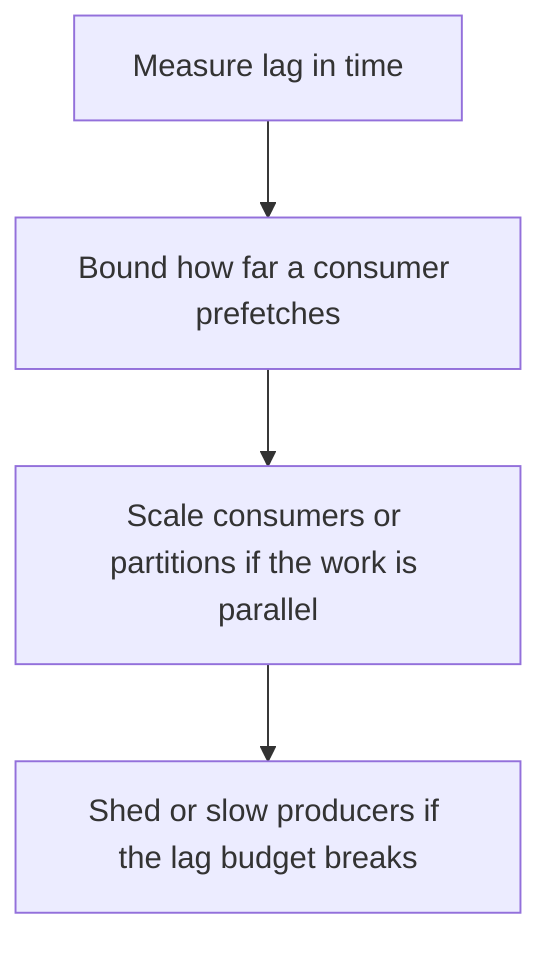

# D14-T015 — Backpressure and consumer lag

Topic ID: `D14-T015`
Domain: Messaging and Event-Driven Architecture
Subdomain: Backpressure and consumer lag
Importance: common
Complexity: advanced
Dependencies: `D14-T014`, `D14-T001`, `D04-T001`, `D04-T002`, `D05-T001`, `D05-T002`
Execution status of the code in section F: unexecuted

## A. Topic Overview

Backpressure in a log means consumers fall behind and the lag grows. The broker keeps the bytes until retention. That protects producers and risks disk fill and stale processing. A consumer applies backpressure by not fetching more than it can handle. A producer applies it by blocking or failing when the broker rejects. Lag is the age of unprocessed records, not only the count.

In production this shows up as follows: An orders topic gains ten minutes of lag. Autoscaling consumers helps only up to the partition count. If one key is hot, scaling does nothing and the fix is the key design.

Interviewers use Backpressure and consumer lag to see whether you can state the failure mode, not only the definition. The failure to name is: a disk full of retained bytes, or a consumer that prefetches a huge batch and then stalls the group

Prerequisites: `D14-T014`, `D14-T001`, `D04-T001`, `D04-T002`, `D05-T001`, `D05-T002`. Later notes should link here instead of repeating the mechanism.

## B. First-Principles Explanation

Backpressure in a log means consumers fall behind and the lag grows. The broker keeps the bytes until retention. That protects producers and risks disk fill and stale processing. A consumer applies backpressure by not fetching more than it can handle. A producer applies it by blocking or failing when the broker rejects. Lag is the age of unprocessed records, not only the count.

The useful picture is: Backpressure is the line of unwashed plates. Lag in minutes is how long the oldest plate has been sitting. A count of plates without the age hides a stuck burner.

What has to be true:

1. Measure lag in time
2. Bound how far a consumer prefetches
3. Scale consumers or partitions if the work is parallel
4. Shed or slow producers if the lag budget breaks

It works when those steps preserve one invariant. It fails when a disk full of retained bytes, or a consumer that prefetches a huge batch and then stalls the group. The alternative is: you alert on message count and miss a stuck partition whose count looks small

## C. Internal Working and Architecture

Components involved: the caller, the state Backpressure and consumer lag mutates or reads, and the observer that reports time lag per partition and disk usage of the log.

Execution:

1. Measure lag in time
2. Bound how far a consumer prefetches
3. Scale consumers or partitions if the work is parallel
4. Shed or slow producers if the lag budget breaks

Data moves only along that path. A retry re-enters at step 1, so the operation must say what a duplicate does. Memory and locks stay inside this mechanism. Callers see the result or a typed error, not a half-updated invariant.

State to remember: choose this when producers and consumers run at different speeds. Do not choose it when you alert on message count and miss a stuck partition whose count looks small.

## D. Diagrams and Visual Models



Read the diagram from top to bottom. Each box is one step of Backpressure and consumer lag. The failure mode (a disk full of retained bytes, or a consumer that prefetches a huge batch and then stalls the group) is what you look for when a later box never happens or happens twice.

## E. Examples and Analogies

Analogy: Backpressure is the line of unwashed plates. Lag in minutes is how long the oldest plate has been sitting. A count of plates without the age hides a stuck burner.

Production example: An orders topic gains ten minutes of lag. Autoscaling consumers helps only up to the partition count. If one key is hot, scaling does nothing and the fix is the key design.

A small counterexample is enough in an interview. Show the input, apply the steps, and show the broken outcome if someone uses the mechanism outside its rule: a disk full of retained bytes, or a consumer that prefetches a huge batch and then stalls the group.

## F. Code Examples

The snippet is labeled unexecuted. It illustrates the shape of the idea. It is not a benchmark and it embeds no secret.

```python
def over_budget(lag_seconds, budget):
    return lag_seconds > budget
```

After the snippet, check time lag per partition and disk usage of the log. If that signal moves the wrong way, the snippet is the wrong tool for the workload.

## G. Practical Backend Application

Use Backpressure and consumer lag in a service when producers and consumers run at different speeds.

A typical place is the production case already stated: An orders topic gains ten minutes of lag. Autoscaling consumers helps only up to the partition count. If one key is hot, scaling does nothing and the fix is the key design.

Operationally you alert on time lag per partition and disk usage of the log. You do not alert only on process uptime. The dashboard should show the failure mode, a success rate, and the saturation signal (queue depth, lock wait, or latency) that predicts it.

## H. Advantages, Limitations and Trade-offs

| Choice | Benefit | Cost | Choose when | Avoid when |
| --- | --- | --- | --- | --- |
| Apply Backpressure and consumer lag | producers and consumers run at different speeds | Extra moving parts and a new failure mode | The failure you are preventing is already real | you alert on message count and miss a stuck partition whose count looks small |
| Simpler alternative | Less code and fewer dependencies | a disk full of retained bytes, or a consumer that prefetches a huge batch and then stalls the group | The workload does not hit the limit | The invariant must hold under concurrency or failure |

Backpressure and consumer lag is a trade. State the benefit and the cost in the same sentence when you propose it in a design review.

## I. Common Mistakes and Misconceptions

- Infinite retention with no disk alarm.
- Prefetch far beyond the handler.
- Adding consumers beyond partitions and expecting speed.
- Treating a diagram of Backpressure and consumer lag as proof that the invariant holds in production.
- Copying a default configuration without naming time lag per partition and disk usage of the log.

## J. Debugging and Troubleshooting

Symptom: a disk full of retained bytes, or a consumer that prefetches a huge batch and then stalls the group

First check: time lag per partition and disk usage of the log.

Then compare one healthy instance against one unhealthy instance. Confirm whether retries are duplicating work. Confirm whether a timeout is shorter than the work. Fix the invariant, then watch the same metric for a full peak, not only for the next minute.

Useful questions: did the step order in section C actually happen, or did a caller skip a step? Did a deploy change the data shape that Backpressure and consumer lag assumes?

## K. Interview Preparation

### Beginner

#### Q1. What problem does Backpressure and consumer lag solve?

**Answer:** Backpressure in a log means consumers fall behind and the lag grows. The broker keeps the bytes until retention. That protects producers and risks disk fill and stale processing. A consumer applies backpressure by not fetching more than it can handle. A producer applies it by blocking or failing when the broker rejects. Lag is the age of unprocessed records, not only the count. Without it, the usual backend failure is: a disk full of retained bytes, or a consumer that prefetches a huge batch and then stalls the group.

#### Q2. Where does Backpressure and consumer lag sit on a request path?

**Answer:** Backpressure and consumer lag is not a library you sprinkle on every call. producers and consumers run at different speeds You notice it when time lag per partition and disk usage of the log. Name the constraint that makes this choice correct. Say what you would measure to confirm it.

#### Q3. Give a concrete example of Backpressure and consumer lag.

**Answer:** An orders topic gains ten minutes of lag. Autoscaling consumers helps only up to the partition count. If one key is hot, scaling does nothing and the fix is the key design. Walk the input, the state change, and the observable output.

#### Q4. What is a common mix-up around Backpressure and consumer lag?

**Answer:** a disk full of retained bytes, or a consumer that prefetches a huge batch and then stalls the group The corrective check is time lag per partition and disk usage of the log. Name the constraint that makes this choice correct. Say what you would measure to confirm it. Say which alternative you rejected and why.

#### Q5. When would you skip Backpressure and consumer lag?

**Answer:** you alert on message count and miss a stuck partition whose count looks small Skipping is a decision with a measured cost, not a slogan. Name the constraint that makes this choice correct. Say what you would measure to confirm it. Say which alternative you rejected and why.

### Intermediate

#### Q1. What invariant makes Backpressure and consumer lag correct?

**Answer:** Backpressure in a log means consumers fall behind and the lag grows. The broker keeps the bytes until retention. That protects producers and risks disk fill and stale processing. A consumer applies backpressure by not fetching more than it can handle. A producer applies it by blocking or failing when the broker rejects. Lag is the age of unprocessed records, not only the count. State the invariant before you name the tool.

#### Q2. How do you test Backpressure and consumer lag?

**Answer:** Assert the failure mode directly: a disk full of retained bytes, or a consumer that prefetches a huge batch and then stalls the group. The assertion should watch time lag per partition and disk usage of the log. Include a concurrent or retry case if the bug only appears then. Name the constraint that makes this choice correct.

#### Q3. What signal tells you Backpressure and consumer lag is misbehaving in production?

**Answer:** Watch time lag per partition and disk usage of the log. The user-visible symptom is usually a disk full of retained bytes, or a consumer that prefetches a huge batch and then stalls the group. Name the constraint that makes this choice correct. Say what you would measure to confirm it.

#### Q4. How would you introduce Backpressure and consumer lag into a legacy service?

**Answer:** producers and consumers run at different speeds Ship it behind a metric so you can compare the old path. Roll back if a disk full of retained bytes, or a consumer that prefetches a huge batch and then stalls the group gets worse. Name the constraint that makes this choice correct. Say what you would measure to confirm it.

#### Q5. What do you trade away by choosing Backpressure and consumer lag?

**Answer:** producers and consumers run at different speeds you alert on message count and miss a stuck partition whose count looks small Say the cost in latency, storage, or operational load. Name the constraint that makes this choice correct. Say what you would measure to confirm it. Say which alternative you rejected and why.

### Advanced

#### Q1. What breaks if a dependency of Backpressure and consumer lag is slow or down?

**Answer:** a disk full of retained bytes, or a consumer that prefetches a huge batch and then stalls the group Degrade using the rule: you alert on message count and miss a stuck partition whose count looks small. Timeouts must be shorter than the caller's deadline. Name the constraint that makes this choice correct. Say what you would measure to confirm it.

#### Q2. How does Backpressure and consumer lag behave under retries?

**Answer:** Retries repeat work, so Backpressure and consumer lag must define what a duplicate does. a disk full of retained bytes, or a consumer that prefetches a huge batch and then stalls the group Idempotency keys or fences belong next to the write, not in a comment. Name the constraint that makes this choice correct. Say what you would measure to confirm it.

#### Q3. What is the capacity limit of Backpressure and consumer lag?

**Answer:** The limit shows up as time lag per partition and disk usage of the log. Add capacity only after you know whether the bottleneck is CPU, lock wait, or network. Name the constraint that makes this choice correct. Say what you would measure to confirm it.

#### Q4. How do you evolve Backpressure and consumer lag without a flag day?

**Answer:** producers and consumers run at different speeds Version the contract or the on-disk format. Readers should tolerate one old and one new shape during the rollout. Name the constraint that makes this choice correct. Say what you would measure to confirm it.

#### Q5. What security or correctness bug hides inside Backpressure and consumer lag?

**Answer:** a disk full of retained bytes, or a consumer that prefetches a huge batch and then stalls the group Check authorization and tenancy at the same boundary as the mechanism. A cache or queue must not widen who can read the data. Name the constraint that makes this choice correct. Say what you would measure to confirm it.

### Scenario

#### Q1. Incident: a disk full of retained bytes, or a consumer that prefetches a huge batch and then stalls the group. What do you check first?

**Answer:** Start with time lag per partition and disk usage of the log. Compare a good host and a bad host before you restart anything. Backpressure in a log means consumers fall behind and the lag grows. The broker keeps the bytes until retention. That protects producers and risks disk fill and stale processing. A consumer applies backpressure by not fetching more than it can handle. A producer applies it by blocking or failing when the broker rejects. Lag is the age of unprocessed records, not only the count.

#### Q2. A reviewer wants the clever version. What data settles it?

**Answer:** producers and consumers run at different speeds you alert on message count and miss a stuck partition whose count looks small Bring time lag per partition and disk usage of the log from a load test or from production, not a slogan. Name the constraint that makes this choice correct. Say what you would measure to confirm it. Say which alternative you rejected and why.

#### Q3. You have one hour to explain Backpressure and consumer lag at a whiteboard.

**Answer:** Draw the happy path in four boxes. Then draw the failure: a disk full of retained bytes, or a consumer that prefetches a huge batch and then stalls the group. End with the metric you would page on. Name the constraint that makes this choice correct.

#### Q4. The bug only appears under two concurrent callers.

**Answer:** a disk full of retained bytes, or a consumer that prefetches a huge batch and then stalls the group Reproduce with a barrier so both sides enter the critical window. Confirm the fix with time lag per partition and disk usage of the log. Name the constraint that makes this choice correct. Say what you would measure to confirm it.

#### Q5. Leadership wants this on every service next week.

**Answer:** you alert on message count and miss a stuck partition whose count looks small producers and consumers run at different speeds Roll it out where the failure mode is already hurting users. Name the constraint that makes this choice correct. Say what you would measure to confirm it. Say which alternative you rejected and why.

### Follow-up

#### Q1. What did you assume about the data size or the clock?

**Answer:** Backpressure in a log means consumers fall behind and the lag grows. The broker keeps the bytes until retention. That protects producers and risks disk fill and stale processing. A consumer applies backpressure by not fetching more than it can handle. A producer applies it by blocking or failing when the broker rejects. Lag is the age of unprocessed records, not only the count. Clocks are not a total order across machines. State whether the algorithm needs bounded size or a single leader.

#### Q2. What would you measure after the change ships?

**Answer:** Page on time lag per partition and disk usage of the log. Keep a before/after dashboard for one week. Alert on the failure mode, not only on CPU. Name the constraint that makes this choice correct.

#### Q3. Which neighboring topic did you deliberately not re-teach?

**Answer:** This note owns Backpressure and consumer lag. Related identifiers are in section N. Shared ideas are linked, not copied. Name the constraint that makes this choice correct.

## L. Practical Exercises

Solutions are in `EXERCISES/solutions/D14-T015.md`, not in this section.

1. Whiteboard the four steps of Backpressure and consumer lag and mark where `a disk full of retained bytes, or a consumer that prefetches a huge batch and then stalls the group` enters.
2. Read the snippet in section F and write the assertion that would catch that failure. The assertion must mention `time lag per partition and disk usage of the log`.
3. Argue for or against using Backpressure and consumer lag on a service you know. Use the choose and avoid rows from section H. Do not appeal to popularity.

## M. Revision Notes

- Mechanism: Backpressure in a log means consumers fall behind and the lag grows.
- Failure: a disk full of retained bytes, or a consumer that prefetches a huge batch and then stalls the group
- Metric: time lag per partition and disk usage of the log
- Choose when: producers and consumers run at different speeds
- Avoid when: you alert on message count and miss a stuck partition whose count looks small

## N. Related Topics

Dependencies to review first: `D14-T014`, `D14-T001`, `D04-T001`, `D04-T002`, `D05-T001`, `D05-T002`.

Shared ideas stay in those notes. This note does not restate them.

## O. Completion Criteria

- You can explain Backpressure and consumer lag without reading this note, including the failure mode.
- You can draw the diagram in section D from memory.
- You can say when not to use it, using the avoid condition in section H.
- You can name the metric you would watch after shipping it.
