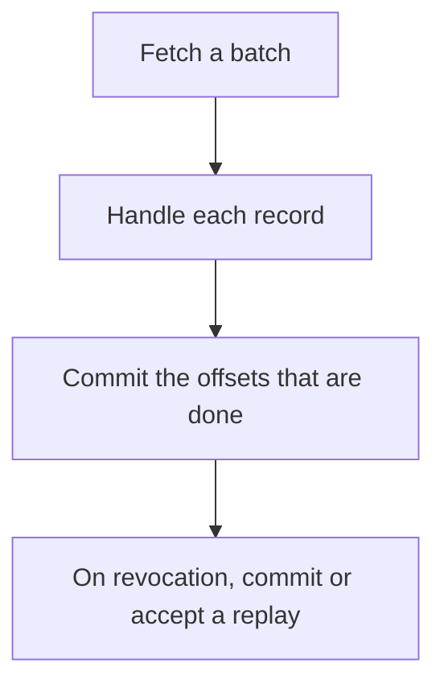

# D14-T016 — Offset commits

Topic ID: `D14-T016`
Domain: Messaging and Event-Driven Architecture
Subdomain: Offset commits
Importance: common
Complexity: advanced
Dependencies: `D14-T015`, `D14-T001`, `D04-T001`, `D04-T002`, `D05-T001`, `D05-T002`
Execution status of the code in section F: unexecuted

## A. Topic Overview

An offset commit records how far a consumer group has processed a partition. Committing after a successful handle gives at-least-once. Committing before gives at-most-once. Auto-commit on an interval commits whatever was fetched, which can skip failed records or replay a large batch. Commits are per partition. A commit during a rebalance must happen before the partition is given away.

In production this shows up as follows: The consumer commits offsets for records whose database transaction committed. It does not auto-commit on a timer. After a crash, only the uncommitted tail is replayed.

Interviewers use Offset commits to see whether you can state the failure mode, not only the definition. The failure to name is: auto-commit marking a failed record as done, or a commit of a later offset while an earlier one failed

Prerequisites: `D14-T015`, `D14-T001`, `D04-T001`, `D04-T002`, `D05-T001`, `D05-T002`. Later notes should link here instead of repeating the mechanism.

## B. First-Principles Explanation

An offset commit records how far a consumer group has processed a partition. Committing after a successful handle gives at-least-once. Committing before gives at-most-once. Auto-commit on an interval commits whatever was fetched, which can skip failed records or replay a large batch. Commits are per partition. A commit during a rebalance must happen before the partition is given away.

The useful picture is: The offset is a bookmark. Moving the bookmark past a chapter you did not understand is how that chapter is never read again.

What has to be true:

1. Fetch a batch
2. Handle each record
3. Commit the offsets that are done
4. On revocation, commit or accept a replay

It works when those steps preserve one invariant. It fails when auto-commit marking a failed record as done, or a commit of a later offset while an earlier one failed. The alternative is: you commit the highest offset even though a middle record failed

## C. Internal Working and Architecture

Components involved: the caller, the state Offset commits mutates or reads, and the observer that reports replayed records after a restart, and skipped records after a crash.

Execution:

1. Fetch a batch
2. Handle each record
3. Commit the offsets that are done
4. On revocation, commit or accept a replay

Data moves only along that path. A retry re-enters at step 1, so the operation must say what a duplicate does. Memory and locks stay inside this mechanism. Callers see the result or a typed error, not a half-updated invariant.

State to remember: choose this when a group must resume after a restart. Do not choose it when you commit the highest offset even though a middle record failed.

## D. Diagrams and Visual Models



Read the diagram from top to bottom. Each box is one step of Offset commits. The failure mode (auto-commit marking a failed record as done, or a commit of a later offset while an earlier one failed) is what you look for when a later box never happens or happens twice.

## E. Examples and Analogies

Analogy: The offset is a bookmark. Moving the bookmark past a chapter you did not understand is how that chapter is never read again.

Production example: The consumer commits offsets for records whose database transaction committed. It does not auto-commit on a timer. After a crash, only the uncommitted tail is replayed.

A small counterexample is enough in an interview. Show the input, apply the steps, and show the broken outcome if someone uses the mechanism outside its rule: auto-commit marking a failed record as done, or a commit of a later offset while an earlier one failed.

## F. Code Examples

The snippet is labeled unexecuted. It illustrates the shape of the idea. It is not a benchmark and it embeds no secret.

```python
def next_commit(succeeded_offset):
    return succeeded_offset + 1
```

After the snippet, check replayed records after a restart, and skipped records after a crash. If that signal moves the wrong way, the snippet is the wrong tool for the workload.

## G. Practical Backend Application

Use Offset commits in a service when a group must resume after a restart.

A typical place is the production case already stated: The consumer commits offsets for records whose database transaction committed. It does not auto-commit on a timer. After a crash, only the uncommitted tail is replayed.

Operationally you alert on replayed records after a restart, and skipped records after a crash. You do not alert only on process uptime. The dashboard should show the failure mode, a success rate, and the saturation signal (queue depth, lock wait, or latency) that predicts it.

## H. Advantages, Limitations and Trade-offs

| Choice | Benefit | Cost | Choose when | Avoid when |
| --- | --- | --- | --- | --- |
| Apply Offset commits | a group must resume after a restart | Extra moving parts and a new failure mode | The failure you are preventing is already real | you commit the highest offset even though a middle record failed |
| Simpler alternative | Less code and fewer dependencies | auto-commit marking a failed record as done, or a commit of a later offset while an earlier one failed | The workload does not hit the limit | The invariant must hold under concurrency or failure |

Offset commits is a trade. State the benefit and the cost in the same sentence when you propose it in a design review.

## I. Common Mistakes and Misconceptions

- Auto-commit with a slow handler.
- Committing before the side effect.
- One commit covering a batch that partially failed.
- Treating a diagram of Offset commits as proof that the invariant holds in production.
- Copying a default configuration without naming replayed records after a restart, and skipped records after a crash.

## J. Debugging and Troubleshooting

Symptom: auto-commit marking a failed record as done, or a commit of a later offset while an earlier one failed

First check: replayed records after a restart, and skipped records after a crash.

Then compare one healthy instance against one unhealthy instance. Confirm whether retries are duplicating work. Confirm whether a timeout is shorter than the work. Fix the invariant, then watch the same metric for a full peak, not only for the next minute.

Useful questions: did the step order in section C actually happen, or did a caller skip a step? Did a deploy change the data shape that Offset commits assumes?

## K. Interview Preparation

### Beginner

#### Q1. What problem does Offset commits solve?

**Answer:** An offset commit records how far a consumer group has processed a partition. Committing after a successful handle gives at-least-once. Committing before gives at-most-once. Auto-commit on an interval commits whatever was fetched, which can skip failed records or replay a large batch. Commits are per partition. A commit during a rebalance must happen before the partition is given away. Without it, the usual backend failure is: auto-commit marking a failed record as done, or a commit of a later offset while an earlier one failed.

#### Q2. Where does Offset commits sit on a request path?

**Answer:** Offset commits is not a library you sprinkle on every call. a group must resume after a restart You notice it when replayed records after a restart, and skipped records after a crash. Name the constraint that makes this choice correct. Say what you would measure to confirm it.

#### Q3. Give a concrete example of Offset commits.

**Answer:** The consumer commits offsets for records whose database transaction committed. It does not auto-commit on a timer. After a crash, only the uncommitted tail is replayed. Walk the input, the state change, and the observable output.

#### Q4. What is a common mix-up around Offset commits?

**Answer:** auto-commit marking a failed record as done, or a commit of a later offset while an earlier one failed The corrective check is replayed records after a restart, and skipped records after a crash. Name the constraint that makes this choice correct. Say what you would measure to confirm it. Say which alternative you rejected and why.

#### Q5. When would you skip Offset commits?

**Answer:** you commit the highest offset even though a middle record failed Skipping is a decision with a measured cost, not a slogan. Name the constraint that makes this choice correct. Say what you would measure to confirm it. Say which alternative you rejected and why.

### Intermediate

#### Q1. What invariant makes Offset commits correct?

**Answer:** An offset commit records how far a consumer group has processed a partition. Committing after a successful handle gives at-least-once. Committing before gives at-most-once. Auto-commit on an interval commits whatever was fetched, which can skip failed records or replay a large batch. Commits are per partition. A commit during a rebalance must happen before the partition is given away. State the invariant before you name the tool.

#### Q2. How do you test Offset commits?

**Answer:** Assert the failure mode directly: auto-commit marking a failed record as done, or a commit of a later offset while an earlier one failed. The assertion should watch replayed records after a restart, and skipped records after a crash. Include a concurrent or retry case if the bug only appears then. Name the constraint that makes this choice correct.

#### Q3. What signal tells you Offset commits is misbehaving in production?

**Answer:** Watch replayed records after a restart, and skipped records after a crash. The user-visible symptom is usually auto-commit marking a failed record as done, or a commit of a later offset while an earlier one failed. Name the constraint that makes this choice correct. Say what you would measure to confirm it.

#### Q4. How would you introduce Offset commits into a legacy service?

**Answer:** a group must resume after a restart Ship it behind a metric so you can compare the old path. Roll back if auto-commit marking a failed record as done, or a commit of a later offset while an earlier one failed gets worse. Name the constraint that makes this choice correct. Say what you would measure to confirm it.

#### Q5. What do you trade away by choosing Offset commits?

**Answer:** a group must resume after a restart you commit the highest offset even though a middle record failed Say the cost in latency, storage, or operational load. Name the constraint that makes this choice correct. Say what you would measure to confirm it. Say which alternative you rejected and why.

### Advanced

#### Q1. What breaks if a dependency of Offset commits is slow or down?

**Answer:** auto-commit marking a failed record as done, or a commit of a later offset while an earlier one failed Degrade using the rule: you commit the highest offset even though a middle record failed. Timeouts must be shorter than the caller's deadline. Name the constraint that makes this choice correct. Say what you would measure to confirm it.

#### Q2. How does Offset commits behave under retries?

**Answer:** Retries repeat work, so Offset commits must define what a duplicate does. auto-commit marking a failed record as done, or a commit of a later offset while an earlier one failed Idempotency keys or fences belong next to the write, not in a comment. Name the constraint that makes this choice correct. Say what you would measure to confirm it.

#### Q3. What is the capacity limit of Offset commits?

**Answer:** The limit shows up as replayed records after a restart, and skipped records after a crash. Add capacity only after you know whether the bottleneck is CPU, lock wait, or network. Name the constraint that makes this choice correct. Say what you would measure to confirm it.

#### Q4. How do you evolve Offset commits without a flag day?

**Answer:** a group must resume after a restart Version the contract or the on-disk format. Readers should tolerate one old and one new shape during the rollout. Name the constraint that makes this choice correct. Say what you would measure to confirm it.

#### Q5. What security or correctness bug hides inside Offset commits?

**Answer:** auto-commit marking a failed record as done, or a commit of a later offset while an earlier one failed Check authorization and tenancy at the same boundary as the mechanism. A cache or queue must not widen who can read the data. Name the constraint that makes this choice correct. Say what you would measure to confirm it.

### Scenario

#### Q1. Incident: auto-commit marking a failed record as done, or a commit of a later offset while an earlier one failed. What do you check first?

**Answer:** Start with replayed records after a restart, and skipped records after a crash. Compare a good host and a bad host before you restart anything. An offset commit records how far a consumer group has processed a partition. Committing after a successful handle gives at-least-once. Committing before gives at-most-once. Auto-commit on an interval commits whatever was fetched, which can skip failed records or replay a large batch. Commits are per partition. A commit during a rebalance must happen before the partition is given away.

#### Q2. A reviewer wants the clever version. What data settles it?

**Answer:** a group must resume after a restart you commit the highest offset even though a middle record failed Bring replayed records after a restart, and skipped records after a crash from a load test or from production, not a slogan. Name the constraint that makes this choice correct. Say what you would measure to confirm it. Say which alternative you rejected and why.

#### Q3. You have one hour to explain Offset commits at a whiteboard.

**Answer:** Draw the happy path in four boxes. Then draw the failure: auto-commit marking a failed record as done, or a commit of a later offset while an earlier one failed. End with the metric you would page on. Name the constraint that makes this choice correct.

#### Q4. The bug only appears under two concurrent callers.

**Answer:** auto-commit marking a failed record as done, or a commit of a later offset while an earlier one failed Reproduce with a barrier so both sides enter the critical window. Confirm the fix with replayed records after a restart, and skipped records after a crash. Name the constraint that makes this choice correct. Say what you would measure to confirm it.

#### Q5. Leadership wants this on every service next week.

**Answer:** you commit the highest offset even though a middle record failed a group must resume after a restart Roll it out where the failure mode is already hurting users. Name the constraint that makes this choice correct. Say what you would measure to confirm it. Say which alternative you rejected and why.

### Follow-up

#### Q1. What did you assume about the data size or the clock?

**Answer:** An offset commit records how far a consumer group has processed a partition. Committing after a successful handle gives at-least-once. Committing before gives at-most-once. Auto-commit on an interval commits whatever was fetched, which can skip failed records or replay a large batch. Commits are per partition. A commit during a rebalance must happen before the partition is given away. Clocks are not a total order across machines. State whether the algorithm needs bounded size or a single leader.

#### Q2. What would you measure after the change ships?

**Answer:** Page on replayed records after a restart, and skipped records after a crash. Keep a before/after dashboard for one week. Alert on the failure mode, not only on CPU. Name the constraint that makes this choice correct.

#### Q3. Which neighboring topic did you deliberately not re-teach?

**Answer:** This note owns Offset commits. Related identifiers are in section N. Shared ideas are linked, not copied. Name the constraint that makes this choice correct.

## L. Practical Exercises

Solutions are in `EXERCISES/solutions/D14-T016.md`, not in this section.

1. Whiteboard the four steps of Offset commits and mark where `auto-commit marking a failed record as done, or a commit of a later offset while an earlier one failed` enters.
2. Read the snippet in section F and write the assertion that would catch that failure. The assertion must mention `replayed records after a restart, and skipped records after a crash`.
3. Argue for or against using Offset commits on a service you know. Use the choose and avoid rows from section H. Do not appeal to popularity.

## M. Revision Notes

- Mechanism: An offset commit records how far a consumer group has processed a partition.
- Failure: auto-commit marking a failed record as done, or a commit of a later offset while an earlier one failed
- Metric: replayed records after a restart, and skipped records after a crash
- Choose when: a group must resume after a restart
- Avoid when: you commit the highest offset even though a middle record failed

## N. Related Topics

Dependencies to review first: `D14-T015`, `D14-T001`, `D04-T001`, `D04-T002`, `D05-T001`, `D05-T002`.

Shared ideas stay in those notes. This note does not restate them.

## O. Completion Criteria

- You can explain Offset commits without reading this note, including the failure mode.
- You can draw the diagram in section D from memory.
- You can say when not to use it, using the avoid condition in section H.
- You can name the metric you would watch after shipping it.
