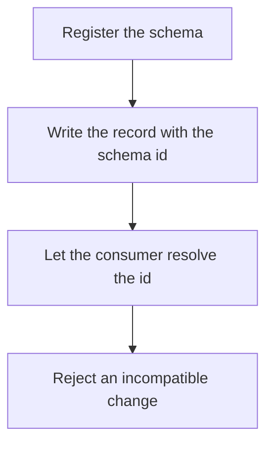

# D14-T017 — Message schemas and schema registry

Topic ID: `D14-T017`
Domain: Messaging and Event-Driven Architecture
Subdomain: Message schemas and schema registry
Importance: common
Complexity: advanced
Dependencies: `D14-T016`, `D14-T001`, `D04-T001`, `D04-T002`, `D05-T001`, `D05-T002`
Execution status of the code in section F: unexecuted

## A. Topic Overview

A message schema describes the fields of a record. A schema registry stores those descriptions and their versions under an id. Producers and consumers embed the id and look up the schema, instead of hoping both sides deployed the same class. The registry is a dependency of the produce path if registration is required. A schema without compatibility rules is only documentation.

In production this shows up as follows: An order event uses a registry id. The consumer looks up the id and decodes. A deploy of the producer that adds a required field without a default fails the compatibility check before it ships.

Interviewers use Message schemas and schema registry to see whether you can state the failure mode, not only the definition. The failure to name is: a consumer that cannot deserialize a new field or a removed field, stopping the partition

Prerequisites: `D14-T016`, `D14-T001`, `D04-T001`, `D04-T002`, `D05-T001`, `D05-T002`. Later notes should link here instead of repeating the mechanism.

## B. First-Principles Explanation

A message schema describes the fields of a record. A schema registry stores those descriptions and their versions under an id. Producers and consumers embed the id and look up the schema, instead of hoping both sides deployed the same class. The registry is a dependency of the produce path if registration is required. A schema without compatibility rules is only documentation.

The useful picture is: A schema registry is the style guide both the writer and the reader check out by number. The number travels with the article. The guide stays in the library.

What has to be true:

1. Register the schema
2. Write the record with the schema id
3. Let the consumer resolve the id
4. Reject an incompatible change

It works when those steps preserve one invariant. It fails when a consumer that cannot deserialize a new field or a removed field, stopping the partition. The alternative is: you serialize language-specific objects with no contract

## C. Internal Working and Architecture

Components involved: the caller, the state Message schemas and schema registry mutates or reads, and the observer that reports schema registration failures and deserialize errors.

Execution:

1. Register the schema
2. Write the record with the schema id
3. Let the consumer resolve the id
4. Reject an incompatible change

Data moves only along that path. A retry re-enters at step 1, so the operation must say what a duplicate does. Memory and locks stay inside this mechanism. Callers see the result or a typed error, not a half-updated invariant.

State to remember: choose this when more than one service writes or reads the topic. Do not choose it when you serialize language-specific objects with no contract.

## D. Diagrams and Visual Models



Read the diagram from top to bottom. Each box is one step of Message schemas and schema registry. The failure mode (a consumer that cannot deserialize a new field or a removed field, stopping the partition) is what you look for when a later box never happens or happens twice.

## E. Examples and Analogies

Analogy: A schema registry is the style guide both the writer and the reader check out by number. The number travels with the article. The guide stays in the library.

Production example: An order event uses a registry id. The consumer looks up the id and decodes. A deploy of the producer that adds a required field without a default fails the compatibility check before it ships.

A small counterexample is enough in an interview. Show the input, apply the steps, and show the broken outcome if someone uses the mechanism outside its rule: a consumer that cannot deserialize a new field or a removed field, stopping the partition.

## F. Code Examples

The snippet is labeled unexecuted. It illustrates the shape of the idea. It is not a benchmark and it embeds no secret.

```python
def envelope(schema_id, payload):
    return {'schema_id': schema_id, 'payload': payload}
```

After the snippet, check schema registration failures and deserialize errors. If that signal moves the wrong way, the snippet is the wrong tool for the workload.

## G. Practical Backend Application

Use Message schemas and schema registry in a service when more than one service writes or reads the topic.

A typical place is the production case already stated: An order event uses a registry id. The consumer looks up the id and decodes. A deploy of the producer that adds a required field without a default fails the compatibility check before it ships.

Operationally you alert on schema registration failures and deserialize errors. You do not alert only on process uptime. The dashboard should show the failure mode, a success rate, and the saturation signal (queue depth, lock wait, or latency) that predicts it.

## H. Advantages, Limitations and Trade-offs

| Choice | Benefit | Cost | Choose when | Avoid when |
| --- | --- | --- | --- | --- |
| Apply Message schemas and schema registry | more than one service writes or reads the topic | Extra moving parts and a new failure mode | The failure you are preventing is already real | you serialize language-specific objects with no contract |
| Simpler alternative | Less code and fewer dependencies | a consumer that cannot deserialize a new field or a removed field, stopping the partition | The workload does not hit the limit | The invariant must hold under concurrency or failure |

Message schemas and schema registry is a trade. State the benefit and the cost in the same sentence when you propose it in a design review.

## I. Common Mistakes and Misconceptions

- No compatibility checks.
- Breaking changes as 'just a deploy'.
- Embedding secrets in schema docs.
- Treating a diagram of Message schemas and schema registry as proof that the invariant holds in production.
- Copying a default configuration without naming schema registration failures and deserialize errors.

## J. Debugging and Troubleshooting

Symptom: a consumer that cannot deserialize a new field or a removed field, stopping the partition

First check: schema registration failures and deserialize errors.

Then compare one healthy instance against one unhealthy instance. Confirm whether retries are duplicating work. Confirm whether a timeout is shorter than the work. Fix the invariant, then watch the same metric for a full peak, not only for the next minute.

Useful questions: did the step order in section C actually happen, or did a caller skip a step? Did a deploy change the data shape that Message schemas and schema registry assumes?

## K. Interview Preparation

### Beginner

#### Q1. What problem does Message schemas and schema registry solve?

**Answer:** A message schema describes the fields of a record. A schema registry stores those descriptions and their versions under an id. Producers and consumers embed the id and look up the schema, instead of hoping both sides deployed the same class. The registry is a dependency of the produce path if registration is required. A schema without compatibility rules is only documentation. Without it, the usual backend failure is: a consumer that cannot deserialize a new field or a removed field, stopping the partition.

#### Q2. Where does Message schemas and schema registry sit on a request path?

**Answer:** Message schemas and schema registry is not a library you sprinkle on every call. more than one service writes or reads the topic You notice it when schema registration failures and deserialize errors. Name the constraint that makes this choice correct. Say what you would measure to confirm it.

#### Q3. Give a concrete example of Message schemas and schema registry.

**Answer:** An order event uses a registry id. The consumer looks up the id and decodes. A deploy of the producer that adds a required field without a default fails the compatibility check before it ships. Walk the input, the state change, and the observable output.

#### Q4. What is a common mix-up around Message schemas and schema registry?

**Answer:** a consumer that cannot deserialize a new field or a removed field, stopping the partition The corrective check is schema registration failures and deserialize errors. Name the constraint that makes this choice correct. Say what you would measure to confirm it. Say which alternative you rejected and why.

#### Q5. When would you skip Message schemas and schema registry?

**Answer:** you serialize language-specific objects with no contract Skipping is a decision with a measured cost, not a slogan. Name the constraint that makes this choice correct. Say what you would measure to confirm it. Say which alternative you rejected and why.

### Intermediate

#### Q1. What invariant makes Message schemas and schema registry correct?

**Answer:** A message schema describes the fields of a record. A schema registry stores those descriptions and their versions under an id. Producers and consumers embed the id and look up the schema, instead of hoping both sides deployed the same class. The registry is a dependency of the produce path if registration is required. A schema without compatibility rules is only documentation. State the invariant before you name the tool.

#### Q2. How do you test Message schemas and schema registry?

**Answer:** Assert the failure mode directly: a consumer that cannot deserialize a new field or a removed field, stopping the partition. The assertion should watch schema registration failures and deserialize errors. Include a concurrent or retry case if the bug only appears then. Name the constraint that makes this choice correct.

#### Q3. What signal tells you Message schemas and schema registry is misbehaving in production?

**Answer:** Watch schema registration failures and deserialize errors. The user-visible symptom is usually a consumer that cannot deserialize a new field or a removed field, stopping the partition. Name the constraint that makes this choice correct. Say what you would measure to confirm it.

#### Q4. How would you introduce Message schemas and schema registry into a legacy service?

**Answer:** more than one service writes or reads the topic Ship it behind a metric so you can compare the old path. Roll back if a consumer that cannot deserialize a new field or a removed field, stopping the partition gets worse. Name the constraint that makes this choice correct. Say what you would measure to confirm it.

#### Q5. What do you trade away by choosing Message schemas and schema registry?

**Answer:** more than one service writes or reads the topic you serialize language-specific objects with no contract Say the cost in latency, storage, or operational load. Name the constraint that makes this choice correct. Say what you would measure to confirm it. Say which alternative you rejected and why.

### Advanced

#### Q1. What breaks if a dependency of Message schemas and schema registry is slow or down?

**Answer:** a consumer that cannot deserialize a new field or a removed field, stopping the partition Degrade using the rule: you serialize language-specific objects with no contract. Timeouts must be shorter than the caller's deadline. Name the constraint that makes this choice correct. Say what you would measure to confirm it.

#### Q2. How does Message schemas and schema registry behave under retries?

**Answer:** Retries repeat work, so Message schemas and schema registry must define what a duplicate does. a consumer that cannot deserialize a new field or a removed field, stopping the partition Idempotency keys or fences belong next to the write, not in a comment. Name the constraint that makes this choice correct. Say what you would measure to confirm it.

#### Q3. What is the capacity limit of Message schemas and schema registry?

**Answer:** The limit shows up as schema registration failures and deserialize errors. Add capacity only after you know whether the bottleneck is CPU, lock wait, or network. Name the constraint that makes this choice correct. Say what you would measure to confirm it.

#### Q4. How do you evolve Message schemas and schema registry without a flag day?

**Answer:** more than one service writes or reads the topic Version the contract or the on-disk format. Readers should tolerate one old and one new shape during the rollout. Name the constraint that makes this choice correct. Say what you would measure to confirm it.

#### Q5. What security or correctness bug hides inside Message schemas and schema registry?

**Answer:** a consumer that cannot deserialize a new field or a removed field, stopping the partition Check authorization and tenancy at the same boundary as the mechanism. A cache or queue must not widen who can read the data. Name the constraint that makes this choice correct. Say what you would measure to confirm it.

### Scenario

#### Q1. Incident: a consumer that cannot deserialize a new field or a removed field, stopping the partition. What do you check first?

**Answer:** Start with schema registration failures and deserialize errors. Compare a good host and a bad host before you restart anything. A message schema describes the fields of a record. A schema registry stores those descriptions and their versions under an id. Producers and consumers embed the id and look up the schema, instead of hoping both sides deployed the same class. The registry is a dependency of the produce path if registration is required. A schema without compatibility rules is only documentation.

#### Q2. A reviewer wants the clever version. What data settles it?

**Answer:** more than one service writes or reads the topic you serialize language-specific objects with no contract Bring schema registration failures and deserialize errors from a load test or from production, not a slogan. Name the constraint that makes this choice correct. Say what you would measure to confirm it. Say which alternative you rejected and why.

#### Q3. You have one hour to explain Message schemas and schema registry at a whiteboard.

**Answer:** Draw the happy path in four boxes. Then draw the failure: a consumer that cannot deserialize a new field or a removed field, stopping the partition. End with the metric you would page on. Name the constraint that makes this choice correct.

#### Q4. The bug only appears under two concurrent callers.

**Answer:** a consumer that cannot deserialize a new field or a removed field, stopping the partition Reproduce with a barrier so both sides enter the critical window. Confirm the fix with schema registration failures and deserialize errors. Name the constraint that makes this choice correct. Say what you would measure to confirm it.

#### Q5. Leadership wants this on every service next week.

**Answer:** you serialize language-specific objects with no contract more than one service writes or reads the topic Roll it out where the failure mode is already hurting users. Name the constraint that makes this choice correct. Say what you would measure to confirm it. Say which alternative you rejected and why.

### Follow-up

#### Q1. What did you assume about the data size or the clock?

**Answer:** A message schema describes the fields of a record. A schema registry stores those descriptions and their versions under an id. Producers and consumers embed the id and look up the schema, instead of hoping both sides deployed the same class. The registry is a dependency of the produce path if registration is required. A schema without compatibility rules is only documentation. Clocks are not a total order across machines. State whether the algorithm needs bounded size or a single leader.

#### Q2. What would you measure after the change ships?

**Answer:** Page on schema registration failures and deserialize errors. Keep a before/after dashboard for one week. Alert on the failure mode, not only on CPU. Name the constraint that makes this choice correct.

#### Q3. Which neighboring topic did you deliberately not re-teach?

**Answer:** This note owns Message schemas and schema registry. Related identifiers are in section N. Shared ideas are linked, not copied. Name the constraint that makes this choice correct.

## L. Practical Exercises

Solutions are in `EXERCISES/solutions/D14-T017.md`, not in this section.

1. Whiteboard the four steps of Message schemas and schema registry and mark where `a consumer that cannot deserialize a new field or a removed field, stopping the partition` enters.
2. Read the snippet in section F and write the assertion that would catch that failure. The assertion must mention `schema registration failures and deserialize errors`.
3. Argue for or against using Message schemas and schema registry on a service you know. Use the choose and avoid rows from section H. Do not appeal to popularity.

## M. Revision Notes

- Mechanism: A message schema describes the fields of a record.
- Failure: a consumer that cannot deserialize a new field or a removed field, stopping the partition
- Metric: schema registration failures and deserialize errors
- Choose when: more than one service writes or reads the topic
- Avoid when: you serialize language-specific objects with no contract

## N. Related Topics

Dependencies to review first: `D14-T016`, `D14-T001`, `D04-T001`, `D04-T002`, `D05-T001`, `D05-T002`.

Shared ideas stay in those notes. This note does not restate them.

## O. Completion Criteria

- You can explain Message schemas and schema registry without reading this note, including the failure mode.
- You can draw the diagram in section D from memory.
- You can say when not to use it, using the avoid condition in section H.
- You can name the metric you would watch after shipping it.
