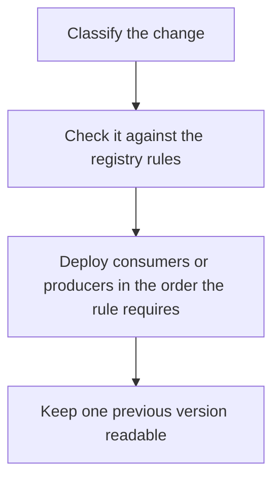

# D14-T018 — Schema evolution and compatibility

Topic ID: `D14-T018`
Domain: Messaging and Event-Driven Architecture
Subdomain: Schema evolution and compatibility
Importance: common
Complexity: advanced
Dependencies: `D14-T017`, `D14-T001`, `D04-T001`, `D04-T002`, `D05-T001`, `D05-T002`
Execution status of the code in section F: unexecuted

## A. Topic Overview

Schema evolution is changing a contract while old and new code both exist. Backward compatibility lets a new consumer read old data. Forward compatibility lets an old consumer read new data. Full compatibility is both. Adding an optional field with a default is usually safe. Removing a required field or changing a type is not. The order of deploys follows the compatibility direction.

In production this shows up as follows: A team adds an optional discount_code with a default. Old consumers ignore it. New consumers understand old events. Removing price in the same release would strand old consumers, so that is a new topic or a major version.

Interviewers use Schema evolution and compatibility to see whether you can state the failure mode, not only the definition. The failure to name is: a producer rolling out a breaking field before consumers can skip it, halting the group

Prerequisites: `D14-T017`, `D14-T001`, `D04-T001`, `D04-T002`, `D05-T001`, `D05-T002`. Later notes should link here instead of repeating the mechanism.

## B. First-Principles Explanation

Schema evolution is changing a contract while old and new code both exist. Backward compatibility lets a new consumer read old data. Forward compatibility lets an old consumer read new data. Full compatibility is both. Adding an optional field with a default is usually safe. Removing a required field or changing a type is not. The order of deploys follows the compatibility direction.

The useful picture is: Evolution is editing a form so last year's forms still make sense. Adding an optional box works. Renaming a box in place is a new form, whether you meant it to be or not.

What has to be true:

1. Classify the change
2. Check it against the registry rules
3. Deploy consumers or producers in the order the rule requires
4. Keep one previous version readable

It works when those steps preserve one invariant. It fails when a producer rolling out a breaking field before consumers can skip it, halting the group. The alternative is: you change types in place and call it agile

## C. Internal Working and Architecture

Components involved: the caller, the state Schema evolution and compatibility mutates or reads, and the observer that reports compatibility-check failures and deserialize errors during a deploy.

Execution:

1. Classify the change
2. Check it against the registry rules
3. Deploy consumers or producers in the order the rule requires
4. Keep one previous version readable

Data moves only along that path. A retry re-enters at step 1, so the operation must say what a duplicate does. Memory and locks stay inside this mechanism. Callers see the result or a typed error, not a half-updated invariant.

State to remember: choose this when rolling deploys of producers and consumers overlap. Do not choose it when you change types in place and call it agile.

## D. Diagrams and Visual Models



Read the diagram from top to bottom. Each box is one step of Schema evolution and compatibility. The failure mode (a producer rolling out a breaking field before consumers can skip it, halting the group) is what you look for when a later box never happens or happens twice.

## E. Examples and Analogies

Analogy: Evolution is editing a form so last year's forms still make sense. Adding an optional box works. Renaming a box in place is a new form, whether you meant it to be or not.

Production example: A team adds an optional discount_code with a default. Old consumers ignore it. New consumers understand old events. Removing price in the same release would strand old consumers, so that is a new topic or a major version.

A small counterexample is enough in an interview. Show the input, apply the steps, and show the broken outcome if someone uses the mechanism outside its rule: a producer rolling out a breaking field before consumers can skip it, halting the group.

## F. Code Examples

The snippet is labeled unexecuted. It illustrates the shape of the idea. It is not a benchmark and it embeds no secret.

```python
def backward_ok(added_optional, removed_required):
    return added_optional and not removed_required
```

After the snippet, check compatibility-check failures and deserialize errors during a deploy. If that signal moves the wrong way, the snippet is the wrong tool for the workload.

## G. Practical Backend Application

Use Schema evolution and compatibility in a service when rolling deploys of producers and consumers overlap.

A typical place is the production case already stated: A team adds an optional discount_code with a default. Old consumers ignore it. New consumers understand old events. Removing price in the same release would strand old consumers, so that is a new topic or a major version.

Operationally you alert on compatibility-check failures and deserialize errors during a deploy. You do not alert only on process uptime. The dashboard should show the failure mode, a success rate, and the saturation signal (queue depth, lock wait, or latency) that predicts it.

## H. Advantages, Limitations and Trade-offs

| Choice | Benefit | Cost | Choose when | Avoid when |
| --- | --- | --- | --- | --- |
| Apply Schema evolution and compatibility | rolling deploys of producers and consumers overlap | Extra moving parts and a new failure mode | The failure you are preventing is already real | you change types in place and call it agile |
| Simpler alternative | Less code and fewer dependencies | a producer rolling out a breaking field before consumers can skip it, halting the group | The workload does not hit the limit | The invariant must hold under concurrency or failure |

Schema evolution and compatibility is a trade. State the benefit and the cost in the same sentence when you propose it in a design review.

## I. Common Mistakes and Misconceptions

- Deploying a breaking producer first.
- Reusing a field number for a new meaning.
- No default on a newly required field.
- Treating a diagram of Schema evolution and compatibility as proof that the invariant holds in production.
- Copying a default configuration without naming compatibility-check failures and deserialize errors during a deploy.

## J. Debugging and Troubleshooting

Symptom: a producer rolling out a breaking field before consumers can skip it, halting the group

First check: compatibility-check failures and deserialize errors during a deploy.

Then compare one healthy instance against one unhealthy instance. Confirm whether retries are duplicating work. Confirm whether a timeout is shorter than the work. Fix the invariant, then watch the same metric for a full peak, not only for the next minute.

Useful questions: did the step order in section C actually happen, or did a caller skip a step? Did a deploy change the data shape that Schema evolution and compatibility assumes?

## K. Interview Preparation

### Beginner

#### Q1. What problem does Schema evolution and compatibility solve?

**Answer:** Schema evolution is changing a contract while old and new code both exist. Backward compatibility lets a new consumer read old data. Forward compatibility lets an old consumer read new data. Full compatibility is both. Adding an optional field with a default is usually safe. Removing a required field or changing a type is not. The order of deploys follows the compatibility direction. Without it, the usual backend failure is: a producer rolling out a breaking field before consumers can skip it, halting the group.

#### Q2. Where does Schema evolution and compatibility sit on a request path?

**Answer:** Schema evolution and compatibility is not a library you sprinkle on every call. rolling deploys of producers and consumers overlap You notice it when compatibility-check failures and deserialize errors during a deploy. Name the constraint that makes this choice correct. Say what you would measure to confirm it.

#### Q3. Give a concrete example of Schema evolution and compatibility.

**Answer:** A team adds an optional discount_code with a default. Old consumers ignore it. New consumers understand old events. Removing price in the same release would strand old consumers, so that is a new topic or a major version. Walk the input, the state change, and the observable output.

#### Q4. What is a common mix-up around Schema evolution and compatibility?

**Answer:** a producer rolling out a breaking field before consumers can skip it, halting the group The corrective check is compatibility-check failures and deserialize errors during a deploy. Name the constraint that makes this choice correct. Say what you would measure to confirm it. Say which alternative you rejected and why.

#### Q5. When would you skip Schema evolution and compatibility?

**Answer:** you change types in place and call it agile Skipping is a decision with a measured cost, not a slogan. Name the constraint that makes this choice correct. Say what you would measure to confirm it. Say which alternative you rejected and why.

### Intermediate

#### Q1. What invariant makes Schema evolution and compatibility correct?

**Answer:** Schema evolution is changing a contract while old and new code both exist. Backward compatibility lets a new consumer read old data. Forward compatibility lets an old consumer read new data. Full compatibility is both. Adding an optional field with a default is usually safe. Removing a required field or changing a type is not. The order of deploys follows the compatibility direction. State the invariant before you name the tool.

#### Q2. How do you test Schema evolution and compatibility?

**Answer:** Assert the failure mode directly: a producer rolling out a breaking field before consumers can skip it, halting the group. The assertion should watch compatibility-check failures and deserialize errors during a deploy. Include a concurrent or retry case if the bug only appears then. Name the constraint that makes this choice correct.

#### Q3. What signal tells you Schema evolution and compatibility is misbehaving in production?

**Answer:** Watch compatibility-check failures and deserialize errors during a deploy. The user-visible symptom is usually a producer rolling out a breaking field before consumers can skip it, halting the group. Name the constraint that makes this choice correct. Say what you would measure to confirm it.

#### Q4. How would you introduce Schema evolution and compatibility into a legacy service?

**Answer:** rolling deploys of producers and consumers overlap Ship it behind a metric so you can compare the old path. Roll back if a producer rolling out a breaking field before consumers can skip it, halting the group gets worse. Name the constraint that makes this choice correct. Say what you would measure to confirm it.

#### Q5. What do you trade away by choosing Schema evolution and compatibility?

**Answer:** rolling deploys of producers and consumers overlap you change types in place and call it agile Say the cost in latency, storage, or operational load. Name the constraint that makes this choice correct. Say what you would measure to confirm it. Say which alternative you rejected and why.

### Advanced

#### Q1. What breaks if a dependency of Schema evolution and compatibility is slow or down?

**Answer:** a producer rolling out a breaking field before consumers can skip it, halting the group Degrade using the rule: you change types in place and call it agile. Timeouts must be shorter than the caller's deadline. Name the constraint that makes this choice correct. Say what you would measure to confirm it.

#### Q2. How does Schema evolution and compatibility behave under retries?

**Answer:** Retries repeat work, so Schema evolution and compatibility must define what a duplicate does. a producer rolling out a breaking field before consumers can skip it, halting the group Idempotency keys or fences belong next to the write, not in a comment. Name the constraint that makes this choice correct. Say what you would measure to confirm it.

#### Q3. What is the capacity limit of Schema evolution and compatibility?

**Answer:** The limit shows up as compatibility-check failures and deserialize errors during a deploy. Add capacity only after you know whether the bottleneck is CPU, lock wait, or network. Name the constraint that makes this choice correct. Say what you would measure to confirm it.

#### Q4. How do you evolve Schema evolution and compatibility without a flag day?

**Answer:** rolling deploys of producers and consumers overlap Version the contract or the on-disk format. Readers should tolerate one old and one new shape during the rollout. Name the constraint that makes this choice correct. Say what you would measure to confirm it.

#### Q5. What security or correctness bug hides inside Schema evolution and compatibility?

**Answer:** a producer rolling out a breaking field before consumers can skip it, halting the group Check authorization and tenancy at the same boundary as the mechanism. A cache or queue must not widen who can read the data. Name the constraint that makes this choice correct. Say what you would measure to confirm it.

### Scenario

#### Q1. Incident: a producer rolling out a breaking field before consumers can skip it, halting the group. What do you check first?

**Answer:** Start with compatibility-check failures and deserialize errors during a deploy. Compare a good host and a bad host before you restart anything. Schema evolution is changing a contract while old and new code both exist. Backward compatibility lets a new consumer read old data. Forward compatibility lets an old consumer read new data. Full compatibility is both. Adding an optional field with a default is usually safe. Removing a required field or changing a type is not. The order of deploys follows the compatibility direction.

#### Q2. A reviewer wants the clever version. What data settles it?

**Answer:** rolling deploys of producers and consumers overlap you change types in place and call it agile Bring compatibility-check failures and deserialize errors during a deploy from a load test or from production, not a slogan. Name the constraint that makes this choice correct. Say what you would measure to confirm it. Say which alternative you rejected and why.

#### Q3. You have one hour to explain Schema evolution and compatibility at a whiteboard.

**Answer:** Draw the happy path in four boxes. Then draw the failure: a producer rolling out a breaking field before consumers can skip it, halting the group. End with the metric you would page on. Name the constraint that makes this choice correct.

#### Q4. The bug only appears under two concurrent callers.

**Answer:** a producer rolling out a breaking field before consumers can skip it, halting the group Reproduce with a barrier so both sides enter the critical window. Confirm the fix with compatibility-check failures and deserialize errors during a deploy. Name the constraint that makes this choice correct. Say what you would measure to confirm it.

#### Q5. Leadership wants this on every service next week.

**Answer:** you change types in place and call it agile rolling deploys of producers and consumers overlap Roll it out where the failure mode is already hurting users. Name the constraint that makes this choice correct. Say what you would measure to confirm it. Say which alternative you rejected and why.

### Follow-up

#### Q1. What did you assume about the data size or the clock?

**Answer:** Schema evolution is changing a contract while old and new code both exist. Backward compatibility lets a new consumer read old data. Forward compatibility lets an old consumer read new data. Full compatibility is both. Adding an optional field with a default is usually safe. Removing a required field or changing a type is not. The order of deploys follows the compatibility direction. Clocks are not a total order across machines. State whether the algorithm needs bounded size or a single leader.

#### Q2. What would you measure after the change ships?

**Answer:** Page on compatibility-check failures and deserialize errors during a deploy. Keep a before/after dashboard for one week. Alert on the failure mode, not only on CPU. Name the constraint that makes this choice correct.

#### Q3. Which neighboring topic did you deliberately not re-teach?

**Answer:** This note owns Schema evolution and compatibility. Related identifiers are in section N. Shared ideas are linked, not copied. Name the constraint that makes this choice correct.

## L. Practical Exercises

Solutions are in `EXERCISES/solutions/D14-T018.md`, not in this section.

1. Whiteboard the four steps of Schema evolution and compatibility and mark where `a producer rolling out a breaking field before consumers can skip it, halting the group` enters.
2. Read the snippet in section F and write the assertion that would catch that failure. The assertion must mention `compatibility-check failures and deserialize errors during a deploy`.
3. Argue for or against using Schema evolution and compatibility on a service you know. Use the choose and avoid rows from section H. Do not appeal to popularity.

## M. Revision Notes

- Mechanism: Schema evolution is changing a contract while old and new code both exist.
- Failure: a producer rolling out a breaking field before consumers can skip it, halting the group
- Metric: compatibility-check failures and deserialize errors during a deploy
- Choose when: rolling deploys of producers and consumers overlap
- Avoid when: you change types in place and call it agile

## N. Related Topics

Dependencies to review first: `D14-T017`, `D14-T001`, `D04-T001`, `D04-T002`, `D05-T001`, `D05-T002`.

Shared ideas stay in those notes. This note does not restate them.

## O. Completion Criteria

- You can explain Schema evolution and compatibility without reading this note, including the failure mode.
- You can draw the diagram in section D from memory.
- You can say when not to use it, using the avoid condition in section H.
- You can name the metric you would watch after shipping it.
