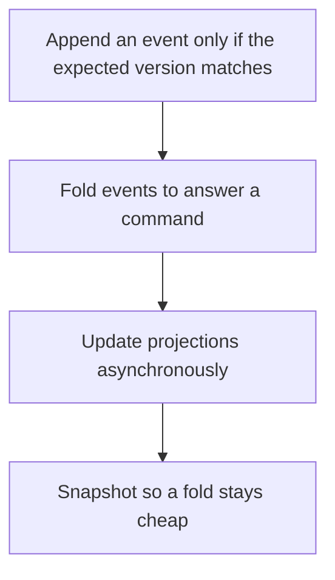

# D14-T019 — Event sourcing

Topic ID: `D14-T019`
Domain: Messaging and Event-Driven Architecture
Subdomain: Event sourcing
Importance: common
Complexity: advanced
Dependencies: `D14-T018`, `D14-T001`, `D04-T001`, `D04-T002`, `D05-T001`, `D05-T002`
Execution status of the code in section F: unexecuted

## A. Topic Overview

Event sourcing stores the state of an entity as a sequence of events and rebuilds state by folding them. The log is the source of truth. A projection is a read model derived from the log and can be rebuilt. Snapshots speed the fold. Concurrency uses an expected version. It is a poor fit when you only needed a row and a history table.

In production this shows up as follows: A ledger appends credited and debited events and rejects an event whose expected version is stale. The balance query can use a projection, and a bug in the projection is fixed by replaying the log.

Interviewers use Event sourcing to see whether you can state the failure mode, not only the definition. The failure to name is: a projection treated as the source of truth, or a version conflict ignored so two events both think they were next

Prerequisites: `D14-T018`, `D14-T001`, `D04-T001`, `D04-T002`, `D05-T001`, `D05-T002`. Later notes should link here instead of repeating the mechanism.

## B. First-Principles Explanation

Event sourcing stores the state of an entity as a sequence of events and rebuilds state by folding them. The log is the source of truth. A projection is a read model derived from the log and can be rebuilt. Snapshots speed the fold. Concurrency uses an expected version. It is a poor fit when you only needed a row and a history table.

The useful picture is: Event sourcing is keeping the receipts and totaling them when you need the balance, instead of erasing the receipts and keeping only the total.

What has to be true:

1. Append an event only if the expected version matches
2. Fold events to answer a command
3. Update projections asynchronously
4. Snapshot so a fold stays cheap

It works when those steps preserve one invariant. It fails when a projection treated as the source of truth, or a version conflict ignored so two events both think they were next. The alternative is: you only need current state and a simple update

## C. Internal Working and Architecture

Components involved: the caller, the state Event sourcing mutates or reads, and the observer that reports fold time, projection lag, and version-conflict rate.

Execution:

1. Append an event only if the expected version matches
2. Fold events to answer a command
3. Update projections asynchronously
4. Snapshot so a fold stays cheap

Data moves only along that path. A retry re-enters at step 1, so the operation must say what a duplicate does. Memory and locks stay inside this mechanism. Callers see the result or a typed error, not a half-updated invariant.

State to remember: choose this when the history is the product or the audit requirement, and you can rebuild state. Do not choose it when you only need current state and a simple update.

## D. Diagrams and Visual Models



Read the diagram from top to bottom. Each box is one step of Event sourcing. The failure mode (a projection treated as the source of truth, or a version conflict ignored so two events both think they were next) is what you look for when a later box never happens or happens twice.

## E. Examples and Analogies

Analogy: Event sourcing is keeping the receipts and totaling them when you need the balance, instead of erasing the receipts and keeping only the total.

Production example: A ledger appends credited and debited events and rejects an event whose expected version is stale. The balance query can use a projection, and a bug in the projection is fixed by replaying the log.

A small counterexample is enough in an interview. Show the input, apply the steps, and show the broken outcome if someone uses the mechanism outside its rule: a projection treated as the source of truth, or a version conflict ignored so two events both think they were next.

## F. Code Examples

The snippet is labeled unexecuted. It illustrates the shape of the idea. It is not a benchmark and it embeds no secret.

```python
def fold(events):
    state = {'balance': 0}
    for event in events:
        if event['type'] == 'credited':
            state['balance'] += event['amount']
    return state
```

After the snippet, check fold time, projection lag, and version-conflict rate. If that signal moves the wrong way, the snippet is the wrong tool for the workload.

## G. Practical Backend Application

Use Event sourcing in a service when the history is the product or the audit requirement, and you can rebuild state.

A typical place is the production case already stated: A ledger appends credited and debited events and rejects an event whose expected version is stale. The balance query can use a projection, and a bug in the projection is fixed by replaying the log.

Operationally you alert on fold time, projection lag, and version-conflict rate. You do not alert only on process uptime. The dashboard should show the failure mode, a success rate, and the saturation signal (queue depth, lock wait, or latency) that predicts it.

## H. Advantages, Limitations and Trade-offs

| Choice | Benefit | Cost | Choose when | Avoid when |
| --- | --- | --- | --- | --- |
| Apply Event sourcing | the history is the product or the audit requirement, and you can rebuild state | Extra moving parts and a new failure mode | The failure you are preventing is already real | you only need current state and a simple update |
| Simpler alternative | Less code and fewer dependencies | a projection treated as the source of truth, or a version conflict ignored so two events both think they were next | The workload does not hit the limit | The invariant must hold under concurrency or failure |

Event sourcing is a trade. State the benefit and the cost in the same sentence when you propose it in a design review.

## I. Common Mistakes and Misconceptions

- Updating a row and also emitting an event that can disagree.
- No version check.
- A projection nobody can rebuild.
- Treating a diagram of Event sourcing as proof that the invariant holds in production.
- Copying a default configuration without naming fold time, projection lag, and version-conflict rate.

## J. Debugging and Troubleshooting

Symptom: a projection treated as the source of truth, or a version conflict ignored so two events both think they were next

First check: fold time, projection lag, and version-conflict rate.

Then compare one healthy instance against one unhealthy instance. Confirm whether retries are duplicating work. Confirm whether a timeout is shorter than the work. Fix the invariant, then watch the same metric for a full peak, not only for the next minute.

Useful questions: did the step order in section C actually happen, or did a caller skip a step? Did a deploy change the data shape that Event sourcing assumes?

## K. Interview Preparation

### Beginner

#### Q1. What problem does Event sourcing solve?

**Answer:** Event sourcing stores the state of an entity as a sequence of events and rebuilds state by folding them. The log is the source of truth. A projection is a read model derived from the log and can be rebuilt. Snapshots speed the fold. Concurrency uses an expected version. It is a poor fit when you only needed a row and a history table. Without it, the usual backend failure is: a projection treated as the source of truth, or a version conflict ignored so two events both think they were next.

#### Q2. Where does Event sourcing sit on a request path?

**Answer:** Event sourcing is not a library you sprinkle on every call. the history is the product or the audit requirement, and you can rebuild state You notice it when fold time, projection lag, and version-conflict rate. Name the constraint that makes this choice correct. Say what you would measure to confirm it.

#### Q3. Give a concrete example of Event sourcing.

**Answer:** A ledger appends credited and debited events and rejects an event whose expected version is stale. The balance query can use a projection, and a bug in the projection is fixed by replaying the log. Walk the input, the state change, and the observable output. Name the constraint that makes this choice correct.

#### Q4. What is a common mix-up around Event sourcing?

**Answer:** a projection treated as the source of truth, or a version conflict ignored so two events both think they were next The corrective check is fold time, projection lag, and version-conflict rate. Name the constraint that makes this choice correct. Say what you would measure to confirm it. Say which alternative you rejected and why.

#### Q5. When would you skip Event sourcing?

**Answer:** you only need current state and a simple update Skipping is a decision with a measured cost, not a slogan. Name the constraint that makes this choice correct. Say what you would measure to confirm it. Say which alternative you rejected and why.

### Intermediate

#### Q1. What invariant makes Event sourcing correct?

**Answer:** Event sourcing stores the state of an entity as a sequence of events and rebuilds state by folding them. The log is the source of truth. A projection is a read model derived from the log and can be rebuilt. Snapshots speed the fold. Concurrency uses an expected version. It is a poor fit when you only needed a row and a history table. State the invariant before you name the tool.

#### Q2. How do you test Event sourcing?

**Answer:** Assert the failure mode directly: a projection treated as the source of truth, or a version conflict ignored so two events both think they were next. The assertion should watch fold time, projection lag, and version-conflict rate. Include a concurrent or retry case if the bug only appears then. Name the constraint that makes this choice correct.

#### Q3. What signal tells you Event sourcing is misbehaving in production?

**Answer:** Watch fold time, projection lag, and version-conflict rate. The user-visible symptom is usually a projection treated as the source of truth, or a version conflict ignored so two events both think they were next. Name the constraint that makes this choice correct. Say what you would measure to confirm it.

#### Q4. How would you introduce Event sourcing into a legacy service?

**Answer:** the history is the product or the audit requirement, and you can rebuild state Ship it behind a metric so you can compare the old path. Roll back if a projection treated as the source of truth, or a version conflict ignored so two events both think they were next gets worse. Name the constraint that makes this choice correct. Say what you would measure to confirm it.

#### Q5. What do you trade away by choosing Event sourcing?

**Answer:** the history is the product or the audit requirement, and you can rebuild state you only need current state and a simple update Say the cost in latency, storage, or operational load. Name the constraint that makes this choice correct. Say what you would measure to confirm it. Say which alternative you rejected and why.

### Advanced

#### Q1. What breaks if a dependency of Event sourcing is slow or down?

**Answer:** a projection treated as the source of truth, or a version conflict ignored so two events both think they were next Degrade using the rule: you only need current state and a simple update. Timeouts must be shorter than the caller's deadline. Name the constraint that makes this choice correct. Say what you would measure to confirm it.

#### Q2. How does Event sourcing behave under retries?

**Answer:** Retries repeat work, so Event sourcing must define what a duplicate does. a projection treated as the source of truth, or a version conflict ignored so two events both think they were next Idempotency keys or fences belong next to the write, not in a comment. Name the constraint that makes this choice correct. Say what you would measure to confirm it.

#### Q3. What is the capacity limit of Event sourcing?

**Answer:** The limit shows up as fold time, projection lag, and version-conflict rate. Add capacity only after you know whether the bottleneck is CPU, lock wait, or network. Name the constraint that makes this choice correct. Say what you would measure to confirm it.

#### Q4. How do you evolve Event sourcing without a flag day?

**Answer:** the history is the product or the audit requirement, and you can rebuild state Version the contract or the on-disk format. Readers should tolerate one old and one new shape during the rollout. Name the constraint that makes this choice correct. Say what you would measure to confirm it.

#### Q5. What security or correctness bug hides inside Event sourcing?

**Answer:** a projection treated as the source of truth, or a version conflict ignored so two events both think they were next Check authorization and tenancy at the same boundary as the mechanism. A cache or queue must not widen who can read the data. Name the constraint that makes this choice correct. Say what you would measure to confirm it.

### Scenario

#### Q1. Incident: a projection treated as the source of truth, or a version conflict ignored so two events both think they were next. What do you check first?

**Answer:** Start with fold time, projection lag, and version-conflict rate. Compare a good host and a bad host before you restart anything. Event sourcing stores the state of an entity as a sequence of events and rebuilds state by folding them. The log is the source of truth. A projection is a read model derived from the log and can be rebuilt. Snapshots speed the fold. Concurrency uses an expected version. It is a poor fit when you only needed a row and a history table.

#### Q2. A reviewer wants the clever version. What data settles it?

**Answer:** the history is the product or the audit requirement, and you can rebuild state you only need current state and a simple update Bring fold time, projection lag, and version-conflict rate from a load test or from production, not a slogan. Name the constraint that makes this choice correct. Say what you would measure to confirm it. Say which alternative you rejected and why.

#### Q3. You have one hour to explain Event sourcing at a whiteboard.

**Answer:** Draw the happy path in four boxes. Then draw the failure: a projection treated as the source of truth, or a version conflict ignored so two events both think they were next. End with the metric you would page on. Name the constraint that makes this choice correct.

#### Q4. The bug only appears under two concurrent callers.

**Answer:** a projection treated as the source of truth, or a version conflict ignored so two events both think they were next Reproduce with a barrier so both sides enter the critical window. Confirm the fix with fold time, projection lag, and version-conflict rate. Name the constraint that makes this choice correct. Say what you would measure to confirm it.

#### Q5. Leadership wants this on every service next week.

**Answer:** you only need current state and a simple update the history is the product or the audit requirement, and you can rebuild state Roll it out where the failure mode is already hurting users. Name the constraint that makes this choice correct. Say what you would measure to confirm it. Say which alternative you rejected and why.

### Follow-up

#### Q1. What did you assume about the data size or the clock?

**Answer:** Event sourcing stores the state of an entity as a sequence of events and rebuilds state by folding them. The log is the source of truth. A projection is a read model derived from the log and can be rebuilt. Snapshots speed the fold. Concurrency uses an expected version. It is a poor fit when you only needed a row and a history table. Clocks are not a total order across machines. State whether the algorithm needs bounded size or a single leader.

#### Q2. What would you measure after the change ships?

**Answer:** Page on fold time, projection lag, and version-conflict rate. Keep a before/after dashboard for one week. Alert on the failure mode, not only on CPU. Name the constraint that makes this choice correct.

#### Q3. Which neighboring topic did you deliberately not re-teach?

**Answer:** This note owns Event sourcing. Related identifiers are in section N. Shared ideas are linked, not copied. Name the constraint that makes this choice correct.

## L. Practical Exercises

Solutions are in `EXERCISES/solutions/D14-T019.md`, not in this section.

1. Whiteboard the four steps of Event sourcing and mark where `a projection treated as the source of truth, or a version conflict ignored so two events both think they were next` enters.
2. Read the snippet in section F and write the assertion that would catch that failure. The assertion must mention `fold time, projection lag, and version-conflict rate`.
3. Argue for or against using Event sourcing on a service you know. Use the choose and avoid rows from section H. Do not appeal to popularity.

## M. Revision Notes

- Mechanism: Event sourcing stores the state of an entity as a sequence of events and rebuilds state by folding them.
- Failure: a projection treated as the source of truth, or a version conflict ignored so two events both think they were next
- Metric: fold time, projection lag, and version-conflict rate
- Choose when: the history is the product or the audit requirement, and you can rebuild state
- Avoid when: you only need current state and a simple update

## N. Related Topics

Dependencies to review first: `D14-T018`, `D14-T001`, `D04-T001`, `D04-T002`, `D05-T001`, `D05-T002`.

Shared ideas stay in those notes. This note does not restate them.

## O. Completion Criteria

- You can explain Event sourcing without reading this note, including the failure mode.
- You can draw the diagram in section D from memory.
- You can say when not to use it, using the avoid condition in section H.
- You can name the metric you would watch after shipping it.
