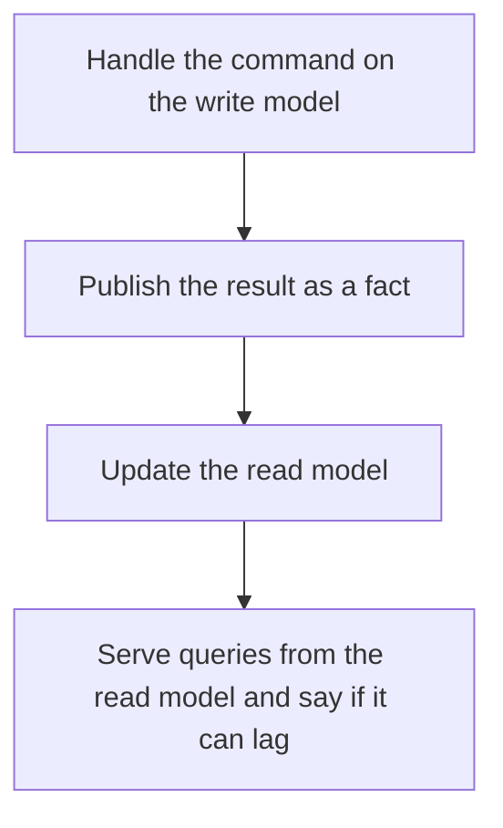

# D14-T020 — CQRS

Topic ID: `D14-T020`
Domain: Messaging and Event-Driven Architecture
Subdomain: CQRS
Importance: common
Complexity: advanced
Dependencies: `D14-T019`, `D14-T001`, `D04-T001`, `D04-T002`, `D05-T001`, `D05-T002`
Execution status of the code in section F: unexecuted

## A. Topic Overview

CQRS separates the model that handles commands from the model that handles queries. They can be the same database with different schemas, or a write log and a read projection. The read side is allowed to lag. Commands are not 'create a row shaped like the screen.' The split pays off when reads and writes scale or change differently. It costs consistency and operational surface.

In production this shows up as follows: An order command writes the order aggregate. The customer list page reads a denormalized table updated by a consumer. The confirmation screen reads the write model so the user sees their own order.

Interviewers use CQRS to see whether you can state the failure mode, not only the definition. The failure to name is: a user who writes and then reads their own change from a lagged view and thinks the write failed

Prerequisites: `D14-T019`, `D14-T001`, `D04-T001`, `D04-T002`, `D05-T001`, `D05-T002`. Later notes should link here instead of repeating the mechanism.

## B. First-Principles Explanation

CQRS separates the model that handles commands from the model that handles queries. They can be the same database with different schemas, or a write log and a read projection. The read side is allowed to lag. Commands are not 'create a row shaped like the screen.' The split pays off when reads and writes scale or change differently. It costs consistency and operational surface.

The useful picture is: CQRS is a kitchen that does not plate food from the prep board. The dining room has its own menu copy, and that copy can be a minute behind the kitchen.

What has to be true:

1. Handle the command on the write model
2. Publish the result as a fact
3. Update the read model
4. Serve queries from the read model and say if it can lag

It works when those steps preserve one invariant. It fails when a user who writes and then reads their own change from a lagged view and thinks the write failed. The alternative is: you split a CRUD form into two services on day one and double the failure modes

## C. Internal Working and Architecture

Components involved: the caller, the state CQRS mutates or reads, and the observer that reports projection lag and read-your-writes failures.

Execution:

1. Handle the command on the write model
2. Publish the result as a fact
3. Update the read model
4. Serve queries from the read model and say if it can lag

Data moves only along that path. A retry re-enters at step 1, so the operation must say what a duplicate does. Memory and locks stay inside this mechanism. Callers see the result or a typed error, not a half-updated invariant.

State to remember: choose this when read and write shapes or rates genuinely differ. Do not choose it when you split a CRUD form into two services on day one and double the failure modes.

## D. Diagrams and Visual Models



Read the diagram from top to bottom. Each box is one step of CQRS. The failure mode (a user who writes and then reads their own change from a lagged view and thinks the write failed) is what you look for when a later box never happens or happens twice.

## E. Examples and Analogies

Analogy: CQRS is a kitchen that does not plate food from the prep board. The dining room has its own menu copy, and that copy can be a minute behind the kitchen.

Production example: An order command writes the order aggregate. The customer list page reads a denormalized table updated by a consumer. The confirmation screen reads the write model so the user sees their own order.

A small counterexample is enough in an interview. Show the input, apply the steps, and show the broken outcome if someone uses the mechanism outside its rule: a user who writes and then reads their own change from a lagged view and thinks the write failed.

## F. Code Examples

The snippet is labeled unexecuted. It illustrates the shape of the idea. It is not a benchmark and it embeds no secret.

```python
def route(op):
    return 'write-model' if op == 'command' else 'read-model'
```

After the snippet, check projection lag and read-your-writes failures. If that signal moves the wrong way, the snippet is the wrong tool for the workload.

## G. Practical Backend Application

Use CQRS in a service when read and write shapes or rates genuinely differ.

A typical place is the production case already stated: An order command writes the order aggregate. The customer list page reads a denormalized table updated by a consumer. The confirmation screen reads the write model so the user sees their own order.

Operationally you alert on projection lag and read-your-writes failures. You do not alert only on process uptime. The dashboard should show the failure mode, a success rate, and the saturation signal (queue depth, lock wait, or latency) that predicts it.

## H. Advantages, Limitations and Trade-offs

| Choice | Benefit | Cost | Choose when | Avoid when |
| --- | --- | --- | --- | --- |
| Apply CQRS | read and write shapes or rates genuinely differ | Extra moving parts and a new failure mode | The failure you are preventing is already real | you split a CRUD form into two services on day one and double the failure modes |
| Simpler alternative | Less code and fewer dependencies | a user who writes and then reads their own change from a lagged view and thinks the write failed | The workload does not hit the limit | The invariant must hold under concurrency or failure |

CQRS is a trade. State the benefit and the cost in the same sentence when you propose it in a design review.

## I. Common Mistakes and Misconceptions

- Read-your-writes against a lagged projection.
- Two sources of truth.
- CQRS without a lag budget.
- Treating a diagram of CQRS as proof that the invariant holds in production.
- Copying a default configuration without naming projection lag and read-your-writes failures.

## J. Debugging and Troubleshooting

Symptom: a user who writes and then reads their own change from a lagged view and thinks the write failed

First check: projection lag and read-your-writes failures.

Then compare one healthy instance against one unhealthy instance. Confirm whether retries are duplicating work. Confirm whether a timeout is shorter than the work. Fix the invariant, then watch the same metric for a full peak, not only for the next minute.

Useful questions: did the step order in section C actually happen, or did a caller skip a step? Did a deploy change the data shape that CQRS assumes?

## K. Interview Preparation

### Beginner

#### Q1. What problem does CQRS solve?

**Answer:** CQRS separates the model that handles commands from the model that handles queries. They can be the same database with different schemas, or a write log and a read projection. The read side is allowed to lag. Commands are not 'create a row shaped like the screen.' The split pays off when reads and writes scale or change differently. It costs consistency and operational surface. Without it, the usual backend failure is: a user who writes and then reads their own change from a lagged view and thinks the write failed.

#### Q2. Where does CQRS sit on a request path?

**Answer:** CQRS is not a library you sprinkle on every call. read and write shapes or rates genuinely differ You notice it when projection lag and read-your-writes failures. Name the constraint that makes this choice correct. Say what you would measure to confirm it.

#### Q3. Give a concrete example of CQRS.

**Answer:** An order command writes the order aggregate. The customer list page reads a denormalized table updated by a consumer. The confirmation screen reads the write model so the user sees their own order. Walk the input, the state change, and the observable output.

#### Q4. What is a common mix-up around CQRS?

**Answer:** a user who writes and then reads their own change from a lagged view and thinks the write failed The corrective check is projection lag and read-your-writes failures. Name the constraint that makes this choice correct. Say what you would measure to confirm it. Say which alternative you rejected and why.

#### Q5. When would you skip CQRS?

**Answer:** you split a CRUD form into two services on day one and double the failure modes Skipping is a decision with a measured cost, not a slogan. Name the constraint that makes this choice correct. Say what you would measure to confirm it. Say which alternative you rejected and why.

### Intermediate

#### Q1. What invariant makes CQRS correct?

**Answer:** CQRS separates the model that handles commands from the model that handles queries. They can be the same database with different schemas, or a write log and a read projection. The read side is allowed to lag. Commands are not 'create a row shaped like the screen.' The split pays off when reads and writes scale or change differently. It costs consistency and operational surface. State the invariant before you name the tool.

#### Q2. How do you test CQRS?

**Answer:** Assert the failure mode directly: a user who writes and then reads their own change from a lagged view and thinks the write failed. The assertion should watch projection lag and read-your-writes failures. Include a concurrent or retry case if the bug only appears then. Name the constraint that makes this choice correct.

#### Q3. What signal tells you CQRS is misbehaving in production?

**Answer:** Watch projection lag and read-your-writes failures. The user-visible symptom is usually a user who writes and then reads their own change from a lagged view and thinks the write failed. Name the constraint that makes this choice correct. Say what you would measure to confirm it.

#### Q4. How would you introduce CQRS into a legacy service?

**Answer:** read and write shapes or rates genuinely differ Ship it behind a metric so you can compare the old path. Roll back if a user who writes and then reads their own change from a lagged view and thinks the write failed gets worse. Name the constraint that makes this choice correct. Say what you would measure to confirm it.

#### Q5. What do you trade away by choosing CQRS?

**Answer:** read and write shapes or rates genuinely differ you split a CRUD form into two services on day one and double the failure modes Say the cost in latency, storage, or operational load. Name the constraint that makes this choice correct. Say what you would measure to confirm it. Say which alternative you rejected and why.

### Advanced

#### Q1. What breaks if a dependency of CQRS is slow or down?

**Answer:** a user who writes and then reads their own change from a lagged view and thinks the write failed Degrade using the rule: you split a CRUD form into two services on day one and double the failure modes. Timeouts must be shorter than the caller's deadline. Name the constraint that makes this choice correct. Say what you would measure to confirm it.

#### Q2. How does CQRS behave under retries?

**Answer:** Retries repeat work, so CQRS must define what a duplicate does. a user who writes and then reads their own change from a lagged view and thinks the write failed Idempotency keys or fences belong next to the write, not in a comment. Name the constraint that makes this choice correct. Say what you would measure to confirm it.

#### Q3. What is the capacity limit of CQRS?

**Answer:** The limit shows up as projection lag and read-your-writes failures. Add capacity only after you know whether the bottleneck is CPU, lock wait, or network. Name the constraint that makes this choice correct. Say what you would measure to confirm it.

#### Q4. How do you evolve CQRS without a flag day?

**Answer:** read and write shapes or rates genuinely differ Version the contract or the on-disk format. Readers should tolerate one old and one new shape during the rollout. Name the constraint that makes this choice correct. Say what you would measure to confirm it.

#### Q5. What security or correctness bug hides inside CQRS?

**Answer:** a user who writes and then reads their own change from a lagged view and thinks the write failed Check authorization and tenancy at the same boundary as the mechanism. A cache or queue must not widen who can read the data. Name the constraint that makes this choice correct. Say what you would measure to confirm it.

### Scenario

#### Q1. Incident: a user who writes and then reads their own change from a lagged view and thinks the write failed. What do you check first?

**Answer:** Start with projection lag and read-your-writes failures. Compare a good host and a bad host before you restart anything. CQRS separates the model that handles commands from the model that handles queries. They can be the same database with different schemas, or a write log and a read projection. The read side is allowed to lag. Commands are not 'create a row shaped like the screen.' The split pays off when reads and writes scale or change differently. It costs consistency and operational surface.

#### Q2. A reviewer wants the clever version. What data settles it?

**Answer:** read and write shapes or rates genuinely differ you split a CRUD form into two services on day one and double the failure modes Bring projection lag and read-your-writes failures from a load test or from production, not a slogan. Name the constraint that makes this choice correct. Say what you would measure to confirm it. Say which alternative you rejected and why.

#### Q3. You have one hour to explain CQRS at a whiteboard.

**Answer:** Draw the happy path in four boxes. Then draw the failure: a user who writes and then reads their own change from a lagged view and thinks the write failed. End with the metric you would page on. Name the constraint that makes this choice correct.

#### Q4. The bug only appears under two concurrent callers.

**Answer:** a user who writes and then reads their own change from a lagged view and thinks the write failed Reproduce with a barrier so both sides enter the critical window. Confirm the fix with projection lag and read-your-writes failures. Name the constraint that makes this choice correct. Say what you would measure to confirm it.

#### Q5. Leadership wants this on every service next week.

**Answer:** you split a CRUD form into two services on day one and double the failure modes read and write shapes or rates genuinely differ Roll it out where the failure mode is already hurting users. Name the constraint that makes this choice correct. Say what you would measure to confirm it. Say which alternative you rejected and why.

### Follow-up

#### Q1. What did you assume about the data size or the clock?

**Answer:** CQRS separates the model that handles commands from the model that handles queries. They can be the same database with different schemas, or a write log and a read projection. The read side is allowed to lag. Commands are not 'create a row shaped like the screen.' The split pays off when reads and writes scale or change differently. It costs consistency and operational surface. Clocks are not a total order across machines. State whether the algorithm needs bounded size or a single leader.

#### Q2. What would you measure after the change ships?

**Answer:** Page on projection lag and read-your-writes failures. Keep a before/after dashboard for one week. Alert on the failure mode, not only on CPU. Name the constraint that makes this choice correct.

#### Q3. Which neighboring topic did you deliberately not re-teach?

**Answer:** This note owns CQRS. Related identifiers are in section N. Shared ideas are linked, not copied. Name the constraint that makes this choice correct.

## L. Practical Exercises

Solutions are in `EXERCISES/solutions/D14-T020.md`, not in this section.

1. Whiteboard the four steps of CQRS and mark where `a user who writes and then reads their own change from a lagged view and thinks the write failed` enters.
2. Read the snippet in section F and write the assertion that would catch that failure. The assertion must mention `projection lag and read-your-writes failures`.
3. Argue for or against using CQRS on a service you know. Use the choose and avoid rows from section H. Do not appeal to popularity.

## M. Revision Notes

- Mechanism: CQRS separates the model that handles commands from the model that handles queries.
- Failure: a user who writes and then reads their own change from a lagged view and thinks the write failed
- Metric: projection lag and read-your-writes failures
- Choose when: read and write shapes or rates genuinely differ
- Avoid when: you split a CRUD form into two services on day one and double the failure modes

## N. Related Topics

Dependencies to review first: `D14-T019`, `D14-T001`, `D04-T001`, `D04-T002`, `D05-T001`, `D05-T002`.

Shared ideas stay in those notes. This note does not restate them.

## O. Completion Criteria

- You can explain CQRS without reading this note, including the failure mode.
- You can draw the diagram in section D from memory.
- You can say when not to use it, using the avoid condition in section H.
- You can name the metric you would watch after shipping it.
