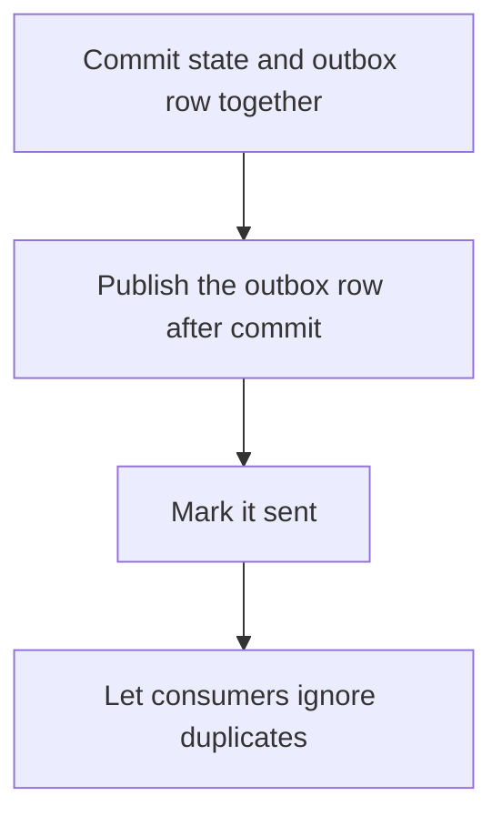

# D14-T021 — Transactional outbox

Topic ID: `D14-T021`
Domain: Messaging and Event-Driven Architecture
Subdomain: Transactional outbox
Importance: core
Complexity: advanced
Dependencies: `D14-T020`, `D14-T001`, `D04-T001`, `D04-T002`, `D05-T001`, `D05-T002`
Execution status of the code in section F: unexecuted

## A. Topic Overview

The transactional outbox writes the business row and the message row in the same database transaction. A separate publisher reads the outbox and publishes to the broker, then marks the row sent. If the process crashes after the commit and before the publish, the message is still in the table and will be sent. Consumers must be idempotent because the publisher may send twice. Polling or a log reader can drain the outbox.

In production this shows up as follows: An order insert and an outbox row commit together. A worker publishes order.created and sets published_at. A crash retries the publish. The inventory consumer upserts by event id.

Interviewers use Transactional outbox to see whether you can state the failure mode, not only the definition. The failure to name is: publishing to the broker inside the database transaction, which can commit the business row and fail the message, or the reverse

Prerequisites: `D14-T020`, `D14-T001`, `D04-T001`, `D04-T002`, `D05-T001`, `D05-T002`. Later notes should link here instead of repeating the mechanism.

## B. First-Principles Explanation

The transactional outbox writes the business row and the message row in the same database transaction. A separate publisher reads the outbox and publishes to the broker, then marks the row sent. If the process crashes after the commit and before the publish, the message is still in the table and will be sent. Consumers must be idempotent because the publisher may send twice. Polling or a log reader can drain the outbox.

The useful picture is: The outbox is a letter copied into the same ledger as the sale. A clerk later carries the letters to the post office. If the clerk trips, the letter is still in the ledger.

What has to be true:

1. Commit state and outbox row together
2. Publish the outbox row after commit
3. Mark it sent
4. Let consumers ignore duplicates

It works when those steps preserve one invariant. It fails when publishing to the broker inside the database transaction, which can commit the business row and fail the message, or the reverse. The alternative is: you send the message first and then commit, or the reverse, without a shared transaction

## C. Internal Working and Architecture

Components involved: the caller, the state Transactional outbox mutates or reads, and the observer that reports outbox rows older than the publish interval, and duplicate publishes.

Execution:

1. Commit state and outbox row together
2. Publish the outbox row after commit
3. Mark it sent
4. Let consumers ignore duplicates

Data moves only along that path. A retry re-enters at step 1, so the operation must say what a duplicate does. Memory and locks stay inside this mechanism. Callers see the result or a typed error, not a half-updated invariant.

State to remember: choose this when a database change must be accompanied by a message. Do not choose it when you send the message first and then commit, or the reverse, without a shared transaction.

## D. Diagrams and Visual Models



Read the diagram from top to bottom. Each box is one step of Transactional outbox. The failure mode (publishing to the broker inside the database transaction, which can commit the business row and fail the message, or the reverse) is what you look for when a later box never happens or happens twice.

## E. Examples and Analogies

Analogy: The outbox is a letter copied into the same ledger as the sale. A clerk later carries the letters to the post office. If the clerk trips, the letter is still in the ledger.

Production example: An order insert and an outbox row commit together. A worker publishes order.created and sets published_at. A crash retries the publish. The inventory consumer upserts by event id.

A small counterexample is enough in an interview. Show the input, apply the steps, and show the broken outcome if someone uses the mechanism outside its rule: publishing to the broker inside the database transaction, which can commit the business row and fail the message, or the reverse.

## F. Code Examples

The snippet is labeled unexecuted. It illustrates the shape of the idea. It is not a benchmark and it embeds no secret.

```python
def same_transaction(state_write, outbox_write):
    return 'commit both or neither'
```

After the snippet, check outbox rows older than the publish interval, and duplicate publishes. If that signal moves the wrong way, the snippet is the wrong tool for the workload.

## G. Practical Backend Application

Use Transactional outbox in a service when a database change must be accompanied by a message.

A typical place is the production case already stated: An order insert and an outbox row commit together. A worker publishes order.created and sets published_at. A crash retries the publish. The inventory consumer upserts by event id.

Operationally you alert on outbox rows older than the publish interval, and duplicate publishes. You do not alert only on process uptime. The dashboard should show the failure mode, a success rate, and the saturation signal (queue depth, lock wait, or latency) that predicts it.

## H. Advantages, Limitations and Trade-offs

| Choice | Benefit | Cost | Choose when | Avoid when |
| --- | --- | --- | --- | --- |
| Apply Transactional outbox | a database change must be accompanied by a message | Extra moving parts and a new failure mode | The failure you are preventing is already real | you send the message first and then commit, or the reverse, without a shared transaction |
| Simpler alternative | Less code and fewer dependencies | publishing to the broker inside the database transaction, which can commit the business row and fail the message, or the reverse | The workload does not hit the limit | The invariant must hold under concurrency or failure |

Transactional outbox is a trade. State the benefit and the cost in the same sentence when you propose it in a design review.

## I. Common Mistakes and Misconceptions

- Dual writes without an outbox.
- No idempotent consumer.
- An outbox nobody polls.
- Treating a diagram of Transactional outbox as proof that the invariant holds in production.
- Copying a default configuration without naming outbox rows older than the publish interval, and duplicate publishes.

## J. Debugging and Troubleshooting

Symptom: publishing to the broker inside the database transaction, which can commit the business row and fail the message, or the reverse

First check: outbox rows older than the publish interval, and duplicate publishes.

Then compare one healthy instance against one unhealthy instance. Confirm whether retries are duplicating work. Confirm whether a timeout is shorter than the work. Fix the invariant, then watch the same metric for a full peak, not only for the next minute.

Useful questions: did the step order in section C actually happen, or did a caller skip a step? Did a deploy change the data shape that Transactional outbox assumes?

## K. Interview Preparation

### Beginner

#### Q1. What problem does Transactional outbox solve?

**Answer:** The transactional outbox writes the business row and the message row in the same database transaction. A separate publisher reads the outbox and publishes to the broker, then marks the row sent. If the process crashes after the commit and before the publish, the message is still in the table and will be sent. Consumers must be idempotent because the publisher may send twice. Polling or a log reader can drain the outbox. Without it, the usual backend failure is: publishing to the broker inside the database transaction, which can commit the business row and fail the message, or the reverse.

#### Q2. Where does Transactional outbox sit on a request path?

**Answer:** Transactional outbox is not a library you sprinkle on every call. a database change must be accompanied by a message You notice it when outbox rows older than the publish interval, and duplicate publishes. Name the constraint that makes this choice correct. Say what you would measure to confirm it.

#### Q3. Give a concrete example of Transactional outbox.

**Answer:** An order insert and an outbox row commit together. A worker publishes order.created and sets published_at. A crash retries the publish. The inventory consumer upserts by event id. Walk the input, the state change, and the observable output.

#### Q4. What is a common mix-up around Transactional outbox?

**Answer:** publishing to the broker inside the database transaction, which can commit the business row and fail the message, or the reverse The corrective check is outbox rows older than the publish interval, and duplicate publishes. Name the constraint that makes this choice correct. Say what you would measure to confirm it. Say which alternative you rejected and why.

#### Q5. When would you skip Transactional outbox?

**Answer:** you send the message first and then commit, or the reverse, without a shared transaction Skipping is a decision with a measured cost, not a slogan. Name the constraint that makes this choice correct. Say what you would measure to confirm it. Say which alternative you rejected and why.

### Intermediate

#### Q1. What invariant makes Transactional outbox correct?

**Answer:** The transactional outbox writes the business row and the message row in the same database transaction. A separate publisher reads the outbox and publishes to the broker, then marks the row sent. If the process crashes after the commit and before the publish, the message is still in the table and will be sent. Consumers must be idempotent because the publisher may send twice. Polling or a log reader can drain the outbox. State the invariant before you name the tool.

#### Q2. How do you test Transactional outbox?

**Answer:** Assert the failure mode directly: publishing to the broker inside the database transaction, which can commit the business row and fail the message, or the reverse. The assertion should watch outbox rows older than the publish interval, and duplicate publishes. Include a concurrent or retry case if the bug only appears then. Name the constraint that makes this choice correct.

#### Q3. What signal tells you Transactional outbox is misbehaving in production?

**Answer:** Watch outbox rows older than the publish interval, and duplicate publishes. The user-visible symptom is usually publishing to the broker inside the database transaction, which can commit the business row and fail the message, or the reverse. Name the constraint that makes this choice correct. Say what you would measure to confirm it.

#### Q4. How would you introduce Transactional outbox into a legacy service?

**Answer:** a database change must be accompanied by a message Ship it behind a metric so you can compare the old path. Roll back if publishing to the broker inside the database transaction, which can commit the business row and fail the message, or the reverse gets worse. Name the constraint that makes this choice correct. Say what you would measure to confirm it.

#### Q5. What do you trade away by choosing Transactional outbox?

**Answer:** a database change must be accompanied by a message you send the message first and then commit, or the reverse, without a shared transaction Say the cost in latency, storage, or operational load. Name the constraint that makes this choice correct. Say what you would measure to confirm it. Say which alternative you rejected and why.

### Advanced

#### Q1. What breaks if a dependency of Transactional outbox is slow or down?

**Answer:** publishing to the broker inside the database transaction, which can commit the business row and fail the message, or the reverse Degrade using the rule: you send the message first and then commit, or the reverse, without a shared transaction. Timeouts must be shorter than the caller's deadline. Name the constraint that makes this choice correct. Say what you would measure to confirm it.

#### Q2. How does Transactional outbox behave under retries?

**Answer:** Retries repeat work, so Transactional outbox must define what a duplicate does. publishing to the broker inside the database transaction, which can commit the business row and fail the message, or the reverse Idempotency keys or fences belong next to the write, not in a comment. Name the constraint that makes this choice correct. Say what you would measure to confirm it.

#### Q3. What is the capacity limit of Transactional outbox?

**Answer:** The limit shows up as outbox rows older than the publish interval, and duplicate publishes. Add capacity only after you know whether the bottleneck is CPU, lock wait, or network. Name the constraint that makes this choice correct. Say what you would measure to confirm it.

#### Q4. How do you evolve Transactional outbox without a flag day?

**Answer:** a database change must be accompanied by a message Version the contract or the on-disk format. Readers should tolerate one old and one new shape during the rollout. Name the constraint that makes this choice correct. Say what you would measure to confirm it.

#### Q5. What security or correctness bug hides inside Transactional outbox?

**Answer:** publishing to the broker inside the database transaction, which can commit the business row and fail the message, or the reverse Check authorization and tenancy at the same boundary as the mechanism. A cache or queue must not widen who can read the data. Name the constraint that makes this choice correct. Say what you would measure to confirm it.

### Scenario

#### Q1. Incident: publishing to the broker inside the database transaction, which can commit the business row and fail the message, or the reverse. What do you check first?

**Answer:** Start with outbox rows older than the publish interval, and duplicate publishes. Compare a good host and a bad host before you restart anything. The transactional outbox writes the business row and the message row in the same database transaction. A separate publisher reads the outbox and publishes to the broker, then marks the row sent. If the process crashes after the commit and before the publish, the message is still in the table and will be sent. Consumers must be idempotent because the publisher may send twice. Polling or a log reader can drain the outbox.

#### Q2. A reviewer wants the clever version. What data settles it?

**Answer:** a database change must be accompanied by a message you send the message first and then commit, or the reverse, without a shared transaction Bring outbox rows older than the publish interval, and duplicate publishes from a load test or from production, not a slogan. Name the constraint that makes this choice correct. Say what you would measure to confirm it. Say which alternative you rejected and why.

#### Q3. You have one hour to explain Transactional outbox at a whiteboard.

**Answer:** Draw the happy path in four boxes. Then draw the failure: publishing to the broker inside the database transaction, which can commit the business row and fail the message, or the reverse. End with the metric you would page on. Name the constraint that makes this choice correct.

#### Q4. The bug only appears under two concurrent callers.

**Answer:** publishing to the broker inside the database transaction, which can commit the business row and fail the message, or the reverse Reproduce with a barrier so both sides enter the critical window. Confirm the fix with outbox rows older than the publish interval, and duplicate publishes. Name the constraint that makes this choice correct. Say what you would measure to confirm it.

#### Q5. Leadership wants this on every service next week.

**Answer:** you send the message first and then commit, or the reverse, without a shared transaction a database change must be accompanied by a message Roll it out where the failure mode is already hurting users. Name the constraint that makes this choice correct. Say what you would measure to confirm it. Say which alternative you rejected and why.

### Follow-up

#### Q1. What did you assume about the data size or the clock?

**Answer:** The transactional outbox writes the business row and the message row in the same database transaction. A separate publisher reads the outbox and publishes to the broker, then marks the row sent. If the process crashes after the commit and before the publish, the message is still in the table and will be sent. Consumers must be idempotent because the publisher may send twice. Polling or a log reader can drain the outbox. Clocks are not a total order across machines. State whether the algorithm needs bounded size or a single leader.

#### Q2. What would you measure after the change ships?

**Answer:** Page on outbox rows older than the publish interval, and duplicate publishes. Keep a before/after dashboard for one week. Alert on the failure mode, not only on CPU. Name the constraint that makes this choice correct.

#### Q3. Which neighboring topic did you deliberately not re-teach?

**Answer:** This note owns Transactional outbox. Related identifiers are in section N. Shared ideas are linked, not copied. Name the constraint that makes this choice correct.

## L. Practical Exercises

Solutions are in `EXERCISES/solutions/D14-T021.md`, not in this section.

1. Whiteboard the four steps of Transactional outbox and mark where `publishing to the broker inside the database transaction, which can commit the business row and fail the message, or the reverse` enters.
2. Read the snippet in section F and write the assertion that would catch that failure. The assertion must mention `outbox rows older than the publish interval, and duplicate publishes`.
3. Argue for or against using Transactional outbox on a service you know. Use the choose and avoid rows from section H. Do not appeal to popularity.

## M. Revision Notes

- Mechanism: The transactional outbox writes the business row and the message row in the same database transaction.
- Failure: publishing to the broker inside the database transaction, which can commit the business row and fail the message, or the reverse
- Metric: outbox rows older than the publish interval, and duplicate publishes
- Choose when: a database change must be accompanied by a message
- Avoid when: you send the message first and then commit, or the reverse, without a shared transaction

## N. Related Topics

Dependencies to review first: `D14-T020`, `D14-T001`, `D04-T001`, `D04-T002`, `D05-T001`, `D05-T002`.

Shared ideas stay in those notes. This note does not restate them.

## O. Completion Criteria

- You can explain Transactional outbox without reading this note, including the failure mode.
- You can draw the diagram in section D from memory.
- You can say when not to use it, using the avoid condition in section H.
- You can name the metric you would watch after shipping it.
