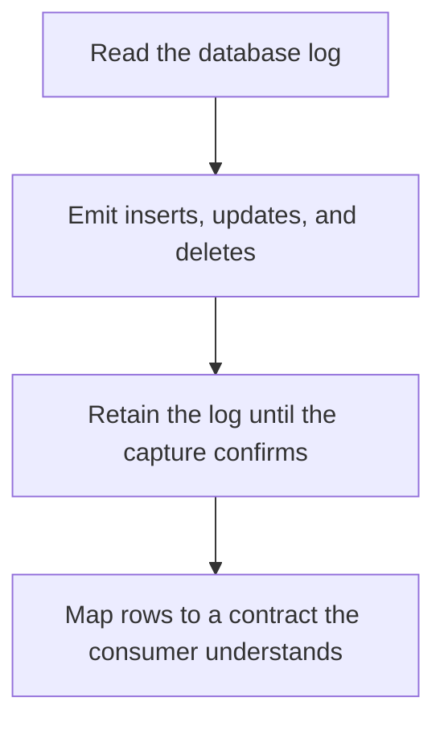

# D14-T022 — CDC (Change Data Capture)

Topic ID: `D14-T022`
Domain: Messaging and Event-Driven Architecture
Subdomain: CDC (Change Data Capture)
Importance: common
Complexity: advanced
Dependencies: `D14-T021`, `D14-T001`, `D04-T001`, `D04-T002`, `D05-T001`, `D05-T002`
Execution status of the code in section F: unexecuted

## A. Topic Overview

Change data capture reads a database's log and emits row changes to another system. It avoids a second write in the application. It sees committed changes, including those from other writers and manual SQL. Schema changes and bulk loads show up. The capture must not fall so far behind that the database cannot recycle its log. It is not a business-level event unless you map rows back to a meaning.

In production this shows up as follows: A connector streams the orders table into a search index. A migration that updates every row creates a huge change stream. The search pipeline has to tolerate that backfill.

Interviewers use CDC (Change Data Capture) to see whether you can state the failure mode, not only the definition. The failure to name is: the database deleting WAL a capture has not read, or a consumer treating a raw update as a clean domain event

Prerequisites: `D14-T021`, `D14-T001`, `D04-T001`, `D04-T002`, `D05-T001`, `D05-T002`. Later notes should link here instead of repeating the mechanism.

## B. First-Principles Explanation

Change data capture reads a database's log and emits row changes to another system. It avoids a second write in the application. It sees committed changes, including those from other writers and manual SQL. Schema changes and bulk loads show up. The capture must not fall so far behind that the database cannot recycle its log. It is not a business-level event unless you map rows back to a meaning.

The useful picture is: CDC is photocopying the diary as it is written, instead of asking the clerk to also drop a note in a box. You see every line, including the ones the clerk did not mean as announcements.

What has to be true:

1. Read the database log
2. Emit inserts, updates, and deletes
3. Retain the log until the capture confirms
4. Map rows to a contract the consumer understands

It works when those steps preserve one invariant. It fails when the database deleting WAL a capture has not read, or a consumer treating a raw update as a clean domain event. The alternative is: you needed a domain event with intent the row image does not carry

## C. Internal Working and Architecture

Components involved: the caller, the state CDC (Change Data Capture) mutates or reads, and the observer that reports CDC lag versus log retention, and schema-change failures.

Execution:

1. Read the database log
2. Emit inserts, updates, and deletes
3. Retain the log until the capture confirms
4. Map rows to a contract the consumer understands

Data moves only along that path. A retry re-enters at step 1, so the operation must say what a duplicate does. Memory and locks stay inside this mechanism. Callers see the result or a typed error, not a half-updated invariant.

State to remember: choose this when you need to react to committed rows without a dual write. Do not choose it when you needed a domain event with intent the row image does not carry.

## D. Diagrams and Visual Models



Read the diagram from top to bottom. Each box is one step of CDC (Change Data Capture). The failure mode (the database deleting WAL a capture has not read, or a consumer treating a raw update as a clean domain event) is what you look for when a later box never happens or happens twice.

## E. Examples and Analogies

Analogy: CDC is photocopying the diary as it is written, instead of asking the clerk to also drop a note in a box. You see every line, including the ones the clerk did not mean as announcements.

Production example: A connector streams the orders table into a search index. A migration that updates every row creates a huge change stream. The search pipeline has to tolerate that backfill.

A small counterexample is enough in an interview. Show the input, apply the steps, and show the broken outcome if someone uses the mechanism outside its rule: the database deleting WAL a capture has not read, or a consumer treating a raw update as a clean domain event.

## F. Code Examples

The snippet is labeled unexecuted. It illustrates the shape of the idea. It is not a benchmark and it embeds no secret.

```python
def map_row(change):
    return {'id': change['after']['id'], 'op': change['op']}
```

After the snippet, check CDC lag versus log retention, and schema-change failures. If that signal moves the wrong way, the snippet is the wrong tool for the workload.

## G. Practical Backend Application

Use CDC (Change Data Capture) in a service when you need to react to committed rows without a dual write.

A typical place is the production case already stated: A connector streams the orders table into a search index. A migration that updates every row creates a huge change stream. The search pipeline has to tolerate that backfill.

Operationally you alert on CDC lag versus log retention, and schema-change failures. You do not alert only on process uptime. The dashboard should show the failure mode, a success rate, and the saturation signal (queue depth, lock wait, or latency) that predicts it.

## H. Advantages, Limitations and Trade-offs

| Choice | Benefit | Cost | Choose when | Avoid when |
| --- | --- | --- | --- | --- |
| Apply CDC (Change Data Capture) | you need to react to committed rows without a dual write | Extra moving parts and a new failure mode | The failure you are preventing is already real | you needed a domain event with intent the row image does not carry |
| Simpler alternative | Less code and fewer dependencies | the database deleting WAL a capture has not read, or a consumer treating a raw update as a clean domain event | The workload does not hit the limit | The invariant must hold under concurrency or failure |

CDC (Change Data Capture) is a trade. State the benefit and the cost in the same sentence when you propose it in a design review.

## I. Common Mistakes and Misconceptions

- No retention for the log.
- Assuming CDC events are exactly the domain language.
- Ignoring snapshot plus stream ordering.
- Treating a diagram of CDC (Change Data Capture) as proof that the invariant holds in production.
- Copying a default configuration without naming CDC lag versus log retention, and schema-change failures.

## J. Debugging and Troubleshooting

Symptom: the database deleting WAL a capture has not read, or a consumer treating a raw update as a clean domain event

First check: CDC lag versus log retention, and schema-change failures.

Then compare one healthy instance against one unhealthy instance. Confirm whether retries are duplicating work. Confirm whether a timeout is shorter than the work. Fix the invariant, then watch the same metric for a full peak, not only for the next minute.

Useful questions: did the step order in section C actually happen, or did a caller skip a step? Did a deploy change the data shape that CDC (Change Data Capture) assumes?

## K. Interview Preparation

### Beginner

#### Q1. What problem does CDC (Change Data Capture) solve?

**Answer:** Change data capture reads a database's log and emits row changes to another system. It avoids a second write in the application. It sees committed changes, including those from other writers and manual SQL. Schema changes and bulk loads show up. The capture must not fall so far behind that the database cannot recycle its log. It is not a business-level event unless you map rows back to a meaning. Without it, the usual backend failure is: the database deleting WAL a capture has not read, or a consumer treating a raw update as a clean domain event.

#### Q2. Where does CDC (Change Data Capture) sit on a request path?

**Answer:** CDC (Change Data Capture) is not a library you sprinkle on every call. you need to react to committed rows without a dual write You notice it when CDC lag versus log retention, and schema-change failures. Name the constraint that makes this choice correct. Say what you would measure to confirm it.

#### Q3. Give a concrete example of CDC (Change Data Capture).

**Answer:** A connector streams the orders table into a search index. A migration that updates every row creates a huge change stream. The search pipeline has to tolerate that backfill. Walk the input, the state change, and the observable output.

#### Q4. What is a common mix-up around CDC (Change Data Capture)?

**Answer:** the database deleting WAL a capture has not read, or a consumer treating a raw update as a clean domain event The corrective check is CDC lag versus log retention, and schema-change failures. Name the constraint that makes this choice correct. Say what you would measure to confirm it. Say which alternative you rejected and why.

#### Q5. When would you skip CDC (Change Data Capture)?

**Answer:** you needed a domain event with intent the row image does not carry Skipping is a decision with a measured cost, not a slogan. Name the constraint that makes this choice correct. Say what you would measure to confirm it. Say which alternative you rejected and why.

### Intermediate

#### Q1. What invariant makes CDC (Change Data Capture) correct?

**Answer:** Change data capture reads a database's log and emits row changes to another system. It avoids a second write in the application. It sees committed changes, including those from other writers and manual SQL. Schema changes and bulk loads show up. The capture must not fall so far behind that the database cannot recycle its log. It is not a business-level event unless you map rows back to a meaning. State the invariant before you name the tool.

#### Q2. How do you test CDC (Change Data Capture)?

**Answer:** Assert the failure mode directly: the database deleting WAL a capture has not read, or a consumer treating a raw update as a clean domain event. The assertion should watch CDC lag versus log retention, and schema-change failures. Include a concurrent or retry case if the bug only appears then. Name the constraint that makes this choice correct.

#### Q3. What signal tells you CDC (Change Data Capture) is misbehaving in production?

**Answer:** Watch CDC lag versus log retention, and schema-change failures. The user-visible symptom is usually the database deleting WAL a capture has not read, or a consumer treating a raw update as a clean domain event. Name the constraint that makes this choice correct. Say what you would measure to confirm it.

#### Q4. How would you introduce CDC (Change Data Capture) into a legacy service?

**Answer:** you need to react to committed rows without a dual write Ship it behind a metric so you can compare the old path. Roll back if the database deleting WAL a capture has not read, or a consumer treating a raw update as a clean domain event gets worse. Name the constraint that makes this choice correct. Say what you would measure to confirm it.

#### Q5. What do you trade away by choosing CDC (Change Data Capture)?

**Answer:** you need to react to committed rows without a dual write you needed a domain event with intent the row image does not carry Say the cost in latency, storage, or operational load. Name the constraint that makes this choice correct. Say what you would measure to confirm it. Say which alternative you rejected and why.

### Advanced

#### Q1. What breaks if a dependency of CDC (Change Data Capture) is slow or down?

**Answer:** the database deleting WAL a capture has not read, or a consumer treating a raw update as a clean domain event Degrade using the rule: you needed a domain event with intent the row image does not carry. Timeouts must be shorter than the caller's deadline. Name the constraint that makes this choice correct. Say what you would measure to confirm it.

#### Q2. How does CDC (Change Data Capture) behave under retries?

**Answer:** Retries repeat work, so CDC (Change Data Capture) must define what a duplicate does. the database deleting WAL a capture has not read, or a consumer treating a raw update as a clean domain event Idempotency keys or fences belong next to the write, not in a comment. Name the constraint that makes this choice correct. Say what you would measure to confirm it.

#### Q3. What is the capacity limit of CDC (Change Data Capture)?

**Answer:** The limit shows up as CDC lag versus log retention, and schema-change failures. Add capacity only after you know whether the bottleneck is CPU, lock wait, or network. Name the constraint that makes this choice correct. Say what you would measure to confirm it.

#### Q4. How do you evolve CDC (Change Data Capture) without a flag day?

**Answer:** you need to react to committed rows without a dual write Version the contract or the on-disk format. Readers should tolerate one old and one new shape during the rollout. Name the constraint that makes this choice correct. Say what you would measure to confirm it.

#### Q5. What security or correctness bug hides inside CDC (Change Data Capture)?

**Answer:** the database deleting WAL a capture has not read, or a consumer treating a raw update as a clean domain event Check authorization and tenancy at the same boundary as the mechanism. A cache or queue must not widen who can read the data. Name the constraint that makes this choice correct. Say what you would measure to confirm it.

### Scenario

#### Q1. Incident: the database deleting WAL a capture has not read, or a consumer treating a raw update as a clean domain event. What do you check first?

**Answer:** Start with CDC lag versus log retention, and schema-change failures. Compare a good host and a bad host before you restart anything. Change data capture reads a database's log and emits row changes to another system. It avoids a second write in the application. It sees committed changes, including those from other writers and manual SQL. Schema changes and bulk loads show up. The capture must not fall so far behind that the database cannot recycle its log. It is not a business-level event unless you map rows back to a meaning.

#### Q2. A reviewer wants the clever version. What data settles it?

**Answer:** you need to react to committed rows without a dual write you needed a domain event with intent the row image does not carry Bring CDC lag versus log retention, and schema-change failures from a load test or from production, not a slogan. Name the constraint that makes this choice correct. Say what you would measure to confirm it. Say which alternative you rejected and why.

#### Q3. You have one hour to explain CDC (Change Data Capture) at a whiteboard.

**Answer:** Draw the happy path in four boxes. Then draw the failure: the database deleting WAL a capture has not read, or a consumer treating a raw update as a clean domain event. End with the metric you would page on. Name the constraint that makes this choice correct.

#### Q4. The bug only appears under two concurrent callers.

**Answer:** the database deleting WAL a capture has not read, or a consumer treating a raw update as a clean domain event Reproduce with a barrier so both sides enter the critical window. Confirm the fix with CDC lag versus log retention, and schema-change failures. Name the constraint that makes this choice correct. Say what you would measure to confirm it.

#### Q5. Leadership wants this on every service next week.

**Answer:** you needed a domain event with intent the row image does not carry you need to react to committed rows without a dual write Roll it out where the failure mode is already hurting users. Name the constraint that makes this choice correct. Say what you would measure to confirm it. Say which alternative you rejected and why.

### Follow-up

#### Q1. What did you assume about the data size or the clock?

**Answer:** Change data capture reads a database's log and emits row changes to another system. It avoids a second write in the application. It sees committed changes, including those from other writers and manual SQL. Schema changes and bulk loads show up. The capture must not fall so far behind that the database cannot recycle its log. It is not a business-level event unless you map rows back to a meaning. Clocks are not a total order across machines. State whether the algorithm needs bounded size or a single leader.

#### Q2. What would you measure after the change ships?

**Answer:** Page on CDC lag versus log retention, and schema-change failures. Keep a before/after dashboard for one week. Alert on the failure mode, not only on CPU. Name the constraint that makes this choice correct.

#### Q3. Which neighboring topic did you deliberately not re-teach?

**Answer:** This note owns CDC (Change Data Capture). Related identifiers are in section N. Shared ideas are linked, not copied. Name the constraint that makes this choice correct.

## L. Practical Exercises

Solutions are in `EXERCISES/solutions/D14-T022.md`, not in this section.

1. Whiteboard the four steps of CDC (Change Data Capture) and mark where `the database deleting WAL a capture has not read, or a consumer treating a raw update as a clean domain event` enters.
2. Read the snippet in section F and write the assertion that would catch that failure. The assertion must mention `CDC lag versus log retention, and schema-change failures`.
3. Argue for or against using CDC (Change Data Capture) on a service you know. Use the choose and avoid rows from section H. Do not appeal to popularity.

## M. Revision Notes

- Mechanism: Change data capture reads a database's log and emits row changes to another system.
- Failure: the database deleting WAL a capture has not read, or a consumer treating a raw update as a clean domain event
- Metric: CDC lag versus log retention, and schema-change failures
- Choose when: you need to react to committed rows without a dual write
- Avoid when: you needed a domain event with intent the row image does not carry

## N. Related Topics

Dependencies to review first: `D14-T021`, `D14-T001`, `D04-T001`, `D04-T002`, `D05-T001`, `D05-T002`.

Shared ideas stay in those notes. This note does not restate them.

## O. Completion Criteria

- You can explain CDC (Change Data Capture) without reading this note, including the failure mode.
- You can draw the diagram in section D from memory.
- You can say when not to use it, using the avoid condition in section H.
- You can name the metric you would watch after shipping it.
