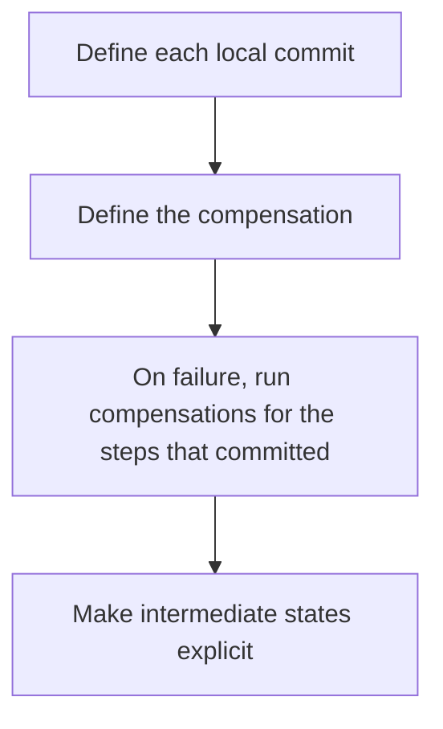

# D14-T023 — Sagas and compensating actions

Topic ID: `D14-T023`
Domain: Messaging and Event-Driven Architecture
Subdomain: Sagas and compensating actions
Importance: common
Complexity: advanced
Dependencies: `D14-T022`, `D14-T001`, `D04-T001`, `D04-T002`, `D05-T001`, `D05-T002`
Execution status of the code in section F: unexecuted

## A. Topic Overview

A saga is a sequence of local transactions with a compensating action for each step that can fail later. It is used when one database transaction cannot span the services. Choreography lets each service react to events. Orchestration gives one coordinator the next step. Compensations must be idempotent and possible. A saga does not give isolation. Other readers can see intermediate states.

In production this shows up as follows: An order charges a card, reserves stock, and books a shipment. If shipment fails, the saga refunds the card and releases stock. The customer may have seen 'paid' in between. The API says so.

Interviewers use Sagas and compensating actions to see whether you can state the failure mode, not only the definition. The failure to name is: a compensation that cannot undo a real-world effect, such as an email already read, or two sagas interleaving without a semantic lock

Prerequisites: `D14-T022`, `D14-T001`, `D04-T001`, `D04-T002`, `D05-T001`, `D05-T002`. Later notes should link here instead of repeating the mechanism.

## B. First-Principles Explanation

A saga is a sequence of local transactions with a compensating action for each step that can fail later. It is used when one database transaction cannot span the services. Choreography lets each service react to events. Orchestration gives one coordinator the next step. Compensations must be idempotent and possible. A saga does not give isolation. Other readers can see intermediate states.

The useful picture is: A saga is a trip with a plan for turning around at each station. It is not a single ticket that can be unprinted from every station at once.

What has to be true:

1. Define each local commit
2. Define the compensation
3. On failure, run compensations for the steps that committed
4. Make intermediate states explicit

It works when those steps preserve one invariant. It fails when a compensation that cannot undo a real-world effect, such as an email already read, or two sagas interleaving without a semantic lock. The alternative is: one database could have done it atomically

## C. Internal Working and Architecture

Components involved: the caller, the state Sagas and compensating actions mutates or reads, and the observer that reports saga completion time and compensation failure count.

Execution:

1. Define each local commit
2. Define the compensation
3. On failure, run compensations for the steps that committed
4. Make intermediate states explicit

Data moves only along that path. A retry re-enters at step 1, so the operation must say what a duplicate does. Memory and locks stay inside this mechanism. Callers see the result or a typed error, not a half-updated invariant.

State to remember: choose this when a business process spans services that cannot share one transaction. Do not choose it when one database could have done it atomically.

## D. Diagrams and Visual Models



Read the diagram from top to bottom. Each box is one step of Sagas and compensating actions. The failure mode (a compensation that cannot undo a real-world effect, such as an email already read, or two sagas interleaving without a semantic lock) is what you look for when a later box never happens or happens twice.

## E. Examples and Analogies

Analogy: A saga is a trip with a plan for turning around at each station. It is not a single ticket that can be unprinted from every station at once.

Production example: An order charges a card, reserves stock, and books a shipment. If shipment fails, the saga refunds the card and releases stock. The customer may have seen 'paid' in between. The API says so.

A small counterexample is enough in an interview. Show the input, apply the steps, and show the broken outcome if someone uses the mechanism outside its rule: a compensation that cannot undo a real-world effect, such as an email already read, or two sagas interleaving without a semantic lock.

## F. Code Examples

The snippet is labeled unexecuted. It illustrates the shape of the idea. It is not a benchmark and it embeds no secret.

```python
def compensate(steps_done):
    for step in reversed(steps_done):
        step.undo()
```

After the snippet, check saga completion time and compensation failure count. If that signal moves the wrong way, the snippet is the wrong tool for the workload.

## G. Practical Backend Application

Use Sagas and compensating actions in a service when a business process spans services that cannot share one transaction.

A typical place is the production case already stated: An order charges a card, reserves stock, and books a shipment. If shipment fails, the saga refunds the card and releases stock. The customer may have seen 'paid' in between. The API says so.

Operationally you alert on saga completion time and compensation failure count. You do not alert only on process uptime. The dashboard should show the failure mode, a success rate, and the saturation signal (queue depth, lock wait, or latency) that predicts it.

## H. Advantages, Limitations and Trade-offs

| Choice | Benefit | Cost | Choose when | Avoid when |
| --- | --- | --- | --- | --- |
| Apply Sagas and compensating actions | a business process spans services that cannot share one transaction | Extra moving parts and a new failure mode | The failure you are preventing is already real | one database could have done it atomically |
| Simpler alternative | Less code and fewer dependencies | a compensation that cannot undo a real-world effect, such as an email already read, or two sagas interleaving without a semantic lock | The workload does not hit the limit | The invariant must hold under concurrency or failure |

Sagas and compensating actions is a trade. State the benefit and the cost in the same sentence when you propose it in a design review.

## I. Common Mistakes and Misconceptions

- No compensation.
- Assuming serializability.
- A compensation that is not idempotent.
- Treating a diagram of Sagas and compensating actions as proof that the invariant holds in production.
- Copying a default configuration without naming saga completion time and compensation failure count.

## J. Debugging and Troubleshooting

Symptom: a compensation that cannot undo a real-world effect, such as an email already read, or two sagas interleaving without a semantic lock

First check: saga completion time and compensation failure count.

Then compare one healthy instance against one unhealthy instance. Confirm whether retries are duplicating work. Confirm whether a timeout is shorter than the work. Fix the invariant, then watch the same metric for a full peak, not only for the next minute.

Useful questions: did the step order in section C actually happen, or did a caller skip a step? Did a deploy change the data shape that Sagas and compensating actions assumes?

## K. Interview Preparation

### Beginner

#### Q1. What problem does Sagas and compensating actions solve?

**Answer:** A saga is a sequence of local transactions with a compensating action for each step that can fail later. It is used when one database transaction cannot span the services. Choreography lets each service react to events. Orchestration gives one coordinator the next step. Compensations must be idempotent and possible. A saga does not give isolation. Other readers can see intermediate states. Without it, the usual backend failure is: a compensation that cannot undo a real-world effect, such as an email already read, or two sagas interleaving without a semantic lock.

#### Q2. Where does Sagas and compensating actions sit on a request path?

**Answer:** Sagas and compensating actions is not a library you sprinkle on every call. a business process spans services that cannot share one transaction You notice it when saga completion time and compensation failure count. Name the constraint that makes this choice correct. Say what you would measure to confirm it.

#### Q3. Give a concrete example of Sagas and compensating actions.

**Answer:** An order charges a card, reserves stock, and books a shipment. If shipment fails, the saga refunds the card and releases stock. The customer may have seen 'paid' in between. The API says so. Walk the input, the state change, and the observable output.

#### Q4. What is a common mix-up around Sagas and compensating actions?

**Answer:** a compensation that cannot undo a real-world effect, such as an email already read, or two sagas interleaving without a semantic lock The corrective check is saga completion time and compensation failure count. Name the constraint that makes this choice correct. Say what you would measure to confirm it. Say which alternative you rejected and why.

#### Q5. When would you skip Sagas and compensating actions?

**Answer:** one database could have done it atomically Skipping is a decision with a measured cost, not a slogan. Name the constraint that makes this choice correct. Say what you would measure to confirm it. Say which alternative you rejected and why.

### Intermediate

#### Q1. What invariant makes Sagas and compensating actions correct?

**Answer:** A saga is a sequence of local transactions with a compensating action for each step that can fail later. It is used when one database transaction cannot span the services. Choreography lets each service react to events. Orchestration gives one coordinator the next step. Compensations must be idempotent and possible. A saga does not give isolation. Other readers can see intermediate states. State the invariant before you name the tool.

#### Q2. How do you test Sagas and compensating actions?

**Answer:** Assert the failure mode directly: a compensation that cannot undo a real-world effect, such as an email already read, or two sagas interleaving without a semantic lock. The assertion should watch saga completion time and compensation failure count. Include a concurrent or retry case if the bug only appears then. Name the constraint that makes this choice correct.

#### Q3. What signal tells you Sagas and compensating actions is misbehaving in production?

**Answer:** Watch saga completion time and compensation failure count. The user-visible symptom is usually a compensation that cannot undo a real-world effect, such as an email already read, or two sagas interleaving without a semantic lock. Name the constraint that makes this choice correct. Say what you would measure to confirm it.

#### Q4. How would you introduce Sagas and compensating actions into a legacy service?

**Answer:** a business process spans services that cannot share one transaction Ship it behind a metric so you can compare the old path. Roll back if a compensation that cannot undo a real-world effect, such as an email already read, or two sagas interleaving without a semantic lock gets worse. Name the constraint that makes this choice correct. Say what you would measure to confirm it.

#### Q5. What do you trade away by choosing Sagas and compensating actions?

**Answer:** a business process spans services that cannot share one transaction one database could have done it atomically Say the cost in latency, storage, or operational load. Name the constraint that makes this choice correct. Say what you would measure to confirm it. Say which alternative you rejected and why.

### Advanced

#### Q1. What breaks if a dependency of Sagas and compensating actions is slow or down?

**Answer:** a compensation that cannot undo a real-world effect, such as an email already read, or two sagas interleaving without a semantic lock Degrade using the rule: one database could have done it atomically. Timeouts must be shorter than the caller's deadline. Name the constraint that makes this choice correct. Say what you would measure to confirm it.

#### Q2. How does Sagas and compensating actions behave under retries?

**Answer:** Retries repeat work, so Sagas and compensating actions must define what a duplicate does. a compensation that cannot undo a real-world effect, such as an email already read, or two sagas interleaving without a semantic lock Idempotency keys or fences belong next to the write, not in a comment. Name the constraint that makes this choice correct. Say what you would measure to confirm it.

#### Q3. What is the capacity limit of Sagas and compensating actions?

**Answer:** The limit shows up as saga completion time and compensation failure count. Add capacity only after you know whether the bottleneck is CPU, lock wait, or network. Name the constraint that makes this choice correct. Say what you would measure to confirm it.

#### Q4. How do you evolve Sagas and compensating actions without a flag day?

**Answer:** a business process spans services that cannot share one transaction Version the contract or the on-disk format. Readers should tolerate one old and one new shape during the rollout. Name the constraint that makes this choice correct. Say what you would measure to confirm it.

#### Q5. What security or correctness bug hides inside Sagas and compensating actions?

**Answer:** a compensation that cannot undo a real-world effect, such as an email already read, or two sagas interleaving without a semantic lock Check authorization and tenancy at the same boundary as the mechanism. A cache or queue must not widen who can read the data. Name the constraint that makes this choice correct. Say what you would measure to confirm it.

### Scenario

#### Q1. Incident: a compensation that cannot undo a real-world effect, such as an email already read, or two sagas interleaving without a semantic lock. What do you check first?

**Answer:** Start with saga completion time and compensation failure count. Compare a good host and a bad host before you restart anything. A saga is a sequence of local transactions with a compensating action for each step that can fail later. It is used when one database transaction cannot span the services. Choreography lets each service react to events. Orchestration gives one coordinator the next step. Compensations must be idempotent and possible. A saga does not give isolation. Other readers can see intermediate states.

#### Q2. A reviewer wants the clever version. What data settles it?

**Answer:** a business process spans services that cannot share one transaction one database could have done it atomically Bring saga completion time and compensation failure count from a load test or from production, not a slogan. Name the constraint that makes this choice correct. Say what you would measure to confirm it. Say which alternative you rejected and why.

#### Q3. You have one hour to explain Sagas and compensating actions at a whiteboard.

**Answer:** Draw the happy path in four boxes. Then draw the failure: a compensation that cannot undo a real-world effect, such as an email already read, or two sagas interleaving without a semantic lock. End with the metric you would page on. Name the constraint that makes this choice correct.

#### Q4. The bug only appears under two concurrent callers.

**Answer:** a compensation that cannot undo a real-world effect, such as an email already read, or two sagas interleaving without a semantic lock Reproduce with a barrier so both sides enter the critical window. Confirm the fix with saga completion time and compensation failure count. Name the constraint that makes this choice correct. Say what you would measure to confirm it.

#### Q5. Leadership wants this on every service next week.

**Answer:** one database could have done it atomically a business process spans services that cannot share one transaction Roll it out where the failure mode is already hurting users. Name the constraint that makes this choice correct. Say what you would measure to confirm it. Say which alternative you rejected and why.

### Follow-up

#### Q1. What did you assume about the data size or the clock?

**Answer:** A saga is a sequence of local transactions with a compensating action for each step that can fail later. It is used when one database transaction cannot span the services. Choreography lets each service react to events. Orchestration gives one coordinator the next step. Compensations must be idempotent and possible. A saga does not give isolation. Other readers can see intermediate states. Clocks are not a total order across machines. State whether the algorithm needs bounded size or a single leader.

#### Q2. What would you measure after the change ships?

**Answer:** Page on saga completion time and compensation failure count. Keep a before/after dashboard for one week. Alert on the failure mode, not only on CPU. Name the constraint that makes this choice correct.

#### Q3. Which neighboring topic did you deliberately not re-teach?

**Answer:** This note owns Sagas and compensating actions. Related identifiers are in section N. Shared ideas are linked, not copied. Name the constraint that makes this choice correct.

## L. Practical Exercises

Solutions are in `EXERCISES/solutions/D14-T023.md`, not in this section.

1. Whiteboard the four steps of Sagas and compensating actions and mark where `a compensation that cannot undo a real-world effect, such as an email already read, or two sagas interleaving without a semantic lock` enters.
2. Read the snippet in section F and write the assertion that would catch that failure. The assertion must mention `saga completion time and compensation failure count`.
3. Argue for or against using Sagas and compensating actions on a service you know. Use the choose and avoid rows from section H. Do not appeal to popularity.

## M. Revision Notes

- Mechanism: A saga is a sequence of local transactions with a compensating action for each step that can fail later.
- Failure: a compensation that cannot undo a real-world effect, such as an email already read, or two sagas interleaving without a semantic lock
- Metric: saga completion time and compensation failure count
- Choose when: a business process spans services that cannot share one transaction
- Avoid when: one database could have done it atomically

## N. Related Topics

Dependencies to review first: `D14-T022`, `D14-T001`, `D04-T001`, `D04-T002`, `D05-T001`, `D05-T002`.

Shared ideas stay in those notes. This note does not restate them.

## O. Completion Criteria

- You can explain Sagas and compensating actions without reading this note, including the failure mode.
- You can draw the diagram in section D from memory.
- You can say when not to use it, using the avoid condition in section H.
- You can name the metric you would watch after shipping it.
