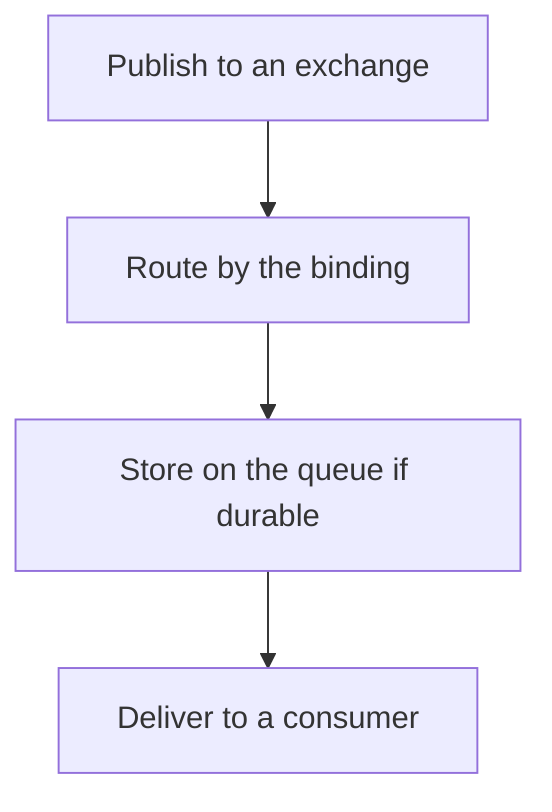

# D14-T024 — RabbitMQ exchanges, queues and bindings

Topic ID: `D14-T024`
Domain: Messaging and Event-Driven Architecture
Subdomain: RabbitMQ exchanges, queues and bindings
Importance: common
Complexity: advanced
Dependencies: `D14-T023`, `D14-T001`, `D04-T001`, `D04-T002`, `D05-T001`, `D05-T002`
Execution status of the code in section F: unexecuted

## A. Topic Overview

In RabbitMQ, an exchange receives a publish and routes it to queues using bindings. A direct exchange matches a routing key. A topic exchange matches a pattern. A fanout delivers to every bound queue. A queue is what consumers read. The broker, not the consumer group protocol, pushes messages. Durability of exchange, queue, and message are separate flags.

In production this shows up as follows: An order service publishes to an orders exchange with routing key order.created. The email queue and the warehouse queue bind to that key or a pattern. A missing binding returns the message if the publisher asked for it.

Interviewers use RabbitMQ exchanges, queues and bindings to see whether you can state the failure mode, not only the definition. The failure to name is: a non-durable queue that vanishes on restart, or a binding so wide that every consumer gets every message

Prerequisites: `D14-T023`, `D14-T001`, `D04-T001`, `D04-T002`, `D05-T001`, `D05-T002`. Later notes should link here instead of repeating the mechanism.

## B. First-Principles Explanation

In RabbitMQ, an exchange receives a publish and routes it to queues using bindings. A direct exchange matches a routing key. A topic exchange matches a pattern. A fanout delivers to every bound queue. A queue is what consumers read. The broker, not the consumer group protocol, pushes messages. Durability of exchange, queue, and message are separate flags.

The useful picture is: An exchange is a sorting table. Bindings are the rules painted on the bins. A queue is one bin. Publishing straight into a bin is a special case, not the whole model.

What has to be true:

1. Publish to an exchange
2. Route by the binding
3. Store on the queue if durable
4. Deliver to a consumer

It works when those steps preserve one invariant. It fails when a non-durable queue that vanishes on restart, or a binding so wide that every consumer gets every message. The alternative is: you need a replayable log of every event for a new consumer next month

## C. Internal Working and Architecture

Components involved: the caller, the state RabbitMQ exchanges, queues and bindings mutates or reads, and the observer that reports queue depth, unroutable message count, and consumer utilisation.

Execution:

1. Publish to an exchange
2. Route by the binding
3. Store on the queue if durable
4. Deliver to a consumer

Data moves only along that path. A retry re-enters at step 1, so the operation must say what a duplicate does. Memory and locks stay inside this mechanism. Callers see the result or a typed error, not a half-updated invariant.

State to remember: choose this when you want routing and competing consumers on a broker queue. Do not choose it when you need a replayable log of every event for a new consumer next month.

## D. Diagrams and Visual Models



Read the diagram from top to bottom. Each box is one step of RabbitMQ exchanges, queues and bindings. The failure mode (a non-durable queue that vanishes on restart, or a binding so wide that every consumer gets every message) is what you look for when a later box never happens or happens twice.

## E. Examples and Analogies

Analogy: An exchange is a sorting table. Bindings are the rules painted on the bins. A queue is one bin. Publishing straight into a bin is a special case, not the whole model.

Production example: An order service publishes to an orders exchange with routing key order.created. The email queue and the warehouse queue bind to that key or a pattern. A missing binding returns the message if the publisher asked for it.

A small counterexample is enough in an interview. Show the input, apply the steps, and show the broken outcome if someone uses the mechanism outside its rule: a non-durable queue that vanishes on restart, or a binding so wide that every consumer gets every message.

## F. Code Examples

The snippet is labeled unexecuted. It illustrates the shape of the idea. It is not a benchmark and it embeds no secret.

```python
def route(exchange, key, bindings):
    return [q for pattern, q in bindings if pattern == key]
```

After the snippet, check queue depth, unroutable message count, and consumer utilisation. If that signal moves the wrong way, the snippet is the wrong tool for the workload.

## G. Practical Backend Application

Use RabbitMQ exchanges, queues and bindings in a service when you want routing and competing consumers on a broker queue.

A typical place is the production case already stated: An order service publishes to an orders exchange with routing key order.created. The email queue and the warehouse queue bind to that key or a pattern. A missing binding returns the message if the publisher asked for it.

Operationally you alert on queue depth, unroutable message count, and consumer utilisation. You do not alert only on process uptime. The dashboard should show the failure mode, a success rate, and the saturation signal (queue depth, lock wait, or latency) that predicts it.

## H. Advantages, Limitations and Trade-offs

| Choice | Benefit | Cost | Choose when | Avoid when |
| --- | --- | --- | --- | --- |
| Apply RabbitMQ exchanges, queues and bindings | you want routing and competing consumers on a broker queue | Extra moving parts and a new failure mode | The failure you are preventing is already real | you need a replayable log of every event for a new consumer next month |
| Simpler alternative | Less code and fewer dependencies | a non-durable queue that vanishes on restart, or a binding so wide that every consumer gets every message | The workload does not hit the limit | The invariant must hold under concurrency or failure |

RabbitMQ exchanges, queues and bindings is a trade. State the benefit and the cost in the same sentence when you propose it in a design review.

## I. Common Mistakes and Misconceptions

- Durable queues with transient messages.
- A fanout you did not mean.
- No dead-letter policy on the queue.
- Treating a diagram of RabbitMQ exchanges, queues and bindings as proof that the invariant holds in production.
- Copying a default configuration without naming queue depth, unroutable message count, and consumer utilisation.

## J. Debugging and Troubleshooting

Symptom: a non-durable queue that vanishes on restart, or a binding so wide that every consumer gets every message

First check: queue depth, unroutable message count, and consumer utilisation.

Then compare one healthy instance against one unhealthy instance. Confirm whether retries are duplicating work. Confirm whether a timeout is shorter than the work. Fix the invariant, then watch the same metric for a full peak, not only for the next minute.

Useful questions: did the step order in section C actually happen, or did a caller skip a step? Did a deploy change the data shape that RabbitMQ exchanges, queues and bindings assumes?

## K. Interview Preparation

### Beginner

#### Q1. What problem does RabbitMQ exchanges, queues and bindings solve?

**Answer:** In RabbitMQ, an exchange receives a publish and routes it to queues using bindings. A direct exchange matches a routing key. A topic exchange matches a pattern. A fanout delivers to every bound queue. A queue is what consumers read. The broker, not the consumer group protocol, pushes messages. Durability of exchange, queue, and message are separate flags. Without it, the usual backend failure is: a non-durable queue that vanishes on restart, or a binding so wide that every consumer gets every message.

#### Q2. Where does RabbitMQ exchanges, queues and bindings sit on a request path?

**Answer:** RabbitMQ exchanges, queues and bindings is not a library you sprinkle on every call. you want routing and competing consumers on a broker queue You notice it when queue depth, unroutable message count, and consumer utilisation. Name the constraint that makes this choice correct. Say what you would measure to confirm it.

#### Q3. Give a concrete example of RabbitMQ exchanges, queues and bindings.

**Answer:** An order service publishes to an orders exchange with routing key order.created. The email queue and the warehouse queue bind to that key or a pattern. A missing binding returns the message if the publisher asked for it. Walk the input, the state change, and the observable output.

#### Q4. What is a common mix-up around RabbitMQ exchanges, queues and bindings?

**Answer:** a non-durable queue that vanishes on restart, or a binding so wide that every consumer gets every message The corrective check is queue depth, unroutable message count, and consumer utilisation. Name the constraint that makes this choice correct. Say what you would measure to confirm it. Say which alternative you rejected and why.

#### Q5. When would you skip RabbitMQ exchanges, queues and bindings?

**Answer:** you need a replayable log of every event for a new consumer next month Skipping is a decision with a measured cost, not a slogan. Name the constraint that makes this choice correct. Say what you would measure to confirm it. Say which alternative you rejected and why.

### Intermediate

#### Q1. What invariant makes RabbitMQ exchanges, queues and bindings correct?

**Answer:** In RabbitMQ, an exchange receives a publish and routes it to queues using bindings. A direct exchange matches a routing key. A topic exchange matches a pattern. A fanout delivers to every bound queue. A queue is what consumers read. The broker, not the consumer group protocol, pushes messages. Durability of exchange, queue, and message are separate flags. State the invariant before you name the tool.

#### Q2. How do you test RabbitMQ exchanges, queues and bindings?

**Answer:** Assert the failure mode directly: a non-durable queue that vanishes on restart, or a binding so wide that every consumer gets every message. The assertion should watch queue depth, unroutable message count, and consumer utilisation. Include a concurrent or retry case if the bug only appears then. Name the constraint that makes this choice correct.

#### Q3. What signal tells you RabbitMQ exchanges, queues and bindings is misbehaving in production?

**Answer:** Watch queue depth, unroutable message count, and consumer utilisation. The user-visible symptom is usually a non-durable queue that vanishes on restart, or a binding so wide that every consumer gets every message. Name the constraint that makes this choice correct. Say what you would measure to confirm it.

#### Q4. How would you introduce RabbitMQ exchanges, queues and bindings into a legacy service?

**Answer:** you want routing and competing consumers on a broker queue Ship it behind a metric so you can compare the old path. Roll back if a non-durable queue that vanishes on restart, or a binding so wide that every consumer gets every message gets worse. Name the constraint that makes this choice correct. Say what you would measure to confirm it.

#### Q5. What do you trade away by choosing RabbitMQ exchanges, queues and bindings?

**Answer:** you want routing and competing consumers on a broker queue you need a replayable log of every event for a new consumer next month Say the cost in latency, storage, or operational load. Name the constraint that makes this choice correct. Say what you would measure to confirm it. Say which alternative you rejected and why.

### Advanced

#### Q1. What breaks if a dependency of RabbitMQ exchanges, queues and bindings is slow or down?

**Answer:** a non-durable queue that vanishes on restart, or a binding so wide that every consumer gets every message Degrade using the rule: you need a replayable log of every event for a new consumer next month. Timeouts must be shorter than the caller's deadline. Name the constraint that makes this choice correct. Say what you would measure to confirm it.

#### Q2. How does RabbitMQ exchanges, queues and bindings behave under retries?

**Answer:** Retries repeat work, so RabbitMQ exchanges, queues and bindings must define what a duplicate does. a non-durable queue that vanishes on restart, or a binding so wide that every consumer gets every message Idempotency keys or fences belong next to the write, not in a comment. Name the constraint that makes this choice correct. Say what you would measure to confirm it.

#### Q3. What is the capacity limit of RabbitMQ exchanges, queues and bindings?

**Answer:** The limit shows up as queue depth, unroutable message count, and consumer utilisation. Add capacity only after you know whether the bottleneck is CPU, lock wait, or network. Name the constraint that makes this choice correct. Say what you would measure to confirm it.

#### Q4. How do you evolve RabbitMQ exchanges, queues and bindings without a flag day?

**Answer:** you want routing and competing consumers on a broker queue Version the contract or the on-disk format. Readers should tolerate one old and one new shape during the rollout. Name the constraint that makes this choice correct. Say what you would measure to confirm it.

#### Q5. What security or correctness bug hides inside RabbitMQ exchanges, queues and bindings?

**Answer:** a non-durable queue that vanishes on restart, or a binding so wide that every consumer gets every message Check authorization and tenancy at the same boundary as the mechanism. A cache or queue must not widen who can read the data. Name the constraint that makes this choice correct. Say what you would measure to confirm it.

### Scenario

#### Q1. Incident: a non-durable queue that vanishes on restart, or a binding so wide that every consumer gets every message. What do you check first?

**Answer:** Start with queue depth, unroutable message count, and consumer utilisation. Compare a good host and a bad host before you restart anything. In RabbitMQ, an exchange receives a publish and routes it to queues using bindings. A direct exchange matches a routing key. A topic exchange matches a pattern. A fanout delivers to every bound queue. A queue is what consumers read. The broker, not the consumer group protocol, pushes messages. Durability of exchange, queue, and message are separate flags.

#### Q2. A reviewer wants the clever version. What data settles it?

**Answer:** you want routing and competing consumers on a broker queue you need a replayable log of every event for a new consumer next month Bring queue depth, unroutable message count, and consumer utilisation from a load test or from production, not a slogan. Name the constraint that makes this choice correct. Say what you would measure to confirm it. Say which alternative you rejected and why.

#### Q3. You have one hour to explain RabbitMQ exchanges, queues and bindings at a whiteboard.

**Answer:** Draw the happy path in four boxes. Then draw the failure: a non-durable queue that vanishes on restart, or a binding so wide that every consumer gets every message. End with the metric you would page on. Name the constraint that makes this choice correct.

#### Q4. The bug only appears under two concurrent callers.

**Answer:** a non-durable queue that vanishes on restart, or a binding so wide that every consumer gets every message Reproduce with a barrier so both sides enter the critical window. Confirm the fix with queue depth, unroutable message count, and consumer utilisation. Name the constraint that makes this choice correct. Say what you would measure to confirm it.

#### Q5. Leadership wants this on every service next week.

**Answer:** you need a replayable log of every event for a new consumer next month you want routing and competing consumers on a broker queue Roll it out where the failure mode is already hurting users. Name the constraint that makes this choice correct. Say what you would measure to confirm it. Say which alternative you rejected and why.

### Follow-up

#### Q1. What did you assume about the data size or the clock?

**Answer:** In RabbitMQ, an exchange receives a publish and routes it to queues using bindings. A direct exchange matches a routing key. A topic exchange matches a pattern. A fanout delivers to every bound queue. A queue is what consumers read. The broker, not the consumer group protocol, pushes messages. Durability of exchange, queue, and message are separate flags. Clocks are not a total order across machines. State whether the algorithm needs bounded size or a single leader.

#### Q2. What would you measure after the change ships?

**Answer:** Page on queue depth, unroutable message count, and consumer utilisation. Keep a before/after dashboard for one week. Alert on the failure mode, not only on CPU. Name the constraint that makes this choice correct.

#### Q3. Which neighboring topic did you deliberately not re-teach?

**Answer:** This note owns RabbitMQ exchanges, queues and bindings. Related identifiers are in section N. Shared ideas are linked, not copied. Name the constraint that makes this choice correct.

## L. Practical Exercises

Solutions are in `EXERCISES/solutions/D14-T024.md`, not in this section.

1. Whiteboard the four steps of RabbitMQ exchanges, queues and bindings and mark where `a non-durable queue that vanishes on restart, or a binding so wide that every consumer gets every message` enters.
2. Read the snippet in section F and write the assertion that would catch that failure. The assertion must mention `queue depth, unroutable message count, and consumer utilisation`.
3. Argue for or against using RabbitMQ exchanges, queues and bindings on a service you know. Use the choose and avoid rows from section H. Do not appeal to popularity.

## M. Revision Notes

- Mechanism: In RabbitMQ, an exchange receives a publish and routes it to queues using bindings.
- Failure: a non-durable queue that vanishes on restart, or a binding so wide that every consumer gets every message
- Metric: queue depth, unroutable message count, and consumer utilisation
- Choose when: you want routing and competing consumers on a broker queue
- Avoid when: you need a replayable log of every event for a new consumer next month

## N. Related Topics

Dependencies to review first: `D14-T023`, `D14-T001`, `D04-T001`, `D04-T002`, `D05-T001`, `D05-T002`.

Shared ideas stay in those notes. This note does not restate them.

## O. Completion Criteria

- You can explain RabbitMQ exchanges, queues and bindings without reading this note, including the failure mode.
- You can draw the diagram in section D from memory.
- You can say when not to use it, using the avoid condition in section H.
- You can name the metric you would watch after shipping it.
