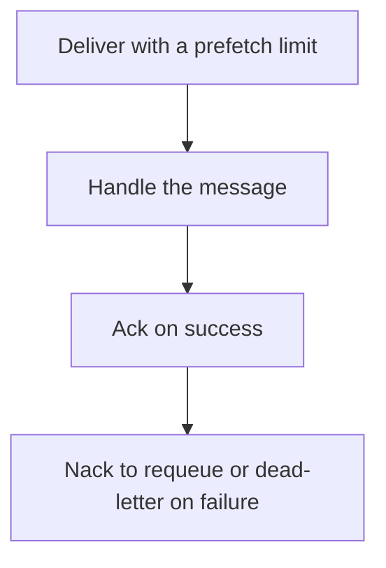

# D14-T025 — Acknowledgments and redelivery

Topic ID: `D14-T025`
Domain: Messaging and Event-Driven Architecture
Subdomain: Acknowledgments and redelivery
Importance: common
Complexity: advanced
Dependencies: `D14-T024`, `D14-T001`, `D04-T001`, `D04-T002`, `D05-T001`, `D05-T002`
Execution status of the code in section F: unexecuted

## A. Topic Overview

A RabbitMQ consumer acknowledges a delivery after handling it. Automatic ack on delivery loses the message if the consumer crashes mid-handler. Manual ack after the work can redeliver if the consumer dies first. A nack or reject can requeue or dead-letter. Redelivery can reorder relative to later messages. Prefetch limits how many unacked deliveries a consumer holds.

In production this shows up as follows: A worker sets prefetch to 10, writes the database, then acks. A poison message is nacked to a dead-letter exchange after three redeliveries so it does not spin at the head of the queue.

Interviewers use Acknowledgments and redelivery to see whether you can state the failure mode, not only the definition. The failure to name is: auto-ack and a crash that loses the message, or a requeue loop of a poison message

Prerequisites: `D14-T024`, `D14-T001`, `D04-T001`, `D04-T002`, `D05-T001`, `D05-T002`. Later notes should link here instead of repeating the mechanism.

## B. First-Principles Explanation

A RabbitMQ consumer acknowledges a delivery after handling it. Automatic ack on delivery loses the message if the consumer crashes mid-handler. Manual ack after the work can redeliver if the consumer dies first. A nack or reject can requeue or dead-letter. Redelivery can reorder relative to later messages. Prefetch limits how many unacked deliveries a consumer holds.

The useful picture is: An ack is signing that you filed the paper. If the clerk signs when the paper hits the desk and then faints, the paper is gone. If the clerk signs after filing, a faint means the desk hands the paper out again.

What has to be true:

1. Deliver with a prefetch limit
2. Handle the message
3. Ack on success
4. Nack to requeue or dead-letter on failure

It works when those steps preserve one invariant. It fails when auto-ack and a crash that loses the message, or a requeue loop of a poison message. The alternative is: you auto-ack work you cannot lose

## C. Internal Working and Architecture

Components involved: the caller, the state Acknowledgments and redelivery mutates or reads, and the observer that reports unacked count, redelivery rate, and prefetch versus processing time.

Execution:

1. Deliver with a prefetch limit
2. Handle the message
3. Ack on success
4. Nack to requeue or dead-letter on failure

Data moves only along that path. A retry re-enters at step 1, so the operation must say what a duplicate does. Memory and locks stay inside this mechanism. Callers see the result or a typed error, not a half-updated invariant.

State to remember: choose this when the broker is RabbitMQ-style and delivery is at-least-once unless you auto-ack. Do not choose it when you auto-ack work you cannot lose.

## D. Diagrams and Visual Models



Read the diagram from top to bottom. Each box is one step of Acknowledgments and redelivery. The failure mode (auto-ack and a crash that loses the message, or a requeue loop of a poison message) is what you look for when a later box never happens or happens twice.

## E. Examples and Analogies

Analogy: An ack is signing that you filed the paper. If the clerk signs when the paper hits the desk and then faints, the paper is gone. If the clerk signs after filing, a faint means the desk hands the paper out again.

Production example: A worker sets prefetch to 10, writes the database, then acks. A poison message is nacked to a dead-letter exchange after three redeliveries so it does not spin at the head of the queue.

A small counterexample is enough in an interview. Show the input, apply the steps, and show the broken outcome if someone uses the mechanism outside its rule: auto-ack and a crash that loses the message, or a requeue loop of a poison message.

## F. Code Examples

The snippet is labeled unexecuted. It illustrates the shape of the idea. It is not a benchmark and it embeds no secret.

```python
def should_ack(success, redelivered, attempts, limit):
    if success:
        return 'ack'
    return 'dead-letter' if attempts >= limit else 'requeue'
```

After the snippet, check unacked count, redelivery rate, and prefetch versus processing time. If that signal moves the wrong way, the snippet is the wrong tool for the workload.

## G. Practical Backend Application

Use Acknowledgments and redelivery in a service when the broker is RabbitMQ-style and delivery is at-least-once unless you auto-ack.

A typical place is the production case already stated: A worker sets prefetch to 10, writes the database, then acks. A poison message is nacked to a dead-letter exchange after three redeliveries so it does not spin at the head of the queue.

Operationally you alert on unacked count, redelivery rate, and prefetch versus processing time. You do not alert only on process uptime. The dashboard should show the failure mode, a success rate, and the saturation signal (queue depth, lock wait, or latency) that predicts it.

## H. Advantages, Limitations and Trade-offs

| Choice | Benefit | Cost | Choose when | Avoid when |
| --- | --- | --- | --- | --- |
| Apply Acknowledgments and redelivery | the broker is RabbitMQ-style and delivery is at-least-once unless you auto-ack | Extra moving parts and a new failure mode | The failure you are preventing is already real | you auto-ack work you cannot lose |
| Simpler alternative | Less code and fewer dependencies | auto-ack and a crash that loses the message, or a requeue loop of a poison message | The workload does not hit the limit | The invariant must hold under concurrency or failure |

Acknowledgments and redelivery is a trade. State the benefit and the cost in the same sentence when you propose it in a design review.

## I. Common Mistakes and Misconceptions

- Unlimited prefetch.
- Requeue forever.
- Ack before the transaction commits.
- Treating a diagram of Acknowledgments and redelivery as proof that the invariant holds in production.
- Copying a default configuration without naming unacked count, redelivery rate, and prefetch versus processing time.

## J. Debugging and Troubleshooting

Symptom: auto-ack and a crash that loses the message, or a requeue loop of a poison message

First check: unacked count, redelivery rate, and prefetch versus processing time.

Then compare one healthy instance against one unhealthy instance. Confirm whether retries are duplicating work. Confirm whether a timeout is shorter than the work. Fix the invariant, then watch the same metric for a full peak, not only for the next minute.

Useful questions: did the step order in section C actually happen, or did a caller skip a step? Did a deploy change the data shape that Acknowledgments and redelivery assumes?

## K. Interview Preparation

### Beginner

#### Q1. What problem does Acknowledgments and redelivery solve?

**Answer:** A RabbitMQ consumer acknowledges a delivery after handling it. Automatic ack on delivery loses the message if the consumer crashes mid-handler. Manual ack after the work can redeliver if the consumer dies first. A nack or reject can requeue or dead-letter. Redelivery can reorder relative to later messages. Prefetch limits how many unacked deliveries a consumer holds. Without it, the usual backend failure is: auto-ack and a crash that loses the message, or a requeue loop of a poison message.

#### Q2. Where does Acknowledgments and redelivery sit on a request path?

**Answer:** Acknowledgments and redelivery is not a library you sprinkle on every call. the broker is RabbitMQ-style and delivery is at-least-once unless you auto-ack You notice it when unacked count, redelivery rate, and prefetch versus processing time. Name the constraint that makes this choice correct. Say what you would measure to confirm it.

#### Q3. Give a concrete example of Acknowledgments and redelivery.

**Answer:** A worker sets prefetch to 10, writes the database, then acks. A poison message is nacked to a dead-letter exchange after three redeliveries so it does not spin at the head of the queue. Walk the input, the state change, and the observable output. Name the constraint that makes this choice correct.

#### Q4. What is a common mix-up around Acknowledgments and redelivery?

**Answer:** auto-ack and a crash that loses the message, or a requeue loop of a poison message The corrective check is unacked count, redelivery rate, and prefetch versus processing time. Name the constraint that makes this choice correct. Say what you would measure to confirm it. Say which alternative you rejected and why.

#### Q5. When would you skip Acknowledgments and redelivery?

**Answer:** you auto-ack work you cannot lose Skipping is a decision with a measured cost, not a slogan. Name the constraint that makes this choice correct. Say what you would measure to confirm it. Say which alternative you rejected and why.

### Intermediate

#### Q1. What invariant makes Acknowledgments and redelivery correct?

**Answer:** A RabbitMQ consumer acknowledges a delivery after handling it. Automatic ack on delivery loses the message if the consumer crashes mid-handler. Manual ack after the work can redeliver if the consumer dies first. A nack or reject can requeue or dead-letter. Redelivery can reorder relative to later messages. Prefetch limits how many unacked deliveries a consumer holds. State the invariant before you name the tool.

#### Q2. How do you test Acknowledgments and redelivery?

**Answer:** Assert the failure mode directly: auto-ack and a crash that loses the message, or a requeue loop of a poison message. The assertion should watch unacked count, redelivery rate, and prefetch versus processing time. Include a concurrent or retry case if the bug only appears then. Name the constraint that makes this choice correct.

#### Q3. What signal tells you Acknowledgments and redelivery is misbehaving in production?

**Answer:** Watch unacked count, redelivery rate, and prefetch versus processing time. The user-visible symptom is usually auto-ack and a crash that loses the message, or a requeue loop of a poison message. Name the constraint that makes this choice correct. Say what you would measure to confirm it.

#### Q4. How would you introduce Acknowledgments and redelivery into a legacy service?

**Answer:** the broker is RabbitMQ-style and delivery is at-least-once unless you auto-ack Ship it behind a metric so you can compare the old path. Roll back if auto-ack and a crash that loses the message, or a requeue loop of a poison message gets worse. Name the constraint that makes this choice correct. Say what you would measure to confirm it.

#### Q5. What do you trade away by choosing Acknowledgments and redelivery?

**Answer:** the broker is RabbitMQ-style and delivery is at-least-once unless you auto-ack you auto-ack work you cannot lose Say the cost in latency, storage, or operational load. Name the constraint that makes this choice correct. Say what you would measure to confirm it. Say which alternative you rejected and why.

### Advanced

#### Q1. What breaks if a dependency of Acknowledgments and redelivery is slow or down?

**Answer:** auto-ack and a crash that loses the message, or a requeue loop of a poison message Degrade using the rule: you auto-ack work you cannot lose. Timeouts must be shorter than the caller's deadline. Name the constraint that makes this choice correct. Say what you would measure to confirm it.

#### Q2. How does Acknowledgments and redelivery behave under retries?

**Answer:** Retries repeat work, so Acknowledgments and redelivery must define what a duplicate does. auto-ack and a crash that loses the message, or a requeue loop of a poison message Idempotency keys or fences belong next to the write, not in a comment. Name the constraint that makes this choice correct. Say what you would measure to confirm it.

#### Q3. What is the capacity limit of Acknowledgments and redelivery?

**Answer:** The limit shows up as unacked count, redelivery rate, and prefetch versus processing time. Add capacity only after you know whether the bottleneck is CPU, lock wait, or network. Name the constraint that makes this choice correct. Say what you would measure to confirm it.

#### Q4. How do you evolve Acknowledgments and redelivery without a flag day?

**Answer:** the broker is RabbitMQ-style and delivery is at-least-once unless you auto-ack Version the contract or the on-disk format. Readers should tolerate one old and one new shape during the rollout. Name the constraint that makes this choice correct. Say what you would measure to confirm it.

#### Q5. What security or correctness bug hides inside Acknowledgments and redelivery?

**Answer:** auto-ack and a crash that loses the message, or a requeue loop of a poison message Check authorization and tenancy at the same boundary as the mechanism. A cache or queue must not widen who can read the data. Name the constraint that makes this choice correct. Say what you would measure to confirm it.

### Scenario

#### Q1. Incident: auto-ack and a crash that loses the message, or a requeue loop of a poison message. What do you check first?

**Answer:** Start with unacked count, redelivery rate, and prefetch versus processing time. Compare a good host and a bad host before you restart anything. A RabbitMQ consumer acknowledges a delivery after handling it. Automatic ack on delivery loses the message if the consumer crashes mid-handler. Manual ack after the work can redeliver if the consumer dies first. A nack or reject can requeue or dead-letter. Redelivery can reorder relative to later messages. Prefetch limits how many unacked deliveries a consumer holds.

#### Q2. A reviewer wants the clever version. What data settles it?

**Answer:** the broker is RabbitMQ-style and delivery is at-least-once unless you auto-ack you auto-ack work you cannot lose Bring unacked count, redelivery rate, and prefetch versus processing time from a load test or from production, not a slogan. Name the constraint that makes this choice correct. Say what you would measure to confirm it. Say which alternative you rejected and why.

#### Q3. You have one hour to explain Acknowledgments and redelivery at a whiteboard.

**Answer:** Draw the happy path in four boxes. Then draw the failure: auto-ack and a crash that loses the message, or a requeue loop of a poison message. End with the metric you would page on. Name the constraint that makes this choice correct.

#### Q4. The bug only appears under two concurrent callers.

**Answer:** auto-ack and a crash that loses the message, or a requeue loop of a poison message Reproduce with a barrier so both sides enter the critical window. Confirm the fix with unacked count, redelivery rate, and prefetch versus processing time. Name the constraint that makes this choice correct. Say what you would measure to confirm it.

#### Q5. Leadership wants this on every service next week.

**Answer:** you auto-ack work you cannot lose the broker is RabbitMQ-style and delivery is at-least-once unless you auto-ack Roll it out where the failure mode is already hurting users. Name the constraint that makes this choice correct. Say what you would measure to confirm it. Say which alternative you rejected and why.

### Follow-up

#### Q1. What did you assume about the data size or the clock?

**Answer:** A RabbitMQ consumer acknowledges a delivery after handling it. Automatic ack on delivery loses the message if the consumer crashes mid-handler. Manual ack after the work can redeliver if the consumer dies first. A nack or reject can requeue or dead-letter. Redelivery can reorder relative to later messages. Prefetch limits how many unacked deliveries a consumer holds. Clocks are not a total order across machines. State whether the algorithm needs bounded size or a single leader.

#### Q2. What would you measure after the change ships?

**Answer:** Page on unacked count, redelivery rate, and prefetch versus processing time. Keep a before/after dashboard for one week. Alert on the failure mode, not only on CPU. Name the constraint that makes this choice correct.

#### Q3. Which neighboring topic did you deliberately not re-teach?

**Answer:** This note owns Acknowledgments and redelivery. Related identifiers are in section N. Shared ideas are linked, not copied. Name the constraint that makes this choice correct.

## L. Practical Exercises

Solutions are in `EXERCISES/solutions/D14-T025.md`, not in this section.

1. Whiteboard the four steps of Acknowledgments and redelivery and mark where `auto-ack and a crash that loses the message, or a requeue loop of a poison message` enters.
2. Read the snippet in section F and write the assertion that would catch that failure. The assertion must mention `unacked count, redelivery rate, and prefetch versus processing time`.
3. Argue for or against using Acknowledgments and redelivery on a service you know. Use the choose and avoid rows from section H. Do not appeal to popularity.

## M. Revision Notes

- Mechanism: A RabbitMQ consumer acknowledges a delivery after handling it.
- Failure: auto-ack and a crash that loses the message, or a requeue loop of a poison message
- Metric: unacked count, redelivery rate, and prefetch versus processing time
- Choose when: the broker is RabbitMQ-style and delivery is at-least-once unless you auto-ack
- Avoid when: you auto-ack work you cannot lose

## N. Related Topics

Dependencies to review first: `D14-T024`, `D14-T001`, `D04-T001`, `D04-T002`, `D05-T001`, `D05-T002`.

Shared ideas stay in those notes. This note does not restate them.

## O. Completion Criteria

- You can explain Acknowledgments and redelivery without reading this note, including the failure mode.
- You can draw the diagram in section D from memory.
- You can say when not to use it, using the avoid condition in section H.
- You can name the metric you would watch after shipping it.
