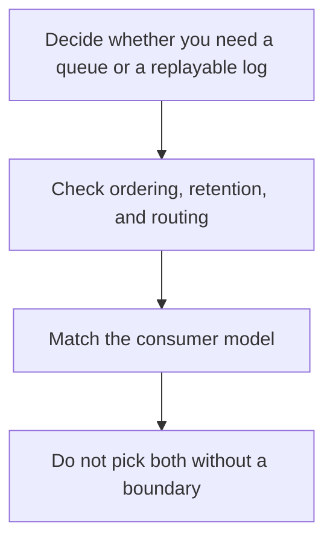

# D14-T026 — RabbitMQ vs Kafka

Topic ID: `D14-T026`
Domain: Messaging and Event-Driven Architecture
Subdomain: RabbitMQ vs Kafka
Importance: common
Complexity: advanced
Dependencies: `D14-T025`, `D14-T001`, `D04-T001`, `D04-T002`, `D05-T001`, `D05-T002`
Execution status of the code in section F: unexecuted

## A. Topic Overview

RabbitMQ is a message broker with exchanges, queues, and push delivery. Kafka is a distributed log with partitions, retention, and pull consumers. RabbitMQ is a strong fit for task queues and routing. Kafka is a strong fit for replay, high throughput streams, and several independent consumer groups reading the same history. You can outgrow either by using it as the other.

In production this shows up as follows: Email jobs go to RabbitMQ or a similar queue. The order event history goes to a log so a new fraud service can replay the quarter. Putting both in one technology is fine only if the retention and consumer model still match.

Interviewers use RabbitMQ vs Kafka to see whether you can state the failure mode, not only the definition. The failure to name is: using Kafka as a per-task work queue with millions of tiny topics, or using RabbitMQ as an event log you cannot replay

Prerequisites: `D14-T025`, `D14-T001`, `D04-T001`, `D04-T002`, `D05-T001`, `D05-T002`. Later notes should link here instead of repeating the mechanism.

## B. First-Principles Explanation

RabbitMQ is a message broker with exchanges, queues, and push delivery. Kafka is a distributed log with partitions, retention, and pull consumers. RabbitMQ is a strong fit for task queues and routing. Kafka is a strong fit for replay, high throughput streams, and several independent consumer groups reading the same history. You can outgrow either by using it as the other.

The useful picture is: RabbitMQ is a post office that sorts letters into slots and hands them over. Kafka is a set of bound journals you can reread. Asking the post office for last month's letters fails if they were thrown away after delivery.

What has to be true:

1. Decide whether you need a queue or a replayable log
2. Check ordering, retention, and routing
3. Match the consumer model
4. Do not pick both without a boundary

It works when those steps preserve one invariant. It fails when using Kafka as a per-task work queue with millions of tiny topics, or using RabbitMQ as an event log you cannot replay. The alternative is: you standardize on one broker to avoid thinking about the workload

## C. Internal Working and Architecture

Components involved: the caller, the state RabbitMQ vs Kafka mutates or reads, and the observer that reports whether a new consumer can read last week's data, and routing complexity.

Execution:

1. Decide whether you need a queue or a replayable log
2. Check ordering, retention, and routing
3. Match the consumer model
4. Do not pick both without a boundary

Data moves only along that path. A retry re-enters at step 1, so the operation must say what a duplicate does. Memory and locks stay inside this mechanism. Callers see the result or a typed error, not a half-updated invariant.

State to remember: choose this when you can say replay versus task routing. Do not choose it when you standardize on one broker to avoid thinking about the workload.

## D. Diagrams and Visual Models



Read the diagram from top to bottom. Each box is one step of RabbitMQ vs Kafka. The failure mode (using Kafka as a per-task work queue with millions of tiny topics, or using RabbitMQ as an event log you cannot replay) is what you look for when a later box never happens or happens twice.

## E. Examples and Analogies

Analogy: RabbitMQ is a post office that sorts letters into slots and hands them over. Kafka is a set of bound journals you can reread. Asking the post office for last month's letters fails if they were thrown away after delivery.

Production example: Email jobs go to RabbitMQ or a similar queue. The order event history goes to a log so a new fraud service can replay the quarter. Putting both in one technology is fine only if the retention and consumer model still match.

A small counterexample is enough in an interview. Show the input, apply the steps, and show the broken outcome if someone uses the mechanism outside its rule: using Kafka as a per-task work queue with millions of tiny topics, or using RabbitMQ as an event log you cannot replay.

## F. Code Examples

The snippet is labeled unexecuted. It illustrates the shape of the idea. It is not a benchmark and it embeds no secret.

```python
def pick(need_replay, need_routing):
    if need_replay:
        return 'log'
    if need_routing:
        return 'broker-queue'
    return 'either-with-a-reason'
```

After the snippet, check whether a new consumer can read last week's data, and routing complexity. If that signal moves the wrong way, the snippet is the wrong tool for the workload.

## G. Practical Backend Application

Use RabbitMQ vs Kafka in a service when you can say replay versus task routing.

A typical place is the production case already stated: Email jobs go to RabbitMQ or a similar queue. The order event history goes to a log so a new fraud service can replay the quarter. Putting both in one technology is fine only if the retention and consumer model still match.

Operationally you alert on whether a new consumer can read last week's data, and routing complexity. You do not alert only on process uptime. The dashboard should show the failure mode, a success rate, and the saturation signal (queue depth, lock wait, or latency) that predicts it.

## H. Advantages, Limitations and Trade-offs

| Choice | Benefit | Cost | Choose when | Avoid when |
| --- | --- | --- | --- | --- |
| Apply RabbitMQ vs Kafka | you can say replay versus task routing | Extra moving parts and a new failure mode | The failure you are preventing is already real | you standardize on one broker to avoid thinking about the workload |
| Simpler alternative | Less code and fewer dependencies | using Kafka as a per-task work queue with millions of tiny topics, or using RabbitMQ as an event log you cannot replay | The workload does not hit the limit | The invariant must hold under concurrency or failure |

RabbitMQ vs Kafka is a trade. State the benefit and the cost in the same sentence when you propose it in a design review.

## I. Common Mistakes and Misconceptions

- Kafka for a single RPC.
- RabbitMQ for a long audit log.
- A religious choice with no requirement.
- Treating a diagram of RabbitMQ vs Kafka as proof that the invariant holds in production.
- Copying a default configuration without naming whether a new consumer can read last week's data, and routing complexity.

## J. Debugging and Troubleshooting

Symptom: using Kafka as a per-task work queue with millions of tiny topics, or using RabbitMQ as an event log you cannot replay

First check: whether a new consumer can read last week's data, and routing complexity.

Then compare one healthy instance against one unhealthy instance. Confirm whether retries are duplicating work. Confirm whether a timeout is shorter than the work. Fix the invariant, then watch the same metric for a full peak, not only for the next minute.

Useful questions: did the step order in section C actually happen, or did a caller skip a step? Did a deploy change the data shape that RabbitMQ vs Kafka assumes?

## K. Interview Preparation

### Beginner

#### Q1. What problem does RabbitMQ vs Kafka solve?

**Answer:** RabbitMQ is a message broker with exchanges, queues, and push delivery. Kafka is a distributed log with partitions, retention, and pull consumers. RabbitMQ is a strong fit for task queues and routing. Kafka is a strong fit for replay, high throughput streams, and several independent consumer groups reading the same history. You can outgrow either by using it as the other. Without it, the usual backend failure is: using Kafka as a per-task work queue with millions of tiny topics, or using RabbitMQ as an event log you cannot replay.

#### Q2. Where does RabbitMQ vs Kafka sit on a request path?

**Answer:** RabbitMQ vs Kafka is not a library you sprinkle on every call. you can say replay versus task routing You notice it when whether a new consumer can read last week's data, and routing complexity. Name the constraint that makes this choice correct. Say what you would measure to confirm it.

#### Q3. Give a concrete example of RabbitMQ vs Kafka.

**Answer:** Email jobs go to RabbitMQ or a similar queue. The order event history goes to a log so a new fraud service can replay the quarter. Putting both in one technology is fine only if the retention and consumer model still match. Walk the input, the state change, and the observable output.

#### Q4. What is a common mix-up around RabbitMQ vs Kafka?

**Answer:** using Kafka as a per-task work queue with millions of tiny topics, or using RabbitMQ as an event log you cannot replay The corrective check is whether a new consumer can read last week's data, and routing complexity. Name the constraint that makes this choice correct. Say what you would measure to confirm it. Say which alternative you rejected and why.

#### Q5. When would you skip RabbitMQ vs Kafka?

**Answer:** you standardize on one broker to avoid thinking about the workload Skipping is a decision with a measured cost, not a slogan. Name the constraint that makes this choice correct. Say what you would measure to confirm it. Say which alternative you rejected and why.

### Intermediate

#### Q1. What invariant makes RabbitMQ vs Kafka correct?

**Answer:** RabbitMQ is a message broker with exchanges, queues, and push delivery. Kafka is a distributed log with partitions, retention, and pull consumers. RabbitMQ is a strong fit for task queues and routing. Kafka is a strong fit for replay, high throughput streams, and several independent consumer groups reading the same history. You can outgrow either by using it as the other. State the invariant before you name the tool.

#### Q2. How do you test RabbitMQ vs Kafka?

**Answer:** Assert the failure mode directly: using Kafka as a per-task work queue with millions of tiny topics, or using RabbitMQ as an event log you cannot replay. The assertion should watch whether a new consumer can read last week's data, and routing complexity. Include a concurrent or retry case if the bug only appears then. Name the constraint that makes this choice correct.

#### Q3. What signal tells you RabbitMQ vs Kafka is misbehaving in production?

**Answer:** Watch whether a new consumer can read last week's data, and routing complexity. The user-visible symptom is usually using Kafka as a per-task work queue with millions of tiny topics, or using RabbitMQ as an event log you cannot replay. Name the constraint that makes this choice correct. Say what you would measure to confirm it.

#### Q4. How would you introduce RabbitMQ vs Kafka into a legacy service?

**Answer:** you can say replay versus task routing Ship it behind a metric so you can compare the old path. Roll back if using Kafka as a per-task work queue with millions of tiny topics, or using RabbitMQ as an event log you cannot replay gets worse. Name the constraint that makes this choice correct. Say what you would measure to confirm it.

#### Q5. What do you trade away by choosing RabbitMQ vs Kafka?

**Answer:** you can say replay versus task routing you standardize on one broker to avoid thinking about the workload Say the cost in latency, storage, or operational load. Name the constraint that makes this choice correct. Say what you would measure to confirm it. Say which alternative you rejected and why.

### Advanced

#### Q1. What breaks if a dependency of RabbitMQ vs Kafka is slow or down?

**Answer:** using Kafka as a per-task work queue with millions of tiny topics, or using RabbitMQ as an event log you cannot replay Degrade using the rule: you standardize on one broker to avoid thinking about the workload. Timeouts must be shorter than the caller's deadline. Name the constraint that makes this choice correct. Say what you would measure to confirm it.

#### Q2. How does RabbitMQ vs Kafka behave under retries?

**Answer:** Retries repeat work, so RabbitMQ vs Kafka must define what a duplicate does. using Kafka as a per-task work queue with millions of tiny topics, or using RabbitMQ as an event log you cannot replay Idempotency keys or fences belong next to the write, not in a comment. Name the constraint that makes this choice correct. Say what you would measure to confirm it.

#### Q3. What is the capacity limit of RabbitMQ vs Kafka?

**Answer:** The limit shows up as whether a new consumer can read last week's data, and routing complexity. Add capacity only after you know whether the bottleneck is CPU, lock wait, or network. Name the constraint that makes this choice correct. Say what you would measure to confirm it.

#### Q4. How do you evolve RabbitMQ vs Kafka without a flag day?

**Answer:** you can say replay versus task routing Version the contract or the on-disk format. Readers should tolerate one old and one new shape during the rollout. Name the constraint that makes this choice correct. Say what you would measure to confirm it.

#### Q5. What security or correctness bug hides inside RabbitMQ vs Kafka?

**Answer:** using Kafka as a per-task work queue with millions of tiny topics, or using RabbitMQ as an event log you cannot replay Check authorization and tenancy at the same boundary as the mechanism. A cache or queue must not widen who can read the data. Name the constraint that makes this choice correct. Say what you would measure to confirm it.

### Scenario

#### Q1. Incident: using Kafka as a per-task work queue with millions of tiny topics, or using RabbitMQ as an event log you cannot replay. What do you check first?

**Answer:** Start with whether a new consumer can read last week's data, and routing complexity. Compare a good host and a bad host before you restart anything. RabbitMQ is a message broker with exchanges, queues, and push delivery. Kafka is a distributed log with partitions, retention, and pull consumers. RabbitMQ is a strong fit for task queues and routing. Kafka is a strong fit for replay, high throughput streams, and several independent consumer groups reading the same history. You can outgrow either by using it as the other.

#### Q2. A reviewer wants the clever version. What data settles it?

**Answer:** you can say replay versus task routing you standardize on one broker to avoid thinking about the workload Bring whether a new consumer can read last week's data, and routing complexity from a load test or from production, not a slogan. Name the constraint that makes this choice correct. Say what you would measure to confirm it. Say which alternative you rejected and why.

#### Q3. You have one hour to explain RabbitMQ vs Kafka at a whiteboard.

**Answer:** Draw the happy path in four boxes. Then draw the failure: using Kafka as a per-task work queue with millions of tiny topics, or using RabbitMQ as an event log you cannot replay. End with the metric you would page on. Name the constraint that makes this choice correct.

#### Q4. The bug only appears under two concurrent callers.

**Answer:** using Kafka as a per-task work queue with millions of tiny topics, or using RabbitMQ as an event log you cannot replay Reproduce with a barrier so both sides enter the critical window. Confirm the fix with whether a new consumer can read last week's data, and routing complexity. Name the constraint that makes this choice correct. Say what you would measure to confirm it.

#### Q5. Leadership wants this on every service next week.

**Answer:** you standardize on one broker to avoid thinking about the workload you can say replay versus task routing Roll it out where the failure mode is already hurting users. Name the constraint that makes this choice correct. Say what you would measure to confirm it. Say which alternative you rejected and why.

### Follow-up

#### Q1. What did you assume about the data size or the clock?

**Answer:** RabbitMQ is a message broker with exchanges, queues, and push delivery. Kafka is a distributed log with partitions, retention, and pull consumers. RabbitMQ is a strong fit for task queues and routing. Kafka is a strong fit for replay, high throughput streams, and several independent consumer groups reading the same history. You can outgrow either by using it as the other. Clocks are not a total order across machines. State whether the algorithm needs bounded size or a single leader.

#### Q2. What would you measure after the change ships?

**Answer:** Page on whether a new consumer can read last week's data, and routing complexity. Keep a before/after dashboard for one week. Alert on the failure mode, not only on CPU. Name the constraint that makes this choice correct.

#### Q3. Which neighboring topic did you deliberately not re-teach?

**Answer:** This note owns RabbitMQ vs Kafka. Related identifiers are in section N. Shared ideas are linked, not copied. Name the constraint that makes this choice correct.

## L. Practical Exercises

Solutions are in `EXERCISES/solutions/D14-T026.md`, not in this section.

1. Whiteboard the four steps of RabbitMQ vs Kafka and mark where `using Kafka as a per-task work queue with millions of tiny topics, or using RabbitMQ as an event log you cannot replay` enters.
2. Read the snippet in section F and write the assertion that would catch that failure. The assertion must mention `whether a new consumer can read last week's data, and routing complexity`.
3. Argue for or against using RabbitMQ vs Kafka on a service you know. Use the choose and avoid rows from section H. Do not appeal to popularity.

## M. Revision Notes

- Mechanism: RabbitMQ is a message broker with exchanges, queues, and push delivery.
- Failure: using Kafka as a per-task work queue with millions of tiny topics, or using RabbitMQ as an event log you cannot replay
- Metric: whether a new consumer can read last week's data, and routing complexity
- Choose when: you can say replay versus task routing
- Avoid when: you standardize on one broker to avoid thinking about the workload

## N. Related Topics

Dependencies to review first: `D14-T025`, `D14-T001`, `D04-T001`, `D04-T002`, `D05-T001`, `D05-T002`.

Shared ideas stay in those notes. This note does not restate them.

## O. Completion Criteria

- You can explain RabbitMQ vs Kafka without reading this note, including the failure mode.
- You can draw the diagram in section D from memory.
- You can say when not to use it, using the avoid condition in section H.
- You can name the metric you would watch after shipping it.
