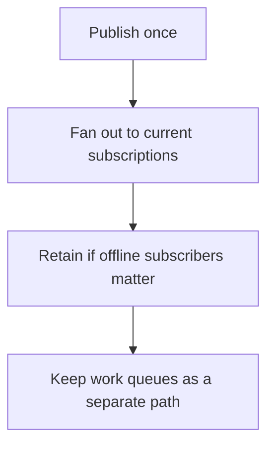

# D14-T027 — Pub/Sub systems

Topic ID: `D14-T027`
Domain: Messaging and Event-Driven Architecture
Subdomain: Pub/Sub systems
Importance: common
Complexity: advanced
Dependencies: `D14-T026`, `D14-T001`, `D04-T001`, `D04-T002`, `D05-T001`, `D05-T002`
Execution status of the code in section F: unexecuted

## A. Topic Overview

Publish-subscribe delivers each message to every subscriber that asked for that class of message. It is a fan-out. It is different from a work queue, where one of several workers takes the job. If subscribers are offline, a log retains the message and a pure pub/sub bus may not. The subscriber, not the publisher, decides what it cares about, within the filters offered.

In production this shows up as follows: A price-change event is published so the search index and the cache invalidator each get a copy. The 'send receipt' job is a queue with competing consumers, not a second subscription on the same fan-out.

Interviewers use Pub/Sub systems to see whether you can state the failure mode, not only the definition. The failure to name is: two workers in a pub/sub both sending the same email because the channel was not a competing-consumer queue

Prerequisites: `D14-T026`, `D14-T001`, `D04-T001`, `D04-T002`, `D05-T001`, `D05-T002`. Later notes should link here instead of repeating the mechanism.

## B. First-Principles Explanation

Publish-subscribe delivers each message to every subscriber that asked for that class of message. It is a fan-out. It is different from a work queue, where one of several workers takes the job. If subscribers are offline, a log retains the message and a pure pub/sub bus may not. The subscriber, not the publisher, decides what it cares about, within the filters offered.

The useful picture is: Pub/sub is a radio broadcast. A work queue is one walkie-talkie passed to whichever guard is free. Broadcasting a job makes every guard do it.

What has to be true:

1. Publish once
2. Fan out to current subscriptions
3. Retain if offline subscribers matter
4. Keep work queues as a separate path

It works when those steps preserve one invariant. It fails when two workers in a pub/sub both sending the same email because the channel was not a competing-consumer queue. The alternative is: exactly one worker must do the job

## C. Internal Working and Architecture

Components involved: the caller, the state Pub/Sub systems mutates or reads, and the observer that reports subscriber count versus copies sent, and messages missed while disconnected.

Execution:

1. Publish once
2. Fan out to current subscriptions
3. Retain if offline subscribers matter
4. Keep work queues as a separate path

Data moves only along that path. A retry re-enters at step 1, so the operation must say what a duplicate does. Memory and locks stay inside this mechanism. Callers see the result or a typed error, not a half-updated invariant.

State to remember: choose this when several independent components must each see the event. Do not choose it when exactly one worker must do the job.

## D. Diagrams and Visual Models



Read the diagram from top to bottom. Each box is one step of Pub/Sub systems. The failure mode (two workers in a pub/sub both sending the same email because the channel was not a competing-consumer queue) is what you look for when a later box never happens or happens twice.

## E. Examples and Analogies

Analogy: Pub/sub is a radio broadcast. A work queue is one walkie-talkie passed to whichever guard is free. Broadcasting a job makes every guard do it.

Production example: A price-change event is published so the search index and the cache invalidator each get a copy. The 'send receipt' job is a queue with competing consumers, not a second subscription on the same fan-out.

A small counterexample is enough in an interview. Show the input, apply the steps, and show the broken outcome if someone uses the mechanism outside its rule: two workers in a pub/sub both sending the same email because the channel was not a competing-consumer queue.

## F. Code Examples

The snippet is labeled unexecuted. It illustrates the shape of the idea. It is not a benchmark and it embeds no secret.

```python
def copies(subscribers, competing):
    return 1 if competing else len(subscribers)
```

After the snippet, check subscriber count versus copies sent, and messages missed while disconnected. If that signal moves the wrong way, the snippet is the wrong tool for the workload.

## G. Practical Backend Application

Use Pub/Sub systems in a service when several independent components must each see the event.

A typical place is the production case already stated: A price-change event is published so the search index and the cache invalidator each get a copy. The 'send receipt' job is a queue with competing consumers, not a second subscription on the same fan-out.

Operationally you alert on subscriber count versus copies sent, and messages missed while disconnected. You do not alert only on process uptime. The dashboard should show the failure mode, a success rate, and the saturation signal (queue depth, lock wait, or latency) that predicts it.

## H. Advantages, Limitations and Trade-offs

| Choice | Benefit | Cost | Choose when | Avoid when |
| --- | --- | --- | --- | --- |
| Apply Pub/Sub systems | several independent components must each see the event | Extra moving parts and a new failure mode | The failure you are preventing is already real | exactly one worker must do the job |
| Simpler alternative | Less code and fewer dependencies | two workers in a pub/sub both sending the same email because the channel was not a competing-consumer queue | The workload does not hit the limit | The invariant must hold under concurrency or failure |

Pub/Sub systems is a trade. State the benefit and the cost in the same sentence when you propose it in a design review.

## I. Common Mistakes and Misconceptions

- Using pub/sub as a work queue.
- No retention for a subscriber that deploys.
- Filters so broad they become a second full copy of every topic.
- Treating a diagram of Pub/Sub systems as proof that the invariant holds in production.
- Copying a default configuration without naming subscriber count versus copies sent, and messages missed while disconnected.

## J. Debugging and Troubleshooting

Symptom: two workers in a pub/sub both sending the same email because the channel was not a competing-consumer queue

First check: subscriber count versus copies sent, and messages missed while disconnected.

Then compare one healthy instance against one unhealthy instance. Confirm whether retries are duplicating work. Confirm whether a timeout is shorter than the work. Fix the invariant, then watch the same metric for a full peak, not only for the next minute.

Useful questions: did the step order in section C actually happen, or did a caller skip a step? Did a deploy change the data shape that Pub/Sub systems assumes?

## K. Interview Preparation

### Beginner

#### Q1. What problem does Pub/Sub systems solve?

**Answer:** Publish-subscribe delivers each message to every subscriber that asked for that class of message. It is a fan-out. It is different from a work queue, where one of several workers takes the job. If subscribers are offline, a log retains the message and a pure pub/sub bus may not. The subscriber, not the publisher, decides what it cares about, within the filters offered. Without it, the usual backend failure is: two workers in a pub/sub both sending the same email because the channel was not a competing-consumer queue.

#### Q2. Where does Pub/Sub systems sit on a request path?

**Answer:** Pub/Sub systems is not a library you sprinkle on every call. several independent components must each see the event You notice it when subscriber count versus copies sent, and messages missed while disconnected. Name the constraint that makes this choice correct. Say what you would measure to confirm it.

#### Q3. Give a concrete example of Pub/Sub systems.

**Answer:** A price-change event is published so the search index and the cache invalidator each get a copy. The 'send receipt' job is a queue with competing consumers, not a second subscription on the same fan-out. Walk the input, the state change, and the observable output. Name the constraint that makes this choice correct.

#### Q4. What is a common mix-up around Pub/Sub systems?

**Answer:** two workers in a pub/sub both sending the same email because the channel was not a competing-consumer queue The corrective check is subscriber count versus copies sent, and messages missed while disconnected. Name the constraint that makes this choice correct. Say what you would measure to confirm it. Say which alternative you rejected and why.

#### Q5. When would you skip Pub/Sub systems?

**Answer:** exactly one worker must do the job Skipping is a decision with a measured cost, not a slogan. Name the constraint that makes this choice correct. Say what you would measure to confirm it. Say which alternative you rejected and why.

### Intermediate

#### Q1. What invariant makes Pub/Sub systems correct?

**Answer:** Publish-subscribe delivers each message to every subscriber that asked for that class of message. It is a fan-out. It is different from a work queue, where one of several workers takes the job. If subscribers are offline, a log retains the message and a pure pub/sub bus may not. The subscriber, not the publisher, decides what it cares about, within the filters offered. State the invariant before you name the tool.

#### Q2. How do you test Pub/Sub systems?

**Answer:** Assert the failure mode directly: two workers in a pub/sub both sending the same email because the channel was not a competing-consumer queue. The assertion should watch subscriber count versus copies sent, and messages missed while disconnected. Include a concurrent or retry case if the bug only appears then. Name the constraint that makes this choice correct.

#### Q3. What signal tells you Pub/Sub systems is misbehaving in production?

**Answer:** Watch subscriber count versus copies sent, and messages missed while disconnected. The user-visible symptom is usually two workers in a pub/sub both sending the same email because the channel was not a competing-consumer queue. Name the constraint that makes this choice correct. Say what you would measure to confirm it.

#### Q4. How would you introduce Pub/Sub systems into a legacy service?

**Answer:** several independent components must each see the event Ship it behind a metric so you can compare the old path. Roll back if two workers in a pub/sub both sending the same email because the channel was not a competing-consumer queue gets worse. Name the constraint that makes this choice correct. Say what you would measure to confirm it.

#### Q5. What do you trade away by choosing Pub/Sub systems?

**Answer:** several independent components must each see the event exactly one worker must do the job Say the cost in latency, storage, or operational load. Name the constraint that makes this choice correct. Say what you would measure to confirm it. Say which alternative you rejected and why.

### Advanced

#### Q1. What breaks if a dependency of Pub/Sub systems is slow or down?

**Answer:** two workers in a pub/sub both sending the same email because the channel was not a competing-consumer queue Degrade using the rule: exactly one worker must do the job. Timeouts must be shorter than the caller's deadline. Name the constraint that makes this choice correct. Say what you would measure to confirm it.

#### Q2. How does Pub/Sub systems behave under retries?

**Answer:** Retries repeat work, so Pub/Sub systems must define what a duplicate does. two workers in a pub/sub both sending the same email because the channel was not a competing-consumer queue Idempotency keys or fences belong next to the write, not in a comment. Name the constraint that makes this choice correct. Say what you would measure to confirm it.

#### Q3. What is the capacity limit of Pub/Sub systems?

**Answer:** The limit shows up as subscriber count versus copies sent, and messages missed while disconnected. Add capacity only after you know whether the bottleneck is CPU, lock wait, or network. Name the constraint that makes this choice correct. Say what you would measure to confirm it.

#### Q4. How do you evolve Pub/Sub systems without a flag day?

**Answer:** several independent components must each see the event Version the contract or the on-disk format. Readers should tolerate one old and one new shape during the rollout. Name the constraint that makes this choice correct. Say what you would measure to confirm it.

#### Q5. What security or correctness bug hides inside Pub/Sub systems?

**Answer:** two workers in a pub/sub both sending the same email because the channel was not a competing-consumer queue Check authorization and tenancy at the same boundary as the mechanism. A cache or queue must not widen who can read the data. Name the constraint that makes this choice correct. Say what you would measure to confirm it.

### Scenario

#### Q1. Incident: two workers in a pub/sub both sending the same email because the channel was not a competing-consumer queue. What do you check first?

**Answer:** Start with subscriber count versus copies sent, and messages missed while disconnected. Compare a good host and a bad host before you restart anything. Publish-subscribe delivers each message to every subscriber that asked for that class of message. It is a fan-out. It is different from a work queue, where one of several workers takes the job. If subscribers are offline, a log retains the message and a pure pub/sub bus may not. The subscriber, not the publisher, decides what it cares about, within the filters offered.

#### Q2. A reviewer wants the clever version. What data settles it?

**Answer:** several independent components must each see the event exactly one worker must do the job Bring subscriber count versus copies sent, and messages missed while disconnected from a load test or from production, not a slogan. Name the constraint that makes this choice correct. Say what you would measure to confirm it. Say which alternative you rejected and why.

#### Q3. You have one hour to explain Pub/Sub systems at a whiteboard.

**Answer:** Draw the happy path in four boxes. Then draw the failure: two workers in a pub/sub both sending the same email because the channel was not a competing-consumer queue. End with the metric you would page on. Name the constraint that makes this choice correct.

#### Q4. The bug only appears under two concurrent callers.

**Answer:** two workers in a pub/sub both sending the same email because the channel was not a competing-consumer queue Reproduce with a barrier so both sides enter the critical window. Confirm the fix with subscriber count versus copies sent, and messages missed while disconnected. Name the constraint that makes this choice correct. Say what you would measure to confirm it.

#### Q5. Leadership wants this on every service next week.

**Answer:** exactly one worker must do the job several independent components must each see the event Roll it out where the failure mode is already hurting users. Name the constraint that makes this choice correct. Say what you would measure to confirm it. Say which alternative you rejected and why.

### Follow-up

#### Q1. What did you assume about the data size or the clock?

**Answer:** Publish-subscribe delivers each message to every subscriber that asked for that class of message. It is a fan-out. It is different from a work queue, where one of several workers takes the job. If subscribers are offline, a log retains the message and a pure pub/sub bus may not. The subscriber, not the publisher, decides what it cares about, within the filters offered. Clocks are not a total order across machines. State whether the algorithm needs bounded size or a single leader.

#### Q2. What would you measure after the change ships?

**Answer:** Page on subscriber count versus copies sent, and messages missed while disconnected. Keep a before/after dashboard for one week. Alert on the failure mode, not only on CPU. Name the constraint that makes this choice correct.

#### Q3. Which neighboring topic did you deliberately not re-teach?

**Answer:** This note owns Pub/Sub systems. Related identifiers are in section N. Shared ideas are linked, not copied. Name the constraint that makes this choice correct.

## L. Practical Exercises

Solutions are in `EXERCISES/solutions/D14-T027.md`, not in this section.

1. Whiteboard the four steps of Pub/Sub systems and mark where `two workers in a pub/sub both sending the same email because the channel was not a competing-consumer queue` enters.
2. Read the snippet in section F and write the assertion that would catch that failure. The assertion must mention `subscriber count versus copies sent, and messages missed while disconnected`.
3. Argue for or against using Pub/Sub systems on a service you know. Use the choose and avoid rows from section H. Do not appeal to popularity.

## M. Revision Notes

- Mechanism: Publish-subscribe delivers each message to every subscriber that asked for that class of message.
- Failure: two workers in a pub/sub both sending the same email because the channel was not a competing-consumer queue
- Metric: subscriber count versus copies sent, and messages missed while disconnected
- Choose when: several independent components must each see the event
- Avoid when: exactly one worker must do the job

## N. Related Topics

Dependencies to review first: `D14-T026`, `D14-T001`, `D04-T001`, `D04-T002`, `D05-T001`, `D05-T002`.

Shared ideas stay in those notes. This note does not restate them.

## O. Completion Criteria

- You can explain Pub/Sub systems without reading this note, including the failure mode.
- You can draw the diagram in section D from memory.
- You can say when not to use it, using the avoid condition in section H.
- You can name the metric you would watch after shipping it.
