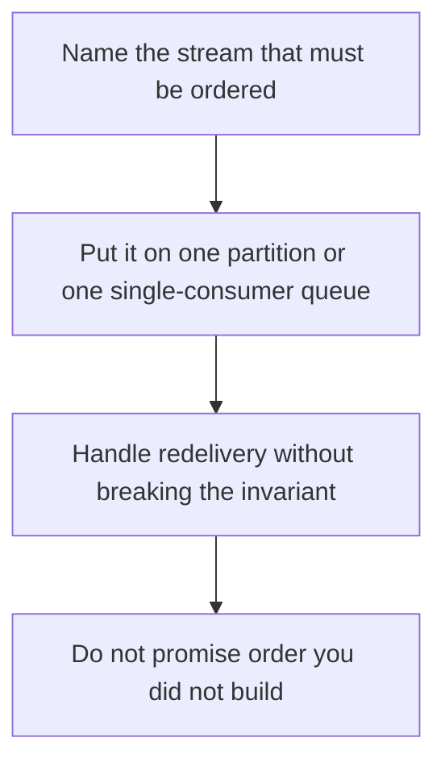

# D14-T028 — Ordering guarantees

Topic ID: `D14-T028`
Domain: Messaging and Event-Driven Architecture
Subdomain: Ordering guarantees
Importance: common
Complexity: advanced
Dependencies: `D14-T027`, `D14-T001`, `D04-T001`, `D04-T002`, `D05-T001`, `D05-T002`
Execution status of the code in section F: unexecuted

## A. Topic Overview

Ordering guarantees say which events a consumer will see in the order they were written. A partition orders its own key. A queue with one consumer orders that queue until redelivery or multiple consumers shuffle it. Global order across partitions does not exist unless you use one partition. Gaps appear when a consumer fails and retries. The business rule should name the entity that needs order.

In production this shows up as follows: Charges and refunds for one payment share a partition key. Across payments, the ledger sorts by its own sequence after applying idempotent events. The team does not promise a global Kafka order.

Interviewers use Ordering guarantees to see whether you can state the failure mode, not only the definition. The failure to name is: two partitions merged by timestamp with clock skew, so a refund is applied before the charge

Prerequisites: `D14-T027`, `D14-T001`, `D04-T001`, `D04-T002`, `D05-T001`, `D05-T002`. Later notes should link here instead of repeating the mechanism.

## B. First-Principles Explanation

Ordering guarantees say which events a consumer will see in the order they were written. A partition orders its own key. A queue with one consumer orders that queue until redelivery or multiple consumers shuffle it. Global order across partitions does not exist unless you use one partition. Gaps appear when a consumer fails and retries. The business rule should name the entity that needs order.

The useful picture is: Ordering is a single-file line. Two doors into the same room do not preserve one line. A person who steps out and comes back through retry can stand in a new place.

What has to be true:

1. Name the stream that must be ordered
2. Put it on one partition or one single-consumer queue
3. Handle redelivery without breaking the invariant
4. Do not promise order you did not build

It works when those steps preserve one invariant. It fails when two partitions merged by timestamp with clock skew, so a refund is applied before the charge. The alternative is: you need that sequence globally at high throughput

## C. Internal Working and Architecture

Components involved: the caller, the state Ordering guarantees mutates or reads, and the observer that reports inversions observed per key in a contract test.

Execution:

1. Name the stream that must be ordered
2. Put it on one partition or one single-consumer queue
3. Handle redelivery without breaking the invariant
4. Do not promise order you did not build

Data moves only along that path. A retry re-enters at step 1, so the operation must say what a duplicate does. Memory and locks stay inside this mechanism. Callers see the result or a typed error, not a half-updated invariant.

State to remember: choose this when a business invariant requires one sequence. Do not choose it when you need that sequence globally at high throughput.

## D. Diagrams and Visual Models



Read the diagram from top to bottom. Each box is one step of Ordering guarantees. The failure mode (two partitions merged by timestamp with clock skew, so a refund is applied before the charge) is what you look for when a later box never happens or happens twice.

## E. Examples and Analogies

Analogy: Ordering is a single-file line. Two doors into the same room do not preserve one line. A person who steps out and comes back through retry can stand in a new place.

Production example: Charges and refunds for one payment share a partition key. Across payments, the ledger sorts by its own sequence after applying idempotent events. The team does not promise a global Kafka order.

A small counterexample is enough in an interview. Show the input, apply the steps, and show the broken outcome if someone uses the mechanism outside its rule: two partitions merged by timestamp with clock skew, so a refund is applied before the charge.

## F. Code Examples

The snippet is labeled unexecuted. It illustrates the shape of the idea. It is not a benchmark and it embeds no secret.

```python
def ordered(events):
    return events == sorted(events, key=lambda e: e['seq'])
```

After the snippet, check inversions observed per key in a contract test. If that signal moves the wrong way, the snippet is the wrong tool for the workload.

## G. Practical Backend Application

Use Ordering guarantees in a service when a business invariant requires one sequence.

A typical place is the production case already stated: Charges and refunds for one payment share a partition key. Across payments, the ledger sorts by its own sequence after applying idempotent events. The team does not promise a global Kafka order.

Operationally you alert on inversions observed per key in a contract test. You do not alert only on process uptime. The dashboard should show the failure mode, a success rate, and the saturation signal (queue depth, lock wait, or latency) that predicts it.

## H. Advantages, Limitations and Trade-offs

| Choice | Benefit | Cost | Choose when | Avoid when |
| --- | --- | --- | --- | --- |
| Apply Ordering guarantees | a business invariant requires one sequence | Extra moving parts and a new failure mode | The failure you are preventing is already real | you need that sequence globally at high throughput |
| Simpler alternative | Less code and fewer dependencies | two partitions merged by timestamp with clock skew, so a refund is applied before the charge | The workload does not hit the limit | The invariant must hold under concurrency or failure |

Ordering guarantees is a trade. State the benefit and the cost in the same sentence when you propose it in a design review.

## I. Common Mistakes and Misconceptions

- Sorting by wall clock across machines.
- Multiple consumers on a queue that must stay ordered.
- Ignoring redelivery.
- Treating a diagram of Ordering guarantees as proof that the invariant holds in production.
- Copying a default configuration without naming inversions observed per key in a contract test.

## J. Debugging and Troubleshooting

Symptom: two partitions merged by timestamp with clock skew, so a refund is applied before the charge

First check: inversions observed per key in a contract test.

Then compare one healthy instance against one unhealthy instance. Confirm whether retries are duplicating work. Confirm whether a timeout is shorter than the work. Fix the invariant, then watch the same metric for a full peak, not only for the next minute.

Useful questions: did the step order in section C actually happen, or did a caller skip a step? Did a deploy change the data shape that Ordering guarantees assumes?

## K. Interview Preparation

### Beginner

#### Q1. What problem does Ordering guarantees solve?

**Answer:** Ordering guarantees say which events a consumer will see in the order they were written. A partition orders its own key. A queue with one consumer orders that queue until redelivery or multiple consumers shuffle it. Global order across partitions does not exist unless you use one partition. Gaps appear when a consumer fails and retries. The business rule should name the entity that needs order. Without it, the usual backend failure is: two partitions merged by timestamp with clock skew, so a refund is applied before the charge.

#### Q2. Where does Ordering guarantees sit on a request path?

**Answer:** Ordering guarantees is not a library you sprinkle on every call. a business invariant requires one sequence You notice it when inversions observed per key in a contract test. Name the constraint that makes this choice correct. Say what you would measure to confirm it.

#### Q3. Give a concrete example of Ordering guarantees.

**Answer:** Charges and refunds for one payment share a partition key. Across payments, the ledger sorts by its own sequence after applying idempotent events. The team does not promise a global Kafka order. Walk the input, the state change, and the observable output.

#### Q4. What is a common mix-up around Ordering guarantees?

**Answer:** two partitions merged by timestamp with clock skew, so a refund is applied before the charge The corrective check is inversions observed per key in a contract test. Name the constraint that makes this choice correct. Say what you would measure to confirm it. Say which alternative you rejected and why.

#### Q5. When would you skip Ordering guarantees?

**Answer:** you need that sequence globally at high throughput Skipping is a decision with a measured cost, not a slogan. Name the constraint that makes this choice correct. Say what you would measure to confirm it. Say which alternative you rejected and why.

### Intermediate

#### Q1. What invariant makes Ordering guarantees correct?

**Answer:** Ordering guarantees say which events a consumer will see in the order they were written. A partition orders its own key. A queue with one consumer orders that queue until redelivery or multiple consumers shuffle it. Global order across partitions does not exist unless you use one partition. Gaps appear when a consumer fails and retries. The business rule should name the entity that needs order. State the invariant before you name the tool.

#### Q2. How do you test Ordering guarantees?

**Answer:** Assert the failure mode directly: two partitions merged by timestamp with clock skew, so a refund is applied before the charge. The assertion should watch inversions observed per key in a contract test. Include a concurrent or retry case if the bug only appears then. Name the constraint that makes this choice correct.

#### Q3. What signal tells you Ordering guarantees is misbehaving in production?

**Answer:** Watch inversions observed per key in a contract test. The user-visible symptom is usually two partitions merged by timestamp with clock skew, so a refund is applied before the charge. Name the constraint that makes this choice correct. Say what you would measure to confirm it.

#### Q4. How would you introduce Ordering guarantees into a legacy service?

**Answer:** a business invariant requires one sequence Ship it behind a metric so you can compare the old path. Roll back if two partitions merged by timestamp with clock skew, so a refund is applied before the charge gets worse. Name the constraint that makes this choice correct. Say what you would measure to confirm it.

#### Q5. What do you trade away by choosing Ordering guarantees?

**Answer:** a business invariant requires one sequence you need that sequence globally at high throughput Say the cost in latency, storage, or operational load. Name the constraint that makes this choice correct. Say what you would measure to confirm it. Say which alternative you rejected and why.

### Advanced

#### Q1. What breaks if a dependency of Ordering guarantees is slow or down?

**Answer:** two partitions merged by timestamp with clock skew, so a refund is applied before the charge Degrade using the rule: you need that sequence globally at high throughput. Timeouts must be shorter than the caller's deadline. Name the constraint that makes this choice correct. Say what you would measure to confirm it.

#### Q2. How does Ordering guarantees behave under retries?

**Answer:** Retries repeat work, so Ordering guarantees must define what a duplicate does. two partitions merged by timestamp with clock skew, so a refund is applied before the charge Idempotency keys or fences belong next to the write, not in a comment. Name the constraint that makes this choice correct. Say what you would measure to confirm it.

#### Q3. What is the capacity limit of Ordering guarantees?

**Answer:** The limit shows up as inversions observed per key in a contract test. Add capacity only after you know whether the bottleneck is CPU, lock wait, or network. Name the constraint that makes this choice correct. Say what you would measure to confirm it.

#### Q4. How do you evolve Ordering guarantees without a flag day?

**Answer:** a business invariant requires one sequence Version the contract or the on-disk format. Readers should tolerate one old and one new shape during the rollout. Name the constraint that makes this choice correct. Say what you would measure to confirm it.

#### Q5. What security or correctness bug hides inside Ordering guarantees?

**Answer:** two partitions merged by timestamp with clock skew, so a refund is applied before the charge Check authorization and tenancy at the same boundary as the mechanism. A cache or queue must not widen who can read the data. Name the constraint that makes this choice correct. Say what you would measure to confirm it.

### Scenario

#### Q1. Incident: two partitions merged by timestamp with clock skew, so a refund is applied before the charge. What do you check first?

**Answer:** Start with inversions observed per key in a contract test. Compare a good host and a bad host before you restart anything. Ordering guarantees say which events a consumer will see in the order they were written. A partition orders its own key. A queue with one consumer orders that queue until redelivery or multiple consumers shuffle it. Global order across partitions does not exist unless you use one partition. Gaps appear when a consumer fails and retries. The business rule should name the entity that needs order.

#### Q2. A reviewer wants the clever version. What data settles it?

**Answer:** a business invariant requires one sequence you need that sequence globally at high throughput Bring inversions observed per key in a contract test from a load test or from production, not a slogan. Name the constraint that makes this choice correct. Say what you would measure to confirm it. Say which alternative you rejected and why.

#### Q3. You have one hour to explain Ordering guarantees at a whiteboard.

**Answer:** Draw the happy path in four boxes. Then draw the failure: two partitions merged by timestamp with clock skew, so a refund is applied before the charge. End with the metric you would page on. Name the constraint that makes this choice correct.

#### Q4. The bug only appears under two concurrent callers.

**Answer:** two partitions merged by timestamp with clock skew, so a refund is applied before the charge Reproduce with a barrier so both sides enter the critical window. Confirm the fix with inversions observed per key in a contract test. Name the constraint that makes this choice correct. Say what you would measure to confirm it.

#### Q5. Leadership wants this on every service next week.

**Answer:** you need that sequence globally at high throughput a business invariant requires one sequence Roll it out where the failure mode is already hurting users. Name the constraint that makes this choice correct. Say what you would measure to confirm it. Say which alternative you rejected and why.

### Follow-up

#### Q1. What did you assume about the data size or the clock?

**Answer:** Ordering guarantees say which events a consumer will see in the order they were written. A partition orders its own key. A queue with one consumer orders that queue until redelivery or multiple consumers shuffle it. Global order across partitions does not exist unless you use one partition. Gaps appear when a consumer fails and retries. The business rule should name the entity that needs order. Clocks are not a total order across machines. State whether the algorithm needs bounded size or a single leader.

#### Q2. What would you measure after the change ships?

**Answer:** Page on inversions observed per key in a contract test. Keep a before/after dashboard for one week. Alert on the failure mode, not only on CPU. Name the constraint that makes this choice correct.

#### Q3. Which neighboring topic did you deliberately not re-teach?

**Answer:** This note owns Ordering guarantees. Related identifiers are in section N. Shared ideas are linked, not copied. Name the constraint that makes this choice correct.

## L. Practical Exercises

Solutions are in `EXERCISES/solutions/D14-T028.md`, not in this section.

1. Whiteboard the four steps of Ordering guarantees and mark where `two partitions merged by timestamp with clock skew, so a refund is applied before the charge` enters.
2. Read the snippet in section F and write the assertion that would catch that failure. The assertion must mention `inversions observed per key in a contract test`.
3. Argue for or against using Ordering guarantees on a service you know. Use the choose and avoid rows from section H. Do not appeal to popularity.

## M. Revision Notes

- Mechanism: Ordering guarantees say which events a consumer will see in the order they were written.
- Failure: two partitions merged by timestamp with clock skew, so a refund is applied before the charge
- Metric: inversions observed per key in a contract test
- Choose when: a business invariant requires one sequence
- Avoid when: you need that sequence globally at high throughput

## N. Related Topics

Dependencies to review first: `D14-T027`, `D14-T001`, `D04-T001`, `D04-T002`, `D05-T001`, `D05-T002`.

Shared ideas stay in those notes. This note does not restate them.

## O. Completion Criteria

- You can explain Ordering guarantees without reading this note, including the failure mode.
- You can draw the diagram in section D from memory.
- You can say when not to use it, using the avoid condition in section H.
- You can name the metric you would watch after shipping it.
