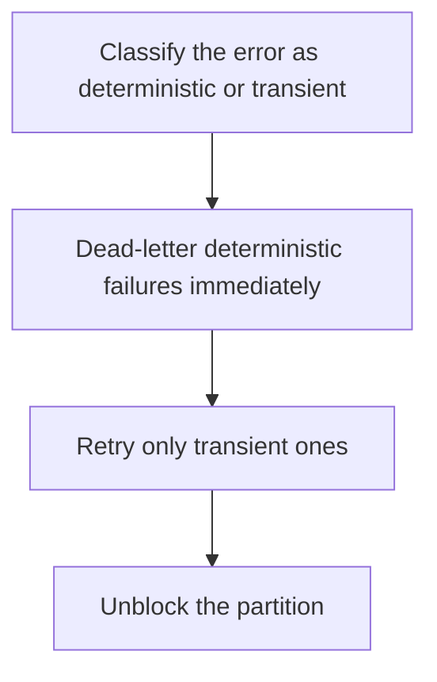

# D14-T029 — Poison messages

Topic ID: `D14-T029`
Domain: Messaging and Event-Driven Architecture
Subdomain: Poison messages
Importance: common
Complexity: advanced
Dependencies: `D14-T028`, `D14-T001`, `D04-T001`, `D04-T002`, `D05-T001`, `D05-T002`
Execution status of the code in section F: unexecuted

## A. Topic Overview

A poison message is one a consumer will fail on every time, such as a payload that cannot be parsed or a business rule that will never pass. Retries do not help. If it stays at the head of an ordered partition, it blocks every later message. The handler should detect a deterministic failure and dead-letter it. A crash loop is the symptom.

In production this shows up as follows: A consumer throws on a negative quantity forever and the partition lag grows. The fix is to DLQ decode and validation errors and alert, while retrying only timeouts from the database.

Interviewers use Poison messages to see whether you can state the failure mode, not only the definition. The failure to name is: one bad payload stalling a partition for the whole tenant or key

Prerequisites: `D14-T028`, `D14-T001`, `D04-T001`, `D04-T002`, `D05-T001`, `D05-T002`. Later notes should link here instead of repeating the mechanism.

## B. First-Principles Explanation

A poison message is one a consumer will fail on every time, such as a payload that cannot be parsed or a business rule that will never pass. Retries do not help. If it stays at the head of an ordered partition, it blocks every later message. The handler should detect a deterministic failure and dead-letter it. A crash loop is the symptom.

The useful picture is: A poison message is a package that will never fit through the door. Leaving it on the threshold means nobody behind it can enter.

What has to be true:

1. Classify the error as deterministic or transient
2. Dead-letter deterministic failures immediately
3. Retry only transient ones
4. Unblock the partition

It works when those steps preserve one invariant. It fails when one bad payload stalling a partition for the whole tenant or key. The alternative is: you retry them until the retry budget and the partition are both exhausted

## C. Internal Working and Architecture

Components involved: the caller, the state Poison messages mutates or reads, and the observer that reports retry rate on a single offset, and consumer crash loops.

Execution:

1. Classify the error as deterministic or transient
2. Dead-letter deterministic failures immediately
3. Retry only transient ones
4. Unblock the partition

Data moves only along that path. A retry re-enters at step 1, so the operation must say what a duplicate does. Memory and locks stay inside this mechanism. Callers see the result or a typed error, not a half-updated invariant.

State to remember: choose this when some failures are properties of the payload. Do not choose it when you retry them until the retry budget and the partition are both exhausted.

## D. Diagrams and Visual Models



Read the diagram from top to bottom. Each box is one step of Poison messages. The failure mode (one bad payload stalling a partition for the whole tenant or key) is what you look for when a later box never happens or happens twice.

## E. Examples and Analogies

Analogy: A poison message is a package that will never fit through the door. Leaving it on the threshold means nobody behind it can enter.

Production example: A consumer throws on a negative quantity forever and the partition lag grows. The fix is to DLQ decode and validation errors and alert, while retrying only timeouts from the database.

A small counterexample is enough in an interview. Show the input, apply the steps, and show the broken outcome if someone uses the mechanism outside its rule: one bad payload stalling a partition for the whole tenant or key.

## F. Code Examples

The snippet is labeled unexecuted. It illustrates the shape of the idea. It is not a benchmark and it embeds no secret.

```python
def poison(error):
    return error in ('decode', 'validation')
```

After the snippet, check retry rate on a single offset, and consumer crash loops. If that signal moves the wrong way, the snippet is the wrong tool for the workload.

## G. Practical Backend Application

Use Poison messages in a service when some failures are properties of the payload.

A typical place is the production case already stated: A consumer throws on a negative quantity forever and the partition lag grows. The fix is to DLQ decode and validation errors and alert, while retrying only timeouts from the database.

Operationally you alert on retry rate on a single offset, and consumer crash loops. You do not alert only on process uptime. The dashboard should show the failure mode, a success rate, and the saturation signal (queue depth, lock wait, or latency) that predicts it.

## H. Advantages, Limitations and Trade-offs

| Choice | Benefit | Cost | Choose when | Avoid when |
| --- | --- | --- | --- | --- |
| Apply Poison messages | some failures are properties of the payload | Extra moving parts and a new failure mode | The failure you are preventing is already real | you retry them until the retry budget and the partition are both exhausted |
| Simpler alternative | Less code and fewer dependencies | one bad payload stalling a partition for the whole tenant or key | The workload does not hit the limit | The invariant must hold under concurrency or failure |

Poison messages is a trade. State the benefit and the cost in the same sentence when you propose it in a design review.

## I. Common Mistakes and Misconceptions

- An unbounded retry.
- No classification of errors.
- Skipping the offset and losing the message with no record.
- Treating a diagram of Poison messages as proof that the invariant holds in production.
- Copying a default configuration without naming retry rate on a single offset, and consumer crash loops.

## J. Debugging and Troubleshooting

Symptom: one bad payload stalling a partition for the whole tenant or key

First check: retry rate on a single offset, and consumer crash loops.

Then compare one healthy instance against one unhealthy instance. Confirm whether retries are duplicating work. Confirm whether a timeout is shorter than the work. Fix the invariant, then watch the same metric for a full peak, not only for the next minute.

Useful questions: did the step order in section C actually happen, or did a caller skip a step? Did a deploy change the data shape that Poison messages assumes?

## K. Interview Preparation

### Beginner

#### Q1. What problem does Poison messages solve?

**Answer:** A poison message is one a consumer will fail on every time, such as a payload that cannot be parsed or a business rule that will never pass. Retries do not help. If it stays at the head of an ordered partition, it blocks every later message. The handler should detect a deterministic failure and dead-letter it. A crash loop is the symptom. Without it, the usual backend failure is: one bad payload stalling a partition for the whole tenant or key.

#### Q2. Where does Poison messages sit on a request path?

**Answer:** Poison messages is not a library you sprinkle on every call. some failures are properties of the payload You notice it when retry rate on a single offset, and consumer crash loops. Name the constraint that makes this choice correct. Say what you would measure to confirm it.

#### Q3. Give a concrete example of Poison messages.

**Answer:** A consumer throws on a negative quantity forever and the partition lag grows. The fix is to DLQ decode and validation errors and alert, while retrying only timeouts from the database. Walk the input, the state change, and the observable output. Name the constraint that makes this choice correct.

#### Q4. What is a common mix-up around Poison messages?

**Answer:** one bad payload stalling a partition for the whole tenant or key The corrective check is retry rate on a single offset, and consumer crash loops. Name the constraint that makes this choice correct. Say what you would measure to confirm it. Say which alternative you rejected and why.

#### Q5. When would you skip Poison messages?

**Answer:** you retry them until the retry budget and the partition are both exhausted Skipping is a decision with a measured cost, not a slogan. Name the constraint that makes this choice correct. Say what you would measure to confirm it. Say which alternative you rejected and why.

### Intermediate

#### Q1. What invariant makes Poison messages correct?

**Answer:** A poison message is one a consumer will fail on every time, such as a payload that cannot be parsed or a business rule that will never pass. Retries do not help. If it stays at the head of an ordered partition, it blocks every later message. The handler should detect a deterministic failure and dead-letter it. A crash loop is the symptom. State the invariant before you name the tool.

#### Q2. How do you test Poison messages?

**Answer:** Assert the failure mode directly: one bad payload stalling a partition for the whole tenant or key. The assertion should watch retry rate on a single offset, and consumer crash loops. Include a concurrent or retry case if the bug only appears then. Name the constraint that makes this choice correct.

#### Q3. What signal tells you Poison messages is misbehaving in production?

**Answer:** Watch retry rate on a single offset, and consumer crash loops. The user-visible symptom is usually one bad payload stalling a partition for the whole tenant or key. Name the constraint that makes this choice correct. Say what you would measure to confirm it.

#### Q4. How would you introduce Poison messages into a legacy service?

**Answer:** some failures are properties of the payload Ship it behind a metric so you can compare the old path. Roll back if one bad payload stalling a partition for the whole tenant or key gets worse. Name the constraint that makes this choice correct. Say what you would measure to confirm it.

#### Q5. What do you trade away by choosing Poison messages?

**Answer:** some failures are properties of the payload you retry them until the retry budget and the partition are both exhausted Say the cost in latency, storage, or operational load. Name the constraint that makes this choice correct. Say what you would measure to confirm it. Say which alternative you rejected and why.

### Advanced

#### Q1. What breaks if a dependency of Poison messages is slow or down?

**Answer:** one bad payload stalling a partition for the whole tenant or key Degrade using the rule: you retry them until the retry budget and the partition are both exhausted. Timeouts must be shorter than the caller's deadline. Name the constraint that makes this choice correct. Say what you would measure to confirm it.

#### Q2. How does Poison messages behave under retries?

**Answer:** Retries repeat work, so Poison messages must define what a duplicate does. one bad payload stalling a partition for the whole tenant or key Idempotency keys or fences belong next to the write, not in a comment. Name the constraint that makes this choice correct. Say what you would measure to confirm it.

#### Q3. What is the capacity limit of Poison messages?

**Answer:** The limit shows up as retry rate on a single offset, and consumer crash loops. Add capacity only after you know whether the bottleneck is CPU, lock wait, or network. Name the constraint that makes this choice correct. Say what you would measure to confirm it.

#### Q4. How do you evolve Poison messages without a flag day?

**Answer:** some failures are properties of the payload Version the contract or the on-disk format. Readers should tolerate one old and one new shape during the rollout. Name the constraint that makes this choice correct. Say what you would measure to confirm it.

#### Q5. What security or correctness bug hides inside Poison messages?

**Answer:** one bad payload stalling a partition for the whole tenant or key Check authorization and tenancy at the same boundary as the mechanism. A cache or queue must not widen who can read the data. Name the constraint that makes this choice correct. Say what you would measure to confirm it.

### Scenario

#### Q1. Incident: one bad payload stalling a partition for the whole tenant or key. What do you check first?

**Answer:** Start with retry rate on a single offset, and consumer crash loops. Compare a good host and a bad host before you restart anything. A poison message is one a consumer will fail on every time, such as a payload that cannot be parsed or a business rule that will never pass. Retries do not help. If it stays at the head of an ordered partition, it blocks every later message. The handler should detect a deterministic failure and dead-letter it. A crash loop is the symptom.

#### Q2. A reviewer wants the clever version. What data settles it?

**Answer:** some failures are properties of the payload you retry them until the retry budget and the partition are both exhausted Bring retry rate on a single offset, and consumer crash loops from a load test or from production, not a slogan. Name the constraint that makes this choice correct. Say what you would measure to confirm it. Say which alternative you rejected and why.

#### Q3. You have one hour to explain Poison messages at a whiteboard.

**Answer:** Draw the happy path in four boxes. Then draw the failure: one bad payload stalling a partition for the whole tenant or key. End with the metric you would page on. Name the constraint that makes this choice correct.

#### Q4. The bug only appears under two concurrent callers.

**Answer:** one bad payload stalling a partition for the whole tenant or key Reproduce with a barrier so both sides enter the critical window. Confirm the fix with retry rate on a single offset, and consumer crash loops. Name the constraint that makes this choice correct. Say what you would measure to confirm it.

#### Q5. Leadership wants this on every service next week.

**Answer:** you retry them until the retry budget and the partition are both exhausted some failures are properties of the payload Roll it out where the failure mode is already hurting users. Name the constraint that makes this choice correct. Say what you would measure to confirm it. Say which alternative you rejected and why.

### Follow-up

#### Q1. What did you assume about the data size or the clock?

**Answer:** A poison message is one a consumer will fail on every time, such as a payload that cannot be parsed or a business rule that will never pass. Retries do not help. If it stays at the head of an ordered partition, it blocks every later message. The handler should detect a deterministic failure and dead-letter it. A crash loop is the symptom. Clocks are not a total order across machines. State whether the algorithm needs bounded size or a single leader.

#### Q2. What would you measure after the change ships?

**Answer:** Page on retry rate on a single offset, and consumer crash loops. Keep a before/after dashboard for one week. Alert on the failure mode, not only on CPU. Name the constraint that makes this choice correct.

#### Q3. Which neighboring topic did you deliberately not re-teach?

**Answer:** This note owns Poison messages. Related identifiers are in section N. Shared ideas are linked, not copied. Name the constraint that makes this choice correct.

## L. Practical Exercises

Solutions are in `EXERCISES/solutions/D14-T029.md`, not in this section.

1. Whiteboard the four steps of Poison messages and mark where `one bad payload stalling a partition for the whole tenant or key` enters.
2. Read the snippet in section F and write the assertion that would catch that failure. The assertion must mention `retry rate on a single offset, and consumer crash loops`.
3. Argue for or against using Poison messages on a service you know. Use the choose and avoid rows from section H. Do not appeal to popularity.

## M. Revision Notes

- Mechanism: A poison message is one a consumer will fail on every time, such as a payload that cannot be parsed or a business rule that will never pass.
- Failure: one bad payload stalling a partition for the whole tenant or key
- Metric: retry rate on a single offset, and consumer crash loops
- Choose when: some failures are properties of the payload
- Avoid when: you retry them until the retry budget and the partition are both exhausted

## N. Related Topics

Dependencies to review first: `D14-T028`, `D14-T001`, `D04-T001`, `D04-T002`, `D05-T001`, `D05-T002`.

Shared ideas stay in those notes. This note does not restate them.

## O. Completion Criteria

- You can explain Poison messages without reading this note, including the failure mode.
- You can draw the diagram in section D from memory.
- You can say when not to use it, using the avoid condition in section H.
- You can name the metric you would watch after shipping it.
