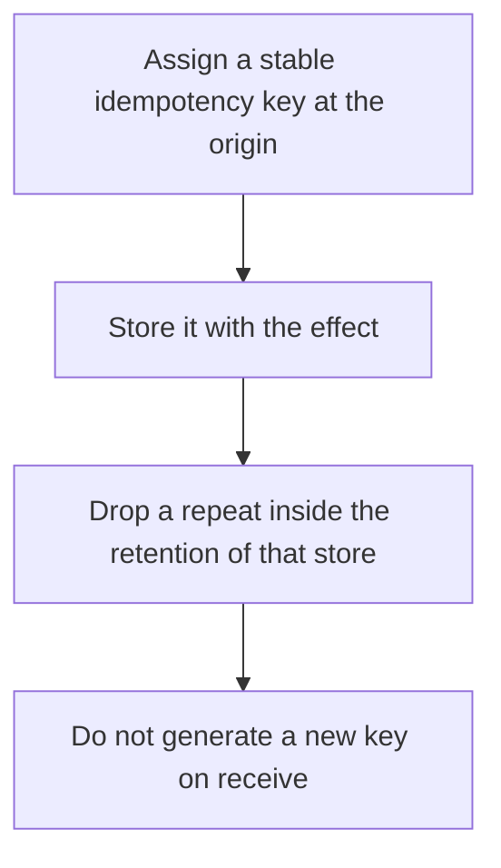

# D14-T030 — Message deduplication

Topic ID: `D14-T030`
Domain: Messaging and Event-Driven Architecture
Subdomain: Message deduplication
Importance: common
Complexity: advanced
Dependencies: `D14-T029`, `D14-T001`, `D04-T001`, `D04-T002`, `D05-T001`, `D05-T002`
Execution status of the code in section F: unexecuted

## A. Topic Overview

Message deduplication drops a repeat of a message the system already accepted. Brokers can dedupe producer retries for a window. Business dedupe stores the idempotency key for longer than the retry window, in the same transaction as the effect. A short broker window does not cover a consumer that replays yesterday's log. The key must be stable across retries.

In production this shows up as follows: The API gateway stamps Idempotency-Key. The outbox carries it. The consumer inserts it into a unique column kept for thirty days, which covers the broker's retry window and a manual replay.

Interviewers use Message deduplication to see whether you can state the failure mode, not only the definition. The failure to name is: a dedupe window shorter than the replay, so the second handling charges the customer again

Prerequisites: `D14-T029`, `D14-T001`, `D04-T001`, `D04-T002`, `D05-T001`, `D05-T002`. Later notes should link here instead of repeating the mechanism.

## B. First-Principles Explanation

Message deduplication drops a repeat of a message the system already accepted. Brokers can dedupe producer retries for a window. Business dedupe stores the idempotency key for longer than the retry window, in the same transaction as the effect. A short broker window does not cover a consumer that replays yesterday's log. The key must be stable across retries.

The useful picture is: Deduplication is recognizing a receipt number. If you only remember receipt numbers until lunch, the same receipt after lunch gets paid again.

What has to be true:

1. Assign a stable idempotency key at the origin
2. Store it with the effect
3. Drop a repeat inside the retention of that store
4. Do not generate a new key on receive

It works when those steps preserve one invariant. It fails when a dedupe window shorter than the replay, so the second handling charges the customer again. The alternative is: the dedupe memory is shorter than the ways a duplicate can appear

## C. Internal Working and Architecture

Components involved: the caller, the state Message deduplication mutates or reads, and the observer that reports duplicate effects whose keys arrived twice outside the window.

Execution:

1. Assign a stable idempotency key at the origin
2. Store it with the effect
3. Drop a repeat inside the retention of that store
4. Do not generate a new key on receive

Data moves only along that path. A retry re-enters at step 1, so the operation must say what a duplicate does. Memory and locks stay inside this mechanism. Callers see the result or a typed error, not a half-updated invariant.

State to remember: choose this when the same logical event can be delivered more than once. Do not choose it when the dedupe memory is shorter than the ways a duplicate can appear.

## D. Diagrams and Visual Models



Read the diagram from top to bottom. Each box is one step of Message deduplication. The failure mode (a dedupe window shorter than the replay, so the second handling charges the customer again) is what you look for when a later box never happens or happens twice.

## E. Examples and Analogies

Analogy: Deduplication is recognizing a receipt number. If you only remember receipt numbers until lunch, the same receipt after lunch gets paid again.

Production example: The API gateway stamps Idempotency-Key. The outbox carries it. The consumer inserts it into a unique column kept for thirty days, which covers the broker's retry window and a manual replay.

A small counterexample is enough in an interview. Show the input, apply the steps, and show the broken outcome if someone uses the mechanism outside its rule: a dedupe window shorter than the replay, so the second handling charges the customer again.

## F. Code Examples

The snippet is labeled unexecuted. It illustrates the shape of the idea. It is not a benchmark and it embeds no secret.

```python
def duplicate(store, key):
    return not store.add(key)
```

After the snippet, check duplicate effects whose keys arrived twice outside the window. If that signal moves the wrong way, the snippet is the wrong tool for the workload.

## G. Practical Backend Application

Use Message deduplication in a service when the same logical event can be delivered more than once.

A typical place is the production case already stated: The API gateway stamps Idempotency-Key. The outbox carries it. The consumer inserts it into a unique column kept for thirty days, which covers the broker's retry window and a manual replay.

Operationally you alert on duplicate effects whose keys arrived twice outside the window. You do not alert only on process uptime. The dashboard should show the failure mode, a success rate, and the saturation signal (queue depth, lock wait, or latency) that predicts it.

## H. Advantages, Limitations and Trade-offs

| Choice | Benefit | Cost | Choose when | Avoid when |
| --- | --- | --- | --- | --- |
| Apply Message deduplication | the same logical event can be delivered more than once | Extra moving parts and a new failure mode | The failure you are preventing is already real | the dedupe memory is shorter than the ways a duplicate can appear |
| Simpler alternative | Less code and fewer dependencies | a dedupe window shorter than the replay, so the second handling charges the customer again | The workload does not hit the limit | The invariant must hold under concurrency or failure |

Message deduplication is a trade. State the benefit and the cost in the same sentence when you propose it in a design review.

## I. Common Mistakes and Misconceptions

- A new UUID per attempt.
- In-memory sets.
- Broker dedupe only, with a five-minute window, for a financial effect.
- Treating a diagram of Message deduplication as proof that the invariant holds in production.
- Copying a default configuration without naming duplicate effects whose keys arrived twice outside the window.

## J. Debugging and Troubleshooting

Symptom: a dedupe window shorter than the replay, so the second handling charges the customer again

First check: duplicate effects whose keys arrived twice outside the window.

Then compare one healthy instance against one unhealthy instance. Confirm whether retries are duplicating work. Confirm whether a timeout is shorter than the work. Fix the invariant, then watch the same metric for a full peak, not only for the next minute.

Useful questions: did the step order in section C actually happen, or did a caller skip a step? Did a deploy change the data shape that Message deduplication assumes?

## K. Interview Preparation

### Beginner

#### Q1. What problem does Message deduplication solve?

**Answer:** Message deduplication drops a repeat of a message the system already accepted. Brokers can dedupe producer retries for a window. Business dedupe stores the idempotency key for longer than the retry window, in the same transaction as the effect. A short broker window does not cover a consumer that replays yesterday's log. The key must be stable across retries. Without it, the usual backend failure is: a dedupe window shorter than the replay, so the second handling charges the customer again.

#### Q2. Where does Message deduplication sit on a request path?

**Answer:** Message deduplication is not a library you sprinkle on every call. the same logical event can be delivered more than once You notice it when duplicate effects whose keys arrived twice outside the window. Name the constraint that makes this choice correct. Say what you would measure to confirm it.

#### Q3. Give a concrete example of Message deduplication.

**Answer:** The API gateway stamps Idempotency-Key. The outbox carries it. The consumer inserts it into a unique column kept for thirty days, which covers the broker's retry window and a manual replay. Walk the input, the state change, and the observable output.

#### Q4. What is a common mix-up around Message deduplication?

**Answer:** a dedupe window shorter than the replay, so the second handling charges the customer again The corrective check is duplicate effects whose keys arrived twice outside the window. Name the constraint that makes this choice correct. Say what you would measure to confirm it. Say which alternative you rejected and why.

#### Q5. When would you skip Message deduplication?

**Answer:** the dedupe memory is shorter than the ways a duplicate can appear Skipping is a decision with a measured cost, not a slogan. Name the constraint that makes this choice correct. Say what you would measure to confirm it. Say which alternative you rejected and why.

### Intermediate

#### Q1. What invariant makes Message deduplication correct?

**Answer:** Message deduplication drops a repeat of a message the system already accepted. Brokers can dedupe producer retries for a window. Business dedupe stores the idempotency key for longer than the retry window, in the same transaction as the effect. A short broker window does not cover a consumer that replays yesterday's log. The key must be stable across retries. State the invariant before you name the tool.

#### Q2. How do you test Message deduplication?

**Answer:** Assert the failure mode directly: a dedupe window shorter than the replay, so the second handling charges the customer again. The assertion should watch duplicate effects whose keys arrived twice outside the window. Include a concurrent or retry case if the bug only appears then. Name the constraint that makes this choice correct.

#### Q3. What signal tells you Message deduplication is misbehaving in production?

**Answer:** Watch duplicate effects whose keys arrived twice outside the window. The user-visible symptom is usually a dedupe window shorter than the replay, so the second handling charges the customer again. Name the constraint that makes this choice correct. Say what you would measure to confirm it.

#### Q4. How would you introduce Message deduplication into a legacy service?

**Answer:** the same logical event can be delivered more than once Ship it behind a metric so you can compare the old path. Roll back if a dedupe window shorter than the replay, so the second handling charges the customer again gets worse. Name the constraint that makes this choice correct. Say what you would measure to confirm it.

#### Q5. What do you trade away by choosing Message deduplication?

**Answer:** the same logical event can be delivered more than once the dedupe memory is shorter than the ways a duplicate can appear Say the cost in latency, storage, or operational load. Name the constraint that makes this choice correct. Say what you would measure to confirm it. Say which alternative you rejected and why.

### Advanced

#### Q1. What breaks if a dependency of Message deduplication is slow or down?

**Answer:** a dedupe window shorter than the replay, so the second handling charges the customer again Degrade using the rule: the dedupe memory is shorter than the ways a duplicate can appear. Timeouts must be shorter than the caller's deadline. Name the constraint that makes this choice correct. Say what you would measure to confirm it.

#### Q2. How does Message deduplication behave under retries?

**Answer:** Retries repeat work, so Message deduplication must define what a duplicate does. a dedupe window shorter than the replay, so the second handling charges the customer again Idempotency keys or fences belong next to the write, not in a comment. Name the constraint that makes this choice correct. Say what you would measure to confirm it.

#### Q3. What is the capacity limit of Message deduplication?

**Answer:** The limit shows up as duplicate effects whose keys arrived twice outside the window. Add capacity only after you know whether the bottleneck is CPU, lock wait, or network. Name the constraint that makes this choice correct. Say what you would measure to confirm it.

#### Q4. How do you evolve Message deduplication without a flag day?

**Answer:** the same logical event can be delivered more than once Version the contract or the on-disk format. Readers should tolerate one old and one new shape during the rollout. Name the constraint that makes this choice correct. Say what you would measure to confirm it.

#### Q5. What security or correctness bug hides inside Message deduplication?

**Answer:** a dedupe window shorter than the replay, so the second handling charges the customer again Check authorization and tenancy at the same boundary as the mechanism. A cache or queue must not widen who can read the data. Name the constraint that makes this choice correct. Say what you would measure to confirm it.

### Scenario

#### Q1. Incident: a dedupe window shorter than the replay, so the second handling charges the customer again. What do you check first?

**Answer:** Start with duplicate effects whose keys arrived twice outside the window. Compare a good host and a bad host before you restart anything. Message deduplication drops a repeat of a message the system already accepted. Brokers can dedupe producer retries for a window. Business dedupe stores the idempotency key for longer than the retry window, in the same transaction as the effect. A short broker window does not cover a consumer that replays yesterday's log. The key must be stable across retries.

#### Q2. A reviewer wants the clever version. What data settles it?

**Answer:** the same logical event can be delivered more than once the dedupe memory is shorter than the ways a duplicate can appear Bring duplicate effects whose keys arrived twice outside the window from a load test or from production, not a slogan. Name the constraint that makes this choice correct. Say what you would measure to confirm it. Say which alternative you rejected and why.

#### Q3. You have one hour to explain Message deduplication at a whiteboard.

**Answer:** Draw the happy path in four boxes. Then draw the failure: a dedupe window shorter than the replay, so the second handling charges the customer again. End with the metric you would page on. Name the constraint that makes this choice correct.

#### Q4. The bug only appears under two concurrent callers.

**Answer:** a dedupe window shorter than the replay, so the second handling charges the customer again Reproduce with a barrier so both sides enter the critical window. Confirm the fix with duplicate effects whose keys arrived twice outside the window. Name the constraint that makes this choice correct. Say what you would measure to confirm it.

#### Q5. Leadership wants this on every service next week.

**Answer:** the dedupe memory is shorter than the ways a duplicate can appear the same logical event can be delivered more than once Roll it out where the failure mode is already hurting users. Name the constraint that makes this choice correct. Say what you would measure to confirm it. Say which alternative you rejected and why.

### Follow-up

#### Q1. What did you assume about the data size or the clock?

**Answer:** Message deduplication drops a repeat of a message the system already accepted. Brokers can dedupe producer retries for a window. Business dedupe stores the idempotency key for longer than the retry window, in the same transaction as the effect. A short broker window does not cover a consumer that replays yesterday's log. The key must be stable across retries. Clocks are not a total order across machines. State whether the algorithm needs bounded size or a single leader.

#### Q2. What would you measure after the change ships?

**Answer:** Page on duplicate effects whose keys arrived twice outside the window. Keep a before/after dashboard for one week. Alert on the failure mode, not only on CPU. Name the constraint that makes this choice correct.

#### Q3. Which neighboring topic did you deliberately not re-teach?

**Answer:** This note owns Message deduplication. Related identifiers are in section N. Shared ideas are linked, not copied. Name the constraint that makes this choice correct.

## L. Practical Exercises

Solutions are in `EXERCISES/solutions/D14-T030.md`, not in this section.

1. Whiteboard the four steps of Message deduplication and mark where `a dedupe window shorter than the replay, so the second handling charges the customer again` enters.
2. Read the snippet in section F and write the assertion that would catch that failure. The assertion must mention `duplicate effects whose keys arrived twice outside the window`.
3. Argue for or against using Message deduplication on a service you know. Use the choose and avoid rows from section H. Do not appeal to popularity.

## M. Revision Notes

- Mechanism: Message deduplication drops a repeat of a message the system already accepted.
- Failure: a dedupe window shorter than the replay, so the second handling charges the customer again
- Metric: duplicate effects whose keys arrived twice outside the window
- Choose when: the same logical event can be delivered more than once
- Avoid when: the dedupe memory is shorter than the ways a duplicate can appear

## N. Related Topics

Dependencies to review first: `D14-T029`, `D14-T001`, `D04-T001`, `D04-T002`, `D05-T001`, `D05-T002`.

Shared ideas stay in those notes. This note does not restate them.

## O. Completion Criteria

- You can explain Message deduplication without reading this note, including the failure mode.
- You can draw the diagram in section D from memory.
- You can say when not to use it, using the avoid condition in section H.
- You can name the metric you would watch after shipping it.
