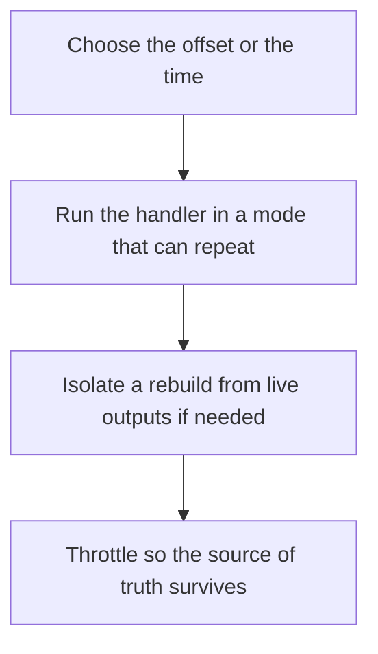

# D14-T031 — Replay and reprocessing

Topic ID: `D14-T031`
Domain: Messaging and Event-Driven Architecture
Subdomain: Replay and reprocessing
Importance: core
Complexity: advanced
Dependencies: `D14-T030`, `D14-T001`, `D04-T001`, `D04-T002`, `D05-T001`, `D05-T002`
Execution status of the code in section F: unexecuted

## A. Topic Overview

Replay rereads a log from an earlier offset. Reprocessing applies the handler again. Both are safe only if the handler is idempotent or the output is rebuilt from scratch into a new projection. Replay is how you fix a bug in a consumer or seed a new one. It is not free: it can overload the database and reorder relative to live traffic if you are not careful.

In production this shows up as follows: A new search index is built by replaying the order log into a new index name, then swapping. The live email consumer is not pointed at the old offset. A bugfix in the projection is deployed before the replay.

Interviewers use Replay and reprocessing to see whether you can state the failure mode, not only the definition. The failure to name is: a replay that sends a second email for every historical order, or that overwrites a newer live update with an older event

Prerequisites: `D14-T030`, `D14-T001`, `D04-T001`, `D04-T002`, `D05-T001`, `D05-T002`. Later notes should link here instead of repeating the mechanism.

## B. First-Principles Explanation

Replay rereads a log from an earlier offset. Reprocessing applies the handler again. Both are safe only if the handler is idempotent or the output is rebuilt from scratch into a new projection. Replay is how you fix a bug in a consumer or seed a new one. It is not free: it can overload the database and reorder relative to live traffic if you are not careful.

The useful picture is: Replay is reading the diary from March again. Reprocessing is doing the chores written there. If the chores include mailing a letter, you mail it again unless the chore knows the letter already went.

What has to be true:

1. Choose the offset or the time
2. Run the handler in a mode that can repeat
3. Isolate a rebuild from live outputs if needed
4. Throttle so the source of truth survives

It works when those steps preserve one invariant. It fails when a replay that sends a second email for every historical order, or that overwrites a newer live update with an older event. The alternative is: you rewind a live side-effecting consumer with no idempotency

## C. Internal Working and Architecture

Components involved: the caller, the state Replay and reprocessing mutates or reads, and the observer that reports duplicate side effects during replay, and load on the database.

Execution:

1. Choose the offset or the time
2. Run the handler in a mode that can repeat
3. Isolate a rebuild from live outputs if needed
4. Throttle so the source of truth survives

Data moves only along that path. A retry re-enters at step 1, so the operation must say what a duplicate does. Memory and locks stay inside this mechanism. Callers see the result or a typed error, not a half-updated invariant.

State to remember: choose this when the log still has the history and the handler can repeat or write to a new output. Do not choose it when you rewind a live side-effecting consumer with no idempotency.

## D. Diagrams and Visual Models



Read the diagram from top to bottom. Each box is one step of Replay and reprocessing. The failure mode (a replay that sends a second email for every historical order, or that overwrites a newer live update with an older event) is what you look for when a later box never happens or happens twice.

## E. Examples and Analogies

Analogy: Replay is reading the diary from March again. Reprocessing is doing the chores written there. If the chores include mailing a letter, you mail it again unless the chore knows the letter already went.

Production example: A new search index is built by replaying the order log into a new index name, then swapping. The live email consumer is not pointed at the old offset. A bugfix in the projection is deployed before the replay.

A small counterexample is enough in an interview. Show the input, apply the steps, and show the broken outcome if someone uses the mechanism outside its rule: a replay that sends a second email for every historical order, or that overwrites a newer live update with an older event.

## F. Code Examples

The snippet is labeled unexecuted. It illustrates the shape of the idea. It is not a benchmark and it embeds no secret.

```python
def replay_mode(rebuild):
    return 'new-projection' if rebuild else 'idempotent-handler'
```

After the snippet, check duplicate side effects during replay, and load on the database. If that signal moves the wrong way, the snippet is the wrong tool for the workload.

## G. Practical Backend Application

Use Replay and reprocessing in a service when the log still has the history and the handler can repeat or write to a new output.

A typical place is the production case already stated: A new search index is built by replaying the order log into a new index name, then swapping. The live email consumer is not pointed at the old offset. A bugfix in the projection is deployed before the replay.

Operationally you alert on duplicate side effects during replay, and load on the database. You do not alert only on process uptime. The dashboard should show the failure mode, a success rate, and the saturation signal (queue depth, lock wait, or latency) that predicts it.

## H. Advantages, Limitations and Trade-offs

| Choice | Benefit | Cost | Choose when | Avoid when |
| --- | --- | --- | --- | --- |
| Apply Replay and reprocessing | the log still has the history and the handler can repeat or write to a new output | Extra moving parts and a new failure mode | The failure you are preventing is already real | you rewind a live side-effecting consumer with no idempotency |
| Simpler alternative | Less code and fewer dependencies | a replay that sends a second email for every historical order, or that overwrites a newer live update with an older event | The workload does not hit the limit | The invariant must hold under concurrency or failure |

Replay and reprocessing is a trade. State the benefit and the cost in the same sentence when you propose it in a design review.

## I. Common Mistakes and Misconceptions

- Replay into production email.
- No throttle.
- Old events overwriting newer state.
- Treating a diagram of Replay and reprocessing as proof that the invariant holds in production.
- Copying a default configuration without naming duplicate side effects during replay, and load on the database.

## J. Debugging and Troubleshooting

Symptom: a replay that sends a second email for every historical order, or that overwrites a newer live update with an older event

First check: duplicate side effects during replay, and load on the database.

Then compare one healthy instance against one unhealthy instance. Confirm whether retries are duplicating work. Confirm whether a timeout is shorter than the work. Fix the invariant, then watch the same metric for a full peak, not only for the next minute.

Useful questions: did the step order in section C actually happen, or did a caller skip a step? Did a deploy change the data shape that Replay and reprocessing assumes?

## K. Interview Preparation

### Beginner

#### Q1. What problem does Replay and reprocessing solve?

**Answer:** Replay rereads a log from an earlier offset. Reprocessing applies the handler again. Both are safe only if the handler is idempotent or the output is rebuilt from scratch into a new projection. Replay is how you fix a bug in a consumer or seed a new one. It is not free: it can overload the database and reorder relative to live traffic if you are not careful. Without it, the usual backend failure is: a replay that sends a second email for every historical order, or that overwrites a newer live update with an older event.

#### Q2. Where does Replay and reprocessing sit on a request path?

**Answer:** Replay and reprocessing is not a library you sprinkle on every call. the log still has the history and the handler can repeat or write to a new output You notice it when duplicate side effects during replay, and load on the database. Name the constraint that makes this choice correct. Say what you would measure to confirm it.

#### Q3. Give a concrete example of Replay and reprocessing.

**Answer:** A new search index is built by replaying the order log into a new index name, then swapping. The live email consumer is not pointed at the old offset. A bugfix in the projection is deployed before the replay. Walk the input, the state change, and the observable output.

#### Q4. What is a common mix-up around Replay and reprocessing?

**Answer:** a replay that sends a second email for every historical order, or that overwrites a newer live update with an older event The corrective check is duplicate side effects during replay, and load on the database. Name the constraint that makes this choice correct. Say what you would measure to confirm it. Say which alternative you rejected and why.

#### Q5. When would you skip Replay and reprocessing?

**Answer:** you rewind a live side-effecting consumer with no idempotency Skipping is a decision with a measured cost, not a slogan. Name the constraint that makes this choice correct. Say what you would measure to confirm it. Say which alternative you rejected and why.

### Intermediate

#### Q1. What invariant makes Replay and reprocessing correct?

**Answer:** Replay rereads a log from an earlier offset. Reprocessing applies the handler again. Both are safe only if the handler is idempotent or the output is rebuilt from scratch into a new projection. Replay is how you fix a bug in a consumer or seed a new one. It is not free: it can overload the database and reorder relative to live traffic if you are not careful. State the invariant before you name the tool.

#### Q2. How do you test Replay and reprocessing?

**Answer:** Assert the failure mode directly: a replay that sends a second email for every historical order, or that overwrites a newer live update with an older event. The assertion should watch duplicate side effects during replay, and load on the database. Include a concurrent or retry case if the bug only appears then. Name the constraint that makes this choice correct.

#### Q3. What signal tells you Replay and reprocessing is misbehaving in production?

**Answer:** Watch duplicate side effects during replay, and load on the database. The user-visible symptom is usually a replay that sends a second email for every historical order, or that overwrites a newer live update with an older event. Name the constraint that makes this choice correct. Say what you would measure to confirm it.

#### Q4. How would you introduce Replay and reprocessing into a legacy service?

**Answer:** the log still has the history and the handler can repeat or write to a new output Ship it behind a metric so you can compare the old path. Roll back if a replay that sends a second email for every historical order, or that overwrites a newer live update with an older event gets worse. Name the constraint that makes this choice correct. Say what you would measure to confirm it.

#### Q5. What do you trade away by choosing Replay and reprocessing?

**Answer:** the log still has the history and the handler can repeat or write to a new output you rewind a live side-effecting consumer with no idempotency Say the cost in latency, storage, or operational load. Name the constraint that makes this choice correct. Say what you would measure to confirm it. Say which alternative you rejected and why.

### Advanced

#### Q1. What breaks if a dependency of Replay and reprocessing is slow or down?

**Answer:** a replay that sends a second email for every historical order, or that overwrites a newer live update with an older event Degrade using the rule: you rewind a live side-effecting consumer with no idempotency. Timeouts must be shorter than the caller's deadline. Name the constraint that makes this choice correct. Say what you would measure to confirm it.

#### Q2. How does Replay and reprocessing behave under retries?

**Answer:** Retries repeat work, so Replay and reprocessing must define what a duplicate does. a replay that sends a second email for every historical order, or that overwrites a newer live update with an older event Idempotency keys or fences belong next to the write, not in a comment. Name the constraint that makes this choice correct. Say what you would measure to confirm it.

#### Q3. What is the capacity limit of Replay and reprocessing?

**Answer:** The limit shows up as duplicate side effects during replay, and load on the database. Add capacity only after you know whether the bottleneck is CPU, lock wait, or network. Name the constraint that makes this choice correct. Say what you would measure to confirm it.

#### Q4. How do you evolve Replay and reprocessing without a flag day?

**Answer:** the log still has the history and the handler can repeat or write to a new output Version the contract or the on-disk format. Readers should tolerate one old and one new shape during the rollout. Name the constraint that makes this choice correct. Say what you would measure to confirm it.

#### Q5. What security or correctness bug hides inside Replay and reprocessing?

**Answer:** a replay that sends a second email for every historical order, or that overwrites a newer live update with an older event Check authorization and tenancy at the same boundary as the mechanism. A cache or queue must not widen who can read the data. Name the constraint that makes this choice correct. Say what you would measure to confirm it.

### Scenario

#### Q1. Incident: a replay that sends a second email for every historical order, or that overwrites a newer live update with an older event. What do you check first?

**Answer:** Start with duplicate side effects during replay, and load on the database. Compare a good host and a bad host before you restart anything. Replay rereads a log from an earlier offset. Reprocessing applies the handler again. Both are safe only if the handler is idempotent or the output is rebuilt from scratch into a new projection. Replay is how you fix a bug in a consumer or seed a new one. It is not free: it can overload the database and reorder relative to live traffic if you are not careful.

#### Q2. A reviewer wants the clever version. What data settles it?

**Answer:** the log still has the history and the handler can repeat or write to a new output you rewind a live side-effecting consumer with no idempotency Bring duplicate side effects during replay, and load on the database from a load test or from production, not a slogan. Name the constraint that makes this choice correct. Say what you would measure to confirm it. Say which alternative you rejected and why.

#### Q3. You have one hour to explain Replay and reprocessing at a whiteboard.

**Answer:** Draw the happy path in four boxes. Then draw the failure: a replay that sends a second email for every historical order, or that overwrites a newer live update with an older event. End with the metric you would page on. Name the constraint that makes this choice correct.

#### Q4. The bug only appears under two concurrent callers.

**Answer:** a replay that sends a second email for every historical order, or that overwrites a newer live update with an older event Reproduce with a barrier so both sides enter the critical window. Confirm the fix with duplicate side effects during replay, and load on the database. Name the constraint that makes this choice correct. Say what you would measure to confirm it.

#### Q5. Leadership wants this on every service next week.

**Answer:** you rewind a live side-effecting consumer with no idempotency the log still has the history and the handler can repeat or write to a new output Roll it out where the failure mode is already hurting users. Name the constraint that makes this choice correct. Say what you would measure to confirm it. Say which alternative you rejected and why.

### Follow-up

#### Q1. What did you assume about the data size or the clock?

**Answer:** Replay rereads a log from an earlier offset. Reprocessing applies the handler again. Both are safe only if the handler is idempotent or the output is rebuilt from scratch into a new projection. Replay is how you fix a bug in a consumer or seed a new one. It is not free: it can overload the database and reorder relative to live traffic if you are not careful. Clocks are not a total order across machines. State whether the algorithm needs bounded size or a single leader.

#### Q2. What would you measure after the change ships?

**Answer:** Page on duplicate side effects during replay, and load on the database. Keep a before/after dashboard for one week. Alert on the failure mode, not only on CPU. Name the constraint that makes this choice correct.

#### Q3. Which neighboring topic did you deliberately not re-teach?

**Answer:** This note owns Replay and reprocessing. Related identifiers are in section N. Shared ideas are linked, not copied. Name the constraint that makes this choice correct.

## L. Practical Exercises

Solutions are in `EXERCISES/solutions/D14-T031.md`, not in this section.

1. Whiteboard the four steps of Replay and reprocessing and mark where `a replay that sends a second email for every historical order, or that overwrites a newer live update with an older event` enters.
2. Read the snippet in section F and write the assertion that would catch that failure. The assertion must mention `duplicate side effects during replay, and load on the database`.
3. Argue for or against using Replay and reprocessing on a service you know. Use the choose and avoid rows from section H. Do not appeal to popularity.

## M. Revision Notes

- Mechanism: Replay rereads a log from an earlier offset.
- Failure: a replay that sends a second email for every historical order, or that overwrites a newer live update with an older event
- Metric: duplicate side effects during replay, and load on the database
- Choose when: the log still has the history and the handler can repeat or write to a new output
- Avoid when: you rewind a live side-effecting consumer with no idempotency

## N. Related Topics

Dependencies to review first: `D14-T030`, `D14-T001`, `D04-T001`, `D04-T002`, `D05-T001`, `D05-T002`.

Shared ideas stay in those notes. This note does not restate them.

## O. Completion Criteria

- You can explain Replay and reprocessing without reading this note, including the failure mode.
- You can draw the diagram in section D from memory.
- You can say when not to use it, using the avoid condition in section H.
- You can name the metric you would watch after shipping it.
