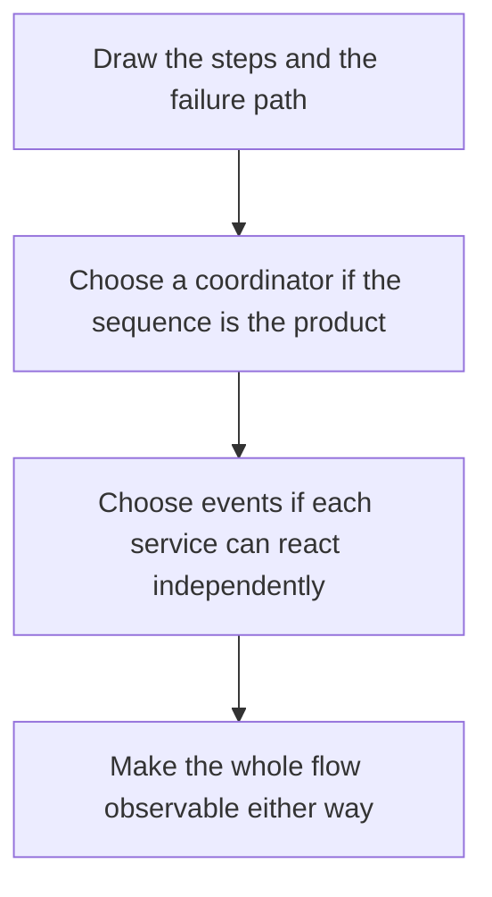

# D14-T032 — Workflow orchestration vs choreography

Topic ID: `D14-T032`
Domain: Messaging and Event-Driven Architecture
Subdomain: Workflow orchestration vs choreography
Importance: common
Complexity: advanced
Dependencies: `D14-T031`, `D14-T001`, `D04-T001`, `D04-T002`, `D05-T001`, `D05-T002`
Execution status of the code in section F: unexecuted

## A. Topic Overview

Orchestration puts a coordinator in charge of the next step of a workflow. The steps are explicit and easier to see, and the coordinator is a dependency. Choreography lets each service react to events and decide its own next step. It avoids a central brain and makes the overall flow harder to see and to change. Many systems orchestrate the business process and choreograph the notifications around it.

In production this shows up as follows: Order fulfillment is an orchestrated workflow with a row per step, so support can see 'waiting on warehouse'. A cache invalidation is choreographed from the order event. Mixing them without a picture is how steps get skipped.

Interviewers use Workflow orchestration vs choreography to see whether you can state the failure mode, not only the definition. The failure to name is: a choreography nobody can draw, or an orchestrator that stores no state and cannot resume

Prerequisites: `D14-T031`, `D14-T001`, `D04-T001`, `D04-T002`, `D05-T001`, `D05-T002`. Later notes should link here instead of repeating the mechanism.

## B. First-Principles Explanation

Orchestration puts a coordinator in charge of the next step of a workflow. The steps are explicit and easier to see, and the coordinator is a dependency. Choreography lets each service react to events and decide its own next step. It avoids a central brain and makes the overall flow harder to see and to change. Many systems orchestrate the business process and choreograph the notifications around it.

The useful picture is: Orchestration is a conductor with a score. Choreography is dancers who move when they hear a cue. The conductor is easier to follow and is a person who can faint. The dancers keep going and can collide.

What has to be true:

1. Draw the steps and the failure path
2. Choose a coordinator if the sequence is the product
3. Choose events if each service can react independently
4. Make the whole flow observable either way

It works when those steps preserve one invariant. It fails when a choreography nobody can draw, or an orchestrator that stores no state and cannot resume. The alternative is: you add a central orchestrator for a single notification

## C. Internal Working and Architecture

Components involved: the caller, the state Workflow orchestration vs choreography mutates or reads, and the observer that reports time to answer 'where is this order stuck', and failed workflow count.

Execution:

1. Draw the steps and the failure path
2. Choose a coordinator if the sequence is the product
3. Choose events if each service can react independently
4. Make the whole flow observable either way

Data moves only along that path. A retry re-enters at step 1, so the operation must say what a duplicate does. Memory and locks stay inside this mechanism. Callers see the result or a typed error, not a half-updated invariant.

State to remember: choose this when you need to see and change a multi-step process. Do not choose it when you add a central orchestrator for a single notification.

## D. Diagrams and Visual Models



Read the diagram from top to bottom. Each box is one step of Workflow orchestration vs choreography. The failure mode (a choreography nobody can draw, or an orchestrator that stores no state and cannot resume) is what you look for when a later box never happens or happens twice.

## E. Examples and Analogies

Analogy: Orchestration is a conductor with a score. Choreography is dancers who move when they hear a cue. The conductor is easier to follow and is a person who can faint. The dancers keep going and can collide.

Production example: Order fulfillment is an orchestrated workflow with a row per step, so support can see 'waiting on warehouse'. A cache invalidation is choreographed from the order event. Mixing them without a picture is how steps get skipped.

A small counterexample is enough in an interview. Show the input, apply the steps, and show the broken outcome if someone uses the mechanism outside its rule: a choreography nobody can draw, or an orchestrator that stores no state and cannot resume.

## F. Code Examples

The snippet is labeled unexecuted. It illustrates the shape of the idea. It is not a benchmark and it embeds no secret.

```python
def style(steps_are_strict):
    return 'orchestrate' if steps_are_strict else 'choreograph'
```

After the snippet, check time to answer 'where is this order stuck', and failed workflow count. If that signal moves the wrong way, the snippet is the wrong tool for the workload.

## G. Practical Backend Application

Use Workflow orchestration vs choreography in a service when you need to see and change a multi-step process.

A typical place is the production case already stated: Order fulfillment is an orchestrated workflow with a row per step, so support can see 'waiting on warehouse'. A cache invalidation is choreographed from the order event. Mixing them without a picture is how steps get skipped.

Operationally you alert on time to answer 'where is this order stuck', and failed workflow count. You do not alert only on process uptime. The dashboard should show the failure mode, a success rate, and the saturation signal (queue depth, lock wait, or latency) that predicts it.

## H. Advantages, Limitations and Trade-offs

| Choice | Benefit | Cost | Choose when | Avoid when |
| --- | --- | --- | --- | --- |
| Apply Workflow orchestration vs choreography | you need to see and change a multi-step process | Extra moving parts and a new failure mode | The failure you are preventing is already real | you add a central orchestrator for a single notification |
| Simpler alternative | Less code and fewer dependencies | a choreography nobody can draw, or an orchestrator that stores no state and cannot resume | The workload does not hit the limit | The invariant must hold under concurrency or failure |

Workflow orchestration vs choreography is a trade. State the benefit and the cost in the same sentence when you propose it in a design review.

## I. Common Mistakes and Misconceptions

- An orchestrator with no durable state.
- Choreography with no trace of the flow.
- A religious split instead of a per-process choice.
- Treating a diagram of Workflow orchestration vs choreography as proof that the invariant holds in production.
- Copying a default configuration without naming time to answer 'where is this order stuck', and failed workflow count.

## J. Debugging and Troubleshooting

Symptom: a choreography nobody can draw, or an orchestrator that stores no state and cannot resume

First check: time to answer 'where is this order stuck', and failed workflow count.

Then compare one healthy instance against one unhealthy instance. Confirm whether retries are duplicating work. Confirm whether a timeout is shorter than the work. Fix the invariant, then watch the same metric for a full peak, not only for the next minute.

Useful questions: did the step order in section C actually happen, or did a caller skip a step? Did a deploy change the data shape that Workflow orchestration vs choreography assumes?

## K. Interview Preparation

### Beginner

#### Q1. What problem does Workflow orchestration vs choreography solve?

**Answer:** Orchestration puts a coordinator in charge of the next step of a workflow. The steps are explicit and easier to see, and the coordinator is a dependency. Choreography lets each service react to events and decide its own next step. It avoids a central brain and makes the overall flow harder to see and to change. Many systems orchestrate the business process and choreograph the notifications around it. Without it, the usual backend failure is: a choreography nobody can draw, or an orchestrator that stores no state and cannot resume.

#### Q2. Where does Workflow orchestration vs choreography sit on a request path?

**Answer:** Workflow orchestration vs choreography is not a library you sprinkle on every call. you need to see and change a multi-step process You notice it when time to answer 'where is this order stuck', and failed workflow count. Name the constraint that makes this choice correct. Say what you would measure to confirm it.

#### Q3. Give a concrete example of Workflow orchestration vs choreography.

**Answer:** Order fulfillment is an orchestrated workflow with a row per step, so support can see 'waiting on warehouse'. A cache invalidation is choreographed from the order event. Mixing them without a picture is how steps get skipped. Walk the input, the state change, and the observable output.

#### Q4. What is a common mix-up around Workflow orchestration vs choreography?

**Answer:** a choreography nobody can draw, or an orchestrator that stores no state and cannot resume The corrective check is time to answer 'where is this order stuck', and failed workflow count. Name the constraint that makes this choice correct. Say what you would measure to confirm it. Say which alternative you rejected and why.

#### Q5. When would you skip Workflow orchestration vs choreography?

**Answer:** you add a central orchestrator for a single notification Skipping is a decision with a measured cost, not a slogan. Name the constraint that makes this choice correct. Say what you would measure to confirm it. Say which alternative you rejected and why.

### Intermediate

#### Q1. What invariant makes Workflow orchestration vs choreography correct?

**Answer:** Orchestration puts a coordinator in charge of the next step of a workflow. The steps are explicit and easier to see, and the coordinator is a dependency. Choreography lets each service react to events and decide its own next step. It avoids a central brain and makes the overall flow harder to see and to change. Many systems orchestrate the business process and choreograph the notifications around it. State the invariant before you name the tool.

#### Q2. How do you test Workflow orchestration vs choreography?

**Answer:** Assert the failure mode directly: a choreography nobody can draw, or an orchestrator that stores no state and cannot resume. The assertion should watch time to answer 'where is this order stuck', and failed workflow count. Include a concurrent or retry case if the bug only appears then. Name the constraint that makes this choice correct.

#### Q3. What signal tells you Workflow orchestration vs choreography is misbehaving in production?

**Answer:** Watch time to answer 'where is this order stuck', and failed workflow count. The user-visible symptom is usually a choreography nobody can draw, or an orchestrator that stores no state and cannot resume. Name the constraint that makes this choice correct. Say what you would measure to confirm it.

#### Q4. How would you introduce Workflow orchestration vs choreography into a legacy service?

**Answer:** you need to see and change a multi-step process Ship it behind a metric so you can compare the old path. Roll back if a choreography nobody can draw, or an orchestrator that stores no state and cannot resume gets worse. Name the constraint that makes this choice correct. Say what you would measure to confirm it.

#### Q5. What do you trade away by choosing Workflow orchestration vs choreography?

**Answer:** you need to see and change a multi-step process you add a central orchestrator for a single notification Say the cost in latency, storage, or operational load. Name the constraint that makes this choice correct. Say what you would measure to confirm it. Say which alternative you rejected and why.

### Advanced

#### Q1. What breaks if a dependency of Workflow orchestration vs choreography is slow or down?

**Answer:** a choreography nobody can draw, or an orchestrator that stores no state and cannot resume Degrade using the rule: you add a central orchestrator for a single notification. Timeouts must be shorter than the caller's deadline. Name the constraint that makes this choice correct. Say what you would measure to confirm it.

#### Q2. How does Workflow orchestration vs choreography behave under retries?

**Answer:** Retries repeat work, so Workflow orchestration vs choreography must define what a duplicate does. a choreography nobody can draw, or an orchestrator that stores no state and cannot resume Idempotency keys or fences belong next to the write, not in a comment. Name the constraint that makes this choice correct. Say what you would measure to confirm it.

#### Q3. What is the capacity limit of Workflow orchestration vs choreography?

**Answer:** The limit shows up as time to answer 'where is this order stuck', and failed workflow count. Add capacity only after you know whether the bottleneck is CPU, lock wait, or network. Name the constraint that makes this choice correct. Say what you would measure to confirm it.

#### Q4. How do you evolve Workflow orchestration vs choreography without a flag day?

**Answer:** you need to see and change a multi-step process Version the contract or the on-disk format. Readers should tolerate one old and one new shape during the rollout. Name the constraint that makes this choice correct. Say what you would measure to confirm it.

#### Q5. What security or correctness bug hides inside Workflow orchestration vs choreography?

**Answer:** a choreography nobody can draw, or an orchestrator that stores no state and cannot resume Check authorization and tenancy at the same boundary as the mechanism. A cache or queue must not widen who can read the data. Name the constraint that makes this choice correct. Say what you would measure to confirm it.

### Scenario

#### Q1. Incident: a choreography nobody can draw, or an orchestrator that stores no state and cannot resume. What do you check first?

**Answer:** Start with time to answer 'where is this order stuck', and failed workflow count. Compare a good host and a bad host before you restart anything. Orchestration puts a coordinator in charge of the next step of a workflow. The steps are explicit and easier to see, and the coordinator is a dependency. Choreography lets each service react to events and decide its own next step. It avoids a central brain and makes the overall flow harder to see and to change. Many systems orchestrate the business process and choreograph the notifications around it.

#### Q2. A reviewer wants the clever version. What data settles it?

**Answer:** you need to see and change a multi-step process you add a central orchestrator for a single notification Bring time to answer 'where is this order stuck', and failed workflow count from a load test or from production, not a slogan. Name the constraint that makes this choice correct. Say what you would measure to confirm it. Say which alternative you rejected and why.

#### Q3. You have one hour to explain Workflow orchestration vs choreography at a whiteboard.

**Answer:** Draw the happy path in four boxes. Then draw the failure: a choreography nobody can draw, or an orchestrator that stores no state and cannot resume. End with the metric you would page on. Name the constraint that makes this choice correct.

#### Q4. The bug only appears under two concurrent callers.

**Answer:** a choreography nobody can draw, or an orchestrator that stores no state and cannot resume Reproduce with a barrier so both sides enter the critical window. Confirm the fix with time to answer 'where is this order stuck', and failed workflow count. Name the constraint that makes this choice correct. Say what you would measure to confirm it.

#### Q5. Leadership wants this on every service next week.

**Answer:** you add a central orchestrator for a single notification you need to see and change a multi-step process Roll it out where the failure mode is already hurting users. Name the constraint that makes this choice correct. Say what you would measure to confirm it. Say which alternative you rejected and why.

### Follow-up

#### Q1. What did you assume about the data size or the clock?

**Answer:** Orchestration puts a coordinator in charge of the next step of a workflow. The steps are explicit and easier to see, and the coordinator is a dependency. Choreography lets each service react to events and decide its own next step. It avoids a central brain and makes the overall flow harder to see and to change. Many systems orchestrate the business process and choreograph the notifications around it. Clocks are not a total order across machines. State whether the algorithm needs bounded size or a single leader.

#### Q2. What would you measure after the change ships?

**Answer:** Page on time to answer 'where is this order stuck', and failed workflow count. Keep a before/after dashboard for one week. Alert on the failure mode, not only on CPU. Name the constraint that makes this choice correct.

#### Q3. Which neighboring topic did you deliberately not re-teach?

**Answer:** This note owns Workflow orchestration vs choreography. Related identifiers are in section N. Shared ideas are linked, not copied. Name the constraint that makes this choice correct.

## L. Practical Exercises

Solutions are in `EXERCISES/solutions/D14-T032.md`, not in this section.

1. Whiteboard the four steps of Workflow orchestration vs choreography and mark where `a choreography nobody can draw, or an orchestrator that stores no state and cannot resume` enters.
2. Read the snippet in section F and write the assertion that would catch that failure. The assertion must mention `time to answer 'where is this order stuck', and failed workflow count`.
3. Argue for or against using Workflow orchestration vs choreography on a service you know. Use the choose and avoid rows from section H. Do not appeal to popularity.

## M. Revision Notes

- Mechanism: Orchestration puts a coordinator in charge of the next step of a workflow.
- Failure: a choreography nobody can draw, or an orchestrator that stores no state and cannot resume
- Metric: time to answer 'where is this order stuck', and failed workflow count
- Choose when: you need to see and change a multi-step process
- Avoid when: you add a central orchestrator for a single notification

## N. Related Topics

Dependencies to review first: `D14-T031`, `D14-T001`, `D04-T001`, `D04-T002`, `D05-T001`, `D05-T002`.

Shared ideas stay in those notes. This note does not restate them.

## O. Completion Criteria

- You can explain Workflow orchestration vs choreography without reading this note, including the failure mode.
- You can draw the diagram in section D from memory.
- You can say when not to use it, using the avoid condition in section H.
- You can name the metric you would watch after shipping it.
