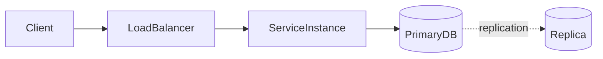

# D15-T001 — Distributed system fundamentals

Topic ID: `D15-T001`
Domain: Distributed Systems
Subdomain: Distributed system fundamentals
Importance: core
Complexity: advanced
Dependencies: `D03-T001`, `D03-T002`, `D04-T001`, `D04-T002`, `D13-T001`, `D13-T002`
Execution status of the code in section F: unexecuted

## A. Topic Overview

A distributed system is a collection of independent computers that cooperate by exchanging messages over a network. No single process has a complete view of global state or synchronized clocks. The concept exists because one machine cannot hold all data, survive all failures, or serve all users with acceptable latency. In production you see this in microservices, replicated databases, caches, and job workers. Interviewers use fundamentals to see whether you reason about partial failure, latency, and consistency instead of pretending the cluster is one big computer.

## B. First-Principles Explanation

Each node has local memory and a local clock. Cooperation happens through unreliable links: messages can be delayed, duplicated, or lost. There is no shared memory unless you build it with protocols on top of the network. A request crosses process boundaries, serialization, load balancers, and possibly several data stores. Correctness is therefore a property of the protocol and the failure model, not of a single try/except block. Design starts by naming invariants and asking which failures can violate them.

## C. Internal Working and Architecture

Typical components: clients, stateless app tiers, stateful stores, message brokers, and coordination services. A write path often flows client → API → primary database → async replication → search index. Each hop adds latency variance and independent failure modes. Observability spans correlation IDs across hops because a single user action becomes many log lines.

## D. Diagrams and Visual Models



## E. Examples and Analogies

A distributed system is like a committee without a shared whiteboard: members mail minutes; some letters arrive late. Checkout calls inventory, payments, and notifications—any one can time out while others succeed. Do not assume a global order of events unless a protocol provides it.

## F. Code Examples

File: `examples/d15_t001_unknown_outcome.py`

```python
def charge_with_timeout(payment_client, order_id: str, timeout_s: float) -> str:
    try:
        payment_client.charge(order_id, timeout=timeout_s)
        return "ok"
    except payment_client.Timeout:
        return "unknown"
    except payment_client.PaymentError:
        return "failed"
```

Timeouts create a third outcome besides success and failure; money paths must reconcile unknowns.

## G. Practical Backend Application

Treat every outbound call as success, definitive failure, or unknown. Persist intent before irreversible side effects. Use health checks per dependency. Capacity planning includes fan-out: one API request may become many internal calls.

## H. Advantages, Limitations and Trade-offs

| Choice | Benefit | Cost | Choose when | Avoid when |
| --- | --- | --- | --- | --- |
| Microservices | Isolation, team scale | Partial failures | Clear domain seams | No ops maturity |
| Sync RPC | Simple flow | Tail latency | Low fan-out | Deep call chains |
| Async messaging | Decoupling | Ordering limits | Peak smoothing | Immediate read-your-writes |

## I. Common Mistakes and Misconceptions

- Assuming no client error means the server committed.
- Using wall-clock timestamps across regions as total order.
- Ignoring tail latency when setting synchronous timeouts.

## J. Debugging and Troubleshooting

Trace one correlation ID across services. Compare primary versus replica reads. Check idempotency stores after timeout reports. Mitigate with tighter budgets and documented unknown-outcome handling.

## K. Interview Preparation

### Beginner

#### Q1. What is a distributed system?

**Answer:** Independent computers cooperating via messages without shared memory or a perfect global clock. Scale and fault tolerance motivate the split. Correctness depends on protocols handling delay and loss. Backend work is mostly about boundaries and failure modes.

#### Q2. Why can't we treat a cluster as one computer?

**Answer:** There is no atomic read of all RAM, clocks drift, and networks partition. A single slow replica affects part of the system while clients still see anomalies. Software must explicitly coordinate. That coordination has latency and availability costs.

#### Q3. What is a partial failure?

**Answer:** Some nodes or links fail while others continue. Unlike a single process crash, the system may be half alive. Callers can hang, succeed locally, or see stale data. Design assumes this is normal, not exceptional.

#### Q4. What is latency variance and why does it matter?

**Answer:** Most requests are fast but a fraction are very slow. Synchronous chains multiply tail risk. Users experience the slowest hop in a critical path. Set deadlines and shed load based on tails, not averages.

#### Q5. What is the difference between scale-up and scale-out?

**Answer:** Scale-up uses a bigger machine; scale-out adds machines. Scale-out needs partitioning or replication. Scale-out increases coordination overhead. Most large backends combine both until economics favor out.

### Intermediate

#### Q1. How does a load balancer change failure semantics?

**Answer:** It may retry on another instance when one fails or times out. That can convert a crash into a duplicate request if the first attempt actually succeeded. Health checks may lag real failure. Idempotency keys address duplicate risk.

#### Q2. Why are correlation IDs necessary?

**Answer:** They stitch logs across services for one user action. Without them, debugging partial failure is guesswork. They should propagate on every outbound call. They do not fix correctness by themselves.

#### Q3. What is fan-out and its risk?

**Answer:** One inbound request triggers many outbound calls. Failure probability grows with dependency count. Parallel calls reduce latency but increase load spikes. Bulkheads and circuit breakers limit blast radius.

#### Q4. How do you reason about unknown outcomes?

**Answer:** After a timeout you do not know if the server committed. Safe systems reconcile with idempotent retries or durable workflow state. Blind retries can double-charge. Never map unknown to success for money movement.

#### Q5. What is the role of a message broker here?

**Answer:** It decouples producers and consumers in time. It enables at-least-once delivery unless you add deduplication. Ordering guarantees are limited to partitions. It is not a replacement for a transactional database.

### Advanced

#### Q1. How do fallacies of distributed computing show up in APIs?

**Answer:** Teams assume zero latency, infinite bandwidth, and a secure network. Production violates each daily. APIs need timeouts, payload limits, and auth on every hop. SDKs should surface retryable versus fatal errors.

#### Q2. What is tail-at-scale?

**Answer:** As you add machines, the chance some machine is slow rises. Requests touching many machines wait on the slowest. Mitigations include hedged requests and smaller cells. You still need backpressure.

#### Q3. Why is determinism hard across nodes?

**Answer:** Remote nodes do not share locks. Race outcomes depend on message order. You need explicit concurrency control or CRDT merges. Tests must inject delay and reordering.

#### Q4. How does caching interact with distribution?

**Answer:** Each instance may cache different values. Invalidation must cross process boundaries. TTL alone allows stale reads. Choose cache-aside or write-through with clear consistency goals.

#### Q5. What is a cell-based architecture?

**Answer:** Partition users into isolated stacks. Failures stay inside a cell. Cross-cell operations are rarer and more expensive. Useful at very large scale.

### Scenarios

#### Q1. Checkout times out after payment but inventory deducted. What happened?

**Answer:** Likely partial success: inventory committed while payment RPC timed out. Without a saga, stock is wrong. Check idempotency keys and workflow state. Reconcile with the payment provider before refunding blindly.

#### Q2. Users see alternating values on refresh. First diagnosis?

**Answer:** They may hit different instances reading different replica lag, or a cache without shared invalidation. Compare read paths. Fix with read-your-writes routing or stickiness to primary for session reads.

#### Q3. Deploy doubles error rate only in one region. Why?

**Answer:** Partial rollout or regional dependency failure. A partition can isolate a region from the primary writer. Failover rules may route writes incorrectly until quorum is restored.

#### Q4. p99 latency spikes after adding a microservice. Explain?

**Answer:** Extra hop and serialization add tail risk. Cold pools may contribute. Synchronous chains amplify tails. Consider async handoff or colocate the hot path.

#### Q5. Logs show success but customer says action failed. Next step?

**Answer:** Client may have timed out before the response arrived. Verify idempotency records and client retry behavior. Align product semantics for unknown timeouts. Add end-to-end acknowledgment if required.

### Follow-ups

#### Q1. How does this connect to OS threads?

**Answer:** Threads share memory on one host; distributed nodes do not. Mutexes do not protect remote state. A data race on one machine is a different failure class from split-brain on two machines. See `D03-T001` for local concurrency.

#### Q2. How does this connect to TCP?

**Answer:** TCP gives reliable streams between two endpoints, not end-to-end business guarantees. Mid-request resets still create unknown outcomes. Retries at the application layer can duplicate work even when TCP eventually delivers bytes. Timeouts sit above TCP and define user-visible failure.

#### Q3. How does this connect to API gateways?

**Answer:** Gateways terminate TLS, enforce auth, and aggregate calls. They consume timeout budget and add another failure point. Partial failures at the gateway can mask which origin service failed unless correlation IDs continue downstream. Gateways are not a substitute for idempotent origin design.

## L. Practical Exercises

Solutions are in `EXERCISES/solutions/D15-T001.md`.

### Exercise 1 — implementation

Implement `charge_with_timeout` and classify normal, slow, and bad order ids.

### Exercise 2 — debugging

Payment failed vs finance captured—list cross-service fields and reconciliation order.

### Exercise 3 — trade-off

Sync RPC vs async event for post-checkout email.

## M. Revision Notes

- Distribution adds message passing, not shared memory.
- Timeouts create unknown outcomes.
- Each hop can fail independently.
- Correlate logs across services.

## N. Related Topics

Understand this before: OS and networking fundamentals.

This topic supports: `D15-T002`, `D15-T009`, `D16-T001`.

## O. Completion Criteria

- Explain RPC versus local calls.
- Name three outcomes under timeout.
- Sketch client → LB → service → DB with replication.
