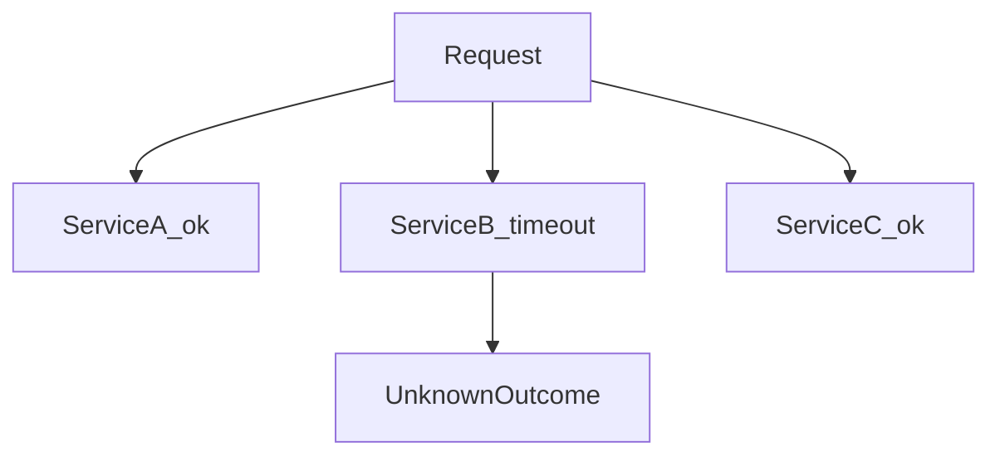

# D15-T002 — Partial failures

Topic ID: `D15-T002`
Domain: Distributed Systems
Subdomain: Partial failures
Importance: core
Complexity: advanced
Dependencies: `D15-T001`, `D03-T001`, `D03-T002`, `D04-T001`, `D04-T002`, `D13-T001`
Execution status of the code in section F: unexecuted

## A. Topic Overview

Partial failure means some components fail or slow down while others keep working. Unlike a total crash, the system enters ambiguous states: half-written workflows, duplicate retries, and clients that cannot tell success from timeout.

## B. First-Principles Explanation

Failure is a first-class outcome at every RPC boundary. A service can fail after doing work but before replying, or fail before work while the client already moved on. Healthy dependency graphs assume any node can disappear at any time. Partial failure means some components fail or slow down while others keep working. Unlike a total crash, the system enters ambiguous states: half-written workflows, duplicate retries, and clients that cannot tell success from timeout.

## C. Internal Working and Architecture

Instrument each outbound call with result class: success, error, timeout. Persist workflow state between steps. Components interact through RPC, replication logs, and coordination services.

## D. Diagrams and Visual Models



Read the diagram as a causal flow from client action to stored or observed outcome, including failure branches.

## E. Examples and Analogies

Payment succeeds while notification times out; user sees failure banner but was charged.

## F. Code Examples

File: `examples/d15_t002_partial_result.py`

Dependencies: Python 3 standard library only.

```python
from dataclasses import dataclass
from typing import Literal

Outcome = Literal["ok", "error", "timeout"]


@dataclass
class StepResult:
    name: str
    outcome: Outcome


def aggregate(results: list[StepResult]) -> str:
    if any(r.outcome == "timeout" for r in results):
        return "needs_reconciliation"
    if any(r.outcome == "error" for r in results):
        return "failed"
    return "completed"
```

The snippet models control flow you would embed in a service or test harness. It is not a production client library.

## G. Practical Backend Application

Use sagas or outbox for multi-step flows; never infer global failure from one timeout.

## H. Advantages, Limitations and Trade-offs

| Choice | Benefit | Cost | Choose when | Avoid when |
| --- | --- | --- | --- | --- |
| Fail fast vs complete partial work | Clear UX | Inconsistent interim state | Money movement | Best-effort analytics | | | | |

Under load, the cheap choice on paper becomes the choice that amplifies retries, stale reads, or operator toil. Measure p99 latency and error budgets, not only happy-path throughput.

## I. Common Mistakes and Misconceptions

- Rolling back a local DB transaction when a downstream call timed out (downstream may have committed).
- Returning 500 to trigger blind client retries on non-idempotent POST.
- Treating health check green as proof all dependencies are usable.

A weak interview answer names a buzzword without a failure story. A strong answer names what breaks, what users see, and what invariant you still enforce.

## J. Debugging and Troubleshooting

Map each step to committed/unknown/failed; reconcile unknown before compensating.

## K. Interview Preparation
### Beginner
#### Q1. What is Partial failures?

**Answer:** Partial failure means some components fail or slow down while others keep working. Unlike a total crash, the system enters ambiguous states: half-written workflows, duplicate retries, and clients that cannot tell success from timeout. Interviewers want a precise definition tied to partial failure and unknown outcomes, not a slogan. In production, the failure mode matters more than the slogan: measure timeouts, error budgets, and client-visible symptoms before you rename the problem.
#### Q2. Why does Partial failures matter in backends?

**Answer:** Partial failure means some components fail or slow down while others keep working. Unlike a total crash, the system enters ambiguous states: half-written workflows, duplicate retries, and clients that cannot tell success from timeout. Production systems fail one hop at a time; users still expect coherent behavior. In production, the failure mode matters more than the slogan: measure timeouts, error budgets, and client-visible symptoms before you rename the problem.
#### Q3. Give a one-line example of partial failure and unknown outcomes.

**Answer:** Partial failure means some components fail or slow down while others keep working. Unlike a total crash, the system enters ambiguous states: half-written workflows, duplicate retries, and clients that cannot tell success from timeout. Name a concrete multi-service flow where the issue appears. In production, the failure mode matters more than the slogan: measure timeouts, error budgets, and client-visible symptoms before you rename the problem.
#### Q4. Is Partial failures about hardware or software policy?

**Answer:** Partial failure means some components fail or slow down while others keep working. Unlike a total crash, the system enters ambiguous states: half-written workflows, duplicate retries, and clients that cannot tell success from timeout. Mostly policy and protocols on top of unreliable networks. In production, the failure mode matters more than the slogan: measure timeouts, error budgets, and client-visible symptoms before you rename the problem.
#### Q5. What is a common myth about Partial failures?

**Answer:** Partial failure means some components fail or slow down while others keep working. Unlike a total crash, the system enters ambiguous states: half-written workflows, duplicate retries, and clients that cannot tell success from timeout. Buzzword definitions that ignore partitions, retries, or consistency definitions. In production, the failure mode matters more than the slogan: measure timeouts, error budgets, and client-visible symptoms before you rename the problem.
### Intermediate
#### Q1. How do timeouts interact with partial failure and unknown outcomes?

**Answer:** Partial failure means some components fail or slow down while others keep working. Unlike a total crash, the system enters ambiguous states: half-written workflows, duplicate retries, and clients that cannot tell success from timeout. Timeouts create unknown outcomes; retries amplify load unless idempotent. In production, the failure mode matters more than the slogan: measure timeouts, error budgets, and client-visible symptoms before you rename the problem.
#### Q2. How do replicas interact with partial failure and unknown outcomes?

**Answer:** Partial failure means some components fail or slow down while others keep working. Unlike a total crash, the system enters ambiguous states: half-written workflows, duplicate retries, and clients that cannot tell success from timeout. Replication lag makes stale reads a normal case unless you pay for stronger reads. In production, the failure mode matters more than the slogan: measure timeouts, error budgets, and client-visible symptoms before you rename the problem.
#### Q3. How do idempotency keys help partial failure and unknown outcomes?

**Answer:** Partial failure means some components fail or slow down while others keep working. Unlike a total crash, the system enters ambiguous states: half-written workflows, duplicate retries, and clients that cannot tell success from timeout. They make at-least-once delivery safe for business side effects. In production, the failure mode matters more than the slogan: measure timeouts, error budgets, and client-visible symptoms before you rename the problem.
#### Q4. What metrics expose partial failure and unknown outcomes?

**Answer:** Partial failure means some components fail or slow down while others keep working. Unlike a total crash, the system enters ambiguous states: half-written workflows, duplicate retries, and clients that cannot tell success from timeout. Error rate by dependency, lag histograms, reconciliation queue depth. In production, the failure mode matters more than the slogan: measure timeouts, error budgets, and client-visible symptoms before you rename the problem.
#### Q5. How does Partial failures relate to user-visible SLAs?

**Answer:** Partial failure means some components fail or slow down while others keep working. Unlike a total crash, the system enters ambiguous states: half-written workflows, duplicate retries, and clients that cannot tell success from timeout. SLAs must state behavior during degradation, not only median latency. In production, the failure mode matters more than the slogan: measure timeouts, error budgets, and client-visible symptoms before you rename the problem.
### Advanced
#### Q1. How would you test partial failure and unknown outcomes?

**Answer:** Partial failure means some components fail or slow down while others keep working. Unlike a total crash, the system enters ambiguous states: half-written workflows, duplicate retries, and clients that cannot tell success from timeout. Fault injection: delay, drop, partition links; assert invariants and recovery. In production, the failure mode matters more than the slogan: measure timeouts, error budgets, and client-visible symptoms before you rename the problem.
#### Q2. How does Partial failures differ from a single-machine failure?

**Answer:** Partial failure means some components fail or slow down while others keep working. Unlike a total crash, the system enters ambiguous states: half-written workflows, duplicate retries, and clients that cannot tell success from timeout. Partial failure leaves other paths alive, producing ambiguous global state. In production, the failure mode matters more than the slogan: measure timeouts, error budgets, and client-visible symptoms before you rename the problem.
#### Q3. What documentation should teams publish about Partial failures?

**Answer:** Partial failure means some components fail or slow down while others keep working. Unlike a total crash, the system enters ambiguous states: half-written workflows, duplicate retries, and clients that cannot tell success from timeout. Failure modes, consistency guarantees per endpoint, and runbooks for unknown outcomes. In production, the failure mode matters more than the slogan: measure timeouts, error budgets, and client-visible symptoms before you rename the problem.
#### Q4. When is strong consistency worth the latency for partial failure and unknown outcomes?

**Answer:** Partial failure means some components fail or slow down while others keep working. Unlike a total crash, the system enters ambiguous states: half-written workflows, duplicate retries, and clients that cannot tell success from timeout. When invariants involve money, inventory, or safety; not for best-effort feeds. In production, the failure mode matters more than the slogan: measure timeouts, error budgets, and client-visible symptoms before you rename the problem.
#### Q5. How do circuit breakers relate to partial failure and unknown outcomes?

**Answer:** Partial failure means some components fail or slow down while others keep working. Unlike a total crash, the system enters ambiguous states: half-written workflows, duplicate retries, and clients that cannot tell success from timeout. They stop retry storms but do not fix correctness; they protect capacity. In production, the failure mode matters more than the slogan: measure timeouts, error budgets, and client-visible symptoms before you rename the problem.
### Scenarios
#### Q1. Incident: errors spike after deploy touching Partial failures. First checks?

**Answer:** Partial failure means some components fail or slow down while others keep working. Unlike a total crash, the system enters ambiguous states: half-written workflows, duplicate retries, and clients that cannot tell success from timeout. Roll forward/rollback decision, feature flag, canary metrics, dependency health. In production, the failure mode matters more than the slogan: measure timeouts, error budgets, and client-visible symptoms before you rename the problem.
#### Q2. Incident: customers report inconsistent reads around partial failure and unknown outcomes. Diagnosis?

**Answer:** Partial failure means some components fail or slow down while others keep working. Unlike a total crash, the system enters ambiguous states: half-written workflows, duplicate retries, and clients that cannot tell success from timeout. Check replica lag, routing, cache TTL, and read-your-writes settings. In production, the failure mode matters more than the slogan: measure timeouts, error budgets, and client-visible symptoms before you rename the problem.
#### Q3. Incident: reconciliation backlog grows for partial failure and unknown outcomes. Why?

**Answer:** Partial failure means some components fail or slow down while others keep working. Unlike a total crash, the system enters ambiguous states: half-written workflows, duplicate retries, and clients that cannot tell success from timeout. Downstream was slow; retries duplicated work; missing idempotency. In production, the failure mode matters more than the slogan: measure timeouts, error budgets, and client-visible symptoms before you rename the problem.
#### Q4. Design review challenges your Partial failures approach. What do you defend?

**Answer:** Partial failure means some components fail or slow down while others keep working. Unlike a total crash, the system enters ambiguous states: half-written workflows, duplicate retries, and clients that cannot tell success from timeout. State invariants, failure model, and measured trade-offs with PACELC/CAP precision. In production, the failure mode matters more than the slogan: measure timeouts, error budgets, and client-visible symptoms before you rename the problem.
#### Q5. Finance audit questions partial failure and unknown outcomes after duplicate charges. Response?

**Answer:** Partial failure means some components fail or slow down while others keep working. Unlike a total crash, the system enters ambiguous states: half-written workflows, duplicate retries, and clients that cannot tell success from timeout. Show idempotency keys, ledger reconciliation, and provider correlation IDs. In production, the failure mode matters more than the slogan: measure timeouts, error budgets, and client-visible symptoms before you rename the problem.
### Follow-ups
#### Q1. How does Partial failures connect to `D15-T001`?

**Answer:** Partial failure means some components fail or slow down while others keep working. Unlike a total crash, the system enters ambiguous states: half-written workflows, duplicate retries, and clients that cannot tell success from timeout. Fundamentals frame partial failure and message passing assumptions. In production, the failure mode matters more than the slogan: measure timeouts, error budgets, and client-visible symptoms before you rename the problem.
#### Q2. How does Partial failures connect to databases (`D07-T012`)?

**Answer:** Partial failure means some components fail or slow down while others keep working. Unlike a total crash, the system enters ambiguous states: half-written workflows, duplicate retries, and clients that cannot tell success from timeout. Transactions are local unless you add distributed protocols or sagas. In production, the failure mode matters more than the slogan: measure timeouts, error budgets, and client-visible symptoms before you rename the problem.
#### Q3. How does Partial failures connect to messaging (`D14-T031`)?

**Answer:** Partial failure means some components fail or slow down while others keep working. Unlike a total crash, the system enters ambiguous states: half-written workflows, duplicate retries, and clients that cannot tell success from timeout. Brokers provide at-least-once unless you engineer exactly-once effects. In production, the failure mode matters more than the slogan: measure timeouts, error budgets, and client-visible symptoms before you rename the problem.

## L. Practical Exercises

Solutions are in `EXERCISES/solutions/D15-T002.md`. Try these before opening that file.

### Exercise 1 — implementation

Implement aggregate() and tests for mixed ok/timeout/error.

### Exercise 2 — debugging

Order shows failed but wallet debited—list reconciliation steps.

### Exercise 3 — trade-off

When is returning 202 better than 500 on partial failure?

## M. Revision Notes

- Partial failures
- Partial failure means some components fail or slow down while others keep working.
- Measure lag, errors, and reconciliation—not only CPU.
- Document behavior during partition and during normal load.

Flashcards:

- What is Partial failures? See focus paragraph in overview.
- Common mistake: Rolling back a local DB transaction when a downstream call timed out (downstream may have committed).

## N. Related Topics

Understand this before: `D15-T001`, `D03-T001`, `D03-T002`, `D04-T001`, `D04-T002`, `D13-T001`.

This topic supports: `D15-T003`, `D15-T021`.

Often confused with: `D15-T008`, `D13-T007`.

Interviewers combine this with replication (`D15-T009`), partial failure (`D15-T002`), and API idempotency (`D06-T011`).

## O. Completion Criteria

- Define Partial failures without buzzwords.
- Draw the mermaid model for D15-T002.
- Explain one mistake and its safer alternative.
