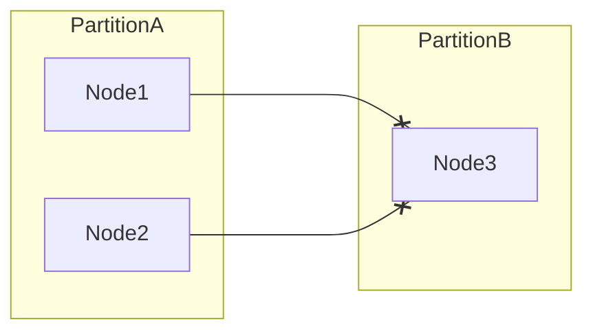

# D15-T003 — Network partitions

Topic ID: `D15-T003`
Domain: Distributed Systems
Subdomain: Network partitions
Importance: core
Complexity: advanced
Dependencies: `D15-T002`, `D15-T001`, `D03-T001`, `D03-T002`, `D04-T001`, `D04-T002`
Execution status of the code in section F: unexecuted

## A. Topic Overview

A network partition splits nodes into groups that cannot communicate for a period. Partitions are indistinguishable from slow networks without extra evidence. Systems must choose whether to refuse writes, accept divergent writes, or elect a single writable side.

## B. First-Principles Explanation

TCP may keep a session alive while routing blackholes traffic. Detection uses timeouts and quorum communication, never a single ping. Partitions are not rare edge cases at scale; they are continuous at low intensity. A network partition splits nodes into groups that cannot communicate for a period. Partitions are indistinguishable from slow networks without extra evidence. Systems must choose whether to refuse writes, accept divergent writes, or elect a single writable side.

## C. Internal Working and Architecture

Design explicit partition behavior: read-only mode, fence tokens, or majority quorum before writes. Components interact through RPC, replication logs, and coordination services.

## D. Diagrams and Visual Models



Read the diagram as a causal flow from client action to stored or observed outcome, including failure branches.

## E. Examples and Analogies

Two DCs lose link; each thinks the other is down and may promote a primary.

## F. Code Examples

File: `examples/d15_t003_quorum_gate.py`

Dependencies: Python 3 standard library only.

```python
def can_write(reachable_peers: int, total: int) -> bool:
    """Majority partition may accept writes; minority should not."""
    return reachable_peers * 2 > total
```

The snippet models control flow you would embed in a service or test harness. It is not a production client library.

## G. Practical Backend Application

Multi-AZ clusters use odd member counts and fencing to avoid dual writers.

## H. Advantages, Limitations and Trade-offs

| Choice | Benefit | Cost | Choose when | Avoid when |
| --- | --- | --- | --- | --- |
| Availability during partition | Keep serving | Risk split brain | Read-heavy | Financial writes | | | | |

Under load, the cheap choice on paper becomes the choice that amplifies retries, stale reads, or operator toil. Measure p99 latency and error budgets, not only happy-path throughput.

## I. Common Mistakes and Misconceptions

- Assuming split-brain cannot happen with 'good networking'.
- Using a single coordinator without quorum for write acceptance.
- Ignoring asymmetric partitions (A can reach B but not vice versa).

A weak interview answer names a buzzword without a failure story. A strong answer names what breaks, what users see, and what invariant you still enforce.

## J. Debugging and Troubleshooting

Compare membership views from both sides; look for divergent epoch numbers.

## K. Interview Preparation
### Beginner
#### Q1. What is Network partitions?

**Answer:** A network partition splits nodes into groups that cannot communicate for a period. Partitions are indistinguishable from slow networks without extra evidence. Systems must choose whether to refuse writes, accept divergent writes, or elect a single writable side. Interviewers want a precise definition tied to network partition detection and write policy, not a slogan.
#### Q2. Why does Network partitions matter in backends?

**Answer:** A network partition splits nodes into groups that cannot communicate for a period. Partitions are indistinguishable from slow networks without extra evidence. Systems must choose whether to refuse writes, accept divergent writes, or elect a single writable side. Production systems fail one hop at a time; users still expect coherent behavior.
#### Q3. Give a one-line example of network partition detection and write policy.

**Answer:** A network partition splits nodes into groups that cannot communicate for a period. Partitions are indistinguishable from slow networks without extra evidence. Systems must choose whether to refuse writes, accept divergent writes, or elect a single writable side. Name a concrete multi-service flow where the issue appears.
#### Q4. Is Network partitions about hardware or software policy?

**Answer:** A network partition splits nodes into groups that cannot communicate for a period. Partitions are indistinguishable from slow networks without extra evidence. Systems must choose whether to refuse writes, accept divergent writes, or elect a single writable side. Mostly policy and protocols on top of unreliable networks.
#### Q5. What is a common myth about Network partitions?

**Answer:** A network partition splits nodes into groups that cannot communicate for a period. Partitions are indistinguishable from slow networks without extra evidence. Systems must choose whether to refuse writes, accept divergent writes, or elect a single writable side. Buzzword definitions that ignore partitions, retries, or consistency definitions.
### Intermediate
#### Q1. How do timeouts interact with network partition detection and write policy?

**Answer:** A network partition splits nodes into groups that cannot communicate for a period. Partitions are indistinguishable from slow networks without extra evidence. Systems must choose whether to refuse writes, accept divergent writes, or elect a single writable side. Timeouts create unknown outcomes; retries amplify load unless idempotent.
#### Q2. How do replicas interact with network partition detection and write policy?

**Answer:** A network partition splits nodes into groups that cannot communicate for a period. Partitions are indistinguishable from slow networks without extra evidence. Systems must choose whether to refuse writes, accept divergent writes, or elect a single writable side. Replication lag makes stale reads a normal case unless you pay for stronger reads.
#### Q3. How do idempotency keys help network partition detection and write policy?

**Answer:** A network partition splits nodes into groups that cannot communicate for a period. Partitions are indistinguishable from slow networks without extra evidence. Systems must choose whether to refuse writes, accept divergent writes, or elect a single writable side. They make at-least-once delivery safe for business side effects.
#### Q4. What metrics expose network partition detection and write policy?

**Answer:** A network partition splits nodes into groups that cannot communicate for a period. Partitions are indistinguishable from slow networks without extra evidence. Systems must choose whether to refuse writes, accept divergent writes, or elect a single writable side. Error rate by dependency, lag histograms, reconciliation queue depth.
#### Q5. How does Network partitions relate to user-visible SLAs?

**Answer:** A network partition splits nodes into groups that cannot communicate for a period. Partitions are indistinguishable from slow networks without extra evidence. Systems must choose whether to refuse writes, accept divergent writes, or elect a single writable side. SLAs must state behavior during degradation, not only median latency.
### Advanced
#### Q1. How would you test network partition detection and write policy?

**Answer:** A network partition splits nodes into groups that cannot communicate for a period. Partitions are indistinguishable from slow networks without extra evidence. Systems must choose whether to refuse writes, accept divergent writes, or elect a single writable side. Fault injection: delay, drop, partition links; assert invariants and recovery.
#### Q2. How does Network partitions differ from a single-machine failure?

**Answer:** A network partition splits nodes into groups that cannot communicate for a period. Partitions are indistinguishable from slow networks without extra evidence. Systems must choose whether to refuse writes, accept divergent writes, or elect a single writable side. Partial failure leaves other paths alive, producing ambiguous global state.
#### Q3. What documentation should teams publish about Network partitions?

**Answer:** A network partition splits nodes into groups that cannot communicate for a period. Partitions are indistinguishable from slow networks without extra evidence. Systems must choose whether to refuse writes, accept divergent writes, or elect a single writable side. Failure modes, consistency guarantees per endpoint, and runbooks for unknown outcomes.
#### Q4. When is strong consistency worth the latency for network partition detection and write policy?

**Answer:** A network partition splits nodes into groups that cannot communicate for a period. Partitions are indistinguishable from slow networks without extra evidence. Systems must choose whether to refuse writes, accept divergent writes, or elect a single writable side. When invariants involve money, inventory, or safety; not for best-effort feeds.
#### Q5. How do circuit breakers relate to network partition detection and write policy?

**Answer:** A network partition splits nodes into groups that cannot communicate for a period. Partitions are indistinguishable from slow networks without extra evidence. Systems must choose whether to refuse writes, accept divergent writes, or elect a single writable side. They stop retry storms but do not fix correctness; they protect capacity.
### Scenarios
#### Q1. Incident: errors spike after deploy touching Network partitions. First checks?

**Answer:** A network partition splits nodes into groups that cannot communicate for a period. Partitions are indistinguishable from slow networks without extra evidence. Systems must choose whether to refuse writes, accept divergent writes, or elect a single writable side. Roll forward/rollback decision, feature flag, canary metrics, dependency health.
#### Q2. Incident: customers report inconsistent reads around network partition detection and write policy. Diagnosis?

**Answer:** A network partition splits nodes into groups that cannot communicate for a period. Partitions are indistinguishable from slow networks without extra evidence. Systems must choose whether to refuse writes, accept divergent writes, or elect a single writable side. Check replica lag, routing, cache TTL, and read-your-writes settings.
#### Q3. Incident: reconciliation backlog grows for network partition detection and write policy. Why?

**Answer:** A network partition splits nodes into groups that cannot communicate for a period. Partitions are indistinguishable from slow networks without extra evidence. Systems must choose whether to refuse writes, accept divergent writes, or elect a single writable side. Downstream was slow; retries duplicated work; missing idempotency.
#### Q4. Design review challenges your Network partitions approach. What do you defend?

**Answer:** A network partition splits nodes into groups that cannot communicate for a period. Partitions are indistinguishable from slow networks without extra evidence. Systems must choose whether to refuse writes, accept divergent writes, or elect a single writable side. State invariants, failure model, and measured trade-offs with PACELC/CAP precision.
#### Q5. Finance audit questions network partition detection and write policy after duplicate charges. Response?

**Answer:** A network partition splits nodes into groups that cannot communicate for a period. Partitions are indistinguishable from slow networks without extra evidence. Systems must choose whether to refuse writes, accept divergent writes, or elect a single writable side. Show idempotency keys, ledger reconciliation, and provider correlation IDs.
### Follow-ups
#### Q1. How does Network partitions connect to `D15-T001`?

**Answer:** A network partition splits nodes into groups that cannot communicate for a period. Partitions are indistinguishable from slow networks without extra evidence. Systems must choose whether to refuse writes, accept divergent writes, or elect a single writable side. Fundamentals frame partial failure and message passing assumptions.
#### Q2. How does Network partitions connect to databases (`D07-T012`)?

**Answer:** A network partition splits nodes into groups that cannot communicate for a period. Partitions are indistinguishable from slow networks without extra evidence. Systems must choose whether to refuse writes, accept divergent writes, or elect a single writable side. Transactions are local unless you add distributed protocols or sagas.
#### Q3. How does Network partitions connect to messaging (`D14-T031`)?

**Answer:** A network partition splits nodes into groups that cannot communicate for a period. Partitions are indistinguishable from slow networks without extra evidence. Systems must choose whether to refuse writes, accept divergent writes, or elect a single writable side. Brokers provide at-least-once unless you engineer exactly-once effects.

## L. Practical Exercises

Solutions are in `EXERCISES/solutions/D15-T003.md`. Try these before opening that file.

### Exercise 1 — implementation

Implement can_write for odd N and document minority behavior.

### Exercise 2 — debugging

Both sites claim primary after link flap—what evidence do you collect?

### Exercise 3 — trade-off

CP vs AP during partition for a shopping cart—justify.

## M. Revision Notes

- Network partitions
- A network partition splits nodes into groups that cannot communicate for a period.
- Measure lag, errors, and reconciliation—not only CPU.
- Document behavior during partition and during normal load.

Flashcards:

- What is Network partitions? See focus paragraph in overview.
- Common mistake: Assuming split-brain cannot happen with 'good networking'.

## N. Related Topics

Understand this before: `D15-T002`, `D15-T001`, `D03-T001`, `D03-T002`, `D04-T001`, `D04-T002`.

This topic supports: `D15-T004`, `D15-T013`.

Often confused with: `D15-T002`, `D04-T016`.

Interviewers combine this with replication (`D15-T009`), partial failure (`D15-T002`), and API idempotency (`D06-T011`).

## O. Completion Criteria

- Define Network partitions without buzzwords.
- Draw the mermaid model for D15-T003.
- Explain one mistake and its safer alternative.
