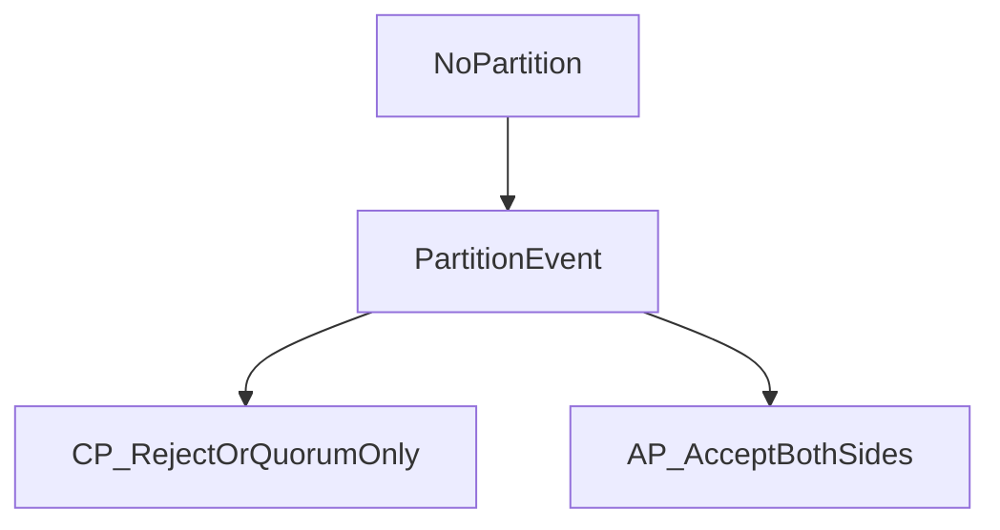

# D15-T004 — CAP theorem

Topic ID: `D15-T004`
Domain: Distributed Systems
Subdomain: CAP theorem
Importance: core
Complexity: advanced
Dependencies: `D15-T003`, `D15-T001`, `D03-T001`, `D03-T002`, `D04-T001`, `D04-T002`
Execution status of the code in section F: unexecuted

## A. Topic Overview

The CAP theorem (Gilbert and Lynch, 2002) models asynchronous networks with crash failures. When a partition occurs, a linearizable read/write register cannot be both available (every request gets a response) and consistent (linearizable) at the same time. It is not a permanent “pick two of three” menu for all operations—when there is no partition, both consistency and availability can hold. Interview precision matters: **C** in this proof is **linearizability** (atomic consistency), not every informal use of “consistent,” and not the **C** in ACID isolation.

## B. First-Principles Explanation

Distributed nodes exchange messages; some may be unreachable during a partition. **Availability** (in the CAP proof) means every request to a non-failing node receives a response in finite time, even while the network is split. **Consistency** means responses reflect a single total order of operations as if on one register—i.e., linearizable behavior. If two sides of a partition both accept writes while unable to communicate, they cannot both preserve linearizability without coordination. The theorem is an impossibility result under the stated model; it does not say you must always sacrifice one property in normal operation.

## C. Internal Working and Architecture

Production systems implement tunable behavior: quorum writes, leader election, read-your-writes routing, or rejecting minority partitions. A CP-leaning store may return errors when a quorum is unreachable. An AP-leaning store may accept writes on both sides and reconcile later with versions. Architecture documents must state **partition behavior**, not only steady-state replication lag (see PACELC, `D15-T005`).

## D. Diagrams and Visual Models



Read this as a decision at partition time: CP paths refuse or restrict writes without majority; AP paths keep responding and accept divergence risk.

## E. Examples and Analogies

Analogy: two checkout clerks who cannot talk during a store blackout may both sell the last item—unless one is told to stop (CP) or you merge sales later (AP with reconciliation). Backend: during a regional network split, a CP database rejects writes on the minority side; a cache-oriented AP layer may serve stale reads everywhere.

## F. Code Examples

File: `examples/d15_t004_cap_mode.py`

```python
def handle_write(partition: bool, has_quorum: bool, policy: str) -> str:
    if not partition:
        return "accept"
    if policy == "CP":
        return "accept" if has_quorum else "reject"
    if policy == "AP":
        return "accept"
    raise ValueError("unknown policy")
```

Policy switches partition behavior; AP here illustrates availability bias, not automatic safe merging.

## G. Practical Backend Application

Label each operation CP or AP: ledger authorization CP; feature flags may be AP. Runbooks should say what clients see when minority partitions cannot reach a quorum. Pair CAP discussion with idempotency and reconciliation for AP paths.

## H. Advantages, Limitations and Trade-offs

| Choice | Benefit | Cost | Choose when | Avoid when |
| --- | --- | --- | --- | --- |
| CP during split | Linearizable writes | Minority unavailable | Inventory, balances | Best-effort counters |
| AP during split | Keeps responding | Divergence | Caches, feeds | Unfenced dual writers |

CAP does not rank products; it bounds behavior during partitions.

## I. Common Mistakes and Misconceptions

- Claiming “we chose AP so we are always consistent.”
- Equating CAP **C** with ACID **C** or with “schema consistent.”
- Stating CAP applies identically when there is no partition.
- Using CAP to argue databases cannot scale (false).

## J. Debugging and Troubleshooting

Symptoms: split-brain writes, elevated conflict versions, or sudden write errors during network events. Check quorum reachability, leader epoch, and whether clients retry into both sides. Mitigation: fencing, majority quorums, and explicit read/write routes.

## K. Interview Preparation

### Beginner

#### Q1. What does CAP actually say?

**Answer:** Under partition, a linearizable register cannot be both available to all non-failing nodes and linearizable at the same time. It is about behavior during a split, not a forever trade among three labels. Many systems are consistent and available when the network is healthy. Interviewers test whether you use the Gilbert–Lynch definitions.

#### Q2. What is C in CAP?

**Answer:** In the proof, C is linearizability (atomic consistency) of a register abstraction. It is not “schema validation” and not the consistency level name in every database brochure. Mislabeling C weakens the rest of your design argument. Map product language to formal guarantees explicitly.

#### Q3. What is A in CAP?

**Answer:** Every request to a non-failing node gets a finite response during a partition. It does not mean 100% uptime for the whole product or zero errors. A node on the minority side may still be “up” yet unsafe to write. Availability in CAP is about responses, not correctness.

#### Q4. What is P in CAP?

**Answer:** P means the network can drop or delay messages—partitions happen. The model assumes asynchronous communication with crash failures. You do not “choose P”; real networks already have it. Designs must assume partitions, not treat them as impossible.

#### Q5. Is CAP “pick two of three” always?

**Answer:** No. The triangle slogan is a shorthand for partition-time tension. Without partition, C and A can coexist. PACELC (`D15-T005`) adds the normal-case latency versus consistency trade. Strong answers separate partition behavior from steady state.

### Intermediate

#### Q1. How does quorum relate to CAP?

**Answer:** Quorums intersect so a read and write overlap when W+R>N, enabling strong behavior when a majority partition exists. Minority partitions lack quorum and should reject writes in CP designs. Quorum does not remove conflicts in multi-writer AP models without version merges. Tie quorum math to `D15-T012`.

#### Q2. Give a CP example during partition.

**Answer:** A consensus-backed leader rejects writes if it cannot reach a majority. Clients on the minority see errors rather than divergent commits. That preserves linearizability at the cost of availability on the minority side. Operations document this as expected, not as “outage bug.”

#### Q3. Give an AP example during partition.

**Answer:** Two partitions accept writes with version vectors and reconcile later. Users keep getting responses, but histories may conflict. Merging requires business rules, not magic. This is availability with eventual convergence, not linearizability.

#### Q4. How is CAP different from PACELC?

**Answer:** CAP addresses partition-time A versus C. PACELC adds Else: latency versus consistency without partition. Most user complaints about stale reads are PACELC, not CAP. Use both frameworks precisely.

#### Q5. Does CAP forbid high availability?

**Answer:** No. It forbids linearizability plus full CAP-style availability on both sides of a partition simultaneously. Many systems are highly available in the majority partition while minority is degraded. Marketing “100% CAP” without partition behavior is incomplete.

### Advanced

#### Q1. What failure model does Gilbert–Lynch use?

**Answer:** Asynchronous network, crash-stop processes, no Byzantine behavior. Messages can be lost or delayed indefinitely; there is no synchronized clock. Proofs do not cover malicious nodes or arbitrary failures. Do not overclaim the theorem beyond its model.

#### Q2. Is linearizability the same as serializability?

**Answer:** No. Linearizability is about single-object histories and real-time ordering of operations. Serializability is a transaction schedule property over multiple objects. A system can be serializable without being linearizable across replicas. Use the right term for replicas versus SQL transactions.

#### Q3. Can you be “mostly CP”?

**Answer:** You can choose CP for some operations and AP for others in the same product. Sharding reduces blast radius. The interview expects nuance: one global label is usually wrong. Document per API and per data class.

#### Q4. How does leader failover interact with CAP?

**Answer:** During partition, only the majority partition should elect a leader that commits. Unfenced old leaders violate C. Fencing tokens and epoch bumps enforce single-writer safety. Failover without quorum is an AP risk.

#### Q5. Why is CAP still debated?

**Answer:** Slogans oversimplify; practitioners mix CAP with PACELC, eventual consistency, and isolation levels. Debate often is terminology, not math. Precise definitions end most arguments.

### Scenarios

#### Q1. Region link fails; both regions accept orders. CAP reading?

**Answer:** That is AP behavior during partition unless one side was fenced. Inventory may oversell until reconciliation. CP would have rejected minority writes. Fix with quorum routing or external inventory authority.

#### Q2. Minority DB nodes return 503 on writes during storm. CP or AP?

**Answer:** CP-leaning: refusing writes without quorum preserves linearizability. Clients must retry or fail over to majority routes. Do not silently redirect to stale replicas for writes. Communicate degradation clearly.

#### Q3. Interviewer says “MongoDB is CP.” Your response?

**Answer:** Ask which operation and deployment. Default replica reads can be stale; causal/majority read concerns change behavior. No blanket CAP label fits all modes. Map settings to guarantees.

#### Q4. Stale reads but no partition—CAP violation?

**Answer:** Not a CAP issue; likely PACELC latency versus consistency or async replication. Fix with read concern, primary reads, or lag bounds. Do not misdiagnose as partition.

#### Q5. Design payment authorization CAP choice.

**Answer:** Favor CP on the authoritative ledger partition with quorum/fencing. Reject rather than double-spend on split brain. AP caches may display balances with lag if labeled honestly. Auditors care about CP on writes.

### Follow-ups

#### Q1. Link to `D15-T003` partitions?

**Answer:** Partitions trigger the CAP trade-off; detection uses timeouts and quorums. Partition tolerance is assumed, not optional.

#### Q2. Link to `D15-T007` linearizability?

**Answer:** CAP C is linearizability for the register abstraction. Weaker models may be available during splits.

#### Q3. Link to `D15-T012` quorums?

**Answer:** Quorum math enables strong operations in the majority partition; minority should not commit in CP designs.

## L. Practical Exercises

Solutions are in `EXERCISES/solutions/D15-T004.md`.

### Exercise 1 — implementation

Implement handle_write for CP/AP policies.

### Exercise 2 — debugging

Interviewer says “we chose AP so we are always consistent”—correct them.

### Exercise 3 — trade-off

Classify primary-replica DB failover as CP or AP during split.

## M. Revision Notes

- CAP applies during partition under Gilbert–Lynch model.
- C means linearizability, not ACID C.
- No partition ⇒ C and A can both hold.
- PACELC covers normal-case latency vs consistency.
- Quorum + fencing implements CP behavior.

Flashcards:

- What is C in CAP? Linearizability.
- What is P? Network can partition (not optional).

## N. Related Topics

Understand this before: `D15-T003`, `D15-T001`.

This topic supports: `D15-T005`, `D15-T006`.

Often confused with: `D15-T005`, `D07-T012`.

## O. Completion Criteria

- State CAP precisely without slogan errors.
- Contrast CP and AP during a partition with examples.
- Separate CAP from PACELC and from SQL serializability.
- Map quorum/fencing to CP behavior.
