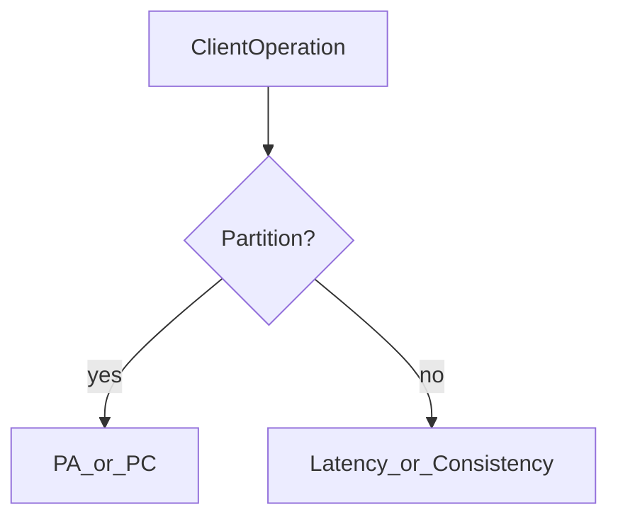

# D15-T005 — PACELC theorem

Topic ID: `D15-T005`
Domain: Distributed Systems
Subdomain: PACELC theorem
Importance: advanced
Complexity: advanced
Dependencies: `D15-T004`, `D15-T001`, `D03-T001`, `D03-T002`, `D04-T001`, `D04-T002`
Execution status of the code in section F: unexecuted

## A. Topic Overview

PACELC extends CAP: if Partition then choose Availability or Consistency (PA/ELC); Else (normal operation) choose Latency or Consistency. Most user-visible trade-offs happen without a partition—replication lag vs fast reads is an LC tension. It is a framework for describing systems, not a formal impossibility result like Gilbert-Lynch CAP.

## B. First-Principles Explanation

Many databases offer tunable consistency: stronger reads cost RTT to a quorum. PACELC reminds you to discuss both partition behavior and steady-state replication lag. PACELC extends CAP: if Partition then choose Availability or Consistency (PA/ELC); Else (normal operation) choose Latency or Consistency. Most user-visible trade-offs happen without a partition—replication lag vs fast reads is an LC tension. It is a framework for describing systems, not a formal impossibility result like Gilbert-Lynch CAP.

## C. Internal Working and Architecture

Expose consistency knobs per query (R/W quorum, read concern) and measure lag. Components interact through RPC, replication logs, and coordination services.

## D. Diagrams and Visual Models



Read the diagram as a causal flow from client action to stored or observed outcome, including failure branches.

## E. Examples and Analogies

Cassandra: PA/EL by default; strong reads add latency via QUORUM.

## F. Code Examples

File: `examples/d15_t005_read_policy.py`

Dependencies: Python 3 standard library only.

```python
def read_replicas(policy: str, lag_ms: float, max_lag: float) -> str:
    if policy == "low_latency":
        return "any_replica"
    if policy == "consistent" and lag_ms <= max_lag:
        return "quorum"
    return "primary_only"
```

The snippet models control flow you would embed in a service or test harness. It is not a production client library.

## G. Practical Backend Application

SLAs should state both partition behavior and p99 read staleness bounds.

## H. Advantages, Limitations and Trade-offs

| Choice | Benefit | Cost | Choose when | Avoid when |
| --- | --- | --- | --- | --- |
| Low latency reads | Fast UX | Stale data | Dashboards | Bank balance | | | | |

Under load, the cheap choice on paper becomes the choice that amplifies retries, stale reads, or operator toil. Measure p99 latency and error budgets, not only happy-path throughput.

## I. Common Mistakes and Misconceptions

- Using PACELC to claim CAP is wrong—it refines the conversation.
- Ignoring EL when marketing 'strongly consistent' with async replication.

A weak interview answer names a buzzword without a failure story. A strong answer names what breaks, what users see, and what invariant you still enforce.

## J. Debugging and Troubleshooting

Plot replication lag vs read policy errors.

## K. Interview Preparation
### Beginner
#### Q1. What is PACELC theorem?

**Answer:** PACELC extends CAP: if Partition then choose Availability or Consistency (PA/ELC); Else (normal operation) choose Latency or Consistency. Most user-visible trade-offs happen without a partition—replication lag vs fast reads is an LC tension. It is a framework for describing systems, not a formal impossibility result like Gilbert-Lynch CAP. Interviewers want a precise definition tied to PACELC Else branch latency vs consistency, not a slogan.
#### Q2. Why does PACELC theorem matter in backends?

**Answer:** PACELC extends CAP: if Partition then choose Availability or Consistency (PA/ELC); Else (normal operation) choose Latency or Consistency. Most user-visible trade-offs happen without a partition—replication lag vs fast reads is an LC tension. It is a framework for describing systems, not a formal impossibility result like Gilbert-Lynch CAP. Production systems fail one hop at a time; users still expect coherent behavior.
#### Q3. Give a one-line example of PACELC Else branch latency vs consistency.

**Answer:** PACELC extends CAP: if Partition then choose Availability or Consistency (PA/ELC); Else (normal operation) choose Latency or Consistency. Most user-visible trade-offs happen without a partition—replication lag vs fast reads is an LC tension. It is a framework for describing systems, not a formal impossibility result like Gilbert-Lynch CAP. Name a concrete multi-service flow where the issue appears.
#### Q4. Is PACELC theorem about hardware or software policy?

**Answer:** PACELC extends CAP: if Partition then choose Availability or Consistency (PA/ELC); Else (normal operation) choose Latency or Consistency. Most user-visible trade-offs happen without a partition—replication lag vs fast reads is an LC tension. It is a framework for describing systems, not a formal impossibility result like Gilbert-Lynch CAP. Mostly policy and protocols on top of unreliable networks.
#### Q5. What is a common myth about PACELC theorem?

**Answer:** PACELC extends CAP: if Partition then choose Availability or Consistency (PA/ELC); Else (normal operation) choose Latency or Consistency. Most user-visible trade-offs happen without a partition—replication lag vs fast reads is an LC tension. It is a framework for describing systems, not a formal impossibility result like Gilbert-Lynch CAP. Buzzword definitions that ignore partitions, retries, or consistency definitions.
### Intermediate
#### Q1. How do timeouts interact with PACELC Else branch latency vs consistency?

**Answer:** PACELC extends CAP: if Partition then choose Availability or Consistency (PA/ELC); Else (normal operation) choose Latency or Consistency. Most user-visible trade-offs happen without a partition—replication lag vs fast reads is an LC tension. It is a framework for describing systems, not a formal impossibility result like Gilbert-Lynch CAP. Timeouts create unknown outcomes; retries amplify load unless idempotent.
#### Q2. How do replicas interact with PACELC Else branch latency vs consistency?

**Answer:** PACELC extends CAP: if Partition then choose Availability or Consistency (PA/ELC); Else (normal operation) choose Latency or Consistency. Most user-visible trade-offs happen without a partition—replication lag vs fast reads is an LC tension. It is a framework for describing systems, not a formal impossibility result like Gilbert-Lynch CAP. Replication lag makes stale reads a normal case unless you pay for stronger reads.
#### Q3. How do idempotency keys help PACELC Else branch latency vs consistency?

**Answer:** PACELC extends CAP: if Partition then choose Availability or Consistency (PA/ELC); Else (normal operation) choose Latency or Consistency. Most user-visible trade-offs happen without a partition—replication lag vs fast reads is an LC tension. It is a framework for describing systems, not a formal impossibility result like Gilbert-Lynch CAP. They make at-least-once delivery safe for business side effects.
#### Q4. What metrics expose PACELC Else branch latency vs consistency?

**Answer:** PACELC extends CAP: if Partition then choose Availability or Consistency (PA/ELC); Else (normal operation) choose Latency or Consistency. Most user-visible trade-offs happen without a partition—replication lag vs fast reads is an LC tension. It is a framework for describing systems, not a formal impossibility result like Gilbert-Lynch CAP. Error rate by dependency, lag histograms, reconciliation queue depth.
#### Q5. How does PACELC theorem relate to user-visible SLAs?

**Answer:** PACELC extends CAP: if Partition then choose Availability or Consistency (PA/ELC); Else (normal operation) choose Latency or Consistency. Most user-visible trade-offs happen without a partition—replication lag vs fast reads is an LC tension. It is a framework for describing systems, not a formal impossibility result like Gilbert-Lynch CAP. SLAs must state behavior during degradation, not only median latency.
### Advanced
#### Q1. How would you test PACELC Else branch latency vs consistency?

**Answer:** PACELC extends CAP: if Partition then choose Availability or Consistency (PA/ELC); Else (normal operation) choose Latency or Consistency. Most user-visible trade-offs happen without a partition—replication lag vs fast reads is an LC tension. It is a framework for describing systems, not a formal impossibility result like Gilbert-Lynch CAP. Fault injection: delay, drop, partition links; assert invariants and recovery.
#### Q2. How does PACELC theorem differ from a single-machine failure?

**Answer:** PACELC extends CAP: if Partition then choose Availability or Consistency (PA/ELC); Else (normal operation) choose Latency or Consistency. Most user-visible trade-offs happen without a partition—replication lag vs fast reads is an LC tension. It is a framework for describing systems, not a formal impossibility result like Gilbert-Lynch CAP. Partial failure leaves other paths alive, producing ambiguous global state.
#### Q3. What documentation should teams publish about PACELC theorem?

**Answer:** PACELC extends CAP: if Partition then choose Availability or Consistency (PA/ELC); Else (normal operation) choose Latency or Consistency. Most user-visible trade-offs happen without a partition—replication lag vs fast reads is an LC tension. It is a framework for describing systems, not a formal impossibility result like Gilbert-Lynch CAP. Failure modes, consistency guarantees per endpoint, and runbooks for unknown outcomes.
#### Q4. When is strong consistency worth the latency for PACELC Else branch latency vs consistency?

**Answer:** PACELC extends CAP: if Partition then choose Availability or Consistency (PA/ELC); Else (normal operation) choose Latency or Consistency. Most user-visible trade-offs happen without a partition—replication lag vs fast reads is an LC tension. It is a framework for describing systems, not a formal impossibility result like Gilbert-Lynch CAP. When invariants involve money, inventory, or safety; not for best-effort feeds.
#### Q5. How do circuit breakers relate to PACELC Else branch latency vs consistency?

**Answer:** PACELC extends CAP: if Partition then choose Availability or Consistency (PA/ELC); Else (normal operation) choose Latency or Consistency. Most user-visible trade-offs happen without a partition—replication lag vs fast reads is an LC tension. It is a framework for describing systems, not a formal impossibility result like Gilbert-Lynch CAP. They stop retry storms but do not fix correctness; they protect capacity.
### Scenarios
#### Q1. Incident: errors spike after deploy touching PACELC theorem. First checks?

**Answer:** PACELC extends CAP: if Partition then choose Availability or Consistency (PA/ELC); Else (normal operation) choose Latency or Consistency. Most user-visible trade-offs happen without a partition—replication lag vs fast reads is an LC tension. It is a framework for describing systems, not a formal impossibility result like Gilbert-Lynch CAP. Roll forward/rollback decision, feature flag, canary metrics, dependency health.
#### Q2. Incident: customers report inconsistent reads around PACELC Else branch latency vs consistency. Diagnosis?

**Answer:** PACELC extends CAP: if Partition then choose Availability or Consistency (PA/ELC); Else (normal operation) choose Latency or Consistency. Most user-visible trade-offs happen without a partition—replication lag vs fast reads is an LC tension. It is a framework for describing systems, not a formal impossibility result like Gilbert-Lynch CAP. Check replica lag, routing, cache TTL, and read-your-writes settings.
#### Q3. Incident: reconciliation backlog grows for PACELC Else branch latency vs consistency. Why?

**Answer:** PACELC extends CAP: if Partition then choose Availability or Consistency (PA/ELC); Else (normal operation) choose Latency or Consistency. Most user-visible trade-offs happen without a partition—replication lag vs fast reads is an LC tension. It is a framework for describing systems, not a formal impossibility result like Gilbert-Lynch CAP. Downstream was slow; retries duplicated work; missing idempotency.
#### Q4. Design review challenges your PACELC theorem approach. What do you defend?

**Answer:** PACELC extends CAP: if Partition then choose Availability or Consistency (PA/ELC); Else (normal operation) choose Latency or Consistency. Most user-visible trade-offs happen without a partition—replication lag vs fast reads is an LC tension. It is a framework for describing systems, not a formal impossibility result like Gilbert-Lynch CAP. State invariants, failure model, and measured trade-offs with PACELC/CAP precision.
#### Q5. Finance audit questions PACELC Else branch latency vs consistency after duplicate charges. Response?

**Answer:** PACELC extends CAP: if Partition then choose Availability or Consistency (PA/ELC); Else (normal operation) choose Latency or Consistency. Most user-visible trade-offs happen without a partition—replication lag vs fast reads is an LC tension. It is a framework for describing systems, not a formal impossibility result like Gilbert-Lynch CAP. Show idempotency keys, ledger reconciliation, and provider correlation IDs.
### Follow-ups
#### Q1. How does PACELC theorem connect to `D15-T001`?

**Answer:** PACELC extends CAP: if Partition then choose Availability or Consistency (PA/ELC); Else (normal operation) choose Latency or Consistency. Most user-visible trade-offs happen without a partition—replication lag vs fast reads is an LC tension. It is a framework for describing systems, not a formal impossibility result like Gilbert-Lynch CAP. Fundamentals frame partial failure and message passing assumptions.
#### Q2. How does PACELC theorem connect to databases (`D07-T012`)?

**Answer:** PACELC extends CAP: if Partition then choose Availability or Consistency (PA/ELC); Else (normal operation) choose Latency or Consistency. Most user-visible trade-offs happen without a partition—replication lag vs fast reads is an LC tension. It is a framework for describing systems, not a formal impossibility result like Gilbert-Lynch CAP. Transactions are local unless you add distributed protocols or sagas.
#### Q3. How does PACELC theorem connect to messaging (`D14-T031`)?

**Answer:** PACELC extends CAP: if Partition then choose Availability or Consistency (PA/ELC); Else (normal operation) choose Latency or Consistency. Most user-visible trade-offs happen without a partition—replication lag vs fast reads is an LC tension. It is a framework for describing systems, not a formal impossibility result like Gilbert-Lynch CAP. Brokers provide at-least-once unless you engineer exactly-once effects.

## L. Practical Exercises

Solutions are in `EXERCISES/solutions/D15-T005.md`. Try these before opening that file.

### Exercise 1 — implementation

Implement read_replicas with lag guard.

### Exercise 2 — debugging

p99 read latency improved but users see stale inventory—map to PACELC.

### Exercise 3 — trade-off

When is PA/EL appropriate for notifications?

## M. Revision Notes

- PACELC theorem
- PACELC extends CAP: if Partition then choose Availability or Consistency (PA/ELC); Else (normal operation) choose Latency or Consistency.
- Measure lag, errors, and reconciliation—not only CPU.
- Document behavior during partition and during normal load.

Flashcards:

- What is PACELC theorem? See focus paragraph in overview.
- Common mistake: Using PACELC to claim CAP is wrong—it refines the conversation.

## N. Related Topics

Understand this before: `D15-T004`, `D15-T001`, `D03-T001`, `D03-T002`, `D04-T001`, `D04-T002`.

This topic supports: `D15-T006`, `D15-T009`.

Often confused with: `D15-T004`, `D15-T007`.

Interviewers combine this with replication (`D15-T009`), partial failure (`D15-T002`), and API idempotency (`D06-T011`).

## O. Completion Criteria

- Define PACELC theorem without buzzwords.
- Draw the mermaid model for D15-T005.
- Explain one mistake and its safer alternative.
