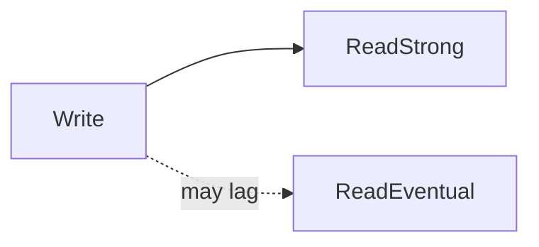

# D15-T006 — Strong, eventual and causal consistency

Topic ID: `D15-T006`
Domain: Distributed Systems
Subdomain: Strong, eventual and causal consistency
Importance: core
Complexity: advanced
Dependencies: `D15-T005`, `D15-T001`, `D03-T001`, `D03-T002`, `D04-T001`, `D04-T002`
Execution status of the code in section F: unexecuted

## A. Topic Overview

Consistency models describe what reads are allowed to return relative to writes. Strong (often linearizable) guarantees behave like a single copy in real time. Eventual consistency promises convergence if writes stop, not a bound on staleness. Causal consistency preserves cause-effect order (read-your-writes, related events) without full global linearization.

## B. First-Principles Explanation

Pick the weakest model that preserves product invariants; stronger models cost latency and availability during faults. Consistency models describe what reads are allowed to return relative to writes. Strong (often linearizable) guarantees behave like a single copy in real time. Eventual consistency promises convergence if writes stop, not a bound on staleness. Causal consistency preserves cause-effect order (read-your-writes, related events) without full global linearization.

## C. Internal Working and Architecture

Tag operations with consistency level; route strong reads to leader or quorum. Components interact through RPC, replication logs, and coordination services.

## D. Diagrams and Visual Models



Read the diagram as a causal flow from client action to stored or observed outcome, including failure branches.

## E. Examples and Analogies

Social feed eventual; bank balance strong; session cart causal.

## F. Code Examples

File: `examples/d15_t006_consistency_level.py`

Dependencies: Python 3 standard library only.

```python
def route_read(level: str, role: str) -> str:
    if level == "strong":
        return "primary"
    if level == "causal":
        return "primary_if_session_token else replica_with_token"
    return "any_replica"
```

The snippet models control flow you would embed in a service or test harness. It is not a production client library.

## G. Practical Backend Application

Document per-endpoint consistency; do not claim strong if replication is async.

## H. Advantages, Limitations and Trade-offs

| Choice | Benefit | Cost | Choose when | Avoid when |
| --- | --- | --- | --- | --- |
| Eventual reads | Low latency | Stale UI | Feeds | Inventory checkout | | | | |

Under load, the cheap choice on paper becomes the choice that amplifies retries, stale reads, or operator toil. Measure p99 latency and error budgets, not only happy-path throughput.

## I. Common Mistakes and Misconceptions

- Calling async replication 'strong'.
- Ignoring monotonic reads for UX.

A weak interview answer names a buzzword without a failure story. A strong answer names what breaks, what users see, and what invariant you still enforce.

## J. Debugging and Troubleshooting

Measure staleness windows; compare primary vs replica read.

## K. Interview Preparation
### Beginner
#### Q1. What is Strong, eventual and causal consistency?

**Answer:** Consistency models describe what reads are allowed to return relative to writes. Strong (often linearizable) guarantees behave like a single copy in real time. Eventual consistency promises convergence if writes stop, not a bound on staleness. Causal consistency preserves cause-effect order (read-your-writes, related events) without full global linearization. Interviewers want a precise definition tied to consistency model selection, not a slogan.
#### Q2. Why does Strong, eventual and causal consistency matter in backends?

**Answer:** Consistency models describe what reads are allowed to return relative to writes. Strong (often linearizable) guarantees behave like a single copy in real time. Eventual consistency promises convergence if writes stop, not a bound on staleness. Causal consistency preserves cause-effect order (read-your-writes, related events) without full global linearization. Production systems fail one hop at a time; users still expect coherent behavior.
#### Q3. Give a one-line example of consistency model selection.

**Answer:** Consistency models describe what reads are allowed to return relative to writes. Strong (often linearizable) guarantees behave like a single copy in real time. Eventual consistency promises convergence if writes stop, not a bound on staleness. Causal consistency preserves cause-effect order (read-your-writes, related events) without full global linearization. Name a concrete multi-service flow where the issue appears.
#### Q4. Is Strong, eventual and causal consistency about hardware or software policy?

**Answer:** Consistency models describe what reads are allowed to return relative to writes. Strong (often linearizable) guarantees behave like a single copy in real time. Eventual consistency promises convergence if writes stop, not a bound on staleness. Causal consistency preserves cause-effect order (read-your-writes, related events) without full global linearization. Mostly policy and protocols on top of unreliable networks.
#### Q5. What is a common myth about Strong, eventual and causal consistency?

**Answer:** Consistency models describe what reads are allowed to return relative to writes. Strong (often linearizable) guarantees behave like a single copy in real time. Eventual consistency promises convergence if writes stop, not a bound on staleness. Causal consistency preserves cause-effect order (read-your-writes, related events) without full global linearization. Buzzword definitions that ignore partitions, retries, or consistency definitions.
### Intermediate
#### Q1. How do timeouts interact with consistency model selection?

**Answer:** Consistency models describe what reads are allowed to return relative to writes. Strong (often linearizable) guarantees behave like a single copy in real time. Eventual consistency promises convergence if writes stop, not a bound on staleness. Causal consistency preserves cause-effect order (read-your-writes, related events) without full global linearization. Timeouts create unknown outcomes; retries amplify load unless idempotent.
#### Q2. How do replicas interact with consistency model selection?

**Answer:** Consistency models describe what reads are allowed to return relative to writes. Strong (often linearizable) guarantees behave like a single copy in real time. Eventual consistency promises convergence if writes stop, not a bound on staleness. Causal consistency preserves cause-effect order (read-your-writes, related events) without full global linearization. Replication lag makes stale reads a normal case unless you pay for stronger reads.
#### Q3. How do idempotency keys help consistency model selection?

**Answer:** Consistency models describe what reads are allowed to return relative to writes. Strong (often linearizable) guarantees behave like a single copy in real time. Eventual consistency promises convergence if writes stop, not a bound on staleness. Causal consistency preserves cause-effect order (read-your-writes, related events) without full global linearization. They make at-least-once delivery safe for business side effects.
#### Q4. What metrics expose consistency model selection?

**Answer:** Consistency models describe what reads are allowed to return relative to writes. Strong (often linearizable) guarantees behave like a single copy in real time. Eventual consistency promises convergence if writes stop, not a bound on staleness. Causal consistency preserves cause-effect order (read-your-writes, related events) without full global linearization. Error rate by dependency, lag histograms, reconciliation queue depth.
#### Q5. How does Strong, eventual and causal consistency relate to user-visible SLAs?

**Answer:** Consistency models describe what reads are allowed to return relative to writes. Strong (often linearizable) guarantees behave like a single copy in real time. Eventual consistency promises convergence if writes stop, not a bound on staleness. Causal consistency preserves cause-effect order (read-your-writes, related events) without full global linearization. SLAs must state behavior during degradation, not only median latency.
### Advanced
#### Q1. How would you test consistency model selection?

**Answer:** Consistency models describe what reads are allowed to return relative to writes. Strong (often linearizable) guarantees behave like a single copy in real time. Eventual consistency promises convergence if writes stop, not a bound on staleness. Causal consistency preserves cause-effect order (read-your-writes, related events) without full global linearization. Fault injection: delay, drop, partition links; assert invariants and recovery.
#### Q2. How does Strong, eventual and causal consistency differ from a single-machine failure?

**Answer:** Consistency models describe what reads are allowed to return relative to writes. Strong (often linearizable) guarantees behave like a single copy in real time. Eventual consistency promises convergence if writes stop, not a bound on staleness. Causal consistency preserves cause-effect order (read-your-writes, related events) without full global linearization. Partial failure leaves other paths alive, producing ambiguous global state.
#### Q3. What documentation should teams publish about Strong, eventual and causal consistency?

**Answer:** Consistency models describe what reads are allowed to return relative to writes. Strong (often linearizable) guarantees behave like a single copy in real time. Eventual consistency promises convergence if writes stop, not a bound on staleness. Causal consistency preserves cause-effect order (read-your-writes, related events) without full global linearization. Failure modes, consistency guarantees per endpoint, and runbooks for unknown outcomes.
#### Q4. When is strong consistency worth the latency for consistency model selection?

**Answer:** Consistency models describe what reads are allowed to return relative to writes. Strong (often linearizable) guarantees behave like a single copy in real time. Eventual consistency promises convergence if writes stop, not a bound on staleness. Causal consistency preserves cause-effect order (read-your-writes, related events) without full global linearization. When invariants involve money, inventory, or safety; not for best-effort feeds.
#### Q5. How do circuit breakers relate to consistency model selection?

**Answer:** Consistency models describe what reads are allowed to return relative to writes. Strong (often linearizable) guarantees behave like a single copy in real time. Eventual consistency promises convergence if writes stop, not a bound on staleness. Causal consistency preserves cause-effect order (read-your-writes, related events) without full global linearization. They stop retry storms but do not fix correctness; they protect capacity.
### Scenarios
#### Q1. Incident: errors spike after deploy touching Strong, eventual and causal consistency. First checks?

**Answer:** Consistency models describe what reads are allowed to return relative to writes. Strong (often linearizable) guarantees behave like a single copy in real time. Eventual consistency promises convergence if writes stop, not a bound on staleness. Causal consistency preserves cause-effect order (read-your-writes, related events) without full global linearization. Roll forward/rollback decision, feature flag, canary metrics, dependency health.
#### Q2. Incident: customers report inconsistent reads around consistency model selection. Diagnosis?

**Answer:** Consistency models describe what reads are allowed to return relative to writes. Strong (often linearizable) guarantees behave like a single copy in real time. Eventual consistency promises convergence if writes stop, not a bound on staleness. Causal consistency preserves cause-effect order (read-your-writes, related events) without full global linearization. Check replica lag, routing, cache TTL, and read-your-writes settings.
#### Q3. Incident: reconciliation backlog grows for consistency model selection. Why?

**Answer:** Consistency models describe what reads are allowed to return relative to writes. Strong (often linearizable) guarantees behave like a single copy in real time. Eventual consistency promises convergence if writes stop, not a bound on staleness. Causal consistency preserves cause-effect order (read-your-writes, related events) without full global linearization. Downstream was slow; retries duplicated work; missing idempotency.
#### Q4. Design review challenges your Strong, eventual and causal consistency approach. What do you defend?

**Answer:** Consistency models describe what reads are allowed to return relative to writes. Strong (often linearizable) guarantees behave like a single copy in real time. Eventual consistency promises convergence if writes stop, not a bound on staleness. Causal consistency preserves cause-effect order (read-your-writes, related events) without full global linearization. State invariants, failure model, and measured trade-offs with PACELC/CAP precision.
#### Q5. Finance audit questions consistency model selection after duplicate charges. Response?

**Answer:** Consistency models describe what reads are allowed to return relative to writes. Strong (often linearizable) guarantees behave like a single copy in real time. Eventual consistency promises convergence if writes stop, not a bound on staleness. Causal consistency preserves cause-effect order (read-your-writes, related events) without full global linearization. Show idempotency keys, ledger reconciliation, and provider correlation IDs.
### Follow-ups
#### Q1. How does Strong, eventual and causal consistency connect to `D15-T001`?

**Answer:** Consistency models describe what reads are allowed to return relative to writes. Strong (often linearizable) guarantees behave like a single copy in real time. Eventual consistency promises convergence if writes stop, not a bound on staleness. Causal consistency preserves cause-effect order (read-your-writes, related events) without full global linearization. Fundamentals frame partial failure and message passing assumptions.
#### Q2. How does Strong, eventual and causal consistency connect to databases (`D07-T012`)?

**Answer:** Consistency models describe what reads are allowed to return relative to writes. Strong (often linearizable) guarantees behave like a single copy in real time. Eventual consistency promises convergence if writes stop, not a bound on staleness. Causal consistency preserves cause-effect order (read-your-writes, related events) without full global linearization. Transactions are local unless you add distributed protocols or sagas.
#### Q3. How does Strong, eventual and causal consistency connect to messaging (`D14-T031`)?

**Answer:** Consistency models describe what reads are allowed to return relative to writes. Strong (often linearizable) guarantees behave like a single copy in real time. Eventual consistency promises convergence if writes stop, not a bound on staleness. Causal consistency preserves cause-effect order (read-your-writes, related events) without full global linearization. Brokers provide at-least-once unless you engineer exactly-once effects.

## L. Practical Exercises

Solutions are in `EXERCISES/solutions/D15-T006.md`. Try these before opening that file.

### Exercise 1 — implementation

Implement route_read for three levels.

### Exercise 2 — debugging

Users never see their own post—what consistency broke?

### Exercise 3 — trade-off

Choose model for 'like count' vs 'password change'.

## M. Revision Notes

- Strong, eventual and causal consistency
- Consistency models describe what reads are allowed to return relative to writes.
- Measure lag, errors, and reconciliation—not only CPU.
- Document behavior during partition and during normal load.

Flashcards:

- What is Strong, eventual and causal consistency? See focus paragraph in overview.
- Common mistake: Calling async replication 'strong'.

## N. Related Topics

Understand this before: `D15-T005`, `D15-T001`, `D03-T001`, `D03-T002`, `D04-T001`, `D04-T002`.

This topic supports: `D15-T007`, `D15-T009`.

Often confused with: `D15-T007`, `D07-T013`.

Interviewers combine this with replication (`D15-T009`), partial failure (`D15-T002`), and API idempotency (`D06-T011`).

## O. Completion Criteria

- Define Strong, eventual and causal consistency without buzzwords.
- Draw the mermaid model for D15-T006.
- Explain one mistake and its safer alternative.
