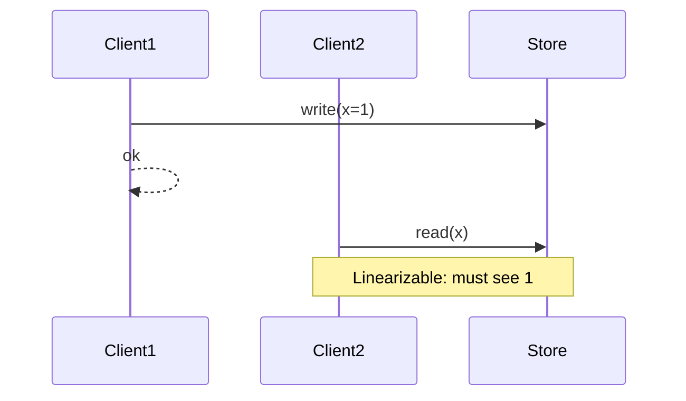

# D15-T007 — Linearizability and sequential consistency

Topic ID: `D15-T007`
Domain: Distributed Systems
Subdomain: Linearizability and sequential consistency
Importance: advanced
Complexity: advanced
Dependencies: `D15-T006`, `D15-T001`, `D03-T001`, `D03-T002`, `D04-T001`, `D04-T002`
Execution status of the code in section F: unexecuted

## A. Topic Overview

Linearizability requires each operation to appear to take effect atomically at some point between its invocation and response, and the global history respects real-time ordering. Sequential consistency only requires a single sequential order agreed by all nodes, but that order need not respect real-time (a slow reader may see an old value even after a faster client finished a write). Linearizability is strictly stronger than sequential consistency for register histories.

## B. First-Principles Explanation

CAP 'C' in Gilbert-Lynch is linearizability. Do not equate either term with database isolation levels without mapping. Linearizability requires each operation to appear to take effect atomically at some point between its invocation and response, and the global history respects real-time ordering. Sequential consistency only requires a single sequential order agreed by all nodes, but that order need not respect real-time (a slow reader may see an old value even after a faster client finished a write). Linearizability is strictly stronger than sequential consistency for register histories.

## C. Internal Working and Architecture

Leader-based replication with synchronous commit to a quorum approximates linearizable writes; reads may need quorum too. Components interact through RPC, replication logs, and coordination services.

## D. Diagrams and Visual Models



Read the diagram as a causal flow from client action to stored or observed outcome, including failure branches.

## E. Examples and Analogies

Compare-and-swap on a leader is often linearizable; multi-leader without coordination is not.

## F. Code Examples

File: `examples/d15_t007_history.py`

Dependencies: Python 3 standard library only.

```python
def is_sequential_order(ops: list[tuple[str, str]]) -> bool:
    """ops: list of (op, value_seen) for single register; toy checker."""
    return len(ops) >= 1
```

The snippet models control flow you would embed in a service or test harness. It is not a production client library.

## G. Practical Backend Application

Use linearizability language only when you can point to coordination (leader, quorum, fencing).

## H. Advantages, Limitations and Trade-offs

| Choice | Benefit | Cost | Choose when | Avoid when |
| --- | --- | --- | --- | --- |
| Linearizable ops | Simple mental model | Higher latency | Locks/inventory | Analytics replicas | | | | |

Under load, the cheap choice on paper becomes the choice that amplifies retries, stale reads, or operator toil. Measure p99 latency and error budgets, not only happy-path throughput.

## I. Common Mistakes and Misconceptions

- Saying 'sequential consistency is good enough for everything'.
- Confusing linearizability with serializability in SQL.

A weak interview answer names a buzzword without a failure story. A strong answer names what breaks, what users see, and what invariant you still enforce.

## J. Debugging and Troubleshooting

Litmus-style tests: write by C1 then read by C2 should see write if linearizable.

## K. Interview Preparation
### Beginner
#### Q1. What is Linearizability and sequential consistency?

**Answer:** Linearizability requires each operation to appear to take effect atomically at some point between its invocation and response, and the global history respects real-time ordering. Sequential consistency only requires a single sequential order agreed by all nodes, but that order need not respect real-time (a slow reader may see an old value even after a faster client finished a write). Linearizability is strictly stronger than sequential consistency for register histories. Interviewers want a precise definition tied to linearizability vs sequential consistency, not a slogan.
#### Q2. Why does Linearizability and sequential consistency matter in backends?

**Answer:** Linearizability requires each operation to appear to take effect atomically at some point between its invocation and response, and the global history respects real-time ordering. Sequential consistency only requires a single sequential order agreed by all nodes, but that order need not respect real-time (a slow reader may see an old value even after a faster client finished a write). Linearizability is strictly stronger than sequential consistency for register histories. Production systems fail one hop at a time; users still expect coherent behavior.
#### Q3. Give a one-line example of linearizability vs sequential consistency.

**Answer:** Linearizability requires each operation to appear to take effect atomically at some point between its invocation and response, and the global history respects real-time ordering. Sequential consistency only requires a single sequential order agreed by all nodes, but that order need not respect real-time (a slow reader may see an old value even after a faster client finished a write). Linearizability is strictly stronger than sequential consistency for register histories. Name a concrete multi-service flow where the issue appears.
#### Q4. Is Linearizability and sequential consistency about hardware or software policy?

**Answer:** Linearizability requires each operation to appear to take effect atomically at some point between its invocation and response, and the global history respects real-time ordering. Sequential consistency only requires a single sequential order agreed by all nodes, but that order need not respect real-time (a slow reader may see an old value even after a faster client finished a write). Linearizability is strictly stronger than sequential consistency for register histories. Mostly policy and protocols on top of unreliable networks.
#### Q5. What is a common myth about Linearizability and sequential consistency?

**Answer:** Linearizability requires each operation to appear to take effect atomically at some point between its invocation and response, and the global history respects real-time ordering. Sequential consistency only requires a single sequential order agreed by all nodes, but that order need not respect real-time (a slow reader may see an old value even after a faster client finished a write). Linearizability is strictly stronger than sequential consistency for register histories. Buzzword definitions that ignore partitions, retries, or consistency definitions.
### Intermediate
#### Q1. How do timeouts interact with linearizability vs sequential consistency?

**Answer:** Linearizability requires each operation to appear to take effect atomically at some point between its invocation and response, and the global history respects real-time ordering. Sequential consistency only requires a single sequential order agreed by all nodes, but that order need not respect real-time (a slow reader may see an old value even after a faster client finished a write). Linearizability is strictly stronger than sequential consistency for register histories. Timeouts create unknown outcomes; retries amplify load unless idempotent.
#### Q2. How do replicas interact with linearizability vs sequential consistency?

**Answer:** Linearizability requires each operation to appear to take effect atomically at some point between its invocation and response, and the global history respects real-time ordering. Sequential consistency only requires a single sequential order agreed by all nodes, but that order need not respect real-time (a slow reader may see an old value even after a faster client finished a write). Linearizability is strictly stronger than sequential consistency for register histories. Replication lag makes stale reads a normal case unless you pay for stronger reads.
#### Q3. How do idempotency keys help linearizability vs sequential consistency?

**Answer:** Linearizability requires each operation to appear to take effect atomically at some point between its invocation and response, and the global history respects real-time ordering. Sequential consistency only requires a single sequential order agreed by all nodes, but that order need not respect real-time (a slow reader may see an old value even after a faster client finished a write). Linearizability is strictly stronger than sequential consistency for register histories. They make at-least-once delivery safe for business side effects.
#### Q4. What metrics expose linearizability vs sequential consistency?

**Answer:** Linearizability requires each operation to appear to take effect atomically at some point between its invocation and response, and the global history respects real-time ordering. Sequential consistency only requires a single sequential order agreed by all nodes, but that order need not respect real-time (a slow reader may see an old value even after a faster client finished a write). Linearizability is strictly stronger than sequential consistency for register histories. Error rate by dependency, lag histograms, reconciliation queue depth.
#### Q5. How does Linearizability and sequential consistency relate to user-visible SLAs?

**Answer:** Linearizability requires each operation to appear to take effect atomically at some point between its invocation and response, and the global history respects real-time ordering. Sequential consistency only requires a single sequential order agreed by all nodes, but that order need not respect real-time (a slow reader may see an old value even after a faster client finished a write). Linearizability is strictly stronger than sequential consistency for register histories. SLAs must state behavior during degradation, not only median latency.
### Advanced
#### Q1. How would you test linearizability vs sequential consistency?

**Answer:** Linearizability requires each operation to appear to take effect atomically at some point between its invocation and response, and the global history respects real-time ordering. Sequential consistency only requires a single sequential order agreed by all nodes, but that order need not respect real-time (a slow reader may see an old value even after a faster client finished a write). Linearizability is strictly stronger than sequential consistency for register histories. Fault injection: delay, drop, partition links; assert invariants and recovery.
#### Q2. How does Linearizability and sequential consistency differ from a single-machine failure?

**Answer:** Linearizability requires each operation to appear to take effect atomically at some point between its invocation and response, and the global history respects real-time ordering. Sequential consistency only requires a single sequential order agreed by all nodes, but that order need not respect real-time (a slow reader may see an old value even after a faster client finished a write). Linearizability is strictly stronger than sequential consistency for register histories. Partial failure leaves other paths alive, producing ambiguous global state.
#### Q3. What documentation should teams publish about Linearizability and sequential consistency?

**Answer:** Linearizability requires each operation to appear to take effect atomically at some point between its invocation and response, and the global history respects real-time ordering. Sequential consistency only requires a single sequential order agreed by all nodes, but that order need not respect real-time (a slow reader may see an old value even after a faster client finished a write). Linearizability is strictly stronger than sequential consistency for register histories. Failure modes, consistency guarantees per endpoint, and runbooks for unknown outcomes.
#### Q4. When is strong consistency worth the latency for linearizability vs sequential consistency?

**Answer:** Linearizability requires each operation to appear to take effect atomically at some point between its invocation and response, and the global history respects real-time ordering. Sequential consistency only requires a single sequential order agreed by all nodes, but that order need not respect real-time (a slow reader may see an old value even after a faster client finished a write). Linearizability is strictly stronger than sequential consistency for register histories. When invariants involve money, inventory, or safety; not for best-effort feeds.
#### Q5. How do circuit breakers relate to linearizability vs sequential consistency?

**Answer:** Linearizability requires each operation to appear to take effect atomically at some point between its invocation and response, and the global history respects real-time ordering. Sequential consistency only requires a single sequential order agreed by all nodes, but that order need not respect real-time (a slow reader may see an old value even after a faster client finished a write). Linearizability is strictly stronger than sequential consistency for register histories. They stop retry storms but do not fix correctness; they protect capacity.
### Scenarios
#### Q1. Incident: errors spike after deploy touching Linearizability and sequential consistency. First checks?

**Answer:** Linearizability requires each operation to appear to take effect atomically at some point between its invocation and response, and the global history respects real-time ordering. Sequential consistency only requires a single sequential order agreed by all nodes, but that order need not respect real-time (a slow reader may see an old value even after a faster client finished a write). Linearizability is strictly stronger than sequential consistency for register histories. Roll forward/rollback decision, feature flag, canary metrics, dependency health.
#### Q2. Incident: customers report inconsistent reads around linearizability vs sequential consistency. Diagnosis?

**Answer:** Linearizability requires each operation to appear to take effect atomically at some point between its invocation and response, and the global history respects real-time ordering. Sequential consistency only requires a single sequential order agreed by all nodes, but that order need not respect real-time (a slow reader may see an old value even after a faster client finished a write). Linearizability is strictly stronger than sequential consistency for register histories. Check replica lag, routing, cache TTL, and read-your-writes settings.
#### Q3. Incident: reconciliation backlog grows for linearizability vs sequential consistency. Why?

**Answer:** Linearizability requires each operation to appear to take effect atomically at some point between its invocation and response, and the global history respects real-time ordering. Sequential consistency only requires a single sequential order agreed by all nodes, but that order need not respect real-time (a slow reader may see an old value even after a faster client finished a write). Linearizability is strictly stronger than sequential consistency for register histories. Downstream was slow; retries duplicated work; missing idempotency.
#### Q4. Design review challenges your Linearizability and sequential consistency approach. What do you defend?

**Answer:** Linearizability requires each operation to appear to take effect atomically at some point between its invocation and response, and the global history respects real-time ordering. Sequential consistency only requires a single sequential order agreed by all nodes, but that order need not respect real-time (a slow reader may see an old value even after a faster client finished a write). Linearizability is strictly stronger than sequential consistency for register histories. State invariants, failure model, and measured trade-offs with PACELC/CAP precision.
#### Q5. Finance audit questions linearizability vs sequential consistency after duplicate charges. Response?

**Answer:** Linearizability requires each operation to appear to take effect atomically at some point between its invocation and response, and the global history respects real-time ordering. Sequential consistency only requires a single sequential order agreed by all nodes, but that order need not respect real-time (a slow reader may see an old value even after a faster client finished a write). Linearizability is strictly stronger than sequential consistency for register histories. Show idempotency keys, ledger reconciliation, and provider correlation IDs.
### Follow-ups
#### Q1. How does Linearizability and sequential consistency connect to `D15-T001`?

**Answer:** Linearizability requires each operation to appear to take effect atomically at some point between its invocation and response, and the global history respects real-time ordering. Sequential consistency only requires a single sequential order agreed by all nodes, but that order need not respect real-time (a slow reader may see an old value even after a faster client finished a write). Linearizability is strictly stronger than sequential consistency for register histories. Fundamentals frame partial failure and message passing assumptions.
#### Q2. How does Linearizability and sequential consistency connect to databases (`D07-T012`)?

**Answer:** Linearizability requires each operation to appear to take effect atomically at some point between its invocation and response, and the global history respects real-time ordering. Sequential consistency only requires a single sequential order agreed by all nodes, but that order need not respect real-time (a slow reader may see an old value even after a faster client finished a write). Linearizability is strictly stronger than sequential consistency for register histories. Transactions are local unless you add distributed protocols or sagas.
#### Q3. How does Linearizability and sequential consistency connect to messaging (`D14-T031`)?

**Answer:** Linearizability requires each operation to appear to take effect atomically at some point between its invocation and response, and the global history respects real-time ordering. Sequential consistency only requires a single sequential order agreed by all nodes, but that order need not respect real-time (a slow reader may see an old value even after a faster client finished a write). Linearizability is strictly stronger than sequential consistency for register histories. Brokers provide at-least-once unless you engineer exactly-once effects.

## L. Practical Exercises

Solutions are in `EXERCISES/solutions/D15-T007.md`. Try these before opening that file.

### Exercise 1 — implementation

Explain litmus test w(x) r(x) for both models.

### Exercise 2 — debugging

System is sequentially consistent but not linearizable—give a timeline.

### Exercise 3 — trade-off

Does Raft leader commit imply linearizable reads?

## M. Revision Notes

- Linearizability and sequential consistency
- Linearizability requires each operation to appear to take effect atomically at some point between its invocation and response, and the global history respects real-time ordering.
- Measure lag, errors, and reconciliation—not only CPU.
- Document behavior during partition and during normal load.

Flashcards:

- What is Linearizability and sequential consistency? See focus paragraph in overview.
- Common mistake: Saying 'sequential consistency is good enough for everything'.

## N. Related Topics

Understand this before: `D15-T006`, `D15-T001`, `D03-T001`, `D03-T002`, `D04-T001`, `D04-T002`.

This topic supports: `D15-T012`, `D15-T004`.

Often confused with: `D15-T006`, `D07-T013`.

Interviewers combine this with replication (`D15-T009`), partial failure (`D15-T002`), and API idempotency (`D06-T011`).

## O. Completion Criteria

- Define Linearizability and sequential consistency without buzzwords.
- Draw the mermaid model for D15-T007.
- Explain one mistake and its safer alternative.
