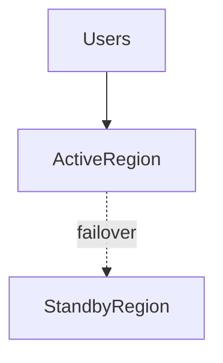

# D15-T008 — Availability and fault tolerance

Topic ID: `D15-T008`
Domain: Distributed Systems
Subdomain: Availability and fault tolerance
Importance: core
Complexity: advanced
Dependencies: `D15-T007`, `D15-T001`, `D03-T001`, `D03-T002`, `D04-T001`, `D04-T002`
Execution status of the code in section F: unexecuted

## A. Topic Overview

Availability is the fraction of time a system correctly serves requests; fault tolerance is the ability to continue despite faults. They require redundancy, failover, and graceful degradation—not infinite retries.

## B. First-Principles Explanation

Define 'correctly' (degraded mode may exclude some features). SLOs use successful responses over window, not ping. Availability is the fraction of time a system correctly serves requests; fault tolerance is the ability to continue despite faults. They require redundancy, failover, and graceful degradation—not infinite retries.

## C. Internal Working and Architecture

N+1 capacity, health checks, automated failover, chaos testing. Components interact through RPC, replication logs, and coordination services.

## D. Diagrams and Visual Models



Read the diagram as a causal flow from client action to stored or observed outcome, including failure branches.

## E. Examples and Analogies

99.9% allows ~43m downtime/month; plan maintenance within error budget.

## F. Code Examples

File: `examples/d15_t008_slo.py`

Dependencies: Python 3 standard library only.

```python
def within_budget(errors: int, total: int, budget: float) -> bool:
    return total > 0 and (errors / total) <= budget
```

The snippet models control flow you would embed in a service or test harness. It is not a production client library.

## G. Practical Backend Application

Pair HA with idempotency and data durability; uptime without correctness is worthless.

## H. Advantages, Limitations and Trade-offs

| Choice | Benefit | Cost | Choose when | Avoid when |
| --- | --- | --- | --- | --- |
| Active-active | Max uptime | Split brain risk | Global read | Single-writer data | | | | |

Under load, the cheap choice on paper becomes the choice that amplifies retries, stale reads, or operator toil. Measure p99 latency and error budgets, not only happy-path throughput.

## I. Common Mistakes and Misconceptions

- Equating load balancer up with app healthy.
- No error budget policy.

A weak interview answer names a buzzword without a failure story. A strong answer names what breaks, what users see, and what invariant you still enforce.

## J. Debugging and Troubleshooting

Split availability by dependency; blame analysis per hop.

## K. Interview Preparation
### Beginner
#### Q1. What is Availability and fault tolerance?

**Answer:** Availability is the fraction of time a system correctly serves requests; fault tolerance is the ability to continue despite faults. They require redundancy, failover, and graceful degradation—not infinite retries. Interviewers want a precise definition tied to availability SLOs and redundancy, not a slogan. In production, the failure mode matters more than the slogan: measure timeouts, error budgets, and client-visible symptoms before you rename the problem.
#### Q2. Why does Availability and fault tolerance matter in backends?

**Answer:** Availability is the fraction of time a system correctly serves requests; fault tolerance is the ability to continue despite faults. They require redundancy, failover, and graceful degradation—not infinite retries. Production systems fail one hop at a time; users still expect coherent behavior. In production, the failure mode matters more than the slogan: measure timeouts, error budgets, and client-visible symptoms before you rename the problem.
#### Q3. Give a one-line example of availability SLOs and redundancy.

**Answer:** Availability is the fraction of time a system correctly serves requests; fault tolerance is the ability to continue despite faults. They require redundancy, failover, and graceful degradation—not infinite retries. Name a concrete multi-service flow where the issue appears. In production, the failure mode matters more than the slogan: measure timeouts, error budgets, and client-visible symptoms before you rename the problem.
#### Q4. Is Availability and fault tolerance about hardware or software policy?

**Answer:** Availability is the fraction of time a system correctly serves requests; fault tolerance is the ability to continue despite faults. They require redundancy, failover, and graceful degradation—not infinite retries. Mostly policy and protocols on top of unreliable networks. In production, the failure mode matters more than the slogan: measure timeouts, error budgets, and client-visible symptoms before you rename the problem.
#### Q5. What is a common myth about Availability and fault tolerance?

**Answer:** Availability is the fraction of time a system correctly serves requests; fault tolerance is the ability to continue despite faults. They require redundancy, failover, and graceful degradation—not infinite retries. Buzzword definitions that ignore partitions, retries, or consistency definitions. In production, the failure mode matters more than the slogan: measure timeouts, error budgets, and client-visible symptoms before you rename the problem.
### Intermediate
#### Q1. How do timeouts interact with availability SLOs and redundancy?

**Answer:** Availability is the fraction of time a system correctly serves requests; fault tolerance is the ability to continue despite faults. They require redundancy, failover, and graceful degradation—not infinite retries. Timeouts create unknown outcomes; retries amplify load unless idempotent. In production, the failure mode matters more than the slogan: measure timeouts, error budgets, and client-visible symptoms before you rename the problem.
#### Q2. How do replicas interact with availability SLOs and redundancy?

**Answer:** Availability is the fraction of time a system correctly serves requests; fault tolerance is the ability to continue despite faults. They require redundancy, failover, and graceful degradation—not infinite retries. Replication lag makes stale reads a normal case unless you pay for stronger reads. In production, the failure mode matters more than the slogan: measure timeouts, error budgets, and client-visible symptoms before you rename the problem.
#### Q3. How do idempotency keys help availability SLOs and redundancy?

**Answer:** Availability is the fraction of time a system correctly serves requests; fault tolerance is the ability to continue despite faults. They require redundancy, failover, and graceful degradation—not infinite retries. They make at-least-once delivery safe for business side effects. In production, the failure mode matters more than the slogan: measure timeouts, error budgets, and client-visible symptoms before you rename the problem.
#### Q4. What metrics expose availability SLOs and redundancy?

**Answer:** Availability is the fraction of time a system correctly serves requests; fault tolerance is the ability to continue despite faults. They require redundancy, failover, and graceful degradation—not infinite retries. Error rate by dependency, lag histograms, reconciliation queue depth. In production, the failure mode matters more than the slogan: measure timeouts, error budgets, and client-visible symptoms before you rename the problem.
#### Q5. How does Availability and fault tolerance relate to user-visible SLAs?

**Answer:** Availability is the fraction of time a system correctly serves requests; fault tolerance is the ability to continue despite faults. They require redundancy, failover, and graceful degradation—not infinite retries. SLAs must state behavior during degradation, not only median latency. In production, the failure mode matters more than the slogan: measure timeouts, error budgets, and client-visible symptoms before you rename the problem.
### Advanced
#### Q1. How would you test availability SLOs and redundancy?

**Answer:** Availability is the fraction of time a system correctly serves requests; fault tolerance is the ability to continue despite faults. They require redundancy, failover, and graceful degradation—not infinite retries. Fault injection: delay, drop, partition links; assert invariants and recovery. In production, the failure mode matters more than the slogan: measure timeouts, error budgets, and client-visible symptoms before you rename the problem.
#### Q2. How does Availability and fault tolerance differ from a single-machine failure?

**Answer:** Availability is the fraction of time a system correctly serves requests; fault tolerance is the ability to continue despite faults. They require redundancy, failover, and graceful degradation—not infinite retries. Partial failure leaves other paths alive, producing ambiguous global state. In production, the failure mode matters more than the slogan: measure timeouts, error budgets, and client-visible symptoms before you rename the problem.
#### Q3. What documentation should teams publish about Availability and fault tolerance?

**Answer:** Availability is the fraction of time a system correctly serves requests; fault tolerance is the ability to continue despite faults. They require redundancy, failover, and graceful degradation—not infinite retries. Failure modes, consistency guarantees per endpoint, and runbooks for unknown outcomes. In production, the failure mode matters more than the slogan: measure timeouts, error budgets, and client-visible symptoms before you rename the problem.
#### Q4. When is strong consistency worth the latency for availability SLOs and redundancy?

**Answer:** Availability is the fraction of time a system correctly serves requests; fault tolerance is the ability to continue despite faults. They require redundancy, failover, and graceful degradation—not infinite retries. When invariants involve money, inventory, or safety; not for best-effort feeds. In production, the failure mode matters more than the slogan: measure timeouts, error budgets, and client-visible symptoms before you rename the problem.
#### Q5. How do circuit breakers relate to availability SLOs and redundancy?

**Answer:** Availability is the fraction of time a system correctly serves requests; fault tolerance is the ability to continue despite faults. They require redundancy, failover, and graceful degradation—not infinite retries. They stop retry storms but do not fix correctness; they protect capacity. In production, the failure mode matters more than the slogan: measure timeouts, error budgets, and client-visible symptoms before you rename the problem.
### Scenarios
#### Q1. Incident: errors spike after deploy touching Availability and fault tolerance. First checks?

**Answer:** Availability is the fraction of time a system correctly serves requests; fault tolerance is the ability to continue despite faults. They require redundancy, failover, and graceful degradation—not infinite retries. Roll forward/rollback decision, feature flag, canary metrics, dependency health. In production, the failure mode matters more than the slogan: measure timeouts, error budgets, and client-visible symptoms before you rename the problem.
#### Q2. Incident: customers report inconsistent reads around availability SLOs and redundancy. Diagnosis?

**Answer:** Availability is the fraction of time a system correctly serves requests; fault tolerance is the ability to continue despite faults. They require redundancy, failover, and graceful degradation—not infinite retries. Check replica lag, routing, cache TTL, and read-your-writes settings. In production, the failure mode matters more than the slogan: measure timeouts, error budgets, and client-visible symptoms before you rename the problem.
#### Q3. Incident: reconciliation backlog grows for availability SLOs and redundancy. Why?

**Answer:** Availability is the fraction of time a system correctly serves requests; fault tolerance is the ability to continue despite faults. They require redundancy, failover, and graceful degradation—not infinite retries. Downstream was slow; retries duplicated work; missing idempotency. In production, the failure mode matters more than the slogan: measure timeouts, error budgets, and client-visible symptoms before you rename the problem.
#### Q4. Design review challenges your Availability and fault tolerance approach. What do you defend?

**Answer:** Availability is the fraction of time a system correctly serves requests; fault tolerance is the ability to continue despite faults. They require redundancy, failover, and graceful degradation—not infinite retries. State invariants, failure model, and measured trade-offs with PACELC/CAP precision. In production, the failure mode matters more than the slogan: measure timeouts, error budgets, and client-visible symptoms before you rename the problem.
#### Q5. Finance audit questions availability SLOs and redundancy after duplicate charges. Response?

**Answer:** Availability is the fraction of time a system correctly serves requests; fault tolerance is the ability to continue despite faults. They require redundancy, failover, and graceful degradation—not infinite retries. Show idempotency keys, ledger reconciliation, and provider correlation IDs. In production, the failure mode matters more than the slogan: measure timeouts, error budgets, and client-visible symptoms before you rename the problem.
### Follow-ups
#### Q1. How does Availability and fault tolerance connect to `D15-T001`?

**Answer:** Availability is the fraction of time a system correctly serves requests; fault tolerance is the ability to continue despite faults. They require redundancy, failover, and graceful degradation—not infinite retries. Fundamentals frame partial failure and message passing assumptions. In production, the failure mode matters more than the slogan: measure timeouts, error budgets, and client-visible symptoms before you rename the problem.
#### Q2. How does Availability and fault tolerance connect to databases (`D07-T012`)?

**Answer:** Availability is the fraction of time a system correctly serves requests; fault tolerance is the ability to continue despite faults. They require redundancy, failover, and graceful degradation—not infinite retries. Transactions are local unless you add distributed protocols or sagas. In production, the failure mode matters more than the slogan: measure timeouts, error budgets, and client-visible symptoms before you rename the problem.
#### Q3. How does Availability and fault tolerance connect to messaging (`D14-T031`)?

**Answer:** Availability is the fraction of time a system correctly serves requests; fault tolerance is the ability to continue despite faults. They require redundancy, failover, and graceful degradation—not infinite retries. Brokers provide at-least-once unless you engineer exactly-once effects. In production, the failure mode matters more than the slogan: measure timeouts, error budgets, and client-visible symptoms before you rename the problem.

## L. Practical Exercises

Solutions are in `EXERCISES/solutions/D15-T008.md`. Try these before opening that file.

### Exercise 1 — implementation

Compute if 15 errors in 100k requests meets 99.95% budget.

### Exercise 2 — debugging

Site up but checkout down—availability metric?

### Exercise 3 — trade-off

When is active-active worth split-brain risk?

## M. Revision Notes

- Availability and fault tolerance
- Availability is the fraction of time a system correctly serves requests; fault tolerance is the ability to continue despite faults.
- Measure lag, errors, and reconciliation—not only CPU.
- Document behavior during partition and during normal load.

Flashcards:

- What is Availability and fault tolerance? See focus paragraph in overview.
- Common mistake: Equating load balancer up with app healthy.

## N. Related Topics

Understand this before: `D15-T007`, `D15-T001`, `D03-T001`, `D03-T002`, `D04-T001`, `D04-T002`.

This topic supports: `D15-T025`, `D15-T010`.

Often confused with: `D15-T002`, `D05-T023`.

Interviewers combine this with replication (`D15-T009`), partial failure (`D15-T002`), and API idempotency (`D06-T011`).

## O. Completion Criteria

- Define Availability and fault tolerance without buzzwords.
- Draw the mermaid model for D15-T008.
- Explain one mistake and its safer alternative.
