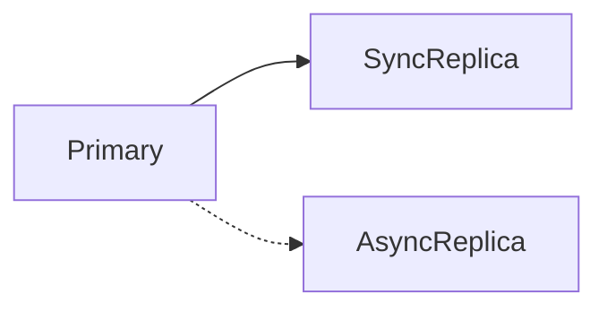

# D15-T009 — Replication strategies

Topic ID: `D15-T009`
Domain: Distributed Systems
Subdomain: Replication strategies
Importance: core
Complexity: advanced
Dependencies: `D15-T008`, `D15-T001`, `D03-T001`, `D03-T002`, `D04-T001`, `D04-T002`
Execution status of the code in section F: unexecuted

## A. Topic Overview

Replication copies data for durability and read scale. Sync replication waits for followers before ack; async acks early and risks loss on primary failure. Multi-leader increases write availability but complicates conflicts.

## B. First-Principles Explanation

Replication is not backup unless you can restore independently; lag is a consistency knob. Replication copies data for durability and read scale. Sync replication waits for followers before ack; async acks early and risks loss on primary failure. Multi-leader increases write availability but complicates conflicts.

## C. Internal Working and Architecture

Binlog/WAL shipping, chain replication, quorum replication. Components interact through RPC, replication logs, and coordination services.

## D. Diagrams and Visual Models



Read the diagram as a causal flow from client action to stored or observed outcome, including failure branches.

## E. Examples and Analogies

Postgres streaming replication async by default; sync replicas for RPO≈0.

## F. Code Examples

File: `examples/d15_t009_ack.py`

Dependencies: Python 3 standard library only.

```python
def client_visible_commit(sync_acks: int, required: int) -> bool:
    return sync_acks >= required
```

The snippet models control flow you would embed in a service or test harness. It is not a production client library.

## G. Practical Backend Application

State RPO/RTO; monitor replication lag alarms.

## H. Advantages, Limitations and Trade-offs

| Choice | Benefit | Cost | Choose when | Avoid when |
| --- | --- | --- | --- | --- |
| Async replication | Fast writes | Data loss window | Most OLTP | Zero RPO needs | | | | |

Under load, the cheap choice on paper becomes the choice that amplifies retries, stale reads, or operator toil. Measure p99 latency and error budgets, not only happy-path throughput.

## I. Common Mistakes and Misconceptions

- Assuming replica read is always fresh.
- No plan when lag unbounded.

A weak interview answer names a buzzword without a failure story. A strong answer names what breaks, what users see, and what invariant you still enforce.

## J. Debugging and Troubleshooting

Compare LSN/offset on primary vs replica.

## K. Interview Preparation
### Beginner
#### Q1. What is Replication strategies?

**Answer:** Replication copies data for durability and read scale. Sync replication waits for followers before ack; async acks early and risks loss on primary failure. Multi-leader increases write availability but complicates conflicts. Interviewers want a precise definition tied to sync vs async replication, not a slogan.
#### Q2. Why does Replication strategies matter in backends?

**Answer:** Replication copies data for durability and read scale. Sync replication waits for followers before ack; async acks early and risks loss on primary failure. Multi-leader increases write availability but complicates conflicts. Production systems fail one hop at a time; users still expect coherent behavior.
#### Q3. Give a one-line example of sync vs async replication.

**Answer:** Replication copies data for durability and read scale. Sync replication waits for followers before ack; async acks early and risks loss on primary failure. Multi-leader increases write availability but complicates conflicts. Name a concrete multi-service flow where the issue appears.
#### Q4. Is Replication strategies about hardware or software policy?

**Answer:** Replication copies data for durability and read scale. Sync replication waits for followers before ack; async acks early and risks loss on primary failure. Multi-leader increases write availability but complicates conflicts. Mostly policy and protocols on top of unreliable networks.
#### Q5. What is a common myth about Replication strategies?

**Answer:** Replication copies data for durability and read scale. Sync replication waits for followers before ack; async acks early and risks loss on primary failure. Multi-leader increases write availability but complicates conflicts. Buzzword definitions that ignore partitions, retries, or consistency definitions.
### Intermediate
#### Q1. How do timeouts interact with sync vs async replication?

**Answer:** Replication copies data for durability and read scale. Sync replication waits for followers before ack; async acks early and risks loss on primary failure. Multi-leader increases write availability but complicates conflicts. Timeouts create unknown outcomes; retries amplify load unless idempotent.
#### Q2. How do replicas interact with sync vs async replication?

**Answer:** Replication copies data for durability and read scale. Sync replication waits for followers before ack; async acks early and risks loss on primary failure. Multi-leader increases write availability but complicates conflicts. Replication lag makes stale reads a normal case unless you pay for stronger reads.
#### Q3. How do idempotency keys help sync vs async replication?

**Answer:** Replication copies data for durability and read scale. Sync replication waits for followers before ack; async acks early and risks loss on primary failure. Multi-leader increases write availability but complicates conflicts. They make at-least-once delivery safe for business side effects.
#### Q4. What metrics expose sync vs async replication?

**Answer:** Replication copies data for durability and read scale. Sync replication waits for followers before ack; async acks early and risks loss on primary failure. Multi-leader increases write availability but complicates conflicts. Error rate by dependency, lag histograms, reconciliation queue depth.
#### Q5. How does Replication strategies relate to user-visible SLAs?

**Answer:** Replication copies data for durability and read scale. Sync replication waits for followers before ack; async acks early and risks loss on primary failure. Multi-leader increases write availability but complicates conflicts. SLAs must state behavior during degradation, not only median latency.
### Advanced
#### Q1. How would you test sync vs async replication?

**Answer:** Replication copies data for durability and read scale. Sync replication waits for followers before ack; async acks early and risks loss on primary failure. Multi-leader increases write availability but complicates conflicts. Fault injection: delay, drop, partition links; assert invariants and recovery.
#### Q2. How does Replication strategies differ from a single-machine failure?

**Answer:** Replication copies data for durability and read scale. Sync replication waits for followers before ack; async acks early and risks loss on primary failure. Multi-leader increases write availability but complicates conflicts. Partial failure leaves other paths alive, producing ambiguous global state.
#### Q3. What documentation should teams publish about Replication strategies?

**Answer:** Replication copies data for durability and read scale. Sync replication waits for followers before ack; async acks early and risks loss on primary failure. Multi-leader increases write availability but complicates conflicts. Failure modes, consistency guarantees per endpoint, and runbooks for unknown outcomes.
#### Q4. When is strong consistency worth the latency for sync vs async replication?

**Answer:** Replication copies data for durability and read scale. Sync replication waits for followers before ack; async acks early and risks loss on primary failure. Multi-leader increases write availability but complicates conflicts. When invariants involve money, inventory, or safety; not for best-effort feeds.
#### Q5. How do circuit breakers relate to sync vs async replication?

**Answer:** Replication copies data for durability and read scale. Sync replication waits for followers before ack; async acks early and risks loss on primary failure. Multi-leader increases write availability but complicates conflicts. They stop retry storms but do not fix correctness; they protect capacity.
### Scenarios
#### Q1. Incident: errors spike after deploy touching Replication strategies. First checks?

**Answer:** Replication copies data for durability and read scale. Sync replication waits for followers before ack; async acks early and risks loss on primary failure. Multi-leader increases write availability but complicates conflicts. Roll forward/rollback decision, feature flag, canary metrics, dependency health.
#### Q2. Incident: customers report inconsistent reads around sync vs async replication. Diagnosis?

**Answer:** Replication copies data for durability and read scale. Sync replication waits for followers before ack; async acks early and risks loss on primary failure. Multi-leader increases write availability but complicates conflicts. Check replica lag, routing, cache TTL, and read-your-writes settings.
#### Q3. Incident: reconciliation backlog grows for sync vs async replication. Why?

**Answer:** Replication copies data for durability and read scale. Sync replication waits for followers before ack; async acks early and risks loss on primary failure. Multi-leader increases write availability but complicates conflicts. Downstream was slow; retries duplicated work; missing idempotency.
#### Q4. Design review challenges your Replication strategies approach. What do you defend?

**Answer:** Replication copies data for durability and read scale. Sync replication waits for followers before ack; async acks early and risks loss on primary failure. Multi-leader increases write availability but complicates conflicts. State invariants, failure model, and measured trade-offs with PACELC/CAP precision.
#### Q5. Finance audit questions sync vs async replication after duplicate charges. Response?

**Answer:** Replication copies data for durability and read scale. Sync replication waits for followers before ack; async acks early and risks loss on primary failure. Multi-leader increases write availability but complicates conflicts. Show idempotency keys, ledger reconciliation, and provider correlation IDs.
### Follow-ups
#### Q1. How does Replication strategies connect to `D15-T001`?

**Answer:** Replication copies data for durability and read scale. Sync replication waits for followers before ack; async acks early and risks loss on primary failure. Multi-leader increases write availability but complicates conflicts. Fundamentals frame partial failure and message passing assumptions.
#### Q2. How does Replication strategies connect to databases (`D07-T012`)?

**Answer:** Replication copies data for durability and read scale. Sync replication waits for followers before ack; async acks early and risks loss on primary failure. Multi-leader increases write availability but complicates conflicts. Transactions are local unless you add distributed protocols or sagas.
#### Q3. How does Replication strategies connect to messaging (`D14-T031`)?

**Answer:** Replication copies data for durability and read scale. Sync replication waits for followers before ack; async acks early and risks loss on primary failure. Multi-leader increases write availability but complicates conflicts. Brokers provide at-least-once unless you engineer exactly-once effects.

## L. Practical Exercises

Solutions are in `EXERCISES/solutions/D15-T009.md`. Try these before opening that file.

### Exercise 1 — implementation

Implement client_visible_commit.

### Exercise 2 — debugging

Failover loses last 30s writes—sync or async?

### Exercise 3 — trade-off

When add read replicas vs shards?

## M. Revision Notes

- Replication strategies
- Replication copies data for durability and read scale.
- Measure lag, errors, and reconciliation—not only CPU.
- Document behavior during partition and during normal load.

Flashcards:

- What is Replication strategies? See focus paragraph in overview.
- Common mistake: Assuming replica read is always fresh.

## N. Related Topics

Understand this before: `D15-T008`, `D15-T001`, `D03-T001`, `D03-T002`, `D04-T001`, `D04-T002`.

This topic supports: `D15-T010`, `D15-T012`.

Often confused with: `D15-T031`, `D07-T019`.

Interviewers combine this with replication (`D15-T009`), partial failure (`D15-T002`), and API idempotency (`D06-T011`).

## O. Completion Criteria

- Define Replication strategies without buzzwords.
- Draw the mermaid model for D15-T009.
- Explain one mistake and its safer alternative.
