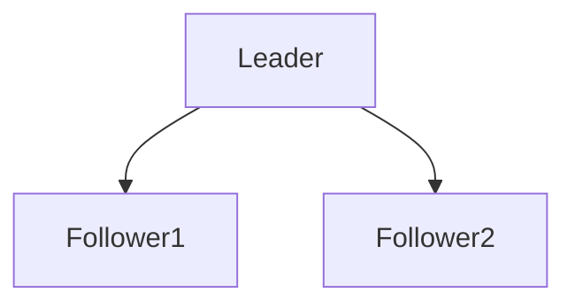

# D15-T010 — Leader-follower architecture

Topic ID: `D15-T010`
Domain: Distributed Systems
Subdomain: Leader-follower architecture
Importance: core
Complexity: advanced
Dependencies: `D15-T009`, `D15-T001`, `D03-T001`, `D03-T002`, `D04-T001`, `D04-T002`
Execution status of the code in section F: unexecuted

## A. Topic Overview

A single leader orders writes; followers apply the log. Reads may hit followers for scale but risk staleness unless routed carefully. Failover promotes a follower when leader is deemed dead.

## B. First-Principles Explanation

Leadership is a safety property: at most one leader epoch should accept writes if fencing works. A single leader orders writes; followers apply the log. Reads may hit followers for scale but risk staleness unless routed carefully. Failover promotes a follower when leader is deemed dead.

## C. Internal Working and Architecture

Log replication, commit index, snapshot shipping. Components interact through RPC, replication logs, and coordination services.

## D. Diagrams and Visual Models



Read the diagram as a causal flow from client action to stored or observed outcome, including failure branches.

## E. Examples and Analogies

MySQL primary/replica; Kafka partition leader.

## F. Code Examples

File: `examples/d15_t010_write_path.py`

Dependencies: Python 3 standard library only.

```python
def accept_write(is_leader: bool, fenced: bool) -> bool:
    return is_leader and fenced
```

The snippet models control flow you would embed in a service or test harness. It is not a production client library.

## G. Practical Backend Application

Route writes to leader; use follower reads with lag bounds for dashboards only.

## H. Advantages, Limitations and Trade-offs

| Choice | Benefit | Cost | Choose when | Avoid when |
| --- | --- | --- | --- | --- |
| Follower reads | Scale reads | Stale | Reports | Session cart after write | | | | |

Under load, the cheap choice on paper becomes the choice that amplifies retries, stale reads, or operator toil. Measure p99 latency and error budgets, not only happy-path throughput.

## I. Common Mistakes and Misconceptions

- Writing to follower 'just once'.
- Failover without epoch bump.

A weak interview answer names a buzzword without a failure story. A strong answer names what breaks, what users see, and what invariant you still enforce.

## J. Debugging and Troubleshooting

Check role, term, replication lag on write errors.

## K. Interview Preparation
### Beginner
#### Q1. What is Leader-follower architecture?

**Answer:** A single leader orders writes; followers apply the log. Reads may hit followers for scale but risk staleness unless routed carefully. Failover promotes a follower when leader is deemed dead. Interviewers want a precise definition tied to leader-follower write routing, not a slogan.
#### Q2. Why does Leader-follower architecture matter in backends?

**Answer:** A single leader orders writes; followers apply the log. Reads may hit followers for scale but risk staleness unless routed carefully. Failover promotes a follower when leader is deemed dead. Production systems fail one hop at a time; users still expect coherent behavior.
#### Q3. Give a one-line example of leader-follower write routing.

**Answer:** A single leader orders writes; followers apply the log. Reads may hit followers for scale but risk staleness unless routed carefully. Failover promotes a follower when leader is deemed dead. Name a concrete multi-service flow where the issue appears.
#### Q4. Is Leader-follower architecture about hardware or software policy?

**Answer:** A single leader orders writes; followers apply the log. Reads may hit followers for scale but risk staleness unless routed carefully. Failover promotes a follower when leader is deemed dead. Mostly policy and protocols on top of unreliable networks.
#### Q5. What is a common myth about Leader-follower architecture?

**Answer:** A single leader orders writes; followers apply the log. Reads may hit followers for scale but risk staleness unless routed carefully. Failover promotes a follower when leader is deemed dead. Buzzword definitions that ignore partitions, retries, or consistency definitions.
### Intermediate
#### Q1. How do timeouts interact with leader-follower write routing?

**Answer:** A single leader orders writes; followers apply the log. Reads may hit followers for scale but risk staleness unless routed carefully. Failover promotes a follower when leader is deemed dead. Timeouts create unknown outcomes; retries amplify load unless idempotent.
#### Q2. How do replicas interact with leader-follower write routing?

**Answer:** A single leader orders writes; followers apply the log. Reads may hit followers for scale but risk staleness unless routed carefully. Failover promotes a follower when leader is deemed dead. Replication lag makes stale reads a normal case unless you pay for stronger reads.
#### Q3. How do idempotency keys help leader-follower write routing?

**Answer:** A single leader orders writes; followers apply the log. Reads may hit followers for scale but risk staleness unless routed carefully. Failover promotes a follower when leader is deemed dead. They make at-least-once delivery safe for business side effects.
#### Q4. What metrics expose leader-follower write routing?

**Answer:** A single leader orders writes; followers apply the log. Reads may hit followers for scale but risk staleness unless routed carefully. Failover promotes a follower when leader is deemed dead. Error rate by dependency, lag histograms, reconciliation queue depth.
#### Q5. How does Leader-follower architecture relate to user-visible SLAs?

**Answer:** A single leader orders writes; followers apply the log. Reads may hit followers for scale but risk staleness unless routed carefully. Failover promotes a follower when leader is deemed dead. SLAs must state behavior during degradation, not only median latency.
### Advanced
#### Q1. How would you test leader-follower write routing?

**Answer:** A single leader orders writes; followers apply the log. Reads may hit followers for scale but risk staleness unless routed carefully. Failover promotes a follower when leader is deemed dead. Fault injection: delay, drop, partition links; assert invariants and recovery.
#### Q2. How does Leader-follower architecture differ from a single-machine failure?

**Answer:** A single leader orders writes; followers apply the log. Reads may hit followers for scale but risk staleness unless routed carefully. Failover promotes a follower when leader is deemed dead. Partial failure leaves other paths alive, producing ambiguous global state.
#### Q3. What documentation should teams publish about Leader-follower architecture?

**Answer:** A single leader orders writes; followers apply the log. Reads may hit followers for scale but risk staleness unless routed carefully. Failover promotes a follower when leader is deemed dead. Failure modes, consistency guarantees per endpoint, and runbooks for unknown outcomes.
#### Q4. When is strong consistency worth the latency for leader-follower write routing?

**Answer:** A single leader orders writes; followers apply the log. Reads may hit followers for scale but risk staleness unless routed carefully. Failover promotes a follower when leader is deemed dead. When invariants involve money, inventory, or safety; not for best-effort feeds.
#### Q5. How do circuit breakers relate to leader-follower write routing?

**Answer:** A single leader orders writes; followers apply the log. Reads may hit followers for scale but risk staleness unless routed carefully. Failover promotes a follower when leader is deemed dead. They stop retry storms but do not fix correctness; they protect capacity.
### Scenarios
#### Q1. Incident: errors spike after deploy touching Leader-follower architecture. First checks?

**Answer:** A single leader orders writes; followers apply the log. Reads may hit followers for scale but risk staleness unless routed carefully. Failover promotes a follower when leader is deemed dead. Roll forward/rollback decision, feature flag, canary metrics, dependency health.
#### Q2. Incident: customers report inconsistent reads around leader-follower write routing. Diagnosis?

**Answer:** A single leader orders writes; followers apply the log. Reads may hit followers for scale but risk staleness unless routed carefully. Failover promotes a follower when leader is deemed dead. Check replica lag, routing, cache TTL, and read-your-writes settings.
#### Q3. Incident: reconciliation backlog grows for leader-follower write routing. Why?

**Answer:** A single leader orders writes; followers apply the log. Reads may hit followers for scale but risk staleness unless routed carefully. Failover promotes a follower when leader is deemed dead. Downstream was slow; retries duplicated work; missing idempotency.
#### Q4. Design review challenges your Leader-follower architecture approach. What do you defend?

**Answer:** A single leader orders writes; followers apply the log. Reads may hit followers for scale but risk staleness unless routed carefully. Failover promotes a follower when leader is deemed dead. State invariants, failure model, and measured trade-offs with PACELC/CAP precision.
#### Q5. Finance audit questions leader-follower write routing after duplicate charges. Response?

**Answer:** A single leader orders writes; followers apply the log. Reads may hit followers for scale but risk staleness unless routed carefully. Failover promotes a follower when leader is deemed dead. Show idempotency keys, ledger reconciliation, and provider correlation IDs.
### Follow-ups
#### Q1. How does Leader-follower architecture connect to `D15-T001`?

**Answer:** A single leader orders writes; followers apply the log. Reads may hit followers for scale but risk staleness unless routed carefully. Failover promotes a follower when leader is deemed dead. Fundamentals frame partial failure and message passing assumptions.
#### Q2. How does Leader-follower architecture connect to databases (`D07-T012`)?

**Answer:** A single leader orders writes; followers apply the log. Reads may hit followers for scale but risk staleness unless routed carefully. Failover promotes a follower when leader is deemed dead. Transactions are local unless you add distributed protocols or sagas.
#### Q3. How does Leader-follower architecture connect to messaging (`D14-T031`)?

**Answer:** A single leader orders writes; followers apply the log. Reads may hit followers for scale but risk staleness unless routed carefully. Failover promotes a follower when leader is deemed dead. Brokers provide at-least-once unless you engineer exactly-once effects.

## L. Practical Exercises

Solutions are in `EXERCISES/solutions/D15-T010.md`. Try these before opening that file.

### Exercise 1 — implementation

Implement accept_write with fencing flag.

### Exercise 2 — debugging

Split writes between leader and replica—symptoms?

### Exercise 3 — trade-off

Sticky sessions vs leader reads for read-your-writes.

## M. Revision Notes

- Leader-follower architecture
- A single leader orders writes; followers apply the log.
- Measure lag, errors, and reconciliation—not only CPU.
- Document behavior during partition and during normal load.

Flashcards:

- What is Leader-follower architecture? See focus paragraph in overview.
- Common mistake: Writing to follower 'just once'.

## N. Related Topics

Understand this before: `D15-T009`, `D15-T001`, `D03-T001`, `D03-T002`, `D04-T001`, `D04-T002`.

This topic supports: `D15-T011`, `D15-T014`.

Often confused with: `D15-T011`, `D15-T009`.

Interviewers combine this with replication (`D15-T009`), partial failure (`D15-T002`), and API idempotency (`D06-T011`).

## O. Completion Criteria

- Define Leader-follower architecture without buzzwords.
- Draw the mermaid model for D15-T010.
- Explain one mistake and its safer alternative.
