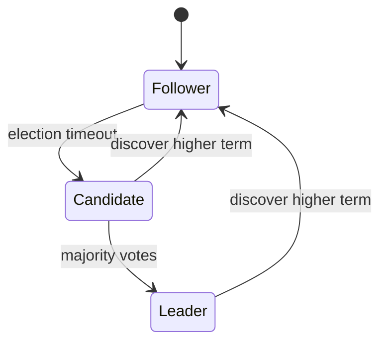

# D15-T011 — Leader election

Topic ID: `D15-T011`
Domain: Distributed Systems
Subdomain: Leader election
Importance: core
Complexity: advanced
Dependencies: `D15-T010`, `D15-T001`, `D03-T001`, `D03-T002`, `D04-T001`, `D04-T002`
Execution status of the code in section F: unexecuted

## A. Topic Overview

Leader election picks one coordinator among peers. Practical systems use timeouts, epochs, and votes (Raft, ZooKeeper ephemeral nodes). Election must tolerate split votes and ensure safety via majority.

## B. First-Principles Explanation

Election is liveness; fencing/epochs are safety during failover. Leader election picks one coordinator among peers. Practical systems use timeouts, epochs, and votes (Raft, ZooKeeper ephemeral nodes). Election must tolerate split votes and ensure safety via majority.

## C. Internal Working and Architecture

Campaign, vote, grant term, heartbeat to maintain leadership. Components interact through RPC, replication logs, and coordination services.

## D. Diagrams and Visual Models



Read the diagram as a causal flow from client action to stored or observed outcome, including failure branches.

## E. Examples and Analogies

etcd Raft election; old leader must step down on higher term.

## F. Code Examples

File: `examples/d15_t011_vote.py`

Dependencies: Python 3 standard library only.

```python
def grant_vote(candidate_term: int, my_term: int, voted: bool) -> bool:
    return candidate_term > my_term and not voted
```

The snippet models control flow you would embed in a service or test harness. It is not a production client library.

## G. Practical Backend Application

Run odd-sized voter sets; avoid manual 'force primary' without quorum.

## H. Advantages, Limitations and Trade-offs

| Choice | Benefit | Cost | Choose when | Avoid when |
| --- | --- | --- | --- | --- |
| Fast election | Quick failover | Flapping | Small clusters | JVM with long GC | | | | |

Under load, the cheap choice on paper becomes the choice that amplifies retries, stale reads, or operator toil. Measure p99 latency and error budgets, not only happy-path throughput.

## I. Common Mistakes and Misconceptions

- Two leaders after network heal without fencing.
- Election storms from too-low timeouts.

A weak interview answer names a buzzword without a failure story. A strong answer names what breaks, what users see, and what invariant you still enforce.

## J. Debugging and Troubleshooting

Graph terms over time; correlate with GC pauses.

## K. Interview Preparation
### Beginner
#### Q1. What is Leader election?

**Answer:** Leader election picks one coordinator among peers. Practical systems use timeouts, epochs, and votes (Raft, ZooKeeper ephemeral nodes). Election must tolerate split votes and ensure safety via majority. Interviewers want a precise definition tied to leader election safety and terms, not a slogan.
#### Q2. Why does Leader election matter in backends?

**Answer:** Leader election picks one coordinator among peers. Practical systems use timeouts, epochs, and votes (Raft, ZooKeeper ephemeral nodes). Election must tolerate split votes and ensure safety via majority. Production systems fail one hop at a time; users still expect coherent behavior.
#### Q3. Give a one-line example of leader election safety and terms.

**Answer:** Leader election picks one coordinator among peers. Practical systems use timeouts, epochs, and votes (Raft, ZooKeeper ephemeral nodes). Election must tolerate split votes and ensure safety via majority. Name a concrete multi-service flow where the issue appears.
#### Q4. Is Leader election about hardware or software policy?

**Answer:** Leader election picks one coordinator among peers. Practical systems use timeouts, epochs, and votes (Raft, ZooKeeper ephemeral nodes). Election must tolerate split votes and ensure safety via majority. Mostly policy and protocols on top of unreliable networks.
#### Q5. What is a common myth about Leader election?

**Answer:** Leader election picks one coordinator among peers. Practical systems use timeouts, epochs, and votes (Raft, ZooKeeper ephemeral nodes). Election must tolerate split votes and ensure safety via majority. Buzzword definitions that ignore partitions, retries, or consistency definitions.
### Intermediate
#### Q1. How do timeouts interact with leader election safety and terms?

**Answer:** Leader election picks one coordinator among peers. Practical systems use timeouts, epochs, and votes (Raft, ZooKeeper ephemeral nodes). Election must tolerate split votes and ensure safety via majority. Timeouts create unknown outcomes; retries amplify load unless idempotent.
#### Q2. How do replicas interact with leader election safety and terms?

**Answer:** Leader election picks one coordinator among peers. Practical systems use timeouts, epochs, and votes (Raft, ZooKeeper ephemeral nodes). Election must tolerate split votes and ensure safety via majority. Replication lag makes stale reads a normal case unless you pay for stronger reads.
#### Q3. How do idempotency keys help leader election safety and terms?

**Answer:** Leader election picks one coordinator among peers. Practical systems use timeouts, epochs, and votes (Raft, ZooKeeper ephemeral nodes). Election must tolerate split votes and ensure safety via majority. They make at-least-once delivery safe for business side effects.
#### Q4. What metrics expose leader election safety and terms?

**Answer:** Leader election picks one coordinator among peers. Practical systems use timeouts, epochs, and votes (Raft, ZooKeeper ephemeral nodes). Election must tolerate split votes and ensure safety via majority. Error rate by dependency, lag histograms, reconciliation queue depth.
#### Q5. How does Leader election relate to user-visible SLAs?

**Answer:** Leader election picks one coordinator among peers. Practical systems use timeouts, epochs, and votes (Raft, ZooKeeper ephemeral nodes). Election must tolerate split votes and ensure safety via majority. SLAs must state behavior during degradation, not only median latency.
### Advanced
#### Q1. How would you test leader election safety and terms?

**Answer:** Leader election picks one coordinator among peers. Practical systems use timeouts, epochs, and votes (Raft, ZooKeeper ephemeral nodes). Election must tolerate split votes and ensure safety via majority. Fault injection: delay, drop, partition links; assert invariants and recovery.
#### Q2. How does Leader election differ from a single-machine failure?

**Answer:** Leader election picks one coordinator among peers. Practical systems use timeouts, epochs, and votes (Raft, ZooKeeper ephemeral nodes). Election must tolerate split votes and ensure safety via majority. Partial failure leaves other paths alive, producing ambiguous global state.
#### Q3. What documentation should teams publish about Leader election?

**Answer:** Leader election picks one coordinator among peers. Practical systems use timeouts, epochs, and votes (Raft, ZooKeeper ephemeral nodes). Election must tolerate split votes and ensure safety via majority. Failure modes, consistency guarantees per endpoint, and runbooks for unknown outcomes.
#### Q4. When is strong consistency worth the latency for leader election safety and terms?

**Answer:** Leader election picks one coordinator among peers. Practical systems use timeouts, epochs, and votes (Raft, ZooKeeper ephemeral nodes). Election must tolerate split votes and ensure safety via majority. When invariants involve money, inventory, or safety; not for best-effort feeds.
#### Q5. How do circuit breakers relate to leader election safety and terms?

**Answer:** Leader election picks one coordinator among peers. Practical systems use timeouts, epochs, and votes (Raft, ZooKeeper ephemeral nodes). Election must tolerate split votes and ensure safety via majority. They stop retry storms but do not fix correctness; they protect capacity.
### Scenarios
#### Q1. Incident: errors spike after deploy touching Leader election. First checks?

**Answer:** Leader election picks one coordinator among peers. Practical systems use timeouts, epochs, and votes (Raft, ZooKeeper ephemeral nodes). Election must tolerate split votes and ensure safety via majority. Roll forward/rollback decision, feature flag, canary metrics, dependency health.
#### Q2. Incident: customers report inconsistent reads around leader election safety and terms. Diagnosis?

**Answer:** Leader election picks one coordinator among peers. Practical systems use timeouts, epochs, and votes (Raft, ZooKeeper ephemeral nodes). Election must tolerate split votes and ensure safety via majority. Check replica lag, routing, cache TTL, and read-your-writes settings.
#### Q3. Incident: reconciliation backlog grows for leader election safety and terms. Why?

**Answer:** Leader election picks one coordinator among peers. Practical systems use timeouts, epochs, and votes (Raft, ZooKeeper ephemeral nodes). Election must tolerate split votes and ensure safety via majority. Downstream was slow; retries duplicated work; missing idempotency.
#### Q4. Design review challenges your Leader election approach. What do you defend?

**Answer:** Leader election picks one coordinator among peers. Practical systems use timeouts, epochs, and votes (Raft, ZooKeeper ephemeral nodes). Election must tolerate split votes and ensure safety via majority. State invariants, failure model, and measured trade-offs with PACELC/CAP precision.
#### Q5. Finance audit questions leader election safety and terms after duplicate charges. Response?

**Answer:** Leader election picks one coordinator among peers. Practical systems use timeouts, epochs, and votes (Raft, ZooKeeper ephemeral nodes). Election must tolerate split votes and ensure safety via majority. Show idempotency keys, ledger reconciliation, and provider correlation IDs.
### Follow-ups
#### Q1. How does Leader election connect to `D15-T001`?

**Answer:** Leader election picks one coordinator among peers. Practical systems use timeouts, epochs, and votes (Raft, ZooKeeper ephemeral nodes). Election must tolerate split votes and ensure safety via majority. Fundamentals frame partial failure and message passing assumptions.
#### Q2. How does Leader election connect to databases (`D07-T012`)?

**Answer:** Leader election picks one coordinator among peers. Practical systems use timeouts, epochs, and votes (Raft, ZooKeeper ephemeral nodes). Election must tolerate split votes and ensure safety via majority. Transactions are local unless you add distributed protocols or sagas.
#### Q3. How does Leader election connect to messaging (`D14-T031`)?

**Answer:** Leader election picks one coordinator among peers. Practical systems use timeouts, epochs, and votes (Raft, ZooKeeper ephemeral nodes). Election must tolerate split votes and ensure safety via majority. Brokers provide at-least-once unless you engineer exactly-once effects.

## L. Practical Exercises

Solutions are in `EXERCISES/solutions/D15-T011.md`. Try these before opening that file.

### Exercise 1 — implementation

Implement grant_vote rules.

### Exercise 2 — debugging

Flapping leadership—causes?

### Exercise 3 — trade-off

Difference election vs distributed lock.

## M. Revision Notes

- Leader election
- Leader election picks one coordinator among peers.
- Measure lag, errors, and reconciliation—not only CPU.
- Document behavior during partition and during normal load.

Flashcards:

- What is Leader election? See focus paragraph in overview.
- Common mistake: Two leaders after network heal without fencing.

## N. Related Topics

Understand this before: `D15-T010`, `D15-T001`, `D03-T001`, `D03-T002`, `D04-T001`, `D04-T002`.

This topic supports: `D15-T014`, `D15-T027`.

Often confused with: `D15-T010`, `D15-T015`.

Interviewers combine this with replication (`D15-T009`), partial failure (`D15-T002`), and API idempotency (`D06-T011`).

## O. Completion Criteria

- Define Leader election without buzzwords.
- Draw the mermaid model for D15-T011.
- Explain one mistake and its safer alternative.
