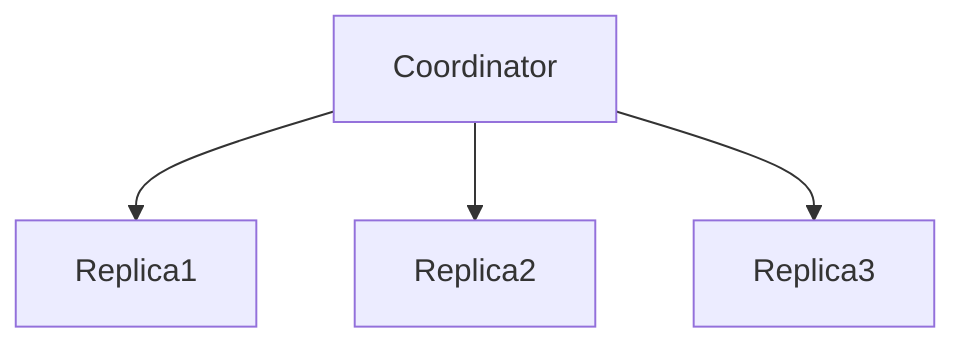

# D15-T012 — Quorum reads and writes

Topic ID: `D15-T012`
Domain: Distributed Systems
Subdomain: Quorum reads and writes
Importance: core
Complexity: advanced
Dependencies: `D15-T011`, `D15-T001`, `D03-T001`, `D03-T002`, `D04-T001`, `D04-T002`
Execution status of the code in section F: unexecuted

## A. Topic Overview

Quorum systems use N replicas with write quorum W and read quorum R. If W + R > N, intersecting quorums overlap so a read sees latest write (classic Dynamo-style argument for versioned values). Sloppy quorums and hinted handoff relax strict quorums for availability. Tunable R/W trades latency versus staleness.

## B. First-Principles Explanation

Use version vectors or timestamps to resolve concurrent writes; quorum does not erase conflicts in multi-writer models. Quorum systems use N replicas with write quorum W and read quorum R. If W + R > N, intersecting quorums overlap so a read sees latest write (classic Dynamo-style argument for versioned values). Sloppy quorums and hinted handoff relax strict quorums for availability. Tunable R/W trades latency versus staleness.

## C. Internal Working and Architecture

Coordinator sends parallel requests; wait for W or R acks. Components interact through RPC, replication logs, and coordination services.

## D. Diagrams and Visual Models



Read the diagram as a causal flow from client action to stored or observed outcome, including failure branches.

## E. Examples and Analogies

Cassandra ONE/QUORUM/ALL; W=2,R=2,N=3 strong for single writer per key if coordinated.

## F. Code Examples

File: `examples/d15_t012_quorum.py`

Dependencies: Python 3 standard library only.

```python
def strong_intersection(n: int, w: int, r: int) -> bool:
    return w + r > n
```

The snippet models control flow you would embed in a service or test harness. It is not a production client library.

## G. Practical Backend Application

Pick W/R per operation; document allowed staleness for reads at ONE.

## H. Advantages, Limitations and Trade-offs

| Choice | Benefit | Cost | Choose when | Avoid when |
| --- | --- | --- | --- | --- |
| W=1 | Fast writes | Weak | Counters | Financial ledger | | | | |

Under load, the cheap choice on paper becomes the choice that amplifies retries, stale reads, or operator toil. Measure p99 latency and error budgets, not only happy-path throughput.

## I. Common Mistakes and Misconceptions

- Assuming quorum without version merge handles all conflicts.
- W+R≤N and expecting strong reads.

A weak interview answer names a buzzword without a failure story. A strong answer names what breaks, what users see, and what invariant you still enforce.

## J. Debugging and Troubleshooting

Check per-replica versions on divergent read results.

## K. Interview Preparation
### Beginner
#### Q1. What is Quorum reads and writes?

**Answer:** Quorum systems use N replicas with write quorum W and read quorum R. If W + R > N, intersecting quorums overlap so a read sees latest write (classic Dynamo-style argument for versioned values). Sloppy quorums and hinted handoff relax strict quorums for availability. Tunable R/W trades latency versus staleness. Interviewers want a precise definition tied to quorum W+R>N, not a slogan.
#### Q2. Why does Quorum reads and writes matter in backends?

**Answer:** Quorum systems use N replicas with write quorum W and read quorum R. If W + R > N, intersecting quorums overlap so a read sees latest write (classic Dynamo-style argument for versioned values). Sloppy quorums and hinted handoff relax strict quorums for availability. Tunable R/W trades latency versus staleness. Production systems fail one hop at a time; users still expect coherent behavior.
#### Q3. Give a one-line example of quorum W+R>N.

**Answer:** Quorum systems use N replicas with write quorum W and read quorum R. If W + R > N, intersecting quorums overlap so a read sees latest write (classic Dynamo-style argument for versioned values). Sloppy quorums and hinted handoff relax strict quorums for availability. Tunable R/W trades latency versus staleness. Name a concrete multi-service flow where the issue appears.
#### Q4. Is Quorum reads and writes about hardware or software policy?

**Answer:** Quorum systems use N replicas with write quorum W and read quorum R. If W + R > N, intersecting quorums overlap so a read sees latest write (classic Dynamo-style argument for versioned values). Sloppy quorums and hinted handoff relax strict quorums for availability. Tunable R/W trades latency versus staleness. Mostly policy and protocols on top of unreliable networks.
#### Q5. What is a common myth about Quorum reads and writes?

**Answer:** Quorum systems use N replicas with write quorum W and read quorum R. If W + R > N, intersecting quorums overlap so a read sees latest write (classic Dynamo-style argument for versioned values). Sloppy quorums and hinted handoff relax strict quorums for availability. Tunable R/W trades latency versus staleness. Buzzword definitions that ignore partitions, retries, or consistency definitions.
### Intermediate
#### Q1. How do timeouts interact with quorum W+R>N?

**Answer:** Quorum systems use N replicas with write quorum W and read quorum R. If W + R > N, intersecting quorums overlap so a read sees latest write (classic Dynamo-style argument for versioned values). Sloppy quorums and hinted handoff relax strict quorums for availability. Tunable R/W trades latency versus staleness. Timeouts create unknown outcomes; retries amplify load unless idempotent.
#### Q2. How do replicas interact with quorum W+R>N?

**Answer:** Quorum systems use N replicas with write quorum W and read quorum R. If W + R > N, intersecting quorums overlap so a read sees latest write (classic Dynamo-style argument for versioned values). Sloppy quorums and hinted handoff relax strict quorums for availability. Tunable R/W trades latency versus staleness. Replication lag makes stale reads a normal case unless you pay for stronger reads.
#### Q3. How do idempotency keys help quorum W+R>N?

**Answer:** Quorum systems use N replicas with write quorum W and read quorum R. If W + R > N, intersecting quorums overlap so a read sees latest write (classic Dynamo-style argument for versioned values). Sloppy quorums and hinted handoff relax strict quorums for availability. Tunable R/W trades latency versus staleness. They make at-least-once delivery safe for business side effects.
#### Q4. What metrics expose quorum W+R>N?

**Answer:** Quorum systems use N replicas with write quorum W and read quorum R. If W + R > N, intersecting quorums overlap so a read sees latest write (classic Dynamo-style argument for versioned values). Sloppy quorums and hinted handoff relax strict quorums for availability. Tunable R/W trades latency versus staleness. Error rate by dependency, lag histograms, reconciliation queue depth.
#### Q5. How does Quorum reads and writes relate to user-visible SLAs?

**Answer:** Quorum systems use N replicas with write quorum W and read quorum R. If W + R > N, intersecting quorums overlap so a read sees latest write (classic Dynamo-style argument for versioned values). Sloppy quorums and hinted handoff relax strict quorums for availability. Tunable R/W trades latency versus staleness. SLAs must state behavior during degradation, not only median latency.
### Advanced
#### Q1. How would you test quorum W+R>N?

**Answer:** Quorum systems use N replicas with write quorum W and read quorum R. If W + R > N, intersecting quorums overlap so a read sees latest write (classic Dynamo-style argument for versioned values). Sloppy quorums and hinted handoff relax strict quorums for availability. Tunable R/W trades latency versus staleness. Fault injection: delay, drop, partition links; assert invariants and recovery.
#### Q2. How does Quorum reads and writes differ from a single-machine failure?

**Answer:** Quorum systems use N replicas with write quorum W and read quorum R. If W + R > N, intersecting quorums overlap so a read sees latest write (classic Dynamo-style argument for versioned values). Sloppy quorums and hinted handoff relax strict quorums for availability. Tunable R/W trades latency versus staleness. Partial failure leaves other paths alive, producing ambiguous global state.
#### Q3. What documentation should teams publish about Quorum reads and writes?

**Answer:** Quorum systems use N replicas with write quorum W and read quorum R. If W + R > N, intersecting quorums overlap so a read sees latest write (classic Dynamo-style argument for versioned values). Sloppy quorums and hinted handoff relax strict quorums for availability. Tunable R/W trades latency versus staleness. Failure modes, consistency guarantees per endpoint, and runbooks for unknown outcomes.
#### Q4. When is strong consistency worth the latency for quorum W+R>N?

**Answer:** Quorum systems use N replicas with write quorum W and read quorum R. If W + R > N, intersecting quorums overlap so a read sees latest write (classic Dynamo-style argument for versioned values). Sloppy quorums and hinted handoff relax strict quorums for availability. Tunable R/W trades latency versus staleness. When invariants involve money, inventory, or safety; not for best-effort feeds.
#### Q5. How do circuit breakers relate to quorum W+R>N?

**Answer:** Quorum systems use N replicas with write quorum W and read quorum R. If W + R > N, intersecting quorums overlap so a read sees latest write (classic Dynamo-style argument for versioned values). Sloppy quorums and hinted handoff relax strict quorums for availability. Tunable R/W trades latency versus staleness. They stop retry storms but do not fix correctness; they protect capacity.
### Scenarios
#### Q1. Incident: errors spike after deploy touching Quorum reads and writes. First checks?

**Answer:** Quorum systems use N replicas with write quorum W and read quorum R. If W + R > N, intersecting quorums overlap so a read sees latest write (classic Dynamo-style argument for versioned values). Sloppy quorums and hinted handoff relax strict quorums for availability. Tunable R/W trades latency versus staleness. Roll forward/rollback decision, feature flag, canary metrics, dependency health.
#### Q2. Incident: customers report inconsistent reads around quorum W+R>N. Diagnosis?

**Answer:** Quorum systems use N replicas with write quorum W and read quorum R. If W + R > N, intersecting quorums overlap so a read sees latest write (classic Dynamo-style argument for versioned values). Sloppy quorums and hinted handoff relax strict quorums for availability. Tunable R/W trades latency versus staleness. Check replica lag, routing, cache TTL, and read-your-writes settings.
#### Q3. Incident: reconciliation backlog grows for quorum W+R>N. Why?

**Answer:** Quorum systems use N replicas with write quorum W and read quorum R. If W + R > N, intersecting quorums overlap so a read sees latest write (classic Dynamo-style argument for versioned values). Sloppy quorums and hinted handoff relax strict quorums for availability. Tunable R/W trades latency versus staleness. Downstream was slow; retries duplicated work; missing idempotency.
#### Q4. Design review challenges your Quorum reads and writes approach. What do you defend?

**Answer:** Quorum systems use N replicas with write quorum W and read quorum R. If W + R > N, intersecting quorums overlap so a read sees latest write (classic Dynamo-style argument for versioned values). Sloppy quorums and hinted handoff relax strict quorums for availability. Tunable R/W trades latency versus staleness. State invariants, failure model, and measured trade-offs with PACELC/CAP precision.
#### Q5. Finance audit questions quorum W+R>N after duplicate charges. Response?

**Answer:** Quorum systems use N replicas with write quorum W and read quorum R. If W + R > N, intersecting quorums overlap so a read sees latest write (classic Dynamo-style argument for versioned values). Sloppy quorums and hinted handoff relax strict quorums for availability. Tunable R/W trades latency versus staleness. Show idempotency keys, ledger reconciliation, and provider correlation IDs.
### Follow-ups
#### Q1. How does Quorum reads and writes connect to `D15-T001`?

**Answer:** Quorum systems use N replicas with write quorum W and read quorum R. If W + R > N, intersecting quorums overlap so a read sees latest write (classic Dynamo-style argument for versioned values). Sloppy quorums and hinted handoff relax strict quorums for availability. Tunable R/W trades latency versus staleness. Fundamentals frame partial failure and message passing assumptions.
#### Q2. How does Quorum reads and writes connect to databases (`D07-T012`)?

**Answer:** Quorum systems use N replicas with write quorum W and read quorum R. If W + R > N, intersecting quorums overlap so a read sees latest write (classic Dynamo-style argument for versioned values). Sloppy quorums and hinted handoff relax strict quorums for availability. Tunable R/W trades latency versus staleness. Transactions are local unless you add distributed protocols or sagas.
#### Q3. How does Quorum reads and writes connect to messaging (`D14-T031`)?

**Answer:** Quorum systems use N replicas with write quorum W and read quorum R. If W + R > N, intersecting quorums overlap so a read sees latest write (classic Dynamo-style argument for versioned values). Sloppy quorums and hinted handoff relax strict quorums for availability. Tunable R/W trades latency versus staleness. Brokers provide at-least-once unless you engineer exactly-once effects.

## L. Practical Exercises

Solutions are in `EXERCISES/solutions/D15-T012.md`. Try these before opening that file.

### Exercise 1 — implementation

Given N=5, find W,R for strong intersection.

### Exercise 2 — debugging

Read returns two versions—next step?

### Exercise 3 — trade-off

When is sloppy quorum acceptable?

## M. Revision Notes

- Quorum reads and writes
- Quorum systems use N replicas with write quorum W and read quorum R.
- Measure lag, errors, and reconciliation—not only CPU.
- Document behavior during partition and during normal load.

Flashcards:

- What is Quorum reads and writes? See focus paragraph in overview.
- Common mistake: Assuming quorum without version merge handles all conflicts.

## N. Related Topics

Understand this before: `D15-T011`, `D15-T001`, `D03-T001`, `D03-T002`, `D04-T001`, `D04-T002`.

This topic supports: `D15-T009`, `D15-T007`.

Often confused with: `D15-T010`, `D15-T004`.

Interviewers combine this with replication (`D15-T009`), partial failure (`D15-T002`), and API idempotency (`D06-T011`).

## O. Completion Criteria

- Define Quorum reads and writes without buzzwords.
- Draw the mermaid model for D15-T012.
- Explain one mistake and its safer alternative.
