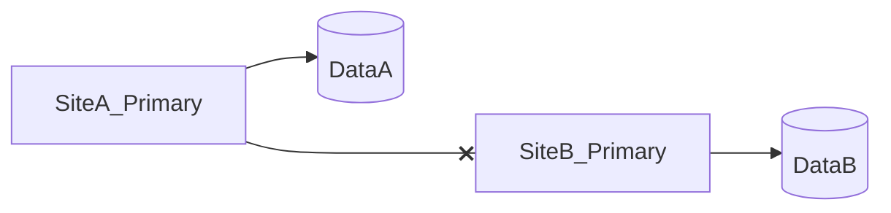

# D15-T013 — Split-brain scenarios

Topic ID: `D15-T013`
Domain: Distributed Systems
Subdomain: Split-brain scenarios
Importance: core
Complexity: advanced
Dependencies: `D15-T012`, `D15-T001`, `D03-T001`, `D03-T002`, `D04-T001`, `D04-T002`
Execution status of the code in section F: unexecuted

## A. Topic Overview

Split-brain is two or more nodes believing they are the active writer, causing divergent data. It follows partitions plus misconfigured failover or lack of fencing.

## B. First-Principles Explanation

Prevention beats cure: quorum, STONITH/fencing, shared witness, or external coordinator. Split-brain is two or more nodes believing they are the active writer, causing divergent data. It follows partitions plus misconfigured failover or lack of fencing.

## C. Internal Working and Architecture

Epoch numbers on storage; reject writes from old epoch. Components interact through RPC, replication logs, and coordination services.

## D. Diagrams and Visual Models



Read the diagram as a causal flow from client action to stored or observed outcome, including failure branches.

## E. Examples and Analogies

DR drill promotes secondary while primary alive.

## F. Code Examples

File: `examples/d15_t013_epoch.py`

Dependencies: Python 3 standard library only.

```python
def allow_write(epoch: int, current_epoch: int) -> bool:
    return epoch == current_epoch
```

The snippet models control flow you would embed in a service or test harness. It is not a production client library.

## G. Practical Backend Application

Automate failover with quorum; ban manual dual-primary.

## H. Advantages, Limitations and Trade-offs

| Choice | Benefit | Cost | Choose when | Avoid when |
| --- | --- | --- | --- | --- |
| Manual failover | Human judgment | Human error | Tiny teams | Regulated HA | | | | |

Under load, the cheap choice on paper becomes the choice that amplifies retries, stale reads, or operator toil. Measure p99 latency and error budgets, not only happy-path throughput.

## I. Common Mistakes and Misconceptions

- DNS flip without data reconciliation.
- Ignoring object store fencing.

A weak interview answer names a buzzword without a failure story. A strong answer names what breaks, what users see, and what invariant you still enforce.

## J. Debugging and Troubleshooting

Compare write epochs and binlog positions both sides.

## K. Interview Preparation
### Beginner
#### Q1. What is Split-brain scenarios?

**Answer:** Split-brain is two or more nodes believing they are the active writer, causing divergent data. It follows partitions plus misconfigured failover or lack of fencing. Interviewers want a precise definition tied to split-brain divergence, not a slogan. In production, the failure mode matters more than the slogan: measure timeouts, error budgets, and client-visible symptoms before you rename the problem.
#### Q2. Why does Split-brain scenarios matter in backends?

**Answer:** Split-brain is two or more nodes believing they are the active writer, causing divergent data. It follows partitions plus misconfigured failover or lack of fencing. Production systems fail one hop at a time; users still expect coherent behavior. In production, the failure mode matters more than the slogan: measure timeouts, error budgets, and client-visible symptoms before you rename the problem.
#### Q3. Give a one-line example of split-brain divergence.

**Answer:** Split-brain is two or more nodes believing they are the active writer, causing divergent data. It follows partitions plus misconfigured failover or lack of fencing. Name a concrete multi-service flow where the issue appears. In production, the failure mode matters more than the slogan: measure timeouts, error budgets, and client-visible symptoms before you rename the problem.
#### Q4. Is Split-brain scenarios about hardware or software policy?

**Answer:** Split-brain is two or more nodes believing they are the active writer, causing divergent data. It follows partitions plus misconfigured failover or lack of fencing. Mostly policy and protocols on top of unreliable networks. In production, the failure mode matters more than the slogan: measure timeouts, error budgets, and client-visible symptoms before you rename the problem.
#### Q5. What is a common myth about Split-brain scenarios?

**Answer:** Split-brain is two or more nodes believing they are the active writer, causing divergent data. It follows partitions plus misconfigured failover or lack of fencing. Buzzword definitions that ignore partitions, retries, or consistency definitions. In production, the failure mode matters more than the slogan: measure timeouts, error budgets, and client-visible symptoms before you rename the problem.
### Intermediate
#### Q1. How do timeouts interact with split-brain divergence?

**Answer:** Split-brain is two or more nodes believing they are the active writer, causing divergent data. It follows partitions plus misconfigured failover or lack of fencing. Timeouts create unknown outcomes; retries amplify load unless idempotent. In production, the failure mode matters more than the slogan: measure timeouts, error budgets, and client-visible symptoms before you rename the problem.
#### Q2. How do replicas interact with split-brain divergence?

**Answer:** Split-brain is two or more nodes believing they are the active writer, causing divergent data. It follows partitions plus misconfigured failover or lack of fencing. Replication lag makes stale reads a normal case unless you pay for stronger reads. In production, the failure mode matters more than the slogan: measure timeouts, error budgets, and client-visible symptoms before you rename the problem.
#### Q3. How do idempotency keys help split-brain divergence?

**Answer:** Split-brain is two or more nodes believing they are the active writer, causing divergent data. It follows partitions plus misconfigured failover or lack of fencing. They make at-least-once delivery safe for business side effects. In production, the failure mode matters more than the slogan: measure timeouts, error budgets, and client-visible symptoms before you rename the problem.
#### Q4. What metrics expose split-brain divergence?

**Answer:** Split-brain is two or more nodes believing they are the active writer, causing divergent data. It follows partitions plus misconfigured failover or lack of fencing. Error rate by dependency, lag histograms, reconciliation queue depth. In production, the failure mode matters more than the slogan: measure timeouts, error budgets, and client-visible symptoms before you rename the problem.
#### Q5. How does Split-brain scenarios relate to user-visible SLAs?

**Answer:** Split-brain is two or more nodes believing they are the active writer, causing divergent data. It follows partitions plus misconfigured failover or lack of fencing. SLAs must state behavior during degradation, not only median latency. In production, the failure mode matters more than the slogan: measure timeouts, error budgets, and client-visible symptoms before you rename the problem.
### Advanced
#### Q1. How would you test split-brain divergence?

**Answer:** Split-brain is two or more nodes believing they are the active writer, causing divergent data. It follows partitions plus misconfigured failover or lack of fencing. Fault injection: delay, drop, partition links; assert invariants and recovery. In production, the failure mode matters more than the slogan: measure timeouts, error budgets, and client-visible symptoms before you rename the problem.
#### Q2. How does Split-brain scenarios differ from a single-machine failure?

**Answer:** Split-brain is two or more nodes believing they are the active writer, causing divergent data. It follows partitions plus misconfigured failover or lack of fencing. Partial failure leaves other paths alive, producing ambiguous global state. In production, the failure mode matters more than the slogan: measure timeouts, error budgets, and client-visible symptoms before you rename the problem.
#### Q3. What documentation should teams publish about Split-brain scenarios?

**Answer:** Split-brain is two or more nodes believing they are the active writer, causing divergent data. It follows partitions plus misconfigured failover or lack of fencing. Failure modes, consistency guarantees per endpoint, and runbooks for unknown outcomes. In production, the failure mode matters more than the slogan: measure timeouts, error budgets, and client-visible symptoms before you rename the problem.
#### Q4. When is strong consistency worth the latency for split-brain divergence?

**Answer:** Split-brain is two or more nodes believing they are the active writer, causing divergent data. It follows partitions plus misconfigured failover or lack of fencing. When invariants involve money, inventory, or safety; not for best-effort feeds. In production, the failure mode matters more than the slogan: measure timeouts, error budgets, and client-visible symptoms before you rename the problem.
#### Q5. How do circuit breakers relate to split-brain divergence?

**Answer:** Split-brain is two or more nodes believing they are the active writer, causing divergent data. It follows partitions plus misconfigured failover or lack of fencing. They stop retry storms but do not fix correctness; they protect capacity. In production, the failure mode matters more than the slogan: measure timeouts, error budgets, and client-visible symptoms before you rename the problem.
### Scenarios
#### Q1. Incident: errors spike after deploy touching Split-brain scenarios. First checks?

**Answer:** Split-brain is two or more nodes believing they are the active writer, causing divergent data. It follows partitions plus misconfigured failover or lack of fencing. Roll forward/rollback decision, feature flag, canary metrics, dependency health. In production, the failure mode matters more than the slogan: measure timeouts, error budgets, and client-visible symptoms before you rename the problem.
#### Q2. Incident: customers report inconsistent reads around split-brain divergence. Diagnosis?

**Answer:** Split-brain is two or more nodes believing they are the active writer, causing divergent data. It follows partitions plus misconfigured failover or lack of fencing. Check replica lag, routing, cache TTL, and read-your-writes settings. In production, the failure mode matters more than the slogan: measure timeouts, error budgets, and client-visible symptoms before you rename the problem.
#### Q3. Incident: reconciliation backlog grows for split-brain divergence. Why?

**Answer:** Split-brain is two or more nodes believing they are the active writer, causing divergent data. It follows partitions plus misconfigured failover or lack of fencing. Downstream was slow; retries duplicated work; missing idempotency. In production, the failure mode matters more than the slogan: measure timeouts, error budgets, and client-visible symptoms before you rename the problem.
#### Q4. Design review challenges your Split-brain scenarios approach. What do you defend?

**Answer:** Split-brain is two or more nodes believing they are the active writer, causing divergent data. It follows partitions plus misconfigured failover or lack of fencing. State invariants, failure model, and measured trade-offs with PACELC/CAP precision. In production, the failure mode matters more than the slogan: measure timeouts, error budgets, and client-visible symptoms before you rename the problem.
#### Q5. Finance audit questions split-brain divergence after duplicate charges. Response?

**Answer:** Split-brain is two or more nodes believing they are the active writer, causing divergent data. It follows partitions plus misconfigured failover or lack of fencing. Show idempotency keys, ledger reconciliation, and provider correlation IDs. In production, the failure mode matters more than the slogan: measure timeouts, error budgets, and client-visible symptoms before you rename the problem.
### Follow-ups
#### Q1. How does Split-brain scenarios connect to `D15-T001`?

**Answer:** Split-brain is two or more nodes believing they are the active writer, causing divergent data. It follows partitions plus misconfigured failover or lack of fencing. Fundamentals frame partial failure and message passing assumptions. In production, the failure mode matters more than the slogan: measure timeouts, error budgets, and client-visible symptoms before you rename the problem.
#### Q2. How does Split-brain scenarios connect to databases (`D07-T012`)?

**Answer:** Split-brain is two or more nodes believing they are the active writer, causing divergent data. It follows partitions plus misconfigured failover or lack of fencing. Transactions are local unless you add distributed protocols or sagas. In production, the failure mode matters more than the slogan: measure timeouts, error budgets, and client-visible symptoms before you rename the problem.
#### Q3. How does Split-brain scenarios connect to messaging (`D14-T031`)?

**Answer:** Split-brain is two or more nodes believing they are the active writer, causing divergent data. It follows partitions plus misconfigured failover or lack of fencing. Brokers provide at-least-once unless you engineer exactly-once effects. In production, the failure mode matters more than the slogan: measure timeouts, error budgets, and client-visible symptoms before you rename the problem.

## L. Practical Exercises

Solutions are in `EXERCISES/solutions/D15-T013.md`. Try these before opening that file.

### Exercise 1 — implementation

Implement epoch gate.

### Exercise 2 — debugging

Two primaries after partition—merge strategy?

### Exercise 3 — trade-off

Witness node role in 2-node DC pair.

## M. Revision Notes

- Split-brain scenarios
- Split-brain is two or more nodes believing they are the active writer, causing divergent data.
- Measure lag, errors, and reconciliation—not only CPU.
- Document behavior during partition and during normal load.

Flashcards:

- What is Split-brain scenarios? See focus paragraph in overview.
- Common mistake: DNS flip without data reconciliation.

## N. Related Topics

Understand this before: `D15-T012`, `D15-T001`, `D03-T001`, `D03-T002`, `D04-T001`, `D04-T002`.

This topic supports: `D15-T033`, `D15-T003`.

Often confused with: `D15-T003`, `D15-T011`.

Interviewers combine this with replication (`D15-T009`), partial failure (`D15-T002`), and API idempotency (`D06-T011`).

## O. Completion Criteria

- Define Split-brain scenarios without buzzwords.
- Draw the mermaid model for D15-T013.
- Explain one mistake and its safer alternative.
