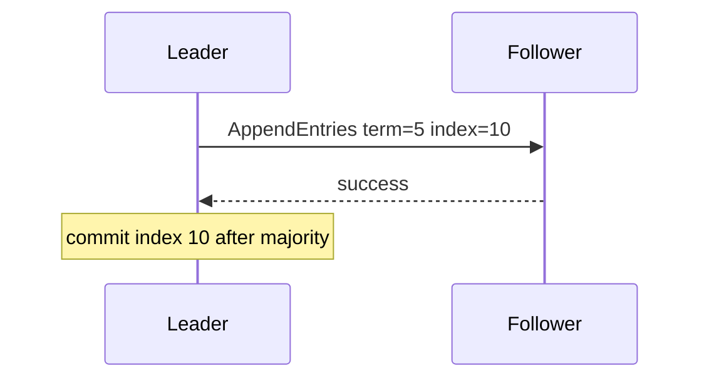

# D15-T014 — Consensus: Raft and Paxos concepts

Topic ID: `D15-T014`
Domain: Distributed Systems
Subdomain: Consensus: Raft and Paxos concepts
Importance: advanced
Complexity: advanced
Dependencies: `D15-T013`, `D15-T001`, `D03-T001`, `D03-T002`, `D04-T001`, `D04-T002`
Execution status of the code in section F: unexecuted

## A. Topic Overview

Consensus agrees on a single ordered log of values despite failures. Paxos is the classic family of protocols; Raft decomposes leader election, log replication, and safety with terms. At concept level: a leader appends entries; followers replicate; commits advance when majority persist. Raft ensures safety (no two leaders in same term) and eventual consistency of logs under partial connectivity.

## B. First-Principles Explanation

Consensus is for coordination metadata and replicated state machines, not a substitute for application sagas across heterogeneous DBs. Consensus agrees on a single ordered log of values despite failures. Paxos is the classic family of protocols; Raft decomposes leader election, log replication, and safety with terms. At concept level: a leader appends entries; followers replicate; commits advance when majority persist. Raft ensures safety (no two leaders in same term) and eventual consistency of logs under partial connectivity.

## C. Internal Working and Architecture

State machine apply at same index; snapshot + log compaction. Components interact through RPC, replication logs, and coordination services.

## D. Diagrams and Visual Models



Read the diagram as a causal flow from client action to stored or observed outcome, including failure branches.

## E. Examples and Analogies

etcd/consul use Raft; Spanner uses Paxos variants at scale.

## F. Code Examples

File: `examples/d15_t014_commit.py`

Dependencies: Python 3 standard library only.

```python
def committed(acks: int, cluster_size: int) -> bool:
    return acks * 2 > cluster_size
```

The snippet models control flow you would embed in a service or test harness. It is not a production client library.

## G. Practical Backend Application

Use off-the-shelf consensus for locks/config; avoid homegrown Raft.

## H. Advantages, Limitations and Trade-offs

| Choice | Benefit | Cost | Choose when | Avoid when |
| --- | --- | --- | --- | --- |
| Embedded Raft | Strong metadata | Ops complexity | Coordination | Simple CRUD app | | | | |

Under load, the cheap choice on paper becomes the choice that amplifies retries, stale reads, or operator toil. Measure p99 latency and error budgets, not only happy-path throughput.

## I. Common Mistakes and Misconceptions

- Claiming Raft gives cross-service transactions.
- Ignoring leader election on membership change.

A weak interview answer names a buzzword without a failure story. A strong answer names what breaks, what users see, and what invariant you still enforce.

## J. Debugging and Troubleshooting

Dump raft log indices, term, commitIndex on incidents.

## K. Interview Preparation
### Beginner
#### Q1. What is Consensus: Raft and Paxos concepts?

**Answer:** Consensus agrees on a single ordered log of values despite failures. Paxos is the classic family of protocols; Raft decomposes leader election, log replication, and safety with terms. At concept level: a leader appends entries; followers replicate; commits advance when majority persist. Raft ensures safety (no two leaders in same term) and eventual consistency of logs under partial connectivity. Interviewers want a precise definition tied to Raft log replication at concept level, not a slogan.
#### Q2. Why does Consensus: Raft and Paxos concepts matter in backends?

**Answer:** Consensus agrees on a single ordered log of values despite failures. Paxos is the classic family of protocols; Raft decomposes leader election, log replication, and safety with terms. At concept level: a leader appends entries; followers replicate; commits advance when majority persist. Raft ensures safety (no two leaders in same term) and eventual consistency of logs under partial connectivity. Production systems fail one hop at a time; users still expect coherent behavior.
#### Q3. Give a one-line example of Raft log replication at concept level.

**Answer:** Consensus agrees on a single ordered log of values despite failures. Paxos is the classic family of protocols; Raft decomposes leader election, log replication, and safety with terms. At concept level: a leader appends entries; followers replicate; commits advance when majority persist. Raft ensures safety (no two leaders in same term) and eventual consistency of logs under partial connectivity. Name a concrete multi-service flow where the issue appears.
#### Q4. Is Consensus: Raft and Paxos concepts about hardware or software policy?

**Answer:** Consensus agrees on a single ordered log of values despite failures. Paxos is the classic family of protocols; Raft decomposes leader election, log replication, and safety with terms. At concept level: a leader appends entries; followers replicate; commits advance when majority persist. Raft ensures safety (no two leaders in same term) and eventual consistency of logs under partial connectivity. Mostly policy and protocols on top of unreliable networks.
#### Q5. What is a common myth about Consensus: Raft and Paxos concepts?

**Answer:** Consensus agrees on a single ordered log of values despite failures. Paxos is the classic family of protocols; Raft decomposes leader election, log replication, and safety with terms. At concept level: a leader appends entries; followers replicate; commits advance when majority persist. Raft ensures safety (no two leaders in same term) and eventual consistency of logs under partial connectivity. Buzzword definitions that ignore partitions, retries, or consistency definitions.
### Intermediate
#### Q1. How do timeouts interact with Raft log replication at concept level?

**Answer:** Consensus agrees on a single ordered log of values despite failures. Paxos is the classic family of protocols; Raft decomposes leader election, log replication, and safety with terms. At concept level: a leader appends entries; followers replicate; commits advance when majority persist. Raft ensures safety (no two leaders in same term) and eventual consistency of logs under partial connectivity. Timeouts create unknown outcomes; retries amplify load unless idempotent.
#### Q2. How do replicas interact with Raft log replication at concept level?

**Answer:** Consensus agrees on a single ordered log of values despite failures. Paxos is the classic family of protocols; Raft decomposes leader election, log replication, and safety with terms. At concept level: a leader appends entries; followers replicate; commits advance when majority persist. Raft ensures safety (no two leaders in same term) and eventual consistency of logs under partial connectivity. Replication lag makes stale reads a normal case unless you pay for stronger reads.
#### Q3. How do idempotency keys help Raft log replication at concept level?

**Answer:** Consensus agrees on a single ordered log of values despite failures. Paxos is the classic family of protocols; Raft decomposes leader election, log replication, and safety with terms. At concept level: a leader appends entries; followers replicate; commits advance when majority persist. Raft ensures safety (no two leaders in same term) and eventual consistency of logs under partial connectivity. They make at-least-once delivery safe for business side effects.
#### Q4. What metrics expose Raft log replication at concept level?

**Answer:** Consensus agrees on a single ordered log of values despite failures. Paxos is the classic family of protocols; Raft decomposes leader election, log replication, and safety with terms. At concept level: a leader appends entries; followers replicate; commits advance when majority persist. Raft ensures safety (no two leaders in same term) and eventual consistency of logs under partial connectivity. Error rate by dependency, lag histograms, reconciliation queue depth.
#### Q5. How does Consensus: Raft and Paxos concepts relate to user-visible SLAs?

**Answer:** Consensus agrees on a single ordered log of values despite failures. Paxos is the classic family of protocols; Raft decomposes leader election, log replication, and safety with terms. At concept level: a leader appends entries; followers replicate; commits advance when majority persist. Raft ensures safety (no two leaders in same term) and eventual consistency of logs under partial connectivity. SLAs must state behavior during degradation, not only median latency.
### Advanced
#### Q1. How would you test Raft log replication at concept level?

**Answer:** Consensus agrees on a single ordered log of values despite failures. Paxos is the classic family of protocols; Raft decomposes leader election, log replication, and safety with terms. At concept level: a leader appends entries; followers replicate; commits advance when majority persist. Raft ensures safety (no two leaders in same term) and eventual consistency of logs under partial connectivity. Fault injection: delay, drop, partition links; assert invariants and recovery.
#### Q2. How does Consensus: Raft and Paxos concepts differ from a single-machine failure?

**Answer:** Consensus agrees on a single ordered log of values despite failures. Paxos is the classic family of protocols; Raft decomposes leader election, log replication, and safety with terms. At concept level: a leader appends entries; followers replicate; commits advance when majority persist. Raft ensures safety (no two leaders in same term) and eventual consistency of logs under partial connectivity. Partial failure leaves other paths alive, producing ambiguous global state.
#### Q3. What documentation should teams publish about Consensus: Raft and Paxos concepts?

**Answer:** Consensus agrees on a single ordered log of values despite failures. Paxos is the classic family of protocols; Raft decomposes leader election, log replication, and safety with terms. At concept level: a leader appends entries; followers replicate; commits advance when majority persist. Raft ensures safety (no two leaders in same term) and eventual consistency of logs under partial connectivity. Failure modes, consistency guarantees per endpoint, and runbooks for unknown outcomes.
#### Q4. When is strong consistency worth the latency for Raft log replication at concept level?

**Answer:** Consensus agrees on a single ordered log of values despite failures. Paxos is the classic family of protocols; Raft decomposes leader election, log replication, and safety with terms. At concept level: a leader appends entries; followers replicate; commits advance when majority persist. Raft ensures safety (no two leaders in same term) and eventual consistency of logs under partial connectivity. When invariants involve money, inventory, or safety; not for best-effort feeds.
#### Q5. How do circuit breakers relate to Raft log replication at concept level?

**Answer:** Consensus agrees on a single ordered log of values despite failures. Paxos is the classic family of protocols; Raft decomposes leader election, log replication, and safety with terms. At concept level: a leader appends entries; followers replicate; commits advance when majority persist. Raft ensures safety (no two leaders in same term) and eventual consistency of logs under partial connectivity. They stop retry storms but do not fix correctness; they protect capacity.
### Scenarios
#### Q1. Incident: errors spike after deploy touching Consensus: Raft and Paxos concepts. First checks?

**Answer:** Consensus agrees on a single ordered log of values despite failures. Paxos is the classic family of protocols; Raft decomposes leader election, log replication, and safety with terms. At concept level: a leader appends entries; followers replicate; commits advance when majority persist. Raft ensures safety (no two leaders in same term) and eventual consistency of logs under partial connectivity. Roll forward/rollback decision, feature flag, canary metrics, dependency health.
#### Q2. Incident: customers report inconsistent reads around Raft log replication at concept level. Diagnosis?

**Answer:** Consensus agrees on a single ordered log of values despite failures. Paxos is the classic family of protocols; Raft decomposes leader election, log replication, and safety with terms. At concept level: a leader appends entries; followers replicate; commits advance when majority persist. Raft ensures safety (no two leaders in same term) and eventual consistency of logs under partial connectivity. Check replica lag, routing, cache TTL, and read-your-writes settings.
#### Q3. Incident: reconciliation backlog grows for Raft log replication at concept level. Why?

**Answer:** Consensus agrees on a single ordered log of values despite failures. Paxos is the classic family of protocols; Raft decomposes leader election, log replication, and safety with terms. At concept level: a leader appends entries; followers replicate; commits advance when majority persist. Raft ensures safety (no two leaders in same term) and eventual consistency of logs under partial connectivity. Downstream was slow; retries duplicated work; missing idempotency.
#### Q4. Design review challenges your Consensus: Raft and Paxos concepts approach. What do you defend?

**Answer:** Consensus agrees on a single ordered log of values despite failures. Paxos is the classic family of protocols; Raft decomposes leader election, log replication, and safety with terms. At concept level: a leader appends entries; followers replicate; commits advance when majority persist. Raft ensures safety (no two leaders in same term) and eventual consistency of logs under partial connectivity. State invariants, failure model, and measured trade-offs with PACELC/CAP precision.
#### Q5. Finance audit questions Raft log replication at concept level after duplicate charges. Response?

**Answer:** Consensus agrees on a single ordered log of values despite failures. Paxos is the classic family of protocols; Raft decomposes leader election, log replication, and safety with terms. At concept level: a leader appends entries; followers replicate; commits advance when majority persist. Raft ensures safety (no two leaders in same term) and eventual consistency of logs under partial connectivity. Show idempotency keys, ledger reconciliation, and provider correlation IDs.
### Follow-ups
#### Q1. How does Consensus: Raft and Paxos concepts connect to `D15-T001`?

**Answer:** Consensus agrees on a single ordered log of values despite failures. Paxos is the classic family of protocols; Raft decomposes leader election, log replication, and safety with terms. At concept level: a leader appends entries; followers replicate; commits advance when majority persist. Raft ensures safety (no two leaders in same term) and eventual consistency of logs under partial connectivity. Fundamentals frame partial failure and message passing assumptions.
#### Q2. How does Consensus: Raft and Paxos concepts connect to databases (`D07-T012`)?

**Answer:** Consensus agrees on a single ordered log of values despite failures. Paxos is the classic family of protocols; Raft decomposes leader election, log replication, and safety with terms. At concept level: a leader appends entries; followers replicate; commits advance when majority persist. Raft ensures safety (no two leaders in same term) and eventual consistency of logs under partial connectivity. Transactions are local unless you add distributed protocols or sagas.
#### Q3. How does Consensus: Raft and Paxos concepts connect to messaging (`D14-T031`)?

**Answer:** Consensus agrees on a single ordered log of values despite failures. Paxos is the classic family of protocols; Raft decomposes leader election, log replication, and safety with terms. At concept level: a leader appends entries; followers replicate; commits advance when majority persist. Raft ensures safety (no two leaders in same term) and eventual consistency of logs under partial connectivity. Brokers provide at-least-once unless you engineer exactly-once effects.

## L. Practical Exercises

Solutions are in `EXERCISES/solutions/D15-T014.md`. Try these before opening that file.

### Exercise 1 — implementation

When is entry committed in Raft?

### Exercise 2 — debugging

Leader partitioned with one follower—can it commit?

### Exercise 3 — trade-off

Raft vs 2PC use cases.

## M. Revision Notes

- Consensus: Raft and Paxos concepts
- Consensus agrees on a single ordered log of values despite failures.
- Measure lag, errors, and reconciliation—not only CPU.
- Document behavior during partition and during normal load.

Flashcards:

- What is Consensus: Raft and Paxos concepts? See focus paragraph in overview.
- Common mistake: Claiming Raft gives cross-service transactions.

## N. Related Topics

Understand this before: `D15-T013`, `D15-T001`, `D03-T001`, `D03-T002`, `D04-T001`, `D04-T002`.

This topic supports: `D15-T011`, `D15-T010`.

Often confused with: `D15-T029`, `D15-T011`.

Interviewers combine this with replication (`D15-T009`), partial failure (`D15-T002`), and API idempotency (`D06-T011`).

## O. Completion Criteria

- Define Consensus: Raft and Paxos concepts without buzzwords.
- Draw the mermaid model for D15-T014.
- Explain one mistake and its safer alternative.
