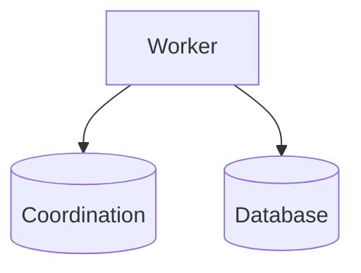

# D15-T015 — Distributed locking

Topic ID: `D15-T015`
Domain: Distributed Systems
Subdomain: Distributed locking
Importance: core
Complexity: advanced
Dependencies: `D15-T014`, `D15-T001`, `D03-T001`, `D03-T002`, `D04-T001`, `D04-T002`
Execution status of the code in section F: unexecuted

## A. Topic Overview

Distributed locks serialize work across nodes using a coordination service with leases and fencing tokens. Locks must expire if holder dies; fencing prevents stale holders from writing after release.

## B. First-Principles Explanation

A lock without fencing is unsafe under GC pause or long stop-the-world. Distributed locks serialize work across nodes using a coordination service with leases and fencing tokens. Locks must expire if holder dies; fencing prevents stale holders from writing after release.

## C. Internal Working and Architecture

Acquire lease, store fence token in DB, reject lower tokens. Components interact through RPC, replication logs, and coordination services.

## D. Diagrams and Visual Models



Read the diagram as a causal flow from client action to stored or observed outcome, including failure branches.

## E. Examples and Analogies

Redlock is debated; prefer consensus-backed locks with fencing for correctness-critical paths.

## F. Code Examples

File: `examples/d15_t015_fence.py`

Dependencies: Python 3 standard library only.

```python
def write_allowed(fence: int, max_fence: int) -> bool:
    return fence >= max_fence
```

The snippet models control flow you would embed in a service or test harness. It is not a production client library.

## G. Practical Backend Application

Prefer idempotent design over global locks; short lease + renew heartbeat.

## H. Advantages, Limitations and Trade-offs

| Choice | Benefit | Cost | Choose when | Avoid when |
| --- | --- | --- | --- | --- |
| Coarse lock | Simple | Low throughput | Batch jobs | Hot key inventory | | | | |

Under load, the cheap choice on paper becomes the choice that amplifies retries, stale reads, or operator toil. Measure p99 latency and error budgets, not only happy-path throughput.

## I. Common Mistakes and Misconceptions

- Lock without TTL.
- Using wall clock only for lease.

A weak interview answer names a buzzword without a failure story. A strong answer names what breaks, what users see, and what invariant you still enforce.

## J. Debugging and Troubleshooting

Log fence monotonicity violations.

## K. Interview Preparation
### Beginner
#### Q1. What is Distributed locking?

**Answer:** Distributed locks serialize work across nodes using a coordination service with leases and fencing tokens. Locks must expire if holder dies; fencing prevents stale holders from writing after release. Interviewers want a precise definition tied to fencing tokens with locks, not a slogan. In production, the failure mode matters more than the slogan: measure timeouts, error budgets, and client-visible symptoms before you rename the problem.
#### Q2. Why does Distributed locking matter in backends?

**Answer:** Distributed locks serialize work across nodes using a coordination service with leases and fencing tokens. Locks must expire if holder dies; fencing prevents stale holders from writing after release. Production systems fail one hop at a time; users still expect coherent behavior. In production, the failure mode matters more than the slogan: measure timeouts, error budgets, and client-visible symptoms before you rename the problem.
#### Q3. Give a one-line example of fencing tokens with locks.

**Answer:** Distributed locks serialize work across nodes using a coordination service with leases and fencing tokens. Locks must expire if holder dies; fencing prevents stale holders from writing after release. Name a concrete multi-service flow where the issue appears. In production, the failure mode matters more than the slogan: measure timeouts, error budgets, and client-visible symptoms before you rename the problem.
#### Q4. Is Distributed locking about hardware or software policy?

**Answer:** Distributed locks serialize work across nodes using a coordination service with leases and fencing tokens. Locks must expire if holder dies; fencing prevents stale holders from writing after release. Mostly policy and protocols on top of unreliable networks. In production, the failure mode matters more than the slogan: measure timeouts, error budgets, and client-visible symptoms before you rename the problem.
#### Q5. What is a common myth about Distributed locking?

**Answer:** Distributed locks serialize work across nodes using a coordination service with leases and fencing tokens. Locks must expire if holder dies; fencing prevents stale holders from writing after release. Buzzword definitions that ignore partitions, retries, or consistency definitions. In production, the failure mode matters more than the slogan: measure timeouts, error budgets, and client-visible symptoms before you rename the problem.
### Intermediate
#### Q1. How do timeouts interact with fencing tokens with locks?

**Answer:** Distributed locks serialize work across nodes using a coordination service with leases and fencing tokens. Locks must expire if holder dies; fencing prevents stale holders from writing after release. Timeouts create unknown outcomes; retries amplify load unless idempotent. In production, the failure mode matters more than the slogan: measure timeouts, error budgets, and client-visible symptoms before you rename the problem.
#### Q2. How do replicas interact with fencing tokens with locks?

**Answer:** Distributed locks serialize work across nodes using a coordination service with leases and fencing tokens. Locks must expire if holder dies; fencing prevents stale holders from writing after release. Replication lag makes stale reads a normal case unless you pay for stronger reads. In production, the failure mode matters more than the slogan: measure timeouts, error budgets, and client-visible symptoms before you rename the problem.
#### Q3. How do idempotency keys help fencing tokens with locks?

**Answer:** Distributed locks serialize work across nodes using a coordination service with leases and fencing tokens. Locks must expire if holder dies; fencing prevents stale holders from writing after release. They make at-least-once delivery safe for business side effects. In production, the failure mode matters more than the slogan: measure timeouts, error budgets, and client-visible symptoms before you rename the problem.
#### Q4. What metrics expose fencing tokens with locks?

**Answer:** Distributed locks serialize work across nodes using a coordination service with leases and fencing tokens. Locks must expire if holder dies; fencing prevents stale holders from writing after release. Error rate by dependency, lag histograms, reconciliation queue depth. In production, the failure mode matters more than the slogan: measure timeouts, error budgets, and client-visible symptoms before you rename the problem.
#### Q5. How does Distributed locking relate to user-visible SLAs?

**Answer:** Distributed locks serialize work across nodes using a coordination service with leases and fencing tokens. Locks must expire if holder dies; fencing prevents stale holders from writing after release. SLAs must state behavior during degradation, not only median latency. In production, the failure mode matters more than the slogan: measure timeouts, error budgets, and client-visible symptoms before you rename the problem.
### Advanced
#### Q1. How would you test fencing tokens with locks?

**Answer:** Distributed locks serialize work across nodes using a coordination service with leases and fencing tokens. Locks must expire if holder dies; fencing prevents stale holders from writing after release. Fault injection: delay, drop, partition links; assert invariants and recovery. In production, the failure mode matters more than the slogan: measure timeouts, error budgets, and client-visible symptoms before you rename the problem.
#### Q2. How does Distributed locking differ from a single-machine failure?

**Answer:** Distributed locks serialize work across nodes using a coordination service with leases and fencing tokens. Locks must expire if holder dies; fencing prevents stale holders from writing after release. Partial failure leaves other paths alive, producing ambiguous global state. In production, the failure mode matters more than the slogan: measure timeouts, error budgets, and client-visible symptoms before you rename the problem.
#### Q3. What documentation should teams publish about Distributed locking?

**Answer:** Distributed locks serialize work across nodes using a coordination service with leases and fencing tokens. Locks must expire if holder dies; fencing prevents stale holders from writing after release. Failure modes, consistency guarantees per endpoint, and runbooks for unknown outcomes. In production, the failure mode matters more than the slogan: measure timeouts, error budgets, and client-visible symptoms before you rename the problem.
#### Q4. When is strong consistency worth the latency for fencing tokens with locks?

**Answer:** Distributed locks serialize work across nodes using a coordination service with leases and fencing tokens. Locks must expire if holder dies; fencing prevents stale holders from writing after release. When invariants involve money, inventory, or safety; not for best-effort feeds. In production, the failure mode matters more than the slogan: measure timeouts, error budgets, and client-visible symptoms before you rename the problem.
#### Q5. How do circuit breakers relate to fencing tokens with locks?

**Answer:** Distributed locks serialize work across nodes using a coordination service with leases and fencing tokens. Locks must expire if holder dies; fencing prevents stale holders from writing after release. They stop retry storms but do not fix correctness; they protect capacity. In production, the failure mode matters more than the slogan: measure timeouts, error budgets, and client-visible symptoms before you rename the problem.
### Scenarios
#### Q1. Incident: errors spike after deploy touching Distributed locking. First checks?

**Answer:** Distributed locks serialize work across nodes using a coordination service with leases and fencing tokens. Locks must expire if holder dies; fencing prevents stale holders from writing after release. Roll forward/rollback decision, feature flag, canary metrics, dependency health. In production, the failure mode matters more than the slogan: measure timeouts, error budgets, and client-visible symptoms before you rename the problem.
#### Q2. Incident: customers report inconsistent reads around fencing tokens with locks. Diagnosis?

**Answer:** Distributed locks serialize work across nodes using a coordination service with leases and fencing tokens. Locks must expire if holder dies; fencing prevents stale holders from writing after release. Check replica lag, routing, cache TTL, and read-your-writes settings. In production, the failure mode matters more than the slogan: measure timeouts, error budgets, and client-visible symptoms before you rename the problem.
#### Q3. Incident: reconciliation backlog grows for fencing tokens with locks. Why?

**Answer:** Distributed locks serialize work across nodes using a coordination service with leases and fencing tokens. Locks must expire if holder dies; fencing prevents stale holders from writing after release. Downstream was slow; retries duplicated work; missing idempotency. In production, the failure mode matters more than the slogan: measure timeouts, error budgets, and client-visible symptoms before you rename the problem.
#### Q4. Design review challenges your Distributed locking approach. What do you defend?

**Answer:** Distributed locks serialize work across nodes using a coordination service with leases and fencing tokens. Locks must expire if holder dies; fencing prevents stale holders from writing after release. State invariants, failure model, and measured trade-offs with PACELC/CAP precision. In production, the failure mode matters more than the slogan: measure timeouts, error budgets, and client-visible symptoms before you rename the problem.
#### Q5. Finance audit questions fencing tokens with locks after duplicate charges. Response?

**Answer:** Distributed locks serialize work across nodes using a coordination service with leases and fencing tokens. Locks must expire if holder dies; fencing prevents stale holders from writing after release. Show idempotency keys, ledger reconciliation, and provider correlation IDs. In production, the failure mode matters more than the slogan: measure timeouts, error budgets, and client-visible symptoms before you rename the problem.
### Follow-ups
#### Q1. How does Distributed locking connect to `D15-T001`?

**Answer:** Distributed locks serialize work across nodes using a coordination service with leases and fencing tokens. Locks must expire if holder dies; fencing prevents stale holders from writing after release. Fundamentals frame partial failure and message passing assumptions. In production, the failure mode matters more than the slogan: measure timeouts, error budgets, and client-visible symptoms before you rename the problem.
#### Q2. How does Distributed locking connect to databases (`D07-T012`)?

**Answer:** Distributed locks serialize work across nodes using a coordination service with leases and fencing tokens. Locks must expire if holder dies; fencing prevents stale holders from writing after release. Transactions are local unless you add distributed protocols or sagas. In production, the failure mode matters more than the slogan: measure timeouts, error budgets, and client-visible symptoms before you rename the problem.
#### Q3. How does Distributed locking connect to messaging (`D14-T031`)?

**Answer:** Distributed locks serialize work across nodes using a coordination service with leases and fencing tokens. Locks must expire if holder dies; fencing prevents stale holders from writing after release. Brokers provide at-least-once unless you engineer exactly-once effects. In production, the failure mode matters more than the slogan: measure timeouts, error budgets, and client-visible symptoms before you rename the problem.

## L. Practical Exercises

Solutions are in `EXERCISES/solutions/D15-T015.md`. Try these before opening that file.

### Exercise 1 — implementation

Implement write_allowed.

### Exercise 2 — debugging

Holder paused by GC—what breaks without fencing?

### Exercise 3 — trade-off

Lock vs database row FOR UPDATE.

## M. Revision Notes

- Distributed locking
- Distributed locks serialize work across nodes using a coordination service with leases and fencing tokens.
- Measure lag, errors, and reconciliation—not only CPU.
- Document behavior during partition and during normal load.

Flashcards:

- What is Distributed locking? See focus paragraph in overview.
- Common mistake: Lock without TTL.

## N. Related Topics

Understand this before: `D15-T014`, `D15-T001`, `D03-T001`, `D03-T002`, `D04-T001`, `D04-T002`.

This topic supports: `D15-T011`, `D15-T019`.

Often confused with: `D03-T005`, `D15-T011`.

Interviewers combine this with replication (`D15-T009`), partial failure (`D15-T002`), and API idempotency (`D06-T011`).

## O. Completion Criteria

- Define Distributed locking without buzzwords.
- Draw the mermaid model for D15-T015.
- Explain one mistake and its safer alternative.
