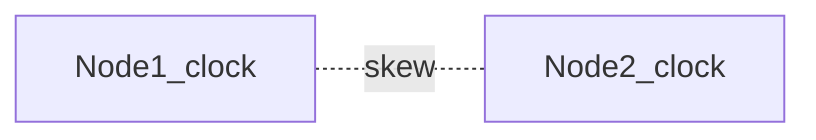

# D15-T016 — Clock skew and clock synchronization

Topic ID: `D15-T016`
Domain: Distributed Systems
Subdomain: Clock skew and clock synchronization
Importance: core
Complexity: advanced
Dependencies: `D15-T015`, `D15-T001`, `D03-T001`, `D03-T002`, `D04-T001`, `D04-T002`
Execution status of the code in section F: unexecuted

## A. Topic Overview

Wall clocks drift and jump (NTP step). Never use unsynchronized time as causal order across nodes. Use logical clocks or centralized timestamps (TrueTime-style) when ordering matters.

## B. First-Principles Explanation

Lease expiry based on local clock can disagree across machines. Wall clocks drift and jump (NTP step). Never use unsynchronized time as causal order across nodes. Use logical clocks or centralized timestamps (TrueTime-style) when ordering matters.

## C. Internal Working and Architecture

Run chrony/NTP; monitor skew; prefer monotonic clocks for durations. Components interact through RPC, replication logs, and coordination services.

## D. Diagrams and Visual Models



Read the diagram as a causal flow from client action to stored or observed outcome, including failure branches.

## E. Examples and Analogies

TTL token appears expired on server with fast clock.

## F. Code Examples

File: `examples/d15_t016_skew.py`

Dependencies: Python 3 standard library only.

```python
def lease_valid(now: float, expires: float, skew_margin: float) -> bool:
    return now + skew_margin < expires
```

The snippet models control flow you would embed in a service or test harness. It is not a production client library.

## G. Practical Backend Application

Add skew margin to lease checks; use DB time for expirations when possible.

## H. Advantages, Limitations and Trade-offs

| Choice | Benefit | Cost | Choose when | Avoid when |
| --- | --- | --- | --- | --- |
| NTP sync | Comparable timestamps | Misconfig spikes | Logging | Distributed ordering | | | | |

Under load, the cheap choice on paper becomes the choice that amplifies retries, stale reads, or operator toil. Measure p99 latency and error budgets, not only happy-path throughput.

## I. Common Mistakes and Misconceptions

- Ordering events by created_at across regions.
- Ignoring leap seconds/smearing policies.

A weak interview answer names a buzzword without a failure story. A strong answer names what breaks, what users see, and what invariant you still enforce.

## J. Debugging and Troubleshooting

Compare offset metrics across fleet.

## K. Interview Preparation
### Beginner
#### Q1. What is Clock skew and clock synchronization?

**Answer:** Wall clocks drift and jump (NTP step). Never use unsynchronized time as causal order across nodes. Use logical clocks or centralized timestamps (TrueTime-style) when ordering matters. Interviewers want a precise definition tied to clock skew and leases, not a slogan.
#### Q2. Why does Clock skew and clock synchronization matter in backends?

**Answer:** Wall clocks drift and jump (NTP step). Never use unsynchronized time as causal order across nodes. Use logical clocks or centralized timestamps (TrueTime-style) when ordering matters. Production systems fail one hop at a time; users still expect coherent behavior.
#### Q3. Give a one-line example of clock skew and leases.

**Answer:** Wall clocks drift and jump (NTP step). Never use unsynchronized time as causal order across nodes. Use logical clocks or centralized timestamps (TrueTime-style) when ordering matters. Name a concrete multi-service flow where the issue appears.
#### Q4. Is Clock skew and clock synchronization about hardware or software policy?

**Answer:** Wall clocks drift and jump (NTP step). Never use unsynchronized time as causal order across nodes. Use logical clocks or centralized timestamps (TrueTime-style) when ordering matters. Mostly policy and protocols on top of unreliable networks.
#### Q5. What is a common myth about Clock skew and clock synchronization?

**Answer:** Wall clocks drift and jump (NTP step). Never use unsynchronized time as causal order across nodes. Use logical clocks or centralized timestamps (TrueTime-style) when ordering matters. Buzzword definitions that ignore partitions, retries, or consistency definitions.
### Intermediate
#### Q1. How do timeouts interact with clock skew and leases?

**Answer:** Wall clocks drift and jump (NTP step). Never use unsynchronized time as causal order across nodes. Use logical clocks or centralized timestamps (TrueTime-style) when ordering matters. Timeouts create unknown outcomes; retries amplify load unless idempotent.
#### Q2. How do replicas interact with clock skew and leases?

**Answer:** Wall clocks drift and jump (NTP step). Never use unsynchronized time as causal order across nodes. Use logical clocks or centralized timestamps (TrueTime-style) when ordering matters. Replication lag makes stale reads a normal case unless you pay for stronger reads.
#### Q3. How do idempotency keys help clock skew and leases?

**Answer:** Wall clocks drift and jump (NTP step). Never use unsynchronized time as causal order across nodes. Use logical clocks or centralized timestamps (TrueTime-style) when ordering matters. They make at-least-once delivery safe for business side effects.
#### Q4. What metrics expose clock skew and leases?

**Answer:** Wall clocks drift and jump (NTP step). Never use unsynchronized time as causal order across nodes. Use logical clocks or centralized timestamps (TrueTime-style) when ordering matters. Error rate by dependency, lag histograms, reconciliation queue depth.
#### Q5. How does Clock skew and clock synchronization relate to user-visible SLAs?

**Answer:** Wall clocks drift and jump (NTP step). Never use unsynchronized time as causal order across nodes. Use logical clocks or centralized timestamps (TrueTime-style) when ordering matters. SLAs must state behavior during degradation, not only median latency.
### Advanced
#### Q1. How would you test clock skew and leases?

**Answer:** Wall clocks drift and jump (NTP step). Never use unsynchronized time as causal order across nodes. Use logical clocks or centralized timestamps (TrueTime-style) when ordering matters. Fault injection: delay, drop, partition links; assert invariants and recovery.
#### Q2. How does Clock skew and clock synchronization differ from a single-machine failure?

**Answer:** Wall clocks drift and jump (NTP step). Never use unsynchronized time as causal order across nodes. Use logical clocks or centralized timestamps (TrueTime-style) when ordering matters. Partial failure leaves other paths alive, producing ambiguous global state.
#### Q3. What documentation should teams publish about Clock skew and clock synchronization?

**Answer:** Wall clocks drift and jump (NTP step). Never use unsynchronized time as causal order across nodes. Use logical clocks or centralized timestamps (TrueTime-style) when ordering matters. Failure modes, consistency guarantees per endpoint, and runbooks for unknown outcomes.
#### Q4. When is strong consistency worth the latency for clock skew and leases?

**Answer:** Wall clocks drift and jump (NTP step). Never use unsynchronized time as causal order across nodes. Use logical clocks or centralized timestamps (TrueTime-style) when ordering matters. When invariants involve money, inventory, or safety; not for best-effort feeds.
#### Q5. How do circuit breakers relate to clock skew and leases?

**Answer:** Wall clocks drift and jump (NTP step). Never use unsynchronized time as causal order across nodes. Use logical clocks or centralized timestamps (TrueTime-style) when ordering matters. They stop retry storms but do not fix correctness; they protect capacity.
### Scenarios
#### Q1. Incident: errors spike after deploy touching Clock skew and clock synchronization. First checks?

**Answer:** Wall clocks drift and jump (NTP step). Never use unsynchronized time as causal order across nodes. Use logical clocks or centralized timestamps (TrueTime-style) when ordering matters. Roll forward/rollback decision, feature flag, canary metrics, dependency health.
#### Q2. Incident: customers report inconsistent reads around clock skew and leases. Diagnosis?

**Answer:** Wall clocks drift and jump (NTP step). Never use unsynchronized time as causal order across nodes. Use logical clocks or centralized timestamps (TrueTime-style) when ordering matters. Check replica lag, routing, cache TTL, and read-your-writes settings.
#### Q3. Incident: reconciliation backlog grows for clock skew and leases. Why?

**Answer:** Wall clocks drift and jump (NTP step). Never use unsynchronized time as causal order across nodes. Use logical clocks or centralized timestamps (TrueTime-style) when ordering matters. Downstream was slow; retries duplicated work; missing idempotency.
#### Q4. Design review challenges your Clock skew and clock synchronization approach. What do you defend?

**Answer:** Wall clocks drift and jump (NTP step). Never use unsynchronized time as causal order across nodes. Use logical clocks or centralized timestamps (TrueTime-style) when ordering matters. State invariants, failure model, and measured trade-offs with PACELC/CAP precision.
#### Q5. Finance audit questions clock skew and leases after duplicate charges. Response?

**Answer:** Wall clocks drift and jump (NTP step). Never use unsynchronized time as causal order across nodes. Use logical clocks or centralized timestamps (TrueTime-style) when ordering matters. Show idempotency keys, ledger reconciliation, and provider correlation IDs.
### Follow-ups
#### Q1. How does Clock skew and clock synchronization connect to `D15-T001`?

**Answer:** Wall clocks drift and jump (NTP step). Never use unsynchronized time as causal order across nodes. Use logical clocks or centralized timestamps (TrueTime-style) when ordering matters. Fundamentals frame partial failure and message passing assumptions.
#### Q2. How does Clock skew and clock synchronization connect to databases (`D07-T012`)?

**Answer:** Wall clocks drift and jump (NTP step). Never use unsynchronized time as causal order across nodes. Use logical clocks or centralized timestamps (TrueTime-style) when ordering matters. Transactions are local unless you add distributed protocols or sagas.
#### Q3. How does Clock skew and clock synchronization connect to messaging (`D14-T031`)?

**Answer:** Wall clocks drift and jump (NTP step). Never use unsynchronized time as causal order across nodes. Use logical clocks or centralized timestamps (TrueTime-style) when ordering matters. Brokers provide at-least-once unless you engineer exactly-once effects.

## L. Practical Exercises

Solutions are in `EXERCISES/solutions/D15-T016.md`. Try these before opening that file.

### Exercise 1 — implementation

Implement lease_valid with margin.

### Exercise 2 — debugging

Events out of order in logs—clock or logic?

### Exercise 3 — trade-off

Why Spanner uses TrueTime bounds.

## M. Revision Notes

- Clock skew and clock synchronization
- Wall clocks drift and jump (NTP step).
- Measure lag, errors, and reconciliation—not only CPU.
- Document behavior during partition and during normal load.

Flashcards:

- What is Clock skew and clock synchronization? See focus paragraph in overview.
- Common mistake: Ordering events by created_at across regions.

## N. Related Topics

Understand this before: `D15-T015`, `D15-T001`, `D03-T001`, `D03-T002`, `D04-T001`, `D04-T002`.

This topic supports: `D15-T017`, `D15-T020`.

Often confused with: `D15-T017`, `D13-T022`.

Interviewers combine this with replication (`D15-T009`), partial failure (`D15-T002`), and API idempotency (`D06-T011`).

## O. Completion Criteria

- Define Clock skew and clock synchronization without buzzwords.
- Draw the mermaid model for D15-T016.
- Explain one mistake and its safer alternative.
