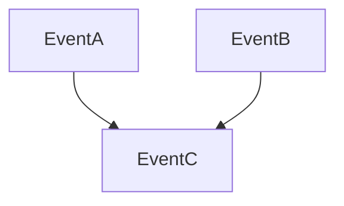

# D15-T017 — Logical clocks and vector clocks

Topic ID: `D15-T017`
Domain: Distributed Systems
Subdomain: Logical clocks and vector clocks
Importance: advanced
Complexity: advanced
Dependencies: `D15-T016`, `D15-T001`, `D03-T001`, `D03-T002`, `D04-T001`, `D04-T002`
Execution status of the code in section F: unexecuted

## A. Topic Overview

Lamport clocks give a partial order via counters; vector clocks track per-node counts to detect concurrency. They help version merges and causal metadata without trusting wall time.

## B. First-Principles Explanation

Logical time does not measure latency; it captures happened-before. Lamport clocks give a partial order via counters; vector clocks track per-node counts to detect concurrency. They help version merges and causal metadata without trusting wall time.

## C. Internal Working and Architecture

Attach version vectors to records for read-repair and CRDT merges. Components interact through RPC, replication logs, and coordination services.

## D. Diagrams and Visual Models



Read the diagram as a causal flow from client action to stored or observed outcome, including failure branches.

## E. Examples and Analogies

Dynamo-style version reconciliation on read.

## F. Code Examples

File: `examples/d15_t017_lamport.py`

Dependencies: Python 3 standard library only.

```python
def lamport_tick(local: int, received: int) -> int:
    return max(local, received) + 1
```

The snippet models control flow you would embed in a service or test harness. It is not a production client library.

## G. Practical Backend Application

Store versions on writes; merge on conflict with deterministic rule.

## H. Advantages, Limitations and Trade-offs

| Choice | Benefit | Cost | Choose when | Avoid when |
| --- | --- | --- | --- | --- |
| Vector metadata | Detect concurrency | Size | Quorum stores | Single-leader log | | | | |

Under load, the cheap choice on paper becomes the choice that amplifies retries, stale reads, or operator toil. Measure p99 latency and error budgets, not only happy-path throughput.

## I. Common Mistakes and Misconceptions

- Thinking Lamport total-orders concurrent events.
- Huge vectors at planet scale without compaction.

A weak interview answer names a buzzword without a failure story. A strong answer names what breaks, what users see, and what invariant you still enforce.

## J. Debugging and Troubleshooting

Dump conflicting versions on divergent reads.

## K. Interview Preparation
### Beginner
#### Q1. What is Logical clocks and vector clocks?

**Answer:** Lamport clocks give a partial order via counters; vector clocks track per-node counts to detect concurrency. They help version merges and causal metadata without trusting wall time. Interviewers want a precise definition tied to logical vs wall-clock ordering, not a slogan. In production, the failure mode matters more than the slogan: measure timeouts, error budgets, and client-visible symptoms before you rename the problem.
#### Q2. Why does Logical clocks and vector clocks matter in backends?

**Answer:** Lamport clocks give a partial order via counters; vector clocks track per-node counts to detect concurrency. They help version merges and causal metadata without trusting wall time. Production systems fail one hop at a time; users still expect coherent behavior. In production, the failure mode matters more than the slogan: measure timeouts, error budgets, and client-visible symptoms before you rename the problem.
#### Q3. Give a one-line example of logical vs wall-clock ordering.

**Answer:** Lamport clocks give a partial order via counters; vector clocks track per-node counts to detect concurrency. They help version merges and causal metadata without trusting wall time. Name a concrete multi-service flow where the issue appears. In production, the failure mode matters more than the slogan: measure timeouts, error budgets, and client-visible symptoms before you rename the problem.
#### Q4. Is Logical clocks and vector clocks about hardware or software policy?

**Answer:** Lamport clocks give a partial order via counters; vector clocks track per-node counts to detect concurrency. They help version merges and causal metadata without trusting wall time. Mostly policy and protocols on top of unreliable networks. In production, the failure mode matters more than the slogan: measure timeouts, error budgets, and client-visible symptoms before you rename the problem.
#### Q5. What is a common myth about Logical clocks and vector clocks?

**Answer:** Lamport clocks give a partial order via counters; vector clocks track per-node counts to detect concurrency. They help version merges and causal metadata without trusting wall time. Buzzword definitions that ignore partitions, retries, or consistency definitions. In production, the failure mode matters more than the slogan: measure timeouts, error budgets, and client-visible symptoms before you rename the problem.
### Intermediate
#### Q1. How do timeouts interact with logical vs wall-clock ordering?

**Answer:** Lamport clocks give a partial order via counters; vector clocks track per-node counts to detect concurrency. They help version merges and causal metadata without trusting wall time. Timeouts create unknown outcomes; retries amplify load unless idempotent. In production, the failure mode matters more than the slogan: measure timeouts, error budgets, and client-visible symptoms before you rename the problem.
#### Q2. How do replicas interact with logical vs wall-clock ordering?

**Answer:** Lamport clocks give a partial order via counters; vector clocks track per-node counts to detect concurrency. They help version merges and causal metadata without trusting wall time. Replication lag makes stale reads a normal case unless you pay for stronger reads. In production, the failure mode matters more than the slogan: measure timeouts, error budgets, and client-visible symptoms before you rename the problem.
#### Q3. How do idempotency keys help logical vs wall-clock ordering?

**Answer:** Lamport clocks give a partial order via counters; vector clocks track per-node counts to detect concurrency. They help version merges and causal metadata without trusting wall time. They make at-least-once delivery safe for business side effects. In production, the failure mode matters more than the slogan: measure timeouts, error budgets, and client-visible symptoms before you rename the problem.
#### Q4. What metrics expose logical vs wall-clock ordering?

**Answer:** Lamport clocks give a partial order via counters; vector clocks track per-node counts to detect concurrency. They help version merges and causal metadata without trusting wall time. Error rate by dependency, lag histograms, reconciliation queue depth. In production, the failure mode matters more than the slogan: measure timeouts, error budgets, and client-visible symptoms before you rename the problem.
#### Q5. How does Logical clocks and vector clocks relate to user-visible SLAs?

**Answer:** Lamport clocks give a partial order via counters; vector clocks track per-node counts to detect concurrency. They help version merges and causal metadata without trusting wall time. SLAs must state behavior during degradation, not only median latency. In production, the failure mode matters more than the slogan: measure timeouts, error budgets, and client-visible symptoms before you rename the problem.
### Advanced
#### Q1. How would you test logical vs wall-clock ordering?

**Answer:** Lamport clocks give a partial order via counters; vector clocks track per-node counts to detect concurrency. They help version merges and causal metadata without trusting wall time. Fault injection: delay, drop, partition links; assert invariants and recovery. In production, the failure mode matters more than the slogan: measure timeouts, error budgets, and client-visible symptoms before you rename the problem.
#### Q2. How does Logical clocks and vector clocks differ from a single-machine failure?

**Answer:** Lamport clocks give a partial order via counters; vector clocks track per-node counts to detect concurrency. They help version merges and causal metadata without trusting wall time. Partial failure leaves other paths alive, producing ambiguous global state. In production, the failure mode matters more than the slogan: measure timeouts, error budgets, and client-visible symptoms before you rename the problem.
#### Q3. What documentation should teams publish about Logical clocks and vector clocks?

**Answer:** Lamport clocks give a partial order via counters; vector clocks track per-node counts to detect concurrency. They help version merges and causal metadata without trusting wall time. Failure modes, consistency guarantees per endpoint, and runbooks for unknown outcomes. In production, the failure mode matters more than the slogan: measure timeouts, error budgets, and client-visible symptoms before you rename the problem.
#### Q4. When is strong consistency worth the latency for logical vs wall-clock ordering?

**Answer:** Lamport clocks give a partial order via counters; vector clocks track per-node counts to detect concurrency. They help version merges and causal metadata without trusting wall time. When invariants involve money, inventory, or safety; not for best-effort feeds. In production, the failure mode matters more than the slogan: measure timeouts, error budgets, and client-visible symptoms before you rename the problem.
#### Q5. How do circuit breakers relate to logical vs wall-clock ordering?

**Answer:** Lamport clocks give a partial order via counters; vector clocks track per-node counts to detect concurrency. They help version merges and causal metadata without trusting wall time. They stop retry storms but do not fix correctness; they protect capacity. In production, the failure mode matters more than the slogan: measure timeouts, error budgets, and client-visible symptoms before you rename the problem.
### Scenarios
#### Q1. Incident: errors spike after deploy touching Logical clocks and vector clocks. First checks?

**Answer:** Lamport clocks give a partial order via counters; vector clocks track per-node counts to detect concurrency. They help version merges and causal metadata without trusting wall time. Roll forward/rollback decision, feature flag, canary metrics, dependency health. In production, the failure mode matters more than the slogan: measure timeouts, error budgets, and client-visible symptoms before you rename the problem.
#### Q2. Incident: customers report inconsistent reads around logical vs wall-clock ordering. Diagnosis?

**Answer:** Lamport clocks give a partial order via counters; vector clocks track per-node counts to detect concurrency. They help version merges and causal metadata without trusting wall time. Check replica lag, routing, cache TTL, and read-your-writes settings. In production, the failure mode matters more than the slogan: measure timeouts, error budgets, and client-visible symptoms before you rename the problem.
#### Q3. Incident: reconciliation backlog grows for logical vs wall-clock ordering. Why?

**Answer:** Lamport clocks give a partial order via counters; vector clocks track per-node counts to detect concurrency. They help version merges and causal metadata without trusting wall time. Downstream was slow; retries duplicated work; missing idempotency. In production, the failure mode matters more than the slogan: measure timeouts, error budgets, and client-visible symptoms before you rename the problem.
#### Q4. Design review challenges your Logical clocks and vector clocks approach. What do you defend?

**Answer:** Lamport clocks give a partial order via counters; vector clocks track per-node counts to detect concurrency. They help version merges and causal metadata without trusting wall time. State invariants, failure model, and measured trade-offs with PACELC/CAP precision. In production, the failure mode matters more than the slogan: measure timeouts, error budgets, and client-visible symptoms before you rename the problem.
#### Q5. Finance audit questions logical vs wall-clock ordering after duplicate charges. Response?

**Answer:** Lamport clocks give a partial order via counters; vector clocks track per-node counts to detect concurrency. They help version merges and causal metadata without trusting wall time. Show idempotency keys, ledger reconciliation, and provider correlation IDs. In production, the failure mode matters more than the slogan: measure timeouts, error budgets, and client-visible symptoms before you rename the problem.
### Follow-ups
#### Q1. How does Logical clocks and vector clocks connect to `D15-T001`?

**Answer:** Lamport clocks give a partial order via counters; vector clocks track per-node counts to detect concurrency. They help version merges and causal metadata without trusting wall time. Fundamentals frame partial failure and message passing assumptions. In production, the failure mode matters more than the slogan: measure timeouts, error budgets, and client-visible symptoms before you rename the problem.
#### Q2. How does Logical clocks and vector clocks connect to databases (`D07-T012`)?

**Answer:** Lamport clocks give a partial order via counters; vector clocks track per-node counts to detect concurrency. They help version merges and causal metadata without trusting wall time. Transactions are local unless you add distributed protocols or sagas. In production, the failure mode matters more than the slogan: measure timeouts, error budgets, and client-visible symptoms before you rename the problem.
#### Q3. How does Logical clocks and vector clocks connect to messaging (`D14-T031`)?

**Answer:** Lamport clocks give a partial order via counters; vector clocks track per-node counts to detect concurrency. They help version merges and causal metadata without trusting wall time. Brokers provide at-least-once unless you engineer exactly-once effects. In production, the failure mode matters more than the slogan: measure timeouts, error budgets, and client-visible symptoms before you rename the problem.

## L. Practical Exercises

Solutions are in `EXERCISES/solutions/D15-T017.md`. Try these before opening that file.

### Exercise 1 — implementation

Apply lamport_tick on message receive.

### Exercise 2 — debugging

Two concurrent writes—vector clock result?

### Exercise 3 — trade-off

When Lamport enough vs vector needed.

## M. Revision Notes

- Logical clocks and vector clocks
- Lamport clocks give a partial order via counters; vector clocks track per-node counts to detect concurrency.
- Measure lag, errors, and reconciliation—not only CPU.
- Document behavior during partition and during normal load.

Flashcards:

- What is Logical clocks and vector clocks? See focus paragraph in overview.
- Common mistake: Thinking Lamport total-orders concurrent events.

## N. Related Topics

Understand this before: `D15-T016`, `D15-T001`, `D03-T001`, `D03-T002`, `D04-T001`, `D04-T002`.

This topic supports: `D15-T006`, `D15-T012`.

Often confused with: `D15-T016`, `D15-T006`.

Interviewers combine this with replication (`D15-T009`), partial failure (`D15-T002`), and API idempotency (`D06-T011`).

## O. Completion Criteria

- Define Logical clocks and vector clocks without buzzwords.
- Draw the mermaid model for D15-T017.
- Explain one mistake and its safer alternative.
