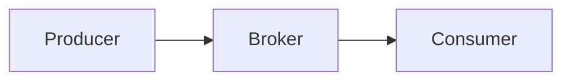

# D15-T018 — At-most-once and at-least-once execution

Topic ID: `D15-T018`
Domain: Distributed Systems
Subdomain: At-most-once and at-least-once execution
Importance: core
Complexity: advanced
Dependencies: `D15-T017`, `D15-T001`, `D03-T001`, `D03-T002`, `D04-T001`, `D04-T002`
Execution status of the code in section F: unexecuted

## A. Topic Overview

At-most-once avoids duplicates by not retrying (may lose work). At-least-once retries until ack (may duplicate). Networks force most systems to at-least-once unless dropping on failure.

## B. First-Principles Explanation

Ack boundaries define delivery semantics end-to-end. At-most-once avoids duplicates by not retrying (may lose work). At-least-once retries until ack (may duplicate). Networks force most systems to at-least-once unless dropping on failure.

## C. Internal Working and Architecture

Consumer offsets, visibility timeout, dedup store. Components interact through RPC, replication logs, and coordination services.

## D. Diagrams and Visual Models



Read the diagram as a causal flow from client action to stored or observed outcome, including failure branches.

## E. Examples and Analogies

Kafka consumers commit offset after processing → at-least-once if crash before commit.

## F. Code Examples

File: `examples/d15_t018_delivery.py`

Dependencies: Python 3 standard library only.

```python
def deliver(mode: str, retry: bool) -> str:
    if mode == "at_most_once":
        return "no_retry"
    if mode == "at_least_once" and retry:
        return "retry_until_ack"
    return "unknown"
```

The snippet models control flow you would embed in a service or test harness. It is not a production client library.

## G. Practical Backend Application

Pair at-least-once with idempotent handlers.

## H. Advantages, Limitations and Trade-offs

| Choice | Benefit | Cost | Choose when | Avoid when |
| --- | --- | --- | --- | --- |
| At-most-once | No dupes | Loss | Metrics | Payments | | | | |

Under load, the cheap choice on paper becomes the choice that amplifies retries, stale reads, or operator toil. Measure p99 latency and error budgets, not only happy-path throughput.

## I. Common Mistakes and Misconceptions

- Assuming TCP gives message exactly-once.
- Committing offset before side effects.

A weak interview answer names a buzzword without a failure story. A strong answer names what breaks, what users see, and what invariant you still enforce.

## J. Debugging and Troubleshooting

Count duplicate business keys in warehouse.

## K. Interview Preparation
### Beginner
#### Q1. What is At-most-once and at-least-once execution?

**Answer:** At-most-once avoids duplicates by not retrying (may lose work). At-least-once retries until ack (may duplicate). Networks force most systems to at-least-once unless dropping on failure. Interviewers want a precise definition tied to delivery semantics, not a slogan.
#### Q2. Why does At-most-once and at-least-once execution matter in backends?

**Answer:** At-most-once avoids duplicates by not retrying (may lose work). At-least-once retries until ack (may duplicate). Networks force most systems to at-least-once unless dropping on failure. Production systems fail one hop at a time; users still expect coherent behavior.
#### Q3. Give a one-line example of delivery semantics.

**Answer:** At-most-once avoids duplicates by not retrying (may lose work). At-least-once retries until ack (may duplicate). Networks force most systems to at-least-once unless dropping on failure. Name a concrete multi-service flow where the issue appears.
#### Q4. Is At-most-once and at-least-once execution about hardware or software policy?

**Answer:** At-most-once avoids duplicates by not retrying (may lose work). At-least-once retries until ack (may duplicate). Networks force most systems to at-least-once unless dropping on failure. Mostly policy and protocols on top of unreliable networks.
#### Q5. What is a common myth about At-most-once and at-least-once execution?

**Answer:** At-most-once avoids duplicates by not retrying (may lose work). At-least-once retries until ack (may duplicate). Networks force most systems to at-least-once unless dropping on failure. Buzzword definitions that ignore partitions, retries, or consistency definitions.
### Intermediate
#### Q1. How do timeouts interact with delivery semantics?

**Answer:** At-most-once avoids duplicates by not retrying (may lose work). At-least-once retries until ack (may duplicate). Networks force most systems to at-least-once unless dropping on failure. Timeouts create unknown outcomes; retries amplify load unless idempotent.
#### Q2. How do replicas interact with delivery semantics?

**Answer:** At-most-once avoids duplicates by not retrying (may lose work). At-least-once retries until ack (may duplicate). Networks force most systems to at-least-once unless dropping on failure. Replication lag makes stale reads a normal case unless you pay for stronger reads.
#### Q3. How do idempotency keys help delivery semantics?

**Answer:** At-most-once avoids duplicates by not retrying (may lose work). At-least-once retries until ack (may duplicate). Networks force most systems to at-least-once unless dropping on failure. They make at-least-once delivery safe for business side effects.
#### Q4. What metrics expose delivery semantics?

**Answer:** At-most-once avoids duplicates by not retrying (may lose work). At-least-once retries until ack (may duplicate). Networks force most systems to at-least-once unless dropping on failure. Error rate by dependency, lag histograms, reconciliation queue depth.
#### Q5. How does At-most-once and at-least-once execution relate to user-visible SLAs?

**Answer:** At-most-once avoids duplicates by not retrying (may lose work). At-least-once retries until ack (may duplicate). Networks force most systems to at-least-once unless dropping on failure. SLAs must state behavior during degradation, not only median latency.
### Advanced
#### Q1. How would you test delivery semantics?

**Answer:** At-most-once avoids duplicates by not retrying (may lose work). At-least-once retries until ack (may duplicate). Networks force most systems to at-least-once unless dropping on failure. Fault injection: delay, drop, partition links; assert invariants and recovery.
#### Q2. How does At-most-once and at-least-once execution differ from a single-machine failure?

**Answer:** At-most-once avoids duplicates by not retrying (may lose work). At-least-once retries until ack (may duplicate). Networks force most systems to at-least-once unless dropping on failure. Partial failure leaves other paths alive, producing ambiguous global state.
#### Q3. What documentation should teams publish about At-most-once and at-least-once execution?

**Answer:** At-most-once avoids duplicates by not retrying (may lose work). At-least-once retries until ack (may duplicate). Networks force most systems to at-least-once unless dropping on failure. Failure modes, consistency guarantees per endpoint, and runbooks for unknown outcomes.
#### Q4. When is strong consistency worth the latency for delivery semantics?

**Answer:** At-most-once avoids duplicates by not retrying (may lose work). At-least-once retries until ack (may duplicate). Networks force most systems to at-least-once unless dropping on failure. When invariants involve money, inventory, or safety; not for best-effort feeds.
#### Q5. How do circuit breakers relate to delivery semantics?

**Answer:** At-most-once avoids duplicates by not retrying (may lose work). At-least-once retries until ack (may duplicate). Networks force most systems to at-least-once unless dropping on failure. They stop retry storms but do not fix correctness; they protect capacity.
### Scenarios
#### Q1. Incident: errors spike after deploy touching At-most-once and at-least-once execution. First checks?

**Answer:** At-most-once avoids duplicates by not retrying (may lose work). At-least-once retries until ack (may duplicate). Networks force most systems to at-least-once unless dropping on failure. Roll forward/rollback decision, feature flag, canary metrics, dependency health.
#### Q2. Incident: customers report inconsistent reads around delivery semantics. Diagnosis?

**Answer:** At-most-once avoids duplicates by not retrying (may lose work). At-least-once retries until ack (may duplicate). Networks force most systems to at-least-once unless dropping on failure. Check replica lag, routing, cache TTL, and read-your-writes settings.
#### Q3. Incident: reconciliation backlog grows for delivery semantics. Why?

**Answer:** At-most-once avoids duplicates by not retrying (may lose work). At-least-once retries until ack (may duplicate). Networks force most systems to at-least-once unless dropping on failure. Downstream was slow; retries duplicated work; missing idempotency.
#### Q4. Design review challenges your At-most-once and at-least-once execution approach. What do you defend?

**Answer:** At-most-once avoids duplicates by not retrying (may lose work). At-least-once retries until ack (may duplicate). Networks force most systems to at-least-once unless dropping on failure. State invariants, failure model, and measured trade-offs with PACELC/CAP precision.
#### Q5. Finance audit questions delivery semantics after duplicate charges. Response?

**Answer:** At-most-once avoids duplicates by not retrying (may lose work). At-least-once retries until ack (may duplicate). Networks force most systems to at-least-once unless dropping on failure. Show idempotency keys, ledger reconciliation, and provider correlation IDs.
### Follow-ups
#### Q1. How does At-most-once and at-least-once execution connect to `D15-T001`?

**Answer:** At-most-once avoids duplicates by not retrying (may lose work). At-least-once retries until ack (may duplicate). Networks force most systems to at-least-once unless dropping on failure. Fundamentals frame partial failure and message passing assumptions.
#### Q2. How does At-most-once and at-least-once execution connect to databases (`D07-T012`)?

**Answer:** At-most-once avoids duplicates by not retrying (may lose work). At-least-once retries until ack (may duplicate). Networks force most systems to at-least-once unless dropping on failure. Transactions are local unless you add distributed protocols or sagas.
#### Q3. How does At-most-once and at-least-once execution connect to messaging (`D14-T031`)?

**Answer:** At-most-once avoids duplicates by not retrying (may lose work). At-least-once retries until ack (may duplicate). Networks force most systems to at-least-once unless dropping on failure. Brokers provide at-least-once unless you engineer exactly-once effects.

## L. Practical Exercises

Solutions are in `EXERCISES/solutions/D15-T018.md`. Try these before opening that file.

### Exercise 1 — implementation

Map Kafka consumer settings to semantics.

### Exercise 2 — debugging

Duplicate emails after crash—fix?

### Exercise 3 — trade-off

When accept message loss.

## M. Revision Notes

- At-most-once and at-least-once execution
- At-most-once avoids duplicates by not retrying (may lose work).
- Measure lag, errors, and reconciliation—not only CPU.
- Document behavior during partition and during normal load.

Flashcards:

- What is At-most-once and at-least-once execution? See focus paragraph in overview.
- Common mistake: Assuming TCP gives message exactly-once.

## N. Related Topics

Understand this before: `D15-T017`, `D15-T001`, `D03-T001`, `D03-T002`, `D04-T001`, `D04-T002`.

This topic supports: `D15-T019`, `D15-T020`.

Often confused with: `D15-T020`, `D14-T028`.

Interviewers combine this with replication (`D15-T009`), partial failure (`D15-T002`), and API idempotency (`D06-T011`).

## O. Completion Criteria

- Define At-most-once and at-least-once execution without buzzwords.
- Draw the mermaid model for D15-T018.
- Explain one mistake and its safer alternative.
