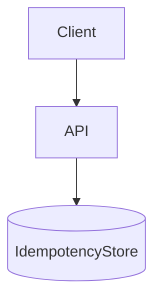

# D15-T019 — Idempotency

Topic ID: `D15-T019`
Domain: Distributed Systems
Subdomain: Idempotency
Importance: core
Complexity: advanced
Dependencies: `D15-T018`, `D15-T001`, `D03-T001`, `D03-T002`, `D04-T001`, `D04-T002`
Execution status of the code in section F: unexecuted

## A. Topic Overview

An idempotent operation can be applied multiple times without changing outcome beyond the first successful application. Idempotency keys let safe retries after timeouts.

## B. First-Principles Explanation

Store key→result with TTL; return same response for duplicates. An idempotent operation can be applied multiple times without changing outcome beyond the first successful application. Idempotency keys let safe retries after timeouts.

## C. Internal Working and Architecture

DB unique constraint on idempotency key; outbox pattern. Components interact through RPC, replication logs, and coordination services.

## D. Diagrams and Visual Models



Read the diagram as a causal flow from client action to stored or observed outcome, including failure branches.

## E. Examples and Analogies

Stripe idempotency-key header on POST /charges.

## F. Code Examples

File: `examples/d15_t019_idem.py`

Dependencies: Python 3 standard library only.

```python
def process(key: str, seen: dict[str, str], body: str) -> str:
    if key in seen:
        return seen[key]
    seen[key] = f"ok:{body}"
    return seen[key]
```

The snippet models control flow you would embed in a service or test harness. It is not a production client library.

## G. Practical Backend Application

Require keys on non-safe methods; scope per user/account.

## H. Advantages, Limitations and Trade-offs

| Choice | Benefit | Cost | Choose when | Avoid when |
| --- | --- | --- | --- | --- |
| DB dedup | Strong | Storage/latency | Payments | Read-only GET | | | | |

Under load, the cheap choice on paper becomes the choice that amplifies retries, stale reads, or operator toil. Measure p99 latency and error budgets, not only happy-path throughput.

## I. Common Mistakes and Misconceptions

- Keys only in memory per instance.
- Reusing keys across different operations.

A weak interview answer names a buzzword without a failure story. A strong answer names what breaks, what users see, and what invariant you still enforce.

## J. Debugging and Troubleshooting

Find duplicate keys with different payloads.

## K. Interview Preparation
### Beginner
#### Q1. What is Idempotency?

**Answer:** An idempotent operation can be applied multiple times without changing outcome beyond the first successful application. Idempotency keys let safe retries after timeouts. Interviewers want a precise definition tied to idempotency keys, not a slogan. In production, the failure mode matters more than the slogan: measure timeouts, error budgets, and client-visible symptoms before you rename the problem.
#### Q2. Why does Idempotency matter in backends?

**Answer:** An idempotent operation can be applied multiple times without changing outcome beyond the first successful application. Idempotency keys let safe retries after timeouts. Production systems fail one hop at a time; users still expect coherent behavior. In production, the failure mode matters more than the slogan: measure timeouts, error budgets, and client-visible symptoms before you rename the problem.
#### Q3. Give a one-line example of idempotency keys.

**Answer:** An idempotent operation can be applied multiple times without changing outcome beyond the first successful application. Idempotency keys let safe retries after timeouts. Name a concrete multi-service flow where the issue appears. In production, the failure mode matters more than the slogan: measure timeouts, error budgets, and client-visible symptoms before you rename the problem.
#### Q4. Is Idempotency about hardware or software policy?

**Answer:** An idempotent operation can be applied multiple times without changing outcome beyond the first successful application. Idempotency keys let safe retries after timeouts. Mostly policy and protocols on top of unreliable networks. In production, the failure mode matters more than the slogan: measure timeouts, error budgets, and client-visible symptoms before you rename the problem.
#### Q5. What is a common myth about Idempotency?

**Answer:** An idempotent operation can be applied multiple times without changing outcome beyond the first successful application. Idempotency keys let safe retries after timeouts. Buzzword definitions that ignore partitions, retries, or consistency definitions. In production, the failure mode matters more than the slogan: measure timeouts, error budgets, and client-visible symptoms before you rename the problem.
### Intermediate
#### Q1. How do timeouts interact with idempotency keys?

**Answer:** An idempotent operation can be applied multiple times without changing outcome beyond the first successful application. Idempotency keys let safe retries after timeouts. Timeouts create unknown outcomes; retries amplify load unless idempotent. In production, the failure mode matters more than the slogan: measure timeouts, error budgets, and client-visible symptoms before you rename the problem.
#### Q2. How do replicas interact with idempotency keys?

**Answer:** An idempotent operation can be applied multiple times without changing outcome beyond the first successful application. Idempotency keys let safe retries after timeouts. Replication lag makes stale reads a normal case unless you pay for stronger reads. In production, the failure mode matters more than the slogan: measure timeouts, error budgets, and client-visible symptoms before you rename the problem.
#### Q3. How do idempotency keys help idempotency keys?

**Answer:** An idempotent operation can be applied multiple times without changing outcome beyond the first successful application. Idempotency keys let safe retries after timeouts. They make at-least-once delivery safe for business side effects. In production, the failure mode matters more than the slogan: measure timeouts, error budgets, and client-visible symptoms before you rename the problem.
#### Q4. What metrics expose idempotency keys?

**Answer:** An idempotent operation can be applied multiple times without changing outcome beyond the first successful application. Idempotency keys let safe retries after timeouts. Error rate by dependency, lag histograms, reconciliation queue depth. In production, the failure mode matters more than the slogan: measure timeouts, error budgets, and client-visible symptoms before you rename the problem.
#### Q5. How does Idempotency relate to user-visible SLAs?

**Answer:** An idempotent operation can be applied multiple times without changing outcome beyond the first successful application. Idempotency keys let safe retries after timeouts. SLAs must state behavior during degradation, not only median latency. In production, the failure mode matters more than the slogan: measure timeouts, error budgets, and client-visible symptoms before you rename the problem.
### Advanced
#### Q1. How would you test idempotency keys?

**Answer:** An idempotent operation can be applied multiple times without changing outcome beyond the first successful application. Idempotency keys let safe retries after timeouts. Fault injection: delay, drop, partition links; assert invariants and recovery. In production, the failure mode matters more than the slogan: measure timeouts, error budgets, and client-visible symptoms before you rename the problem.
#### Q2. How does Idempotency differ from a single-machine failure?

**Answer:** An idempotent operation can be applied multiple times without changing outcome beyond the first successful application. Idempotency keys let safe retries after timeouts. Partial failure leaves other paths alive, producing ambiguous global state. In production, the failure mode matters more than the slogan: measure timeouts, error budgets, and client-visible symptoms before you rename the problem.
#### Q3. What documentation should teams publish about Idempotency?

**Answer:** An idempotent operation can be applied multiple times without changing outcome beyond the first successful application. Idempotency keys let safe retries after timeouts. Failure modes, consistency guarantees per endpoint, and runbooks for unknown outcomes. In production, the failure mode matters more than the slogan: measure timeouts, error budgets, and client-visible symptoms before you rename the problem.
#### Q4. When is strong consistency worth the latency for idempotency keys?

**Answer:** An idempotent operation can be applied multiple times without changing outcome beyond the first successful application. Idempotency keys let safe retries after timeouts. When invariants involve money, inventory, or safety; not for best-effort feeds. In production, the failure mode matters more than the slogan: measure timeouts, error budgets, and client-visible symptoms before you rename the problem.
#### Q5. How do circuit breakers relate to idempotency keys?

**Answer:** An idempotent operation can be applied multiple times without changing outcome beyond the first successful application. Idempotency keys let safe retries after timeouts. They stop retry storms but do not fix correctness; they protect capacity. In production, the failure mode matters more than the slogan: measure timeouts, error budgets, and client-visible symptoms before you rename the problem.
### Scenarios
#### Q1. Incident: errors spike after deploy touching Idempotency. First checks?

**Answer:** An idempotent operation can be applied multiple times without changing outcome beyond the first successful application. Idempotency keys let safe retries after timeouts. Roll forward/rollback decision, feature flag, canary metrics, dependency health. In production, the failure mode matters more than the slogan: measure timeouts, error budgets, and client-visible symptoms before you rename the problem.
#### Q2. Incident: customers report inconsistent reads around idempotency keys. Diagnosis?

**Answer:** An idempotent operation can be applied multiple times without changing outcome beyond the first successful application. Idempotency keys let safe retries after timeouts. Check replica lag, routing, cache TTL, and read-your-writes settings. In production, the failure mode matters more than the slogan: measure timeouts, error budgets, and client-visible symptoms before you rename the problem.
#### Q3. Incident: reconciliation backlog grows for idempotency keys. Why?

**Answer:** An idempotent operation can be applied multiple times without changing outcome beyond the first successful application. Idempotency keys let safe retries after timeouts. Downstream was slow; retries duplicated work; missing idempotency. In production, the failure mode matters more than the slogan: measure timeouts, error budgets, and client-visible symptoms before you rename the problem.
#### Q4. Design review challenges your Idempotency approach. What do you defend?

**Answer:** An idempotent operation can be applied multiple times without changing outcome beyond the first successful application. Idempotency keys let safe retries after timeouts. State invariants, failure model, and measured trade-offs with PACELC/CAP precision. In production, the failure mode matters more than the slogan: measure timeouts, error budgets, and client-visible symptoms before you rename the problem.
#### Q5. Finance audit questions idempotency keys after duplicate charges. Response?

**Answer:** An idempotent operation can be applied multiple times without changing outcome beyond the first successful application. Idempotency keys let safe retries after timeouts. Show idempotency keys, ledger reconciliation, and provider correlation IDs. In production, the failure mode matters more than the slogan: measure timeouts, error budgets, and client-visible symptoms before you rename the problem.
### Follow-ups
#### Q1. How does Idempotency connect to `D15-T001`?

**Answer:** An idempotent operation can be applied multiple times without changing outcome beyond the first successful application. Idempotency keys let safe retries after timeouts. Fundamentals frame partial failure and message passing assumptions. In production, the failure mode matters more than the slogan: measure timeouts, error budgets, and client-visible symptoms before you rename the problem.
#### Q2. How does Idempotency connect to databases (`D07-T012`)?

**Answer:** An idempotent operation can be applied multiple times without changing outcome beyond the first successful application. Idempotency keys let safe retries after timeouts. Transactions are local unless you add distributed protocols or sagas. In production, the failure mode matters more than the slogan: measure timeouts, error budgets, and client-visible symptoms before you rename the problem.
#### Q3. How does Idempotency connect to messaging (`D14-T031`)?

**Answer:** An idempotent operation can be applied multiple times without changing outcome beyond the first successful application. Idempotency keys let safe retries after timeouts. Brokers provide at-least-once unless you engineer exactly-once effects. In production, the failure mode matters more than the slogan: measure timeouts, error budgets, and client-visible symptoms before you rename the problem.

## L. Practical Exercises

Solutions are in `EXERCISES/solutions/D15-T019.md`. Try these before opening that file.

### Exercise 1 — implementation

Implement process() with in-memory store.

### Exercise 2 — debugging

Double charge same key different amounts—bug?

### Exercise 3 — trade-off

TTL for idempotency records.

## M. Revision Notes

- Idempotency
- An idempotent operation can be applied multiple times without changing outcome beyond the first successful application.
- Measure lag, errors, and reconciliation—not only CPU.
- Document behavior during partition and during normal load.

Flashcards:

- What is Idempotency? See focus paragraph in overview.
- Common mistake: Keys only in memory per instance.

## N. Related Topics

Understand this before: `D15-T018`, `D15-T001`, `D03-T001`, `D03-T002`, `D04-T001`, `D04-T002`.

This topic supports: `D06-T011`, `D15-T020`.

Often confused with: `D06-T007`, `D15-T018`.

Interviewers combine this with replication (`D15-T009`), partial failure (`D15-T002`), and API idempotency (`D06-T011`).

## O. Completion Criteria

- Define Idempotency without buzzwords.
- Draw the mermaid model for D15-T019.
- Explain one mistake and its safer alternative.
