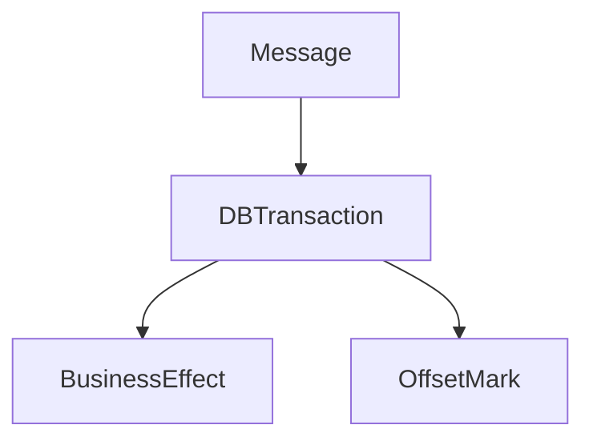

# D15-T020 — Exactly-once processing limitations

Topic ID: `D15-T020`
Domain: Distributed Systems
Subdomain: Exactly-once processing limitations
Importance: advanced
Complexity: advanced
Dependencies: `D15-T019`, `D15-T001`, `D03-T001`, `D03-T002`, `D04-T001`, `D04-T002`
Execution status of the code in section F: unexecuted

## A. Topic Overview

True exactly-once end-to-end across heterogeneous systems is not achievable with only asynchronous messaging under failures. Engineering achieves exactly-once *effects* via idempotent consumers, transactional outbox, and deduplication with atomic write of offset+effect. Kafka 'exactly-once' is scoped to broker transactions between producers/consumers, not your entire business workflow.

## B. First-Principles Explanation

Name the boundary where semantics are defined (broker vs application vs database). True exactly-once end-to-end across heterogeneous systems is not achievable with only asynchronous messaging under failures. Engineering achieves exactly-once *effects* via idempotent consumers, transactional outbox, and deduplication with atomic write of offset+effect. Kafka 'exactly-once' is scoped to broker transactions between producers/consumers, not your entire business workflow.

## C. Internal Working and Architecture

Atomic: mark processed + apply business write in one transaction. Components interact through RPC, replication logs, and coordination services.

## D. Diagrams and Visual Models



Read the diagram as a causal flow from client action to stored or observed outcome, including failure branches.

## E. Examples and Analogies

Flink checkpointing; still needs idempotent sinks.

## F. Code Examples

File: `examples/d15_t020_atomic.py`

Dependencies: Python 3 standard library only.

```python
def handle(msg_id: str, processed: set[str], apply) -> None:
    if msg_id in processed:
        return
    apply()
    processed.add(msg_id)
```

The snippet models control flow you would embed in a service or test harness. It is not a production client library.

## G. Practical Backend Application

Sell stakeholders 'effectively once' with provable dedup, not magic middleware.

## H. Advantages, Limitations and Trade-offs

| Choice | Benefit | Cost | Choose when | Avoid when |
| --- | --- | --- | --- | --- |
| Transactional outbox | Strong effects | Complexity | Billing | Fire-and-forget logs | | | | |

Under load, the cheap choice on paper becomes the choice that amplifies retries, stale reads, or operator toil. Measure p99 latency and error budgets, not only happy-path throughput.

## I. Common Mistakes and Misconceptions

- Marketing exactly-once without defining failure model.
- Side effect outside transaction.

A weak interview answer names a buzzword without a failure story. A strong answer names what breaks, what users see, and what invariant you still enforce.

## J. Debugging and Troubleshooting

Reprocess log segment; count duplicate side effects.

## K. Interview Preparation
### Beginner
#### Q1. What is Exactly-once processing limitations?

**Answer:** True exactly-once end-to-end across heterogeneous systems is not achievable with only asynchronous messaging under failures. Engineering achieves exactly-once *effects* via idempotent consumers, transactional outbox, and deduplication with atomic write of offset+effect. Kafka 'exactly-once' is scoped to broker transactions between producers/consumers, not your entire business workflow. Interviewers want a precise definition tied to exactly-once effect boundaries, not a slogan.
#### Q2. Why does Exactly-once processing limitations matter in backends?

**Answer:** True exactly-once end-to-end across heterogeneous systems is not achievable with only asynchronous messaging under failures. Engineering achieves exactly-once *effects* via idempotent consumers, transactional outbox, and deduplication with atomic write of offset+effect. Kafka 'exactly-once' is scoped to broker transactions between producers/consumers, not your entire business workflow. Production systems fail one hop at a time; users still expect coherent behavior.
#### Q3. Give a one-line example of exactly-once effect boundaries.

**Answer:** True exactly-once end-to-end across heterogeneous systems is not achievable with only asynchronous messaging under failures. Engineering achieves exactly-once *effects* via idempotent consumers, transactional outbox, and deduplication with atomic write of offset+effect. Kafka 'exactly-once' is scoped to broker transactions between producers/consumers, not your entire business workflow. Name a concrete multi-service flow where the issue appears.
#### Q4. Is Exactly-once processing limitations about hardware or software policy?

**Answer:** True exactly-once end-to-end across heterogeneous systems is not achievable with only asynchronous messaging under failures. Engineering achieves exactly-once *effects* via idempotent consumers, transactional outbox, and deduplication with atomic write of offset+effect. Kafka 'exactly-once' is scoped to broker transactions between producers/consumers, not your entire business workflow. Mostly policy and protocols on top of unreliable networks.
#### Q5. What is a common myth about Exactly-once processing limitations?

**Answer:** True exactly-once end-to-end across heterogeneous systems is not achievable with only asynchronous messaging under failures. Engineering achieves exactly-once *effects* via idempotent consumers, transactional outbox, and deduplication with atomic write of offset+effect. Kafka 'exactly-once' is scoped to broker transactions between producers/consumers, not your entire business workflow. Buzzword definitions that ignore partitions, retries, or consistency definitions.
### Intermediate
#### Q1. How do timeouts interact with exactly-once effect boundaries?

**Answer:** True exactly-once end-to-end across heterogeneous systems is not achievable with only asynchronous messaging under failures. Engineering achieves exactly-once *effects* via idempotent consumers, transactional outbox, and deduplication with atomic write of offset+effect. Kafka 'exactly-once' is scoped to broker transactions between producers/consumers, not your entire business workflow. Timeouts create unknown outcomes; retries amplify load unless idempotent.
#### Q2. How do replicas interact with exactly-once effect boundaries?

**Answer:** True exactly-once end-to-end across heterogeneous systems is not achievable with only asynchronous messaging under failures. Engineering achieves exactly-once *effects* via idempotent consumers, transactional outbox, and deduplication with atomic write of offset+effect. Kafka 'exactly-once' is scoped to broker transactions between producers/consumers, not your entire business workflow. Replication lag makes stale reads a normal case unless you pay for stronger reads.
#### Q3. How do idempotency keys help exactly-once effect boundaries?

**Answer:** True exactly-once end-to-end across heterogeneous systems is not achievable with only asynchronous messaging under failures. Engineering achieves exactly-once *effects* via idempotent consumers, transactional outbox, and deduplication with atomic write of offset+effect. Kafka 'exactly-once' is scoped to broker transactions between producers/consumers, not your entire business workflow. They make at-least-once delivery safe for business side effects.
#### Q4. What metrics expose exactly-once effect boundaries?

**Answer:** True exactly-once end-to-end across heterogeneous systems is not achievable with only asynchronous messaging under failures. Engineering achieves exactly-once *effects* via idempotent consumers, transactional outbox, and deduplication with atomic write of offset+effect. Kafka 'exactly-once' is scoped to broker transactions between producers/consumers, not your entire business workflow. Error rate by dependency, lag histograms, reconciliation queue depth.
#### Q5. How does Exactly-once processing limitations relate to user-visible SLAs?

**Answer:** True exactly-once end-to-end across heterogeneous systems is not achievable with only asynchronous messaging under failures. Engineering achieves exactly-once *effects* via idempotent consumers, transactional outbox, and deduplication with atomic write of offset+effect. Kafka 'exactly-once' is scoped to broker transactions between producers/consumers, not your entire business workflow. SLAs must state behavior during degradation, not only median latency.
### Advanced
#### Q1. How would you test exactly-once effect boundaries?

**Answer:** True exactly-once end-to-end across heterogeneous systems is not achievable with only asynchronous messaging under failures. Engineering achieves exactly-once *effects* via idempotent consumers, transactional outbox, and deduplication with atomic write of offset+effect. Kafka 'exactly-once' is scoped to broker transactions between producers/consumers, not your entire business workflow. Fault injection: delay, drop, partition links; assert invariants and recovery.
#### Q2. How does Exactly-once processing limitations differ from a single-machine failure?

**Answer:** True exactly-once end-to-end across heterogeneous systems is not achievable with only asynchronous messaging under failures. Engineering achieves exactly-once *effects* via idempotent consumers, transactional outbox, and deduplication with atomic write of offset+effect. Kafka 'exactly-once' is scoped to broker transactions between producers/consumers, not your entire business workflow. Partial failure leaves other paths alive, producing ambiguous global state.
#### Q3. What documentation should teams publish about Exactly-once processing limitations?

**Answer:** True exactly-once end-to-end across heterogeneous systems is not achievable with only asynchronous messaging under failures. Engineering achieves exactly-once *effects* via idempotent consumers, transactional outbox, and deduplication with atomic write of offset+effect. Kafka 'exactly-once' is scoped to broker transactions between producers/consumers, not your entire business workflow. Failure modes, consistency guarantees per endpoint, and runbooks for unknown outcomes.
#### Q4. When is strong consistency worth the latency for exactly-once effect boundaries?

**Answer:** True exactly-once end-to-end across heterogeneous systems is not achievable with only asynchronous messaging under failures. Engineering achieves exactly-once *effects* via idempotent consumers, transactional outbox, and deduplication with atomic write of offset+effect. Kafka 'exactly-once' is scoped to broker transactions between producers/consumers, not your entire business workflow. When invariants involve money, inventory, or safety; not for best-effort feeds.
#### Q5. How do circuit breakers relate to exactly-once effect boundaries?

**Answer:** True exactly-once end-to-end across heterogeneous systems is not achievable with only asynchronous messaging under failures. Engineering achieves exactly-once *effects* via idempotent consumers, transactional outbox, and deduplication with atomic write of offset+effect. Kafka 'exactly-once' is scoped to broker transactions between producers/consumers, not your entire business workflow. They stop retry storms but do not fix correctness; they protect capacity.
### Scenarios
#### Q1. Incident: errors spike after deploy touching Exactly-once processing limitations. First checks?

**Answer:** True exactly-once end-to-end across heterogeneous systems is not achievable with only asynchronous messaging under failures. Engineering achieves exactly-once *effects* via idempotent consumers, transactional outbox, and deduplication with atomic write of offset+effect. Kafka 'exactly-once' is scoped to broker transactions between producers/consumers, not your entire business workflow. Roll forward/rollback decision, feature flag, canary metrics, dependency health.
#### Q2. Incident: customers report inconsistent reads around exactly-once effect boundaries. Diagnosis?

**Answer:** True exactly-once end-to-end across heterogeneous systems is not achievable with only asynchronous messaging under failures. Engineering achieves exactly-once *effects* via idempotent consumers, transactional outbox, and deduplication with atomic write of offset+effect. Kafka 'exactly-once' is scoped to broker transactions between producers/consumers, not your entire business workflow. Check replica lag, routing, cache TTL, and read-your-writes settings.
#### Q3. Incident: reconciliation backlog grows for exactly-once effect boundaries. Why?

**Answer:** True exactly-once end-to-end across heterogeneous systems is not achievable with only asynchronous messaging under failures. Engineering achieves exactly-once *effects* via idempotent consumers, transactional outbox, and deduplication with atomic write of offset+effect. Kafka 'exactly-once' is scoped to broker transactions between producers/consumers, not your entire business workflow. Downstream was slow; retries duplicated work; missing idempotency.
#### Q4. Design review challenges your Exactly-once processing limitations approach. What do you defend?

**Answer:** True exactly-once end-to-end across heterogeneous systems is not achievable with only asynchronous messaging under failures. Engineering achieves exactly-once *effects* via idempotent consumers, transactional outbox, and deduplication with atomic write of offset+effect. Kafka 'exactly-once' is scoped to broker transactions between producers/consumers, not your entire business workflow. State invariants, failure model, and measured trade-offs with PACELC/CAP precision.
#### Q5. Finance audit questions exactly-once effect boundaries after duplicate charges. Response?

**Answer:** True exactly-once end-to-end across heterogeneous systems is not achievable with only asynchronous messaging under failures. Engineering achieves exactly-once *effects* via idempotent consumers, transactional outbox, and deduplication with atomic write of offset+effect. Kafka 'exactly-once' is scoped to broker transactions between producers/consumers, not your entire business workflow. Show idempotency keys, ledger reconciliation, and provider correlation IDs.
### Follow-ups
#### Q1. How does Exactly-once processing limitations connect to `D15-T001`?

**Answer:** True exactly-once end-to-end across heterogeneous systems is not achievable with only asynchronous messaging under failures. Engineering achieves exactly-once *effects* via idempotent consumers, transactional outbox, and deduplication with atomic write of offset+effect. Kafka 'exactly-once' is scoped to broker transactions between producers/consumers, not your entire business workflow. Fundamentals frame partial failure and message passing assumptions.
#### Q2. How does Exactly-once processing limitations connect to databases (`D07-T012`)?

**Answer:** True exactly-once end-to-end across heterogeneous systems is not achievable with only asynchronous messaging under failures. Engineering achieves exactly-once *effects* via idempotent consumers, transactional outbox, and deduplication with atomic write of offset+effect. Kafka 'exactly-once' is scoped to broker transactions between producers/consumers, not your entire business workflow. Transactions are local unless you add distributed protocols or sagas.
#### Q3. How does Exactly-once processing limitations connect to messaging (`D14-T031`)?

**Answer:** True exactly-once end-to-end across heterogeneous systems is not achievable with only asynchronous messaging under failures. Engineering achieves exactly-once *effects* via idempotent consumers, transactional outbox, and deduplication with atomic write of offset+effect. Kafka 'exactly-once' is scoped to broker transactions between producers/consumers, not your entire business workflow. Brokers provide at-least-once unless you engineer exactly-once effects.

## L. Practical Exercises

Solutions are in `EXERCISES/solutions/D15-T020.md`. Try these before opening that file.

### Exercise 1 — implementation

Why two-phase commit alone ≠ exactly-once across services.

### Exercise 2 — debugging

Kafka EOS still duplicates at sink—why?

### Exercise 3 — trade-off

Design idempotent payment sink.

## M. Revision Notes

- Exactly-once processing limitations
- True exactly-once end-to-end across heterogeneous systems is not achievable with only asynchronous messaging under failures.
- Measure lag, errors, and reconciliation—not only CPU.
- Document behavior during partition and during normal load.

Flashcards:

- What is Exactly-once processing limitations? See focus paragraph in overview.
- Common mistake: Marketing exactly-once without defining failure model.

## N. Related Topics

Understand this before: `D15-T019`, `D15-T001`, `D03-T001`, `D03-T002`, `D04-T001`, `D04-T002`.

This topic supports: `D15-T018`, `D15-T030`.

Often confused with: `D15-T018`, `D14-T030`.

Interviewers combine this with replication (`D15-T009`), partial failure (`D15-T002`), and API idempotency (`D06-T011`).

## O. Completion Criteria

- Define Exactly-once processing limitations without buzzwords.
- Draw the mermaid model for D15-T020.
- Explain one mistake and its safer alternative.
