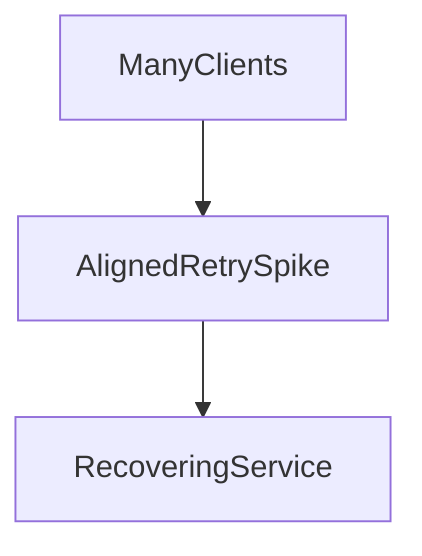

# D15-T022 — Jitter and retry storms

Topic ID: `D15-T022`
Domain: Distributed Systems
Subdomain: Jitter and retry storms
Importance: core
Complexity: advanced
Dependencies: `D15-T021`, `D15-T001`, `D03-T001`, `D03-T002`, `D04-T001`, `D04-T002`
Execution status of the code in section F: unexecuted

## A. Topic Overview

Synchronized retries align in time and create thundering herds. Full jitter randomizes delay in [0, backoff] to spread load. Retry storms can take down a recovering service.

## B. First-Principles Explanation

Decorate retry metrics; alert when retry fraction spikes. Synchronized retries align in time and create thundering herds. Full jitter randomizes delay in [0, backoff] to spread load. Retry storms can take down a recovering service.

## C. Internal Working and Architecture

Combine exponential backoff with equal or full jitter per AWS architecture guidance. Components interact through RPC, replication logs, and coordination services.

## D. Diagrams and Visual Models



Read the diagram as a causal flow from client action to stored or observed outcome, including failure branches.

## E. Examples and Analogies

All clients retry at 1s after outage ends → second outage.

## F. Code Examples

File: `examples/d15_t022_jitter.py`

Dependencies: Python 3 standard library only.

```python
import random

def delay_with_full_jitter(attempt: int, base: float, cap: float) -> float:
    bound = min(cap, base * (2 ** attempt))
    return random.uniform(0, bound)
```

The snippet models control flow you would embed in a service or test harness. It is not a production client library.

## G. Practical Backend Application

Server shed load with 503 + Retry-After; client honors jitter.

## H. Advantages, Limitations and Trade-offs

| Choice | Benefit | Cost | Choose when | Avoid when |
| --- | --- | --- | --- | --- |
| Full jitter | Spreads load | Less predictable latency | Large fleets | Tiny single client | | | | |

Under load, the cheap choice on paper becomes the choice that amplifies retries, stale reads, or operator toil. Measure p99 latency and error budgets, not only happy-path throughput.

## I. Common Mistakes and Misconceptions

- Fixed retry interval for all instances.
- No max concurrency on client retries.

A weak interview answer names a buzzword without a failure story. A strong answer names what breaks, what users see, and what invariant you still enforce.

## J. Debugging and Troubleshooting

Plot retry timestamps—look for periodic spikes.

## K. Interview Preparation
### Beginner
#### Q1. What is Jitter and retry storms?

**Answer:** Synchronized retries align in time and create thundering herds. Full jitter randomizes delay in [0, backoff] to spread load. Retry storms can take down a recovering service. Interviewers want a precise definition tied to jitter preventing retry storms, not a slogan.
#### Q2. Why does Jitter and retry storms matter in backends?

**Answer:** Synchronized retries align in time and create thundering herds. Full jitter randomizes delay in [0, backoff] to spread load. Retry storms can take down a recovering service. Production systems fail one hop at a time; users still expect coherent behavior.
#### Q3. Give a one-line example of jitter preventing retry storms.

**Answer:** Synchronized retries align in time and create thundering herds. Full jitter randomizes delay in [0, backoff] to spread load. Retry storms can take down a recovering service. Name a concrete multi-service flow where the issue appears.
#### Q4. Is Jitter and retry storms about hardware or software policy?

**Answer:** Synchronized retries align in time and create thundering herds. Full jitter randomizes delay in [0, backoff] to spread load. Retry storms can take down a recovering service. Mostly policy and protocols on top of unreliable networks.
#### Q5. What is a common myth about Jitter and retry storms?

**Answer:** Synchronized retries align in time and create thundering herds. Full jitter randomizes delay in [0, backoff] to spread load. Retry storms can take down a recovering service. Buzzword definitions that ignore partitions, retries, or consistency definitions.
### Intermediate
#### Q1. How do timeouts interact with jitter preventing retry storms?

**Answer:** Synchronized retries align in time and create thundering herds. Full jitter randomizes delay in [0, backoff] to spread load. Retry storms can take down a recovering service. Timeouts create unknown outcomes; retries amplify load unless idempotent.
#### Q2. How do replicas interact with jitter preventing retry storms?

**Answer:** Synchronized retries align in time and create thundering herds. Full jitter randomizes delay in [0, backoff] to spread load. Retry storms can take down a recovering service. Replication lag makes stale reads a normal case unless you pay for stronger reads.
#### Q3. How do idempotency keys help jitter preventing retry storms?

**Answer:** Synchronized retries align in time and create thundering herds. Full jitter randomizes delay in [0, backoff] to spread load. Retry storms can take down a recovering service. They make at-least-once delivery safe for business side effects.
#### Q4. What metrics expose jitter preventing retry storms?

**Answer:** Synchronized retries align in time and create thundering herds. Full jitter randomizes delay in [0, backoff] to spread load. Retry storms can take down a recovering service. Error rate by dependency, lag histograms, reconciliation queue depth.
#### Q5. How does Jitter and retry storms relate to user-visible SLAs?

**Answer:** Synchronized retries align in time and create thundering herds. Full jitter randomizes delay in [0, backoff] to spread load. Retry storms can take down a recovering service. SLAs must state behavior during degradation, not only median latency.
### Advanced
#### Q1. How would you test jitter preventing retry storms?

**Answer:** Synchronized retries align in time and create thundering herds. Full jitter randomizes delay in [0, backoff] to spread load. Retry storms can take down a recovering service. Fault injection: delay, drop, partition links; assert invariants and recovery.
#### Q2. How does Jitter and retry storms differ from a single-machine failure?

**Answer:** Synchronized retries align in time and create thundering herds. Full jitter randomizes delay in [0, backoff] to spread load. Retry storms can take down a recovering service. Partial failure leaves other paths alive, producing ambiguous global state.
#### Q3. What documentation should teams publish about Jitter and retry storms?

**Answer:** Synchronized retries align in time and create thundering herds. Full jitter randomizes delay in [0, backoff] to spread load. Retry storms can take down a recovering service. Failure modes, consistency guarantees per endpoint, and runbooks for unknown outcomes.
#### Q4. When is strong consistency worth the latency for jitter preventing retry storms?

**Answer:** Synchronized retries align in time and create thundering herds. Full jitter randomizes delay in [0, backoff] to spread load. Retry storms can take down a recovering service. When invariants involve money, inventory, or safety; not for best-effort feeds.
#### Q5. How do circuit breakers relate to jitter preventing retry storms?

**Answer:** Synchronized retries align in time and create thundering herds. Full jitter randomizes delay in [0, backoff] to spread load. Retry storms can take down a recovering service. They stop retry storms but do not fix correctness; they protect capacity.
### Scenarios
#### Q1. Incident: errors spike after deploy touching Jitter and retry storms. First checks?

**Answer:** Synchronized retries align in time and create thundering herds. Full jitter randomizes delay in [0, backoff] to spread load. Retry storms can take down a recovering service. Roll forward/rollback decision, feature flag, canary metrics, dependency health.
#### Q2. Incident: customers report inconsistent reads around jitter preventing retry storms. Diagnosis?

**Answer:** Synchronized retries align in time and create thundering herds. Full jitter randomizes delay in [0, backoff] to spread load. Retry storms can take down a recovering service. Check replica lag, routing, cache TTL, and read-your-writes settings.
#### Q3. Incident: reconciliation backlog grows for jitter preventing retry storms. Why?

**Answer:** Synchronized retries align in time and create thundering herds. Full jitter randomizes delay in [0, backoff] to spread load. Retry storms can take down a recovering service. Downstream was slow; retries duplicated work; missing idempotency.
#### Q4. Design review challenges your Jitter and retry storms approach. What do you defend?

**Answer:** Synchronized retries align in time and create thundering herds. Full jitter randomizes delay in [0, backoff] to spread load. Retry storms can take down a recovering service. State invariants, failure model, and measured trade-offs with PACELC/CAP precision.
#### Q5. Finance audit questions jitter preventing retry storms after duplicate charges. Response?

**Answer:** Synchronized retries align in time and create thundering herds. Full jitter randomizes delay in [0, backoff] to spread load. Retry storms can take down a recovering service. Show idempotency keys, ledger reconciliation, and provider correlation IDs.
### Follow-ups
#### Q1. How does Jitter and retry storms connect to `D15-T001`?

**Answer:** Synchronized retries align in time and create thundering herds. Full jitter randomizes delay in [0, backoff] to spread load. Retry storms can take down a recovering service. Fundamentals frame partial failure and message passing assumptions.
#### Q2. How does Jitter and retry storms connect to databases (`D07-T012`)?

**Answer:** Synchronized retries align in time and create thundering herds. Full jitter randomizes delay in [0, backoff] to spread load. Retry storms can take down a recovering service. Transactions are local unless you add distributed protocols or sagas.
#### Q3. How does Jitter and retry storms connect to messaging (`D14-T031`)?

**Answer:** Synchronized retries align in time and create thundering herds. Full jitter randomizes delay in [0, backoff] to spread load. Retry storms can take down a recovering service. Brokers provide at-least-once unless you engineer exactly-once effects.

## L. Practical Exercises

Solutions are in `EXERCISES/solutions/D15-T022.md`. Try these before opening that file.

### Exercise 1 — implementation

Compare aligned vs jittered retry timeline.

### Exercise 2 — debugging

Service recovers then dies at T+1s—explain.

### Exercise 3 — trade-off

Equal vs full jitter trade-off.

## M. Revision Notes

- Jitter and retry storms
- Synchronized retries align in time and create thundering herds.
- Measure lag, errors, and reconciliation—not only CPU.
- Document behavior during partition and during normal load.

Flashcards:

- What is Jitter and retry storms? See focus paragraph in overview.
- Common mistake: Fixed retry interval for all instances.

## N. Related Topics

Understand this before: `D15-T021`, `D15-T001`, `D03-T001`, `D03-T002`, `D04-T001`, `D04-T002`.

This topic supports: `D15-T023`, `D15-T021`.

Often confused with: `D15-T021`, `D13-T024`.

Interviewers combine this with replication (`D15-T009`), partial failure (`D15-T002`), and API idempotency (`D06-T011`).

## O. Completion Criteria

- Define Jitter and retry storms without buzzwords.
- Draw the mermaid model for D15-T022.
- Explain one mistake and its safer alternative.
