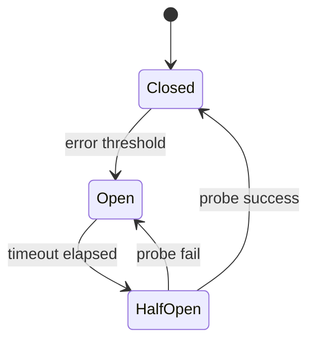

# D15-T023 — Circuit breakers

Topic ID: `D15-T023`
Domain: Distributed Systems
Subdomain: Circuit breakers
Importance: core
Complexity: advanced
Dependencies: `D15-T022`, `D15-T001`, `D03-T001`, `D03-T002`, `D04-T001`, `D04-T002`
Execution status of the code in section F: unexecuted

## A. Topic Overview

Circuit breakers stop calls to a failing dependency after error threshold, fail fast while open, then probe in half-open. They protect caller resources; they do not repair the downstream.

## B. First-Principles Explanation

Breakers complement timeouts/retries; configure per dependency. Circuit breakers stop calls to a failing dependency after error threshold, fail fast while open, then probe in half-open. They protect caller resources; they do not repair the downstream.

## C. Internal Working and Architecture

States: closed, open, half-open; sliding window error rate. Components interact through RPC, replication logs, and coordination services.

## D. Diagrams and Visual Models



Read the diagram as a causal flow from client action to stored or observed outcome, including failure branches.

## E. Examples and Analogies

Hystrix / resilience4j patterns in JVM services.

## F. Code Examples

File: `examples/d15_t023_breaker.py`

Dependencies: Python 3 standard library only.

```python
class Breaker:
    def __init__(self):
        self.state = "closed"
        self.failures = 0

    def record_failure(self, threshold: int) -> None:
        self.failures += 1
        if self.failures >= threshold:
            self.state = "open"
```

The snippet models control flow you would embed in a service or test harness. It is not a production client library.

## G. Practical Backend Application

Return fallback or cached response when open; surface degradation clearly.

## H. Advantages, Limitations and Trade-offs

| Choice | Benefit | Cost | Choose when | Avoid when |
| --- | --- | --- | --- | --- |
| Open circuit | Saves threads | User impact | Cascading failure risk | Optional features | | | | |

Under load, the cheap choice on paper becomes the choice that amplifies retries, stale reads, or operator toil. Measure p99 latency and error budgets, not only happy-path throughput.

## I. Common Mistakes and Misconceptions

- Breaker on wrong metric (latency vs errors).
- Shared breaker across unrelated deps.

A weak interview answer names a buzzword without a failure story. A strong answer names what breaks, what users see, and what invariant you still enforce.

## J. Debugging and Troubleshooting

Log state transitions with dependency name.

## K. Interview Preparation
### Beginner
#### Q1. What is Circuit breakers?

**Answer:** Circuit breakers stop calls to a failing dependency after error threshold, fail fast while open, then probe in half-open. They protect caller resources; they do not repair the downstream. Interviewers want a precise definition tied to circuit breaker states, not a slogan. In production, the failure mode matters more than the slogan: measure timeouts, error budgets, and client-visible symptoms before you rename the problem.
#### Q2. Why does Circuit breakers matter in backends?

**Answer:** Circuit breakers stop calls to a failing dependency after error threshold, fail fast while open, then probe in half-open. They protect caller resources; they do not repair the downstream. Production systems fail one hop at a time; users still expect coherent behavior. In production, the failure mode matters more than the slogan: measure timeouts, error budgets, and client-visible symptoms before you rename the problem.
#### Q3. Give a one-line example of circuit breaker states.

**Answer:** Circuit breakers stop calls to a failing dependency after error threshold, fail fast while open, then probe in half-open. They protect caller resources; they do not repair the downstream. Name a concrete multi-service flow where the issue appears. In production, the failure mode matters more than the slogan: measure timeouts, error budgets, and client-visible symptoms before you rename the problem.
#### Q4. Is Circuit breakers about hardware or software policy?

**Answer:** Circuit breakers stop calls to a failing dependency after error threshold, fail fast while open, then probe in half-open. They protect caller resources; they do not repair the downstream. Mostly policy and protocols on top of unreliable networks. In production, the failure mode matters more than the slogan: measure timeouts, error budgets, and client-visible symptoms before you rename the problem.
#### Q5. What is a common myth about Circuit breakers?

**Answer:** Circuit breakers stop calls to a failing dependency after error threshold, fail fast while open, then probe in half-open. They protect caller resources; they do not repair the downstream. Buzzword definitions that ignore partitions, retries, or consistency definitions. In production, the failure mode matters more than the slogan: measure timeouts, error budgets, and client-visible symptoms before you rename the problem.
### Intermediate
#### Q1. How do timeouts interact with circuit breaker states?

**Answer:** Circuit breakers stop calls to a failing dependency after error threshold, fail fast while open, then probe in half-open. They protect caller resources; they do not repair the downstream. Timeouts create unknown outcomes; retries amplify load unless idempotent. In production, the failure mode matters more than the slogan: measure timeouts, error budgets, and client-visible symptoms before you rename the problem.
#### Q2. How do replicas interact with circuit breaker states?

**Answer:** Circuit breakers stop calls to a failing dependency after error threshold, fail fast while open, then probe in half-open. They protect caller resources; they do not repair the downstream. Replication lag makes stale reads a normal case unless you pay for stronger reads. In production, the failure mode matters more than the slogan: measure timeouts, error budgets, and client-visible symptoms before you rename the problem.
#### Q3. How do idempotency keys help circuit breaker states?

**Answer:** Circuit breakers stop calls to a failing dependency after error threshold, fail fast while open, then probe in half-open. They protect caller resources; they do not repair the downstream. They make at-least-once delivery safe for business side effects. In production, the failure mode matters more than the slogan: measure timeouts, error budgets, and client-visible symptoms before you rename the problem.
#### Q4. What metrics expose circuit breaker states?

**Answer:** Circuit breakers stop calls to a failing dependency after error threshold, fail fast while open, then probe in half-open. They protect caller resources; they do not repair the downstream. Error rate by dependency, lag histograms, reconciliation queue depth. In production, the failure mode matters more than the slogan: measure timeouts, error budgets, and client-visible symptoms before you rename the problem.
#### Q5. How does Circuit breakers relate to user-visible SLAs?

**Answer:** Circuit breakers stop calls to a failing dependency after error threshold, fail fast while open, then probe in half-open. They protect caller resources; they do not repair the downstream. SLAs must state behavior during degradation, not only median latency. In production, the failure mode matters more than the slogan: measure timeouts, error budgets, and client-visible symptoms before you rename the problem.
### Advanced
#### Q1. How would you test circuit breaker states?

**Answer:** Circuit breakers stop calls to a failing dependency after error threshold, fail fast while open, then probe in half-open. They protect caller resources; they do not repair the downstream. Fault injection: delay, drop, partition links; assert invariants and recovery. In production, the failure mode matters more than the slogan: measure timeouts, error budgets, and client-visible symptoms before you rename the problem.
#### Q2. How does Circuit breakers differ from a single-machine failure?

**Answer:** Circuit breakers stop calls to a failing dependency after error threshold, fail fast while open, then probe in half-open. They protect caller resources; they do not repair the downstream. Partial failure leaves other paths alive, producing ambiguous global state. In production, the failure mode matters more than the slogan: measure timeouts, error budgets, and client-visible symptoms before you rename the problem.
#### Q3. What documentation should teams publish about Circuit breakers?

**Answer:** Circuit breakers stop calls to a failing dependency after error threshold, fail fast while open, then probe in half-open. They protect caller resources; they do not repair the downstream. Failure modes, consistency guarantees per endpoint, and runbooks for unknown outcomes. In production, the failure mode matters more than the slogan: measure timeouts, error budgets, and client-visible symptoms before you rename the problem.
#### Q4. When is strong consistency worth the latency for circuit breaker states?

**Answer:** Circuit breakers stop calls to a failing dependency after error threshold, fail fast while open, then probe in half-open. They protect caller resources; they do not repair the downstream. When invariants involve money, inventory, or safety; not for best-effort feeds. In production, the failure mode matters more than the slogan: measure timeouts, error budgets, and client-visible symptoms before you rename the problem.
#### Q5. How do circuit breakers relate to circuit breaker states?

**Answer:** Circuit breakers stop calls to a failing dependency after error threshold, fail fast while open, then probe in half-open. They protect caller resources; they do not repair the downstream. They stop retry storms but do not fix correctness; they protect capacity. In production, the failure mode matters more than the slogan: measure timeouts, error budgets, and client-visible symptoms before you rename the problem.
### Scenarios
#### Q1. Incident: errors spike after deploy touching Circuit breakers. First checks?

**Answer:** Circuit breakers stop calls to a failing dependency after error threshold, fail fast while open, then probe in half-open. They protect caller resources; they do not repair the downstream. Roll forward/rollback decision, feature flag, canary metrics, dependency health. In production, the failure mode matters more than the slogan: measure timeouts, error budgets, and client-visible symptoms before you rename the problem.
#### Q2. Incident: customers report inconsistent reads around circuit breaker states. Diagnosis?

**Answer:** Circuit breakers stop calls to a failing dependency after error threshold, fail fast while open, then probe in half-open. They protect caller resources; they do not repair the downstream. Check replica lag, routing, cache TTL, and read-your-writes settings. In production, the failure mode matters more than the slogan: measure timeouts, error budgets, and client-visible symptoms before you rename the problem.
#### Q3. Incident: reconciliation backlog grows for circuit breaker states. Why?

**Answer:** Circuit breakers stop calls to a failing dependency after error threshold, fail fast while open, then probe in half-open. They protect caller resources; they do not repair the downstream. Downstream was slow; retries duplicated work; missing idempotency. In production, the failure mode matters more than the slogan: measure timeouts, error budgets, and client-visible symptoms before you rename the problem.
#### Q4. Design review challenges your Circuit breakers approach. What do you defend?

**Answer:** Circuit breakers stop calls to a failing dependency after error threshold, fail fast while open, then probe in half-open. They protect caller resources; they do not repair the downstream. State invariants, failure model, and measured trade-offs with PACELC/CAP precision. In production, the failure mode matters more than the slogan: measure timeouts, error budgets, and client-visible symptoms before you rename the problem.
#### Q5. Finance audit questions circuit breaker states after duplicate charges. Response?

**Answer:** Circuit breakers stop calls to a failing dependency after error threshold, fail fast while open, then probe in half-open. They protect caller resources; they do not repair the downstream. Show idempotency keys, ledger reconciliation, and provider correlation IDs. In production, the failure mode matters more than the slogan: measure timeouts, error budgets, and client-visible symptoms before you rename the problem.
### Follow-ups
#### Q1. How does Circuit breakers connect to `D15-T001`?

**Answer:** Circuit breakers stop calls to a failing dependency after error threshold, fail fast while open, then probe in half-open. They protect caller resources; they do not repair the downstream. Fundamentals frame partial failure and message passing assumptions. In production, the failure mode matters more than the slogan: measure timeouts, error budgets, and client-visible symptoms before you rename the problem.
#### Q2. How does Circuit breakers connect to databases (`D07-T012`)?

**Answer:** Circuit breakers stop calls to a failing dependency after error threshold, fail fast while open, then probe in half-open. They protect caller resources; they do not repair the downstream. Transactions are local unless you add distributed protocols or sagas. In production, the failure mode matters more than the slogan: measure timeouts, error budgets, and client-visible symptoms before you rename the problem.
#### Q3. How does Circuit breakers connect to messaging (`D14-T031`)?

**Answer:** Circuit breakers stop calls to a failing dependency after error threshold, fail fast while open, then probe in half-open. They protect caller resources; they do not repair the downstream. Brokers provide at-least-once unless you engineer exactly-once effects. In production, the failure mode matters more than the slogan: measure timeouts, error budgets, and client-visible symptoms before you rename the problem.

## L. Practical Exercises

Solutions are in `EXERCISES/solutions/D15-T023.md`. Try these before opening that file.

### Exercise 1 — implementation

Implement state transitions on failures/success.

### Exercise 2 — debugging

Breaker open but dependency healthy—causes?

### Exercise 3 — trade-off

Breaker vs bulkhead.

## M. Revision Notes

- Circuit breakers
- Circuit breakers stop calls to a failing dependency after error threshold, fail fast while open, then probe in half-open.
- Measure lag, errors, and reconciliation—not only CPU.
- Document behavior during partition and during normal load.

Flashcards:

- What is Circuit breakers? See focus paragraph in overview.
- Common mistake: Breaker on wrong metric (latency vs errors).

## N. Related Topics

Understand this before: `D15-T022`, `D15-T001`, `D03-T001`, `D03-T002`, `D04-T001`, `D04-T002`.

This topic supports: `D15-T024`, `D15-T021`.

Often confused with: `D15-T024`, `D04-T014`.

Interviewers combine this with replication (`D15-T009`), partial failure (`D15-T002`), and API idempotency (`D06-T011`).

## O. Completion Criteria

- Define Circuit breakers without buzzwords.
- Draw the mermaid model for D15-T023.
- Explain one mistake and its safer alternative.
